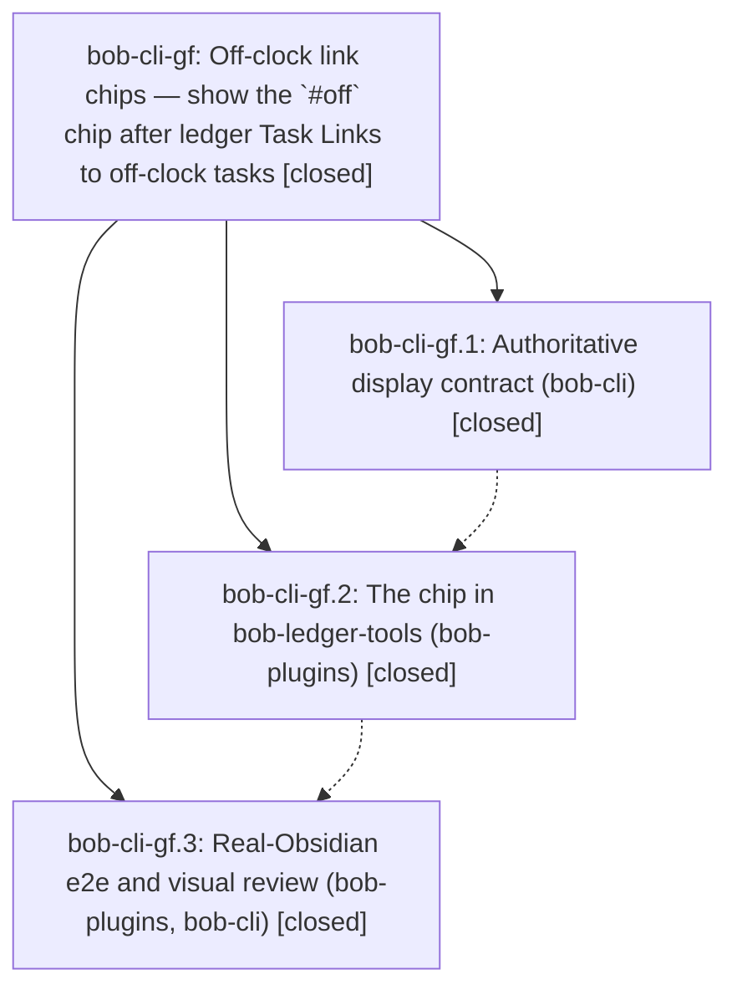

# Bead: bob-cli-gf — Off-clock link chips — show the \`#off\` chip after ledger Task Links to off-clock tasks

[Bead Pages](../README.md) / bob-cli-gf

**Status:** ✓ closed · **Resolution:** done · **Type:** ▸ plan · **Tier:** epic
**Owner:** `bryanbugyi34@gmail.com` · **Created by:** [bbugyi200.apollo.c9](https://github.com/bobs-org/bob-cli--agents/blob/main/sessions/bbugyi200.apollo.c9.md) · **Assignee:** `bob-cli-gf.land`
**Created:** 2026-11-03 09:51:50 EST · **Closed:** 2026-11-03 12:14:12 EST
**Plan:** [202611/off\_clock\_link\_chips.md](https://github.com/bobs-org/bob-cli--plans/blob/main/202611/off_clock_link_chips.md)

<!-- sase:links:start -->

## Links

| Relation | Artifact | Why |
| --- | --- | --- |
| implemented-by | [plan:202611/off_clock_link_chips.md][1] | derived from the plan's `bead_id:` frontmatter field |

_Plus 2 automatic references — see [Referenced By](#referenced-by)._

[1]: https://github.com/bobs-org/bob-cli--plans/blob/main/202611/off_clock_link_chips.md

<!-- sase:links:end -->

## Description

In a daily note's Pomodoro ledger, every Task Link whose task resolves off the clock (an explicit `#off` or alias, or an inherited area/project `offclock: true`) wears the same dashed `timer-off` `off` chip that off-clock Event Tasks already wear, in Live Preview and Reading view, so Bryan can see at a glance which planned or logged work will keep a session off the work clock.

## Notes

[2026-11-03T15:39:17Z · 17b--code] CROSS-EPIC COORDINATION with bob-cli-gg (Event link times). Not remaining work for any phase. Checklist for whichever of gf/gg commits to bob-plugins second, and for this land agent (confirm each item). gf's plan predates gg and has no coordination section; gg's plan has one, and these items add what both plans lack.

State when written (2026-11-03): gf.1 landed in bob-cli (5f35f0b3); gg.1 is closed; no gf or gg commit in bob-plugins yet (master 175aced, bob-ledger-tools 1.95.0); gf.2, gf.3, gg.2, and gg.3 remain in flight.

1. Same hunks; expect textual conflicts and resolve by keeping both features:
   - `src/269-plugin-progress-marks-reading.js` `ledgerMarkClass` list must hold BOTH `bob-off-clock-link-chip` and `bob-event-link-time`. Dropping either one makes rows wearing that host stop counting as ledger rows: ◐/🔓/🔑 vanish and a status ring appears.
   - `src/279-plugin-task-theme-api.js` `taskThemeRequestSourceText` fill callback: keep both refresh calls (`scheduleOffClockLinkChipsRefresh`, `scheduleEventLinkTimesRefresh`).
   - `styles.css` calendar block (about lines 5240-5370): gf adds `.bob-off-clock-link-chip` to the Event off-clock chip rules and renames `--bob-calendar-off-clock-icon` to a body-level `--bob-off-clock-icon`; gg appends its host rule after the wing rules, right next to that variable. Nothing may keep using the old variable name.
   - `src/350-exports.js` tail, the `package.json` "test" line, the `manifest.json` description, and `docs/bob-ledger-tools.md` ("Marks and rendered blocks", "Session toggles", "Calendar Events").
   - Separate spots that should auto-merge: `src/fragments.json`, `src/310-install-methods.js`.
2. Generated output: never hand-merge `main.js` or `npm run docs:gen` output. Resolve the `src/` and docs sources, then rerun `npm run build`, `npm run docs:gen`, and `npm run build:check`.
3. `manifest.json` version: both plans bump the minor from 1.95.0. The second to land takes the next minor past master at commit time (1.97.0 if the first took 1.96.0).
4. `bob plugins sync`: both epics' phase 2 and phase 3 run it. Its deploy guard refuses to overwrite another checkout's uncommitted or non-ancestor deploy, and the refusal text suggests `-F`. If the refusal names the other epic's checkout, do NOT use `-F`; that rolls the other feature out of Bryan's vault. Rebase onto a bob-plugins master that contains the other epic's commit, rebuild, and sync again. If that commit is not on master yet, record the sync as pending in a phase note.
5. Intended overlap, keep both: a ledger link to an off-clock Event Task wears gg's dashed time pill before the link and gf's `off` chip after it (`pill link 🔓 🔑 N off`). Neither epic should hide the other's mark.
6. Parity: both decide the clock with `taskEffectiveClockResolution` (gf through `pomodoroClockLinkFacts`, gg through `gcalEventsApplyClockToRow`). Once both have landed, a row's pill has `data-off-clock="true"` exactly when the row wears the chip. Known transient gap: a full-path same-note link (`[[2026/20261103#^id]]`), where gf reads the source-text cache and gg reads the live document. A disagreement anywhere else is a bug.
7. gf's source-text freshness fix (refresh an already-cached entry on `metadataCache` `changed`) also serves gg's Reading-view pills. Keep exactly one such fix; do not add a second invalidation path.
8. Once both have landed, run both unit suites (`test-ledger-tools-off-clock-link-chips.cjs`, `test-ledger-tools-event-link-times.cjs`). Confirm gg's EP3 (`pill link off`) and gf's OP5 (◐/🔓/🔑 still paint, no ring) with both hosts on one row.

[2026-11-03T16:51:16Z · bob-cli-gf.land] LAND AUDIT / FOLLOW-UP TRIAGE: Read every note on bob-cli-gf and gf.1/.2/.3, approved plan, docs, and actual source/commits (bob-cli 5f35f0b3/e9deb7f8; bob-plugins 23d401b/46b25c6). Verified history_rows=yes, prose_links=no, shared writer resolvers, current-clock display on historical rows, shared CSS, liveness, toggle and real-Obsidian harness evidence. gf.2 #2 five baseline failures independently reproduce at 46b25c6 (75/80 pass); corroborated existing bob-cli-f1 (Chromium), et (freshness date), eh (both startup fakes), ff (expired future date), with attached log. Declined a new performance task: phase reported the large-child performance failure only on clean base and it passed its worktree; already-tracked flake ej exists. gf.3 #2/#3 accepted as one investigation bob-cli-gi (ready, large): Reading ledger rings and absent progress, both shared-classifier callers, root not yet localized; no gf-caused production regression found. No duplicate task or active epic with credible cause. Generated glossary docs drift on current master was attached as DISCOVERED ISSUE to active bob-cli-gh (gh.1 changes), not gf work. Initial 218 focused tests passed; after fetching newly landed gg.2 commit 8ce2feb, 241/241 combined focused tests pass. Source integration preserves both ledger classes, both fill callbacks, single cache freshness fix, shared renamed icon, mixins/exports/test registrations/docs. Remaining integration: gg.2 retained 1.96.0 instead of the required next minor (1.97.0), and its EP3 uses a hand-created chip rather than both production sweeps. A small tale will finish version/inventory, add combined-sweep and clock-parity coverage, deploy safely, and close gf itself. No parent bead. No epic-symbol entries; no symvision recipe in bob-cli. just check is running as ToolRun cf4d4c7b732e2cbdc989d06117b2b26b. No check-full run.

[2026-11-03T16:59:56Z · bob-cli-gf.land] LAND VERIFICATION: just check passed on bob-cli e9deb7f8, ToolRun cf4d4c7b732e2cbdc989d06117b2b26b (exit 0, 699 seconds). Combined plugin feature/neighbor/self-test run on 8ce2feb passed 241/241. No --epic-symbol entries. Remaining small landing tale includes the manifest version correction, real combined-sweep regression, safe sync, and this epic close/plan status update; no follow-up triage remains outstanding.

[2026-11-03T17:14:12Z · bob-cli-gf.land--1] Closed after completing approved history_rows=yes, prose_links=no scope. Reviewed bob-cli commits 5f35f0b3/e9deb7f8 and bob-plugins commits 23d401b, 46b25c6, and 8ce2feb; combined feature, neighbor, and e2e tests pass 242/242. bob-ledger-tools is 1.97.0. Deployment succeeded: bob plugins sync --repo /home/bryan/.local/state/sase/workspaces/bobs-org/bob-cli/bob-cli_10/sase/repos/linked/bob-plugins --no-pull copied the updated plugin files and manifest, created backups, and had no guard refusal. Follow-ups: (1) five baseline failures on clean 46b25c6 were corroborated on existing bob-cli-f1, bob-cli-et, bob-cli-eh, and bob-cli-ff; no duplicate tasks; (2) base-only large-child performance failure was declined as new work because the phase worktree passed and existing bob-cli-ej tracks the flake; (3) gf.3 Reading ring and missing-progress issues were accepted together as bob-cli-gi, a ready large investigation with root cause still open; (4) generated glossary drift was attributed to bob-cli-gh, with no glossary edits here. All three phase descendants are closed; epic-symbol check found none.

## Phases

| Bead | Title | Status | Size | Created | Agents | Commits |
|---|---|---|---|---|---:|---:|
| [bob-cli-gf.1](bob-cli-gf.1.md) | Authoritative display contract (bob-cli) | ✓ closed | small | 2026-11-03 | 1 | 1 |
| [bob-cli-gf.2](bob-cli-gf.2.md) | The chip in bob-ledger-tools (bob-plugins) | ✓ closed | medium | 2026-11-03 | 1 | 1 |
| [bob-cli-gf.3](bob-cli-gf.3.md) | Real-Obsidian e2e and visual review (bob-plugins, bob-cli) | ✓ closed | medium | 2026-11-03 | 1 | 2 |

## Lineage

## Agents

| Agent | Bead | Commits |
|---|---|---:|
| [bbugyi200.apollo.bob-cli-gf.1](https://github.com/bobs-org/bob-cli--agents/blob/main/agents/bbugyi200.apollo.bob-cli-gf.1/README.md) | [bob-cli-gf.1](bob-cli-gf.1.md) | 1 |
| [bbugyi200.apollo.bob-cli-gf.2](https://github.com/bobs-org/bob-cli--agents/blob/main/sessions/bbugyi200.apollo.bob-cli-gf.2.md) | [bob-cli-gf.2](bob-cli-gf.2.md) | 1 |
| [bbugyi200.apollo.bob-cli-gf.3](https://github.com/bobs-org/bob-cli--agents/blob/main/agents/bbugyi200.apollo.bob-cli-gf.3/README.md) | [bob-cli-gf.3](bob-cli-gf.3.md) | 2 |
| [bbugyi200.apollo.bob-cli-gf.land](https://github.com/bobs-org/bob-cli--agents/blob/main/sessions/bbugyi200.apollo.bob-cli-gf.land.md) | [bob-cli-gf](README.md) | 1 |

## Commits

| Repo | Commit | Subject | Bead | Committed |
|---|---|---|---|---|
| bob-cli | [`5f35f0b`](https://github.com/bobs-org/bob-cli/commit/5f35f0b306de8a8155f7b6ba6ac5932aecc748d8) | docs(off-clock-chips): add ledger off-clock link chip display contract | [bob-cli-gf.1](bob-cli-gf.1.md) | 2026-11-03 10:10:19 EST |
| bob-plugins | [`bob-plugins@23d401b`](https://github.com/bobs-org/bob-plugins/commit/23d401bc95fca3e92baed6a5565a98833a4b653b) | feat(ledger-tools): add off-clock link chips | [bob-cli-gf.2](bob-cli-gf.2.md) | 2026-11-03 10:50:05 EST |
| bob-cli | [`e9deb7f`](https://github.com/bobs-org/bob-cli/commit/e9deb7f8ab5e7cc5ecb7ffe68a025d142454e582) | docs(off-clock-chips): record live verification | [bob-cli-gf.3](bob-cli-gf.3.md) | 2026-11-03 11:37:11 EST |
| bob-plugins | [`bob-plugins@46b25c6`](https://github.com/bobs-org/bob-plugins/commit/46b25c682688f5c568f2e031005d4d166e7e67bb) | test(off-clock-chips): add isolated Obsidian e2e | [bob-cli-gf.3](bob-cli-gf.3.md) | 2026-11-03 11:37:36 EST |
| bob-plugins | [`bob-plugins@84ea548`](https://github.com/bobs-org/bob-plugins/commit/84ea5484fa2b38b4170dcc207f9f845dd157b2c7) | test(ledger-tools): verify combined off-clock feature sweeps | [bob-cli-gf](README.md) | 2026-11-03 12:15:51 EST |

<!-- sase:referenced-by:start -->

## Referenced By

| Relation | Artifact | Why | Uses |
| --- | --- | --- | ---: |
| read-by | [agent:bob-cli-gf.2--3][1] | Need the parent epic's cross-epic coordination instructions before plugin sync and final closeout | 1 |
| read-by | [agent:bob-cli-gf.3][2] | Need CROSS-EPIC COORDINATION and parent epic notes for live_verify | 3 |

[1]: https://github.com/bobs-org/bob-cli--agents/blob/main/sessions/bbugyi200.apollo.bob-cli-gf.2.md
[2]: https://github.com/bobs-org/bob-cli--agents/blob/main/agents/bbugyi200.apollo.bob-cli-gf.3/README.md

<!-- sase:referenced-by:end -->
