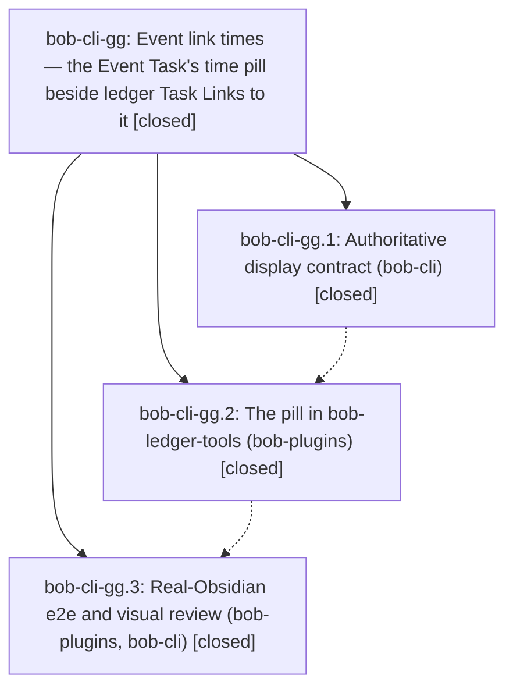

# Bead: bob-cli-gg — Event link times — the Event Task's time pill beside ledger Task Links to it

[Bead Pages](../README.md) / bob-cli-gg

**Status:** ✓ closed · **Resolution:** done · **Type:** ▸ plan · **Tier:** epic
**Owner:** `bryanbugyi34@gmail.com` · **Created by:** [bbugyi200.apollo.ca](https://github.com/bobs-org/bob-cli--agents/blob/main/sessions/bbugyi200.apollo.ca.md) · **Assignee:** `bob-cli-gg.land`
**Created:** 2026-11-03 10:19:37 EST · **Closed:** 2026-11-03 12:53:50 EST
**Plan:** [202611/event\_link\_times.md](https://github.com/bobs-org/bob-cli--plans/blob/main/202611/event_link_times.md)

<!-- sase:links:start -->

## Links

| Relation | Artifact | Why |
| --- | --- | --- |
| implemented-by | [plan:202611/event_link_times.md][1] | derived from the plan's `bead_id:` frontmatter field |

_Plus 2 automatic references — see [Referenced By](#referenced-by)._

[1]: https://github.com/bobs-org/bob-cli--plans/blob/main/202611/event_link_times.md

<!-- sase:links:end -->

## Description

In a daily note's Pomodoro ledger, every Task Link that points at one of that note's Event Tasks wears the same time pill the Event Task wears in `## Events` (meeting span, past/running/future state, MEET hue, off-clock dash, buffer wings), in Live Preview and Reading view, display-only, so a MEET lineup reads as a schedule.

## Notes

[2026-11-03T15:39:21Z · 17b--code] CROSS-EPIC COORDINATION with bob-cli-gf (off-clock link chips). Not remaining work for any phase. Checklist extending this plan's "Coordination with epic bob-cli-gf" section, for whichever of gf/gg commits to bob-plugins second, and for this land agent (confirm each item). gf's plan has no matching section, so gf's workers do not know about gg.

State when written (2026-11-03): gf.1 landed in bob-cli (5f35f0b3); gg.1 is closed; no gf or gg commit in bob-plugins yet (master 175aced, bob-ledger-tools 1.95.0); gf.2, gf.3, gg.2, and gg.3 remain in flight.

1. Same hunks; expect textual conflicts and resolve by keeping both features:
   - `src/269-plugin-progress-marks-reading.js` `ledgerMarkClass` list must hold BOTH `bob-off-clock-link-chip` and `bob-event-link-time`. Dropping either one makes rows wearing that host stop counting as ledger rows: ◐/🔓/🔑 vanish and a status ring appears.
   - `src/279-plugin-task-theme-api.js` `taskThemeRequestSourceText` fill callback: keep both refresh calls (`scheduleOffClockLinkChipsRefresh`, `scheduleEventLinkTimesRefresh`).
   - `styles.css` calendar block (about lines 5240-5370): gf adds `.bob-off-clock-link-chip` to the Event off-clock chip rules and renames `--bob-calendar-off-clock-icon` to a body-level `--bob-off-clock-icon`; gg appends its host rule after the wing rules, right next to that variable. Nothing may keep using the old variable name.
   - `src/350-exports.js` tail, the `package.json` "test" line, the `manifest.json` description, and `docs/bob-ledger-tools.md` ("Marks and rendered blocks", "Session toggles", "Calendar Events").
   - Separate spots that should auto-merge: `src/fragments.json`, `src/310-install-methods.js`.
2. Generated output: never hand-merge `main.js` or `npm run docs:gen` output. Resolve the `src/` and docs sources, then rerun `npm run build`, `npm run docs:gen`, and `npm run build:check`.
3. `manifest.json` version: both plans bump the minor from 1.95.0. The second to land takes the next minor past master at commit time (1.97.0 if the first took 1.96.0).
4. `bob plugins sync`: both epics' phase 2 and phase 3 run it. Its deploy guard refuses to overwrite another checkout's uncommitted or non-ancestor deploy, and the refusal text suggests `-F`. If the refusal names the other epic's checkout, do NOT use `-F`; that rolls the other feature out of Bryan's vault. Rebase onto a bob-plugins master that contains the other epic's commit, rebuild, and sync again. If that commit is not on master yet, record the sync as pending in a phase note.
5. Intended overlap, keep both: a ledger link to an off-clock Event Task wears gg's dashed time pill before the link and gf's `off` chip after it (`pill link 🔓 🔑 N off`). Neither epic should hide the other's mark.
6. Parity: both decide the clock with `taskEffectiveClockResolution` (gf through `pomodoroClockLinkFacts`, gg through `gcalEventsApplyClockToRow`). Once both have landed, a row's pill has `data-off-clock="true"` exactly when the row wears the chip. Known transient gap: a full-path same-note link (`[[2026/20261103#^id]]`), where gf reads the source-text cache and gg reads the live document. A disagreement anywhere else is a bug.
7. gf's source-text freshness fix (refresh an already-cached entry on `metadataCache` `changed`) also serves gg's Reading-view pills. Keep exactly one such fix; do not add a second invalidation path.
8. Once both have landed, run both unit suites (`test-ledger-tools-off-clock-link-chips.cjs`, `test-ledger-tools-event-link-times.cjs`). Confirm gg's EP3 (`pill link off`) and gf's OP5 (◐/🔓/🔑 still paint, no ring) with both hosts on one row.

[2026-11-03T17:23:39Z · bob-cli-gg.land] LAND AUDIT / FOLLOW-UP TRIAGE: Read epic and every note of gg.1/.2/.3 plus approved plan and actual source/commits: bob-cli b9c482da/a5e1c519, bob-plugins 8ce2feb/9b5b285, with gf 23d401b/46b25c6/84ea548 integration. placement=before is implemented (side -3 and Reading insertion before type/progress), shared event clock fix and source resolution match the contract; no vault writers added. Both host classes, refresh callbacks, shared icon, exports/mixins/test registration, cache freshness fix, and additive source styles survive. 84ea548 already fixes version to 1.97.0 and adds production paired-sweep order/clock-parity coverage. Current focused event/off-clock/gcal/harness suites pass 85/85; build:check passes. Main post-start drift is gh.1 glossary sources and gh.2 periods; registry/test counts retain gg and gf, and period notes require no event-pill integration. Live Obsidian skip is explicitly allowed by original plan; phase 3 accurately records absent Obsidian/Xvfb, no screenshots or measured live timings. gg.2 #2 and gg.3 #3 pending sync are resolved: guarded bob plugins sync of current clean 84ea548 succeeds without force, all three vault assets unchanged and provenance clean. Two PROPOSED FOLLOW-UP entries (gg.2 #3, gg.3 #2) are one generated-glossary issue; sase_new_task searches across all task statuses, recent tasks, and active epics found causal owner gh.1. Added independent reproduction to bob-cli-gh as DISCOVERED ISSUE; declined duplicate tasks. npm run docs:check currently passes lint/plugin inventory and fails only generated docs/reference/glossary.md drift. Remaining gg work: gg.1 #2 explicitly prohibited a second instead, but docs/task-link-marks.md rule 5 still says the Event pill is instead of a ring; make pill plus chip coexistence explicit. Plugin manifest description contains literal backslash-u2019 and incorrectly calls the distinct event-times/calendar toggles shared; fix description and regenerate inventory. A small tale will perform these bounded copy fixes, checks, guarded sync, and epic closeout itself. epic-symbols is empty; no symvision recipe currently exists; no parent bead. No check-full run; just check belongs to final edited-tree verification in the tale.

[2026-11-03T17:53:50Z · bob-cli-gg.land] Closeout of bob-cli-gg after the landing-repair tale.

Reviewed phase notes and commits. gg.1/.2/.3 are closed with resolution done. Contract and live verification live in bob-cli b9c482da and a5e1c519 (later 020a1f6d retains both contract registrations and the 38-count; period notes are not event-pill surfaces). Pill, clock fix, isolated harness, and gf integration live in bob-plugins 8ce2feb, 9b5b285, 23d401b, 46b25c6, and 84ea548. Combined pill/chip integration is on master at bob-ledger-tools 1.97.0 with both host classes, both source-fill refresh callbacks, one cache freshness fix, shared off-clock icon, and additive CSS. placement=before is implemented (Live Preview side -3; Reading insert before type/progress).

Copy corrections in this tale: docs/task-link-marks.md rule 5 now states additive behavior without a second "instead" — Event Task links wear the time pill before the link; off-clock links also wear the off chip after it; a row can wear both; no-ring retained. Plugin manifest 1.97.0 description uses a normal apostrophe and names a distinct event-times toggle that also requires calendar event painting; off-clock chips clause kept. Regenerated docs/bob-ledger-tools.md inventory.

Verification: npm run build (ledger-tools unchanged), build:check, validate, and the focused event-link / off-clock-link / gcal / e2e self-test suite 85/85. BOB_CLI_DIR-pointed npm run docs:check and BOB_DOCS_BOB_PLUGINS_DIR just docs-check both passed all implemented gates (447 passed, 1 optional asset skip). git diff --check clean. just check: fmt/clippy plus 2934 cli tests passed; one unrelated failure capture::related::draft_related_stays_under_the_debug_perf_gate (draft query cost above baseline, 565ms vs tiny 55ms) — capture perf gate, not gg copy. Did not run just check-full.

Deployment: bob plugins sync --repo this bob-plugins checkout --no-pull --plugin bob-ledger-tools succeeded without force; copied only manifest.json (+1/-1 description); main.js and styles unchanged; provenance uncommitted build of 84ea548 on apollo.

Live Obsidian skipped as authorized: host has no Obsidian/Xvfb; gg.3 recorded offline self-test, no screenshots or live timings.

Glossary: gg.2 #3 and gg.3 #2 remain one generated-glossary issue already filed on bob-cli-gh as DISCOVERED ISSUE; no duplicate task. This verification's docs gates passed generated drift (no glossary failure present). epic-symbols empty. justfile has no symvision recipe. No parent_bead.

## Phases

| Bead | Title | Status | Size | Created | Agents | Commits |
|---|---|---|---|---|---:|---:|
| [bob-cli-gg.1](bob-cli-gg.1.md) | Authoritative display contract (bob-cli) | ✓ closed | small | 2026-11-03 | 1 | 1 |
| [bob-cli-gg.2](bob-cli-gg.2.md) | The pill in bob-ledger-tools (bob-plugins) | ✓ closed | medium | 2026-11-03 | 1 | 1 |
| [bob-cli-gg.3](bob-cli-gg.3.md) | Real-Obsidian e2e and visual review (bob-plugins, bob-cli) | ✓ closed | medium | 2026-11-03 | 1 | 2 |

## Lineage

## Agents

| Agent | Bead | Commits |
|---|---|---:|
| [bbugyi200.apollo.bob-cli-gg.1](https://github.com/bobs-org/bob-cli--agents/blob/main/agents/bbugyi200.apollo.bob-cli-gg.1/README.md) | [bob-cli-gg.1](bob-cli-gg.1.md) | 1 |
| [bbugyi200.apollo.bob-cli-gg.2](https://github.com/bobs-org/bob-cli--agents/blob/main/agents/bbugyi200.apollo.bob-cli-gg.2/README.md) | [bob-cli-gg.2](bob-cli-gg.2.md) | 1 |
| [bbugyi200.apollo.bob-cli-gg.3](https://github.com/bobs-org/bob-cli--agents/blob/main/agents/bbugyi200.apollo.bob-cli-gg.3/README.md) | [bob-cli-gg.3](bob-cli-gg.3.md) | 2 |
| [bbugyi200.apollo.bob-cli-gg.land](https://github.com/bobs-org/bob-cli--agents/blob/main/sessions/bbugyi200.apollo.bob-cli-gg.land.md) | [bob-cli-gg](README.md) | 2 |

## Commits

| Repo | Commit | Subject | Bead | Committed |
|---|---|---|---|---|
| bob-cli | [`b9c482d`](https://github.com/bobs-org/bob-cli/commit/b9c482da9e35ca2f70df19e74b649abae39364a9) | docs(event-link-times): add ledger Event time pill contract | [bob-cli-gg.1](bob-cli-gg.1.md) | 2026-11-03 10:40:04 EST |
| bob-plugins | [`bob-plugins@8ce2feb`](https://github.com/bobs-org/bob-plugins/commit/8ce2febc8632dc91926f271e3a0033da2f2b9ea2) | feat(ledger-tools): event link time pills with gcal now-on-timeline fix | [bob-cli-gg.2](bob-cli-gg.2.md) | 2026-11-03 11:42:36 EST |
| bob-cli | [`a5e1c51`](https://github.com/bobs-org/bob-cli/commit/a5e1c519a3aa749b50106ab2a122e21fdb4b086f) | docs(event-link-times): record live verification | [bob-cli-gg.3](bob-cli-gg.3.md) | 2026-11-03 12:10:52 EST |
| bob-plugins | [`bob-plugins@9b5b285`](https://github.com/bobs-org/bob-plugins/commit/9b5b2857f02f441cd2920b1f7738522b2ddc8b57) | test(event-link-times): add isolated Obsidian e2e | [bob-cli-gg.3](bob-cli-gg.3.md) | 2026-11-03 12:11:29 EST |
| bob-cli | [`ee5c078`](https://github.com/bobs-org/bob-cli/commit/ee5c0781caa7c748713ab685de9a9dc7da000f78) | docs(task-link-marks): describe event pill and off chip as additive | [bob-cli-gg](README.md) | 2026-11-03 12:55:39 EST |
| bob-plugins | [`bob-plugins@51e661a`](https://github.com/bobs-org/bob-plugins/commit/51e661a3a14763b7f8e81c6e7193210b0c3a2647) | docs(ledger-tools): correct Event time pill plugin description | [bob-cli-gg](README.md) | 2026-11-03 12:56:23 EST |

<!-- sase:referenced-by:start -->

## Referenced By

| Relation | Artifact | Why | Uses |
| --- | --- | --- | ---: |
| read-by | [agent:bob-cli-gg.2][1] | coordination note | 1 |
| read-by | [agent:bob-cli-gg.3][2] | Need cross-epic coordination and live verification context | 1 |

[1]: https://github.com/bobs-org/bob-cli--agents/blob/main/agents/bbugyi200.apollo.bob-cli-gg.2/README.md
[2]: https://github.com/bobs-org/bob-cli--agents/blob/main/agents/bbugyi200.apollo.bob-cli-gg.3/README.md

<!-- sase:referenced-by:end -->
