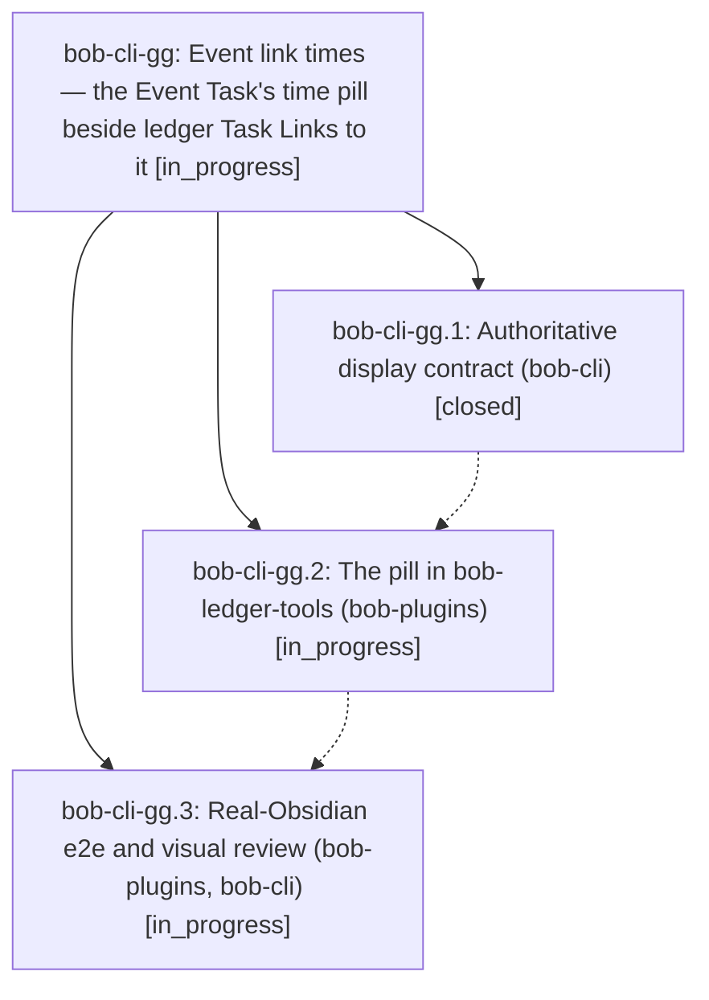

# Bead: bob-cli-gg — Event link times — the Event Task's time pill beside ledger Task Links to it

[Bead Pages](../README.md) / bob-cli-gg

**Status:** ◐ in_progress · **Type:** ▸ plan · **Tier:** epic
**Owner:** `bryanbugyi34@gmail.com` · **Created by:** [bbugyi200.apollo.ca](https://github.com/bobs-org/bob-cli--agents/blob/main/sessions/bbugyi200.apollo.ca.md) · **Assignee:** `bob-cli-gg.land`
**Created:** 2026-11-03 10:19:37 EST
**Plan:** [202611/event\_link\_times.md](https://github.com/bobs-org/bob-cli--plans/blob/main/202611/event_link_times.md)

## Description

In a daily note's Pomodoro ledger, every Task Link that points at one of that note's Event Tasks wears the same time pill the Event Task wears in `## Events` (meeting span, past/running/future state, MEET hue, off-clock dash, buffer wings), in Live Preview and Reading view, display-only, so a MEET lineup reads as a schedule.

## Phases

| Bead | Title | Status | Size | Created | Agents | Commits |
|---|---|---|---|---|---:|---:|
| [bob-cli-gg.1](bob-cli-gg.1.md) | Authoritative display contract (bob-cli) | ✓ closed | small | 2026-11-03 | 1 | 1 |
| [bob-cli-gg.2](bob-cli-gg.2.md) | The pill in bob-ledger-tools (bob-plugins) | ◐ in_progress | medium | 2026-11-03 | 1 | 0 |
| [bob-cli-gg.3](bob-cli-gg.3.md) | Real-Obsidian e2e and visual review (bob-plugins, bob-cli) | ◐ in_progress | medium | 2026-11-03 | 1 | 0 |

## Lineage

## Agents

| Agent | Bead | Commits |
|---|---|---:|
| [bbugyi200.apollo.bob-cli-gg.1](https://github.com/bobs-org/bob-cli--agents/blob/main/agents/bbugyi200.apollo.bob-cli-gg.1/README.md) | [bob-cli-gg.1](bob-cli-gg.1.md) | 1 |
| [bbugyi200.apollo.bob-cli-gg.2](https://github.com/bobs-org/bob-cli--agents/blob/main/agents/bbugyi200.apollo.bob-cli-gg.2/README.md) | [bob-cli-gg.2](bob-cli-gg.2.md) | 0 |
| [bbugyi200.apollo.bob-cli-gg.3](https://github.com/bobs-org/bob-cli--agents/blob/main/agents/bbugyi200.apollo.bob-cli-gg.3/README.md) | [bob-cli-gg.3](bob-cli-gg.3.md) | 0 |
| [bbugyi200.apollo.bob-cli-gg.land](https://github.com/bobs-org/bob-cli--agents/blob/main/agents/bbugyi200.apollo.bob-cli-gg.land/README.md) | [bob-cli-gg](README.md) | 0 |

## Commits

| Repo | Commit | Subject | Bead | Committed |
|---|---|---|---|---|
| bob-cli | [`b9c482d`](https://github.com/bobs-org/bob-cli/commit/b9c482da9e35ca2f70df19e74b649abae39364a9) | docs(event-link-times): add ledger Event time pill contract | [bob-cli-gg.1](bob-cli-gg.1.md) | 2026-11-03 10:40:04 EST |
