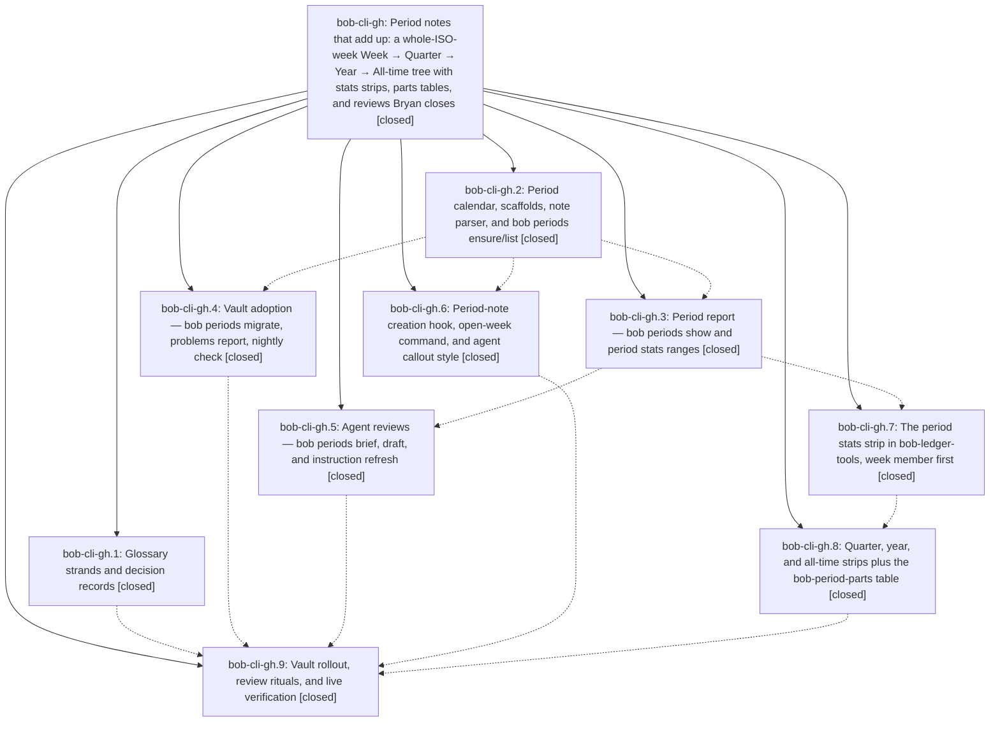

# Bead: bob-cli-gh — Period notes that add up: a whole-ISO-week Week → Quarter → Year → All-time tree with stats strips, parts tables, and reviews Bryan closes

[Bead Pages](../README.md) / bob-cli-gh

**Status:** ✓ closed · **Resolution:** done · **Type:** ▸ plan · **Tier:** epic
**Owner:** `bryanbugyi34@gmail.com` · **Created by:** `bbugyi200.apollo.research.34.linker.w0` · **Assignee:** `bob-cli-gh.land`
**Created:** 2026-11-03 10:55:43 EST · **Closed:** 2026-11-03 17:35:15 EST
**Plan:** [202611/period\_notes\_and\_stats\_strips.md](https://github.com/bobs-org/bob-cli--plans/blob/main/202611/period_notes_and_stats_strips.md)

<!-- sase:links:start -->

## Links

| Relation | Artifact | Why |
| --- | --- | --- |
| implemented-by | [plan:202611/period_notes_and_stats_strips.md][1] | derived from the plan's `bead_id:` frontmatter field |
| related | [bead:bob-cli-gp][2] | Proposed by bob-cli-gh.9 rollout; uses bob periods brief/draft and the v1 agent callouts |
| related | [bead:bob-cli-gq][3] | Proposed by bob-cli-gh.9 rollout; extends bob periods migrate beyond the ISO-2026 tree |

_Plus 2 automatic references — see [Referenced By](#referenced-by)._

[1]: https://github.com/bobs-org/bob-cli--plans/blob/main/202611/period_notes_and_stats_strips.md
[2]: https://github.com/bobs-org/bob-cli--beads/blob/main/pages/bob-cli-gp/README.md
[3]: https://github.com/bobs-org/bob-cli--beads/blob/main/pages/bob-cli-gq/README.md

<!-- sase:links:end -->

## Description

Every daily note's parent is its ISO week note, and the tree climbs week → quarter → year → all_time → org with no dangling links. bob creates each period note ahead of time from a deterministic scaffold and never edits a note it did not just create. Every week, quarter, year, and all-time note opens with a live stats strip — the Day strip's family: the same five facts as period totals, a typical line, root and type lanes, and a parts row of its child periods — and a live parts table that summarizes each child automatically, with or without an agent. Each note carries complete, versioned agent instructions, so "Update 2026/2026-W45.md" is a whole prompt: agents take every number from `bob periods brief` and save only through `bob periods draft`, which never overwrites Bryan's edits. gtd_daily.md runs a Monday weekly review plus calendar-anchored quarterly and yearly reviews, and the glossary and decision records name the new pieces.

## Notes

[2026-11-03T16:48:31Z · bob-cli-gf.land] DISCOVERED ISSUE: bob-cli-gf.land reproduced generated docs drift on bob-cli e9deb7f8 via bob-plugins npm run docs:check (46b25c6): docs/reference/glossary.md is out of date. gh.1 commits 2a9640a6 and 4ce79094 add/reword Period Note, Stats Strip, and Day Strip but do not regenerate that published glossary; the new terms are absent there. Please regenerate via just docs-gen and verify just docs-check during gh integration. No gf source change causes this; attaching to this active epic rather than making a duplicate task. gg.2 note #3 independently reported glossary drift.

[2026-11-03T17:21:35Z · bob-cli-gg.land] DISCOVERED ISSUE: bob-cli-gg landing corroborates gh.1 generated glossary drift, proposed independently by bob-cli-gg.2 note #3 and bob-cli-gg.3 note #2. On bob-cli a5e1c519 and clean bob-plugins 84ea548, npm run docs:check passes lint and plugin inventory then fails: out of date: docs/reference/glossary.md (run just docs-gen). gh.1 commits 2a9640a6/4ce79094 changed Period Note, Stats Strip, and Day Strip without regenerating the published glossary. Same causal issue as gh note #1; please regenerate and run both docs gates during gh integration. No gg source causes it; no duplicate task created.

[2026-11-03T21:26:25Z · bryanbugyi34@gmail.com] I'm not seeing the stats strips in the weekly/quarterly/yearly files. See the 🔒 20261103\_162550.png screenshot for context. The epic lander agent should fix this before landing.

[2026-11-03T21:28:29Z · bryanbugyi34@gmail.com] Also, as a part of landing, we should update the '[n' and ']n' keymaps so they work with the links to previous weeks/quarters/years in these files. Maybe just make them work on any links that have a label that starts with '<' or '>', respectively?

[2026-11-03T22:35:15Z · bob-cli-gh.land] LANDED by bob-cli-gh.land. VERIFIED: all 9 phases closed and their notes addressed; decisions honored (days_table=yes weekly ## Days; pilot W44/Q3 drafts committed; offclock counts only; glossary strands only, no decision records per memory_decisions=no). gh.9's uncommitted migrate parent-insert + note_pull fix is committed as 7de57d04. Epic notes #1/#2 (published glossary drift) already fixed: just docs-gen leaves docs/reference/glossary.md unchanged and just docs-check passes.

FIXED IN LANDING (Bryan notes #3/#4 and epic-caused gaps):
1. Strips never rendered (note #3): BobLedgerToolsPeriodStripMixin was defined but missing from 310-install-methods.js, so setupPeriodStripHosts never ran and bob-stats-strip / bob-period-parts showed as plain code blocks. Installed it; new tests load the real plugin, assert both fences register and paint (fail without the fix), plus a build guard that every plugin installs each mixin class it defines.
2. ]n / [n (note #4): labels match exactly next/prev or arrow labels (prev starts with ‹ or <; next ends or starts with › or >), so the period nav line ‹ W44 · ↑ 2026-Q4 · W46 › works; daily prev/next unchanged.
3. Missing period notes: link-following (Enter, ]n, [n) to a week, quarter, year, or all_time note that doesn't exist yet now asks bob via new bob-ledger-tools api.periodNotes v1 (bob periods ensure -d <first day>) instead of a Templater template (which made ensure-proof stubs; YYYY.md still routed to the deleted yearly template). Ledger Tools also fills Templater frontmatter-only stubs from mouse-clicked dangling links 1.5 s after creation (bob scaffolds are skipped, so look-ahead never cascades). bob periods ensure now fills frontmatter-only stubs (note::is_unfilled).
4. gh.9 follow-up #3: v1 callouts and help say bob periods brief -f md but the CLI only took human|json; brief now takes -f md|json (md default, human alias) per plan §7, so no INSTRUCTIONS_VERSION bump is needed.
5. gh.8 follow-up #2 / gh.6 #1 / gh.7 #1: the full npm test never finished because gh.6's period-notes midnight ticker fell back to an unregistered setInterval when registerInterval was absent (bisected: 84ea548 exits, a56f0dc hangs). It now starts only when registerInterval exists; test-ledger-tools-navigation exits in 3 s and the full npm test finishes in about 45 s.

CHECKS: bob-cli just check: fmt and clippy clean; 4789 lib and 2970 CLI tests pass except the 2 catalog entry-count tests broken by gn.1 0b4cebdf (recorded on bob-cli-gn). just docs-check passes. bob-plugins npm test: 5348/5353 pass; the 5 failures are open tasks bob-cli-et, bob-cli-f7, bob-cli-eh (2), and bob-cli-ff. build:check, docs inventory, and docs:check (BOB_CLI_DIR=this tree) pass. Live on athena: just install, then bob periods brief 2026-W44 -f md works and ensure -n -d 2026-11-16 plans W47/W48. DEPLOY: bob plugins sync to athena's vault was refused because bob-cli_18 (gn.3, in progress) deployed an uncommitted build of the same two plugins at 22:10Z with different bytes; not forced. A later sync after both commits land will deploy. On the Mac, Bryan needs just install-all (or pull plus bob plugins sync) and an Obsidian reload.

INTEGRATION: reviewed every non-epic commit since 2a9640a6 (capture note-pull and move bullets, pomodoro --last, attachments, TODAY badge, event-time and off-clock docs); none use or conflict with periods. Only interaction: gn.1's catalog counts (noted on bob-cli-gn).

FOLLOW-UPS: gh.9 #1 Monday auto-draft job -> new bob-cli-gp (feature, large). gh.9 #2 opt-in 2023-2025 backfill -> new bob-cli-gq (feature, medium). gh.9 #3 -> fixed here. gh.9 #4 (docs-cache clone at b94eec2 fails to compile) declined: master compile fixed by de01143e/7de57d04, and docs:check passes against this tree. gh.8 #1 declined: resolved by 9a606395 (note #4). gh.8 #2 and gh.6 #1 / gh.7 #1 -> fixed here (epic-caused hang). gh.7 #2 (sync blocked by workspace 22) declined: superseded by the clean e1aad7c deploy at 20:22Z. Catalog-count failure -> DISCOVERED ISSUE note on active epic bob-cli-gn. No --epic-symbol entries.

## Attachments

- 🔒 20261103\_162550.png · image/png · 2854×1686 · 319.927 KiB (private attachment)

## Phases

| Bead | Title | Status | Size | Created | Agents | Commits |
|---|---|---|---|---|---:|---:|
| [bob-cli-gh.1](bob-cli-gh.1.md) | Glossary strands and decision records | ✓ closed | small | 2026-11-03 | 2 | 2 |
| [bob-cli-gh.2](bob-cli-gh.2.md) | Period calendar, scaffolds, note parser, and bob periods ensure/list | ✓ closed | medium | 2026-11-03 | 1 | 1 |
| [bob-cli-gh.3](bob-cli-gh.3.md) | Period report — bob periods show and period stats ranges | ✓ closed | medium | 2026-11-03 | 1 | 1 |
| [bob-cli-gh.4](bob-cli-gh.4.md) | Vault adoption — bob periods migrate, problems report, nightly check | ✓ closed | medium | 2026-11-03 | 1 | 1 |
| [bob-cli-gh.5](bob-cli-gh.5.md) | Agent reviews — bob periods brief, draft, and instruction refresh | ✓ closed | medium | 2026-11-03 | 1 | 1 |
| [bob-cli-gh.6](bob-cli-gh.6.md) | Period-note creation hook, open-week command, and agent callout style | ✓ closed | small | 2026-11-03 | 1 | 1 |
| [bob-cli-gh.7](bob-cli-gh.7.md) | The period stats strip in bob-ledger-tools, week member first | ✓ closed | medium | 2026-11-03 | 1 | 1 |
| [bob-cli-gh.8](bob-cli-gh.8.md) | Quarter, year, and all-time strips plus the bob-period-parts table | ✓ closed | medium | 2026-11-03 | 1 | 1 |
| [bob-cli-gh.9](bob-cli-gh.9.md) | Vault rollout, review rituals, and live verification | ✓ closed | medium | 2026-11-03 | 1 | 1 |

## Lineage

## Agents

| Agent | Bead | Commits |
|---|---|---:|
| [bbugyi200.apollo.bob-cli-gh.1](https://github.com/bobs-org/bob-cli--agents/blob/main/sessions/bbugyi200.apollo.bob-cli-gh.1.md) | [bob-cli-gh.1](bob-cli-gh.1.md) | 1 |
| [bbugyi200.athena.bob-cli-gh.1](https://github.com/bobs-org/bob-cli--agents/blob/main/sessions/bbugyi200.athena.bob-cli-gh.1.md) | [bob-cli-gh.1](bob-cli-gh.1.md) | 1 |
| [bbugyi200.athena.bob-cli-gh.2](https://github.com/bobs-org/bob-cli--agents/blob/main/agents/bbugyi200.athena.bob-cli-gh.2/README.md) | [bob-cli-gh.2](bob-cli-gh.2.md) | 1 |
| [bbugyi200.athena.bob-cli-gh.3](https://github.com/bobs-org/bob-cli--agents/blob/main/sessions/bbugyi200.athena.bob-cli-gh.3.md) | [bob-cli-gh.3](bob-cli-gh.3.md) | 1 |
| [bbugyi200.athena.bob-cli-gh.4](https://github.com/bobs-org/bob-cli--agents/blob/main/agents/bbugyi200.athena.bob-cli-gh.4/README.md) | [bob-cli-gh.4](bob-cli-gh.4.md) | 1 |
| [bbugyi200.athena.bob-cli-gh.5](https://github.com/bobs-org/bob-cli--agents/blob/main/agents/bbugyi200.athena.bob-cli-gh.5/README.md) | [bob-cli-gh.5](bob-cli-gh.5.md) | 1 |
| [bbugyi200.athena.bob-cli-gh.6](https://github.com/bobs-org/bob-cli--agents/blob/main/agents/bbugyi200.athena.bob-cli-gh.6/README.md) | [bob-cli-gh.6](bob-cli-gh.6.md) | 1 |
| [bbugyi200.athena.bob-cli-gh.7](https://github.com/bobs-org/bob-cli--agents/blob/main/agents/bbugyi200.athena.bob-cli-gh.7/README.md) | [bob-cli-gh.7](bob-cli-gh.7.md) | 1 |
| [bbugyi200.athena.bob-cli-gh.8](https://github.com/bobs-org/bob-cli--agents/blob/main/agents/bbugyi200.athena.bob-cli-gh.8/README.md) | [bob-cli-gh.8](bob-cli-gh.8.md) | 1 |
| [bbugyi200.athena.bob-cli-gh.9](https://github.com/bobs-org/bob-cli--agents/blob/main/agents/bbugyi200.athena.bob-cli-gh.9/README.md) | [bob-cli-gh.9](bob-cli-gh.9.md) | 1 |
| [bbugyi200.athena.bob-cli-gh.land](https://github.com/bobs-org/bob-cli--agents/blob/main/agents/bbugyi200.athena.bob-cli-gh.land/README.md) | [bob-cli-gh](README.md) | 1 |

## Commits

| Repo | Commit | Subject | Bead | Committed |
|---|---|---|---|---|
| bob-cli | [`2a9640a`](https://github.com/bobs-org/bob-cli/commit/2a9640a6b20c4bcb42e5e0a7cfe3eb347b5d1b44) | docs(memory): add Stats Strip and Period Note glossary strands | [bob-cli-gh.1](bob-cli-gh.1.md) | 2026-11-03 11:09:56 EST |
| bob-cli | [`4ce7909`](https://github.com/bobs-org/bob-cli/commit/4ce79094aaf3cf8753bb438a17cd3d9b40afa02a) | docs(memory): add Period Note and Stats Strip glossary terms | [bob-cli-gh.1](bob-cli-gh.1.md) | 2026-11-03 11:31:20 EST |
| bob-cli | [`020a1f6`](https://github.com/bobs-org/bob-cli/commit/020a1f6da021513bc60abdcbda7a4d9ab606fb90) | feat(periods): add ISO period calendar, scaffolds, parser, ensure/list | [bob-cli-gh.2](bob-cli-gh.2.md) | 2026-11-03 11:59:22 EST |
| bob-plugins | [`bob-plugins@a56f0dc`](https://github.com/bobs-org/bob-plugins/commit/a56f0dc7bdd2158310874e021617df88855a6ace) | feat(ledger-tools): add period-notes hook ensuring period notes on daily-note creation | [bob-cli-gh.6](bob-cli-gh.6.md) | 2026-11-03 12:42:35 EST |
| bob-cli | [`5a1ccf5`](https://github.com/bobs-org/bob-cli/commit/5a1ccf593bb743a9f08c003af550a4b473504540) | feat(periods): adopt the period-note tree (migrate, list -p, nightly) | [bob-cli-gh.4](bob-cli-gh.4.md) | 2026-11-03 13:00:24 EST |
| bob-cli | [`9f88a86`](https://github.com/bobs-org/bob-cli/commit/9f88a861ffa3444058c449b5bdd7218a184e8142) | feat(periods): add period reports and stats ranges | [bob-cli-gh.3](bob-cli-gh.3.md) | 2026-11-03 13:37:09 EST |
| bob-plugins | [`bob-plugins@d1737ea`](https://github.com/bobs-org/bob-plugins/commit/d1737ea7ca1b216960a908904358f91ed1c2a17a) | feat(ledger-tools): add week-member period stats strip (bob-stats-strip) | [bob-cli-gh.7](bob-cli-gh.7.md) | 2026-11-03 14:11:20 EST |
| bob-plugins | [`bob-plugins@e1aad7c`](https://github.com/bobs-org/bob-plugins/commit/e1aad7c3e70732d3a2aa1fba4f9f8406d6cfd8b3) | feat(period-parts): add quarter year and all-time stats views | [bob-cli-gh.8](bob-cli-gh.8.md) | 2026-11-03 14:49:40 EST |
| bob-cli | [`13fb39d`](https://github.com/bobs-org/bob-cli/commit/13fb39d0d40c35ee361400a552a29b08ce1bfcaf) | feat(periods): add agent reviews — brief, draft, and instruction refresh | [bob-cli-gh.5](bob-cli-gh.5.md) | 2026-11-03 15:01:40 EST |
| bob-cli | [`7de57d0`](https://github.com/bobs-org/bob-cli/commit/7de57d04abb5e53439b75b02563750f740d4d030) | fix(periods): insert missing daily parent on migrate; drop duplicate note\_pull field | [bob-cli-gh.9](bob-cli-gh.9.md) | 2026-11-03 16:14:05 EST |
| bob-cli | [`56d8dac`](https://github.com/bobs-org/bob-cli/commit/56d8dac3960b32fc68b92c4641c3f9b25a5fcac2) | fix(periods): accept brief -f md and fill frontmatter-only period stubs | [bob-cli-gh](README.md) | 2026-11-03 17:36:21 EST |

<!-- sase:referenced-by:start -->

## Referenced By

| Relation | Artifact | Why | Uses |
| --- | --- | --- | ---: |
| read-by | [agent:bob-cli-gh.2][1] | Need epic scope and plan linkage | 1 |
| read-by | [agent:bob-cli-gh.9][2] | epic context for phase 9 | 1 |

[1]: https://github.com/bobs-org/bob-cli--agents/blob/main/agents/bbugyi200.athena.bob-cli-gh.2/README.md
[2]: https://github.com/bobs-org/bob-cli--agents/blob/main/agents/bbugyi200.athena.bob-cli-gh.9/README.md

<!-- sase:referenced-by:end -->
