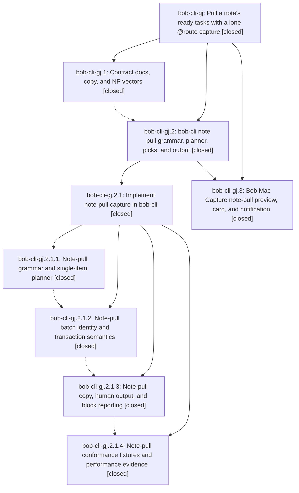

# Bead: bob-cli-gj — Pull a note's ready tasks with a lone @route capture

[Bead Pages](../README.md) / bob-cli-gj

**Status:** ✓ closed · **Resolution:** done · **Type:** ▸ plan · **Tier:** epic
**Owner:** `bryanbugyi34@gmail.com` · **Created by:** [bbugyi200.athena.17g](https://github.com/bobs-org/bob-cli--agents/blob/main/sessions/bbugyi200.athena.17g.md) · **Assignee:** `bob-cli-gj.land`
**Created:** 2026-11-03 11:56:54 EST · **Closed:** 2026-11-04 11:24:38 EST
**Plan:** [202611/note\_pull.md](https://github.com/bobs-org/bob-cli--plans/blob/main/202611/note_pull.md)

<!-- sase:links:start -->

## Links

| Relation | Artifact | Why |
| --- | --- | --- |
| implemented-by | [plan:202611/note_pull.md][1] | derived from the plan's `bead_id:` frontmatter field |
| related | file:explicit:2d4e46033f084dad02ac11a0 | attached via sase artifact create --bead |

_Plus 1 automatic references — see [Referenced By](#referenced-by)._

[1]: https://github.com/bobs-org/bob-cli--plans/blob/main/202611/note_pull.md

<!-- sase:links:end -->

## Description

Capturing a lone `@foobar` item (in `bob capture` or Bob Mac Capture) opens the existing successor Pull-In choice. It lists every ready task that resides in `foobar.md`, previews where each would land, and links only the picked tasks into today's Pomodoros. The flow is atomic, explicit, and presented with one copy and visual system on every surface.

## Notes

[2026-11-03T19:41:36Z · bob-cli-gm.1] Grammar phase bob-cli-gm.1 took capture-language revision 9, one above the highest current code/docs claim. Keep revision 9 as execute and assist phases integrate; do not lower it.

[2026-11-04T00:06:46Z · bob-cli-gm.1.1.4] Activation phase bob-cli-gm.1.1.4 re-scanned the active code and docs claims and activated both target-run parsers at capture-language revision 9. Keep revision 9 as the open integration phases settle; do not lower it.

[2026-11-04T15:01:10Z · bob-cli-gj.land] FOLLOW-UP TRIAGE completed with /sase_new_task before a remaining-work tale. (1) bob-cli-gj.2.1.2 note #1: declined a new clippy task; nonminimal_bool/result_large_err are advisory under the canonical justfile, which does not use -D warnings. Read historical bob-cli-v: it deliberately resolved the mechanical gate only; no unsupported +1 or reopening. (2) bob-cli-gj.2.1.4 note #3: latency is resolved epic acceptance work, not a new task; cbc35adf and committed performance.md record isolated 6907-note release p95 50.41 ms for sase and 30.37 ms for mac_inbox, both below 70 ms. (3) bob-cli-gj.3 note #2: reproduced the task-merge.md missing-front-matter docs generator error on clean 27feff87 and recorded corroboration on causal active epic bob-cli-go, whose go.13 owns the accepted memory output. No standalone task and no memory edits. Searched matching ci tasks, all types, and the past-week task sweep; inspected active epics and plausible owners. All three proposals now have outcomes.

[2026-11-04T15:03:41Z · bob-cli-gj.land] LANDING AUDIT at bob-cli 27feff87 and Mac 206c4b8: reviewed the two epic grammar-coordination notes, all notes on gj.1/.2/.3 and nested gj.2.1 plus all four nested phases, approved main/CLI/move-repair plans, seven matching CLI commits and Mac 206c4b8. Accepted open_lanes/refuse/no-memory decisions hold; grammar stays 10, all result literals have the repaired leading note_pull initialization, staged classification and NP vectors remain present, and release timing evidence passes. Audited non-epic drift since fa077d2f: clipboard literals now integrate; target runs, project-note moves, transfer moves/merges are active; periods, attachments, pomodoro --last and TODAY badge changes add no separate pull behavior. Found remaining epic work: cbc35adf correctly remaps row.note_path after a move, but pull_in_copy group_key and output human grouping still use that mutable destination. Exact current-tree cargo build --locked --bin bob passes. Synthetic dry-run @work followed by project move or transfer of gamma reports Pull from 2 notes and separate work/destination headers despite one source; stable keys and all three links survive. Mac source audit also finds two-note pull-only drafts fall back to Capture because primaryActionTitle checks count == 1, and notification tests pin 1 task where the approved copy is 1. These remain epic work for one medium repair tale, not follow-up tasks. No epic-symbol entries, no symvision recipe in either checkout, no parent_bead. Mac phase recorded scratch bundle/typecheck pass; its CI 41851831313 was queued when checked, not green. Epic remains open and plan status remains unchanged until repair closeout.

[2026-11-04T16:24:38Z · bob-cli-gj.land] LANDED (relaunched lander; approved repair tale note_pull_final_landing's coder exited without changes, so this lander implemented it). VERIFIED: re-read epic notes, gj.1/.2/.3, gj.2.1 and gj.2.1.1-.4 notes; DECISIONS honored (open_lanes, empty_pull=refuse, no memory edits); source confirms grammar/planner/picks/net/JSON/human/Mac work from fa077d2f..cbc35adf and Mac 206c4b8. REPAIRED (epic-caused): (1) bob-cli: additive offer.note (frozen requested source) on note-pull offers; pull_in_copy group_key, human group headers, and no-pick hint group by it (note_path fallback), so a later project/transfer move no longer splits one @work pull into 'Pull from 2 notes' or drops its fold; row note_path/block_id/link stay the final home. Docs: task-dependencies §12.20 + json-outputs. Tests: extended note_pull_move_project_and_transfer_follow_picked_row (none/all/numeric/key/-p none, hidden-resident fold, human headers, unchanged bytes); new np_move_groups_follow_requested_sources_in_cli_fixtures over generated np-move fixtures (one source split across two destinations, two sources into shared bob.md, dev's only offer moved with fold kept, flat pull_in_choice_required offers, pull-only two-note); np1/np2/np13/np16 fixtures regenerated (only offer.note added). (2) Mac: TaskCompleteOffer.note decoded optionally; PullInSectionIdentity uses it (fallback note_path); primaryActionTitle says Pull In for any nonempty all-note_pull preview; notification title now '📥 Pulled in k from ‹N›'; prompt says 'Choose tasks to pull in from 2 notes' for several sources; fixtures refreshed/added from real bob; model/decoding/notification tests; docs/capture-previews.md. CHECKS: just check (sase tool run check ff3c0594) passed; note_pull unit 38/38 and CLI 11/11 pass; Mac just portable-check passed (lint, build, 2091 portable tests incl. new CaptureCore tests); Mac scratch-copy bundle.sh and just typecheck-tests passed on mac, scratch removed (BobMacCapture XCTest bodies are type-checked only; CI runs them). docs-check lint passes in both repos; generated-drift still stops on the pre-existing sase/memory/glossary/task-merge.md missing front matter, owned by bob-cli-go/go.13. No new scans, so 70 ms latency evidence stands. Mac CI 41851831313 (206c4b8) was cancelled with zero steps (never got a runner; superseded by queued 0df42dc run), not a note-pull defect. INTEGRATION: reviewed drift since 27feff87: bfbf482f (^^ move-choice lexer, grammar 11, bob capture still refuses ^^ until bob-cli-h0 lands; h0 owns routing its moves through the move map) and 96a3c744 (transfer-assist completion) touch no note-pull planning; Mac 0df42dc touches no note-pull code and our Swift compiled on top of it. FOLLOW-UP TRIAGE (from note #3, via /sase_new_task by prior lander): gj.2.1.2 clippy proposal declined (advisory lints, gate has no -D warnings); gj.2.1.4 latency proposal resolved epic work (cbc35adf, p95 50.41/30.37 ms); gj.3 docs-generator proposal corroborated on bob-cli-go (go.13). No new follow-ups. epic-symbols: none. symvision: no recipe in either repo.

## Phases

| Bead | Title | Status | Size | Created | Agents | Commits |
|---|---|---|---|---|---:|---:|
| [bob-cli-gj.1](bob-cli-gj.1.md) | Contract docs, copy, and NP vectors | ✓ closed | medium | 2026-11-03 | 1 | 1 |
| [bob-cli-gj.2](bob-cli-gj.2.md) | bob-cli note pull grammar, planner, picks, and output | ✓ closed | large | 2026-11-03 | 1 | 0 |
| [bob-cli-gj.3](bob-cli-gj.3.md) | Bob Mac Capture note-pull preview, card, and notification | ✓ closed | medium | 2026-11-03 | 1 | 1 |

## Lineage

## Agents

| Agent | Bead | Commits |
|---|---|---:|
| [bbugyi200.athena.bob-cli-gj.1](https://github.com/bobs-org/bob-cli--agents/blob/main/sessions/bbugyi200.athena.bob-cli-gj.1.md) | [bob-cli-gj.1](bob-cli-gj.1.md) | 1 |
| [bbugyi200.athena.bob-cli-gj.2](https://github.com/bobs-org/bob-cli--agents/blob/main/sessions/bbugyi200.athena.bob-cli-gj.2.md) | [bob-cli-gj.2](bob-cli-gj.2.md) | 0 |
| [bbugyi200.athena.bob-cli-gj.2.1.1](https://github.com/bobs-org/bob-cli--agents/blob/main/agents/bbugyi200.athena.bob-cli-gj.2.1.1/README.md) | [bob-cli-gj.2.1.1](bob-cli-gj.2.1.1.md) | 1 |
| [bbugyi200.athena.bob-cli-gj.2.1.2](https://github.com/bobs-org/bob-cli--agents/blob/main/agents/bbugyi200.athena.bob-cli-gj.2.1.2/README.md) | [bob-cli-gj.2.1.2](bob-cli-gj.2.1.2.md) | 1 |
| [bbugyi200.athena.bob-cli-gj.2.1.3](https://github.com/bobs-org/bob-cli--agents/blob/main/agents/bbugyi200.athena.bob-cli-gj.2.1.3/README.md) | [bob-cli-gj.2.1.3](bob-cli-gj.2.1.3.md) | 1 |
| [bbugyi200.athena.bob-cli-gj.2.1.4](https://github.com/bobs-org/bob-cli--agents/blob/main/sessions/bbugyi200.athena.bob-cli-gj.2.1.4.md) | [bob-cli-gj.2.1.4](bob-cli-gj.2.1.4.md) | 1 |
| [bbugyi200.athena.bob-cli-gj.2.1.land](https://github.com/bobs-org/bob-cli--agents/blob/main/sessions/bbugyi200.athena.bob-cli-gj.2.1.land.md) | [bob-cli-gj.2.1](bob-cli-gj.2.1.md) | 3 |
| [bbugyi200.athena.bob-cli-gj.3](https://github.com/bobs-org/bob-cli--agents/blob/main/sessions/bbugyi200.athena.bob-cli-gj.3.md) | [bob-cli-gj.3](bob-cli-gj.3.md) | 1 |
| [bbugyi200.athena.bob-cli-gj.land](https://github.com/bobs-org/bob-cli--agents/blob/main/agents/bbugyi200.athena.bob-cli-gj.land/README.md) | [bob-cli-gj](README.md) | 1 |

## Commits

| Repo | Commit | Subject | Bead | Committed |
|---|---|---|---|---|
| bob-cli | [`fa077d2`](https://github.com/bobs-org/bob-cli/commit/fa077d2f8eb8783f2c6d9a65147ba9ef6844bcd8) | docs(contract): note-pull contract docs, copy, and NP vectors | [bob-cli-gj.1](bob-cli-gj.1.md) | 2026-11-03 12:21:39 EST |
| bob-cli | [`c673d14`](https://github.com/bobs-org/bob-cli/commit/c673d14439212e79443d231c81dc11204d10a25c) | feat(capture!): lone @route pulls its note's ready tasks | [bob-cli-gj.2.1.1](bob-cli-gj.2.1.1.md) | 2026-11-03 14:13:21 EST |
| bob-cli | [`a95d5d8`](https://github.com/bobs-org/bob-cli/commit/a95d5d8f0268c9f30cf7d2ff87d1145aca519a9f) | feat(capture): batch note-pull planning with ownership and ordering | [bob-cli-gj.2.1.2](bob-cli-gj.2.1.2.md) | 2026-11-03 14:54:57 EST |
| bob-cli | [`3d1822b`](https://github.com/bobs-org/bob-cli/commit/3d1822be51b4bd307474bb1d154fc2ed8e534eb2) | feat(capture): present note-pull offers | [bob-cli-gj.2.1.3](bob-cli-gj.2.1.3.md) | 2026-11-03 15:20:17 EST |
| bob-cli | [`093dcea`](https://github.com/bobs-org/bob-cli/commit/093dceade9085d57cbd4cdda96478258bed779b9) | feat(capture): add note-pull conformance evidence | [bob-cli-gj.2.1.4](bob-cli-gj.2.1.4.md) | 2026-11-03 17:25:17 EST |
| bob-cli | [`4db3200`](https://github.com/bobs-org/bob-cli/commit/4db3200cd6367c43a252322b66e3c6652e8a7295) | fix(capture)!: finish note-pull contract and landing | [bob-cli-gj.2.1](bob-cli-gj.2.1.md) | 2026-11-03 18:32:59 EST |
| bob-cli | [`cbc35ad`](https://github.com/bobs-org/bob-cli/commit/cbc35adf64a843f25a8adc9855e823f696b088ed) | feat(capture): optimize note-pull landing with move-aware ownership | [bob-cli-gj.2.1](bob-cli-gj.2.1.md) | 2026-11-04 09:43:56 EST |
| bob-cli--plans | [`bob-cli--plans@fb73223`](https://github.com/bobs-org/bob-cli--plans/commit/fb73223e30d5f3cf42b8eac9dfd8801abae641d9) | docs(plans): mark note\_pull\_cli landing work done | [bob-cli-gj.2.1](bob-cli-gj.2.1.md) | 2026-11-04 09:44:22 EST |
| bob-mac-capture | [`bob-mac-capture@206c4b8`](https://github.com/bobs-org/bob-mac-capture/commit/206c4b834917163683cf4ebe8bafc02a965840dd) | feat(capture): present note-pull offers in Mac Capture | [bob-cli-gj.3](bob-cli-gj.3.md) | 2026-11-04 09:51:52 EST |
| bob-cli | [`bd56f1c`](https://github.com/bobs-org/bob-cli/commit/bd56f1cc82eba1d4ea0027d9038be4ea89d09698) | fix(capture): keep note-pull groups on their requested source after moves | [bob-cli-gj](README.md) | 2026-11-04 11:26:08 EST |

<!-- sase:referenced-by:start -->

## Referenced By

| Relation | Artifact | Why | Uses |
| --- | --- | --- | ---: |
| read-by | [agent:research.37.mus][1] | research ^^ picker vs pull-in lone @route successor model | 1 |

[1]: https://github.com/bobs-org/bob-cli--agents/blob/main/agents/bbugyi200.athena.research.37.mus/README.md

<!-- sase:referenced-by:end -->
