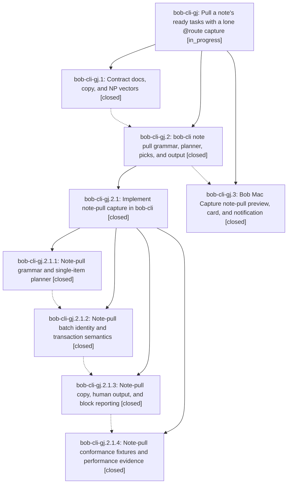

# Bead: bob-cli-gj — Pull a note's ready tasks with a lone @route capture

[Bead Pages](../README.md) / bob-cli-gj

**Status:** ◐ in_progress · **Type:** ▸ plan · **Tier:** epic
**Owner:** `bryanbugyi34@gmail.com` · **Created by:** [bbugyi200.athena.17g](https://github.com/bobs-org/bob-cli--agents/blob/main/sessions/bbugyi200.athena.17g.md) · **Assignee:** `bob-cli-gj.land`
**Created:** 2026-11-03 11:56:54 EST
**Plan:** [202611/note\_pull.md](https://github.com/bobs-org/bob-cli--plans/blob/main/202611/note_pull.md)

<!-- sase:links:start -->

## Links

| Relation | Artifact | Why |
| --- | --- | --- |
| implemented-by | [plan:202611/note_pull.md][1] | derived from the plan's `bead_id:` frontmatter field |

_Plus 1 automatic references — see [Referenced By](#referenced-by)._

[1]: https://github.com/bobs-org/bob-cli--plans/blob/main/202611/note_pull.md

<!-- sase:links:end -->

## Description

Capturing a lone `@foobar` item (in `bob capture` or Bob Mac Capture) opens the existing successor Pull-In choice. It lists every ready task that resides in `foobar.md`, previews where each would land, and links only the picked tasks into today's Pomodoros. The flow is atomic, explicit, and presented with one copy and visual system on every surface.

## Notes

[2026-11-03T19:41:36Z · bob-cli-gm.1] Grammar phase bob-cli-gm.1 took capture-language revision 9, one above the highest current code/docs claim. Keep revision 9 as execute and assist phases integrate; do not lower it.

[2026-11-04T00:06:46Z · bob-cli-gm.1.1.4] Activation phase bob-cli-gm.1.1.4 re-scanned the active code and docs claims and activated both target-run parsers at capture-language revision 9. Keep revision 9 as the open integration phases settle; do not lower it.

## Phases

| Bead | Title | Status | Size | Created | Agents | Commits |
|---|---|---|---|---|---:|---:|
| [bob-cli-gj.1](bob-cli-gj.1.md) | Contract docs, copy, and NP vectors | ✓ closed | medium | 2026-11-03 | 1 | 1 |
| [bob-cli-gj.2](bob-cli-gj.2.md) | bob-cli note pull grammar, planner, picks, and output | ✓ closed | large | 2026-11-03 | 1 | 0 |
| [bob-cli-gj.3](bob-cli-gj.3.md) | Bob Mac Capture note-pull preview, card, and notification | ✓ closed | medium | 2026-11-03 | 1 | 1 |

## Lineage

## Agents

| Agent | Bead | Commits |
|---|---|---:|
| [bbugyi200.athena.bob-cli-gj.1](https://github.com/bobs-org/bob-cli--agents/blob/main/sessions/bbugyi200.athena.bob-cli-gj.1.md) | [bob-cli-gj.1](bob-cli-gj.1.md) | 1 |
| [bbugyi200.athena.bob-cli-gj.2](https://github.com/bobs-org/bob-cli--agents/blob/main/sessions/bbugyi200.athena.bob-cli-gj.2.md) | [bob-cli-gj.2](bob-cli-gj.2.md) | 0 |
| [bbugyi200.athena.bob-cli-gj.2.1.1](https://github.com/bobs-org/bob-cli--agents/blob/main/agents/bbugyi200.athena.bob-cli-gj.2.1.1/README.md) | [bob-cli-gj.2.1.1](bob-cli-gj.2.1.1.md) | 1 |
| [bbugyi200.athena.bob-cli-gj.2.1.2](https://github.com/bobs-org/bob-cli--agents/blob/main/agents/bbugyi200.athena.bob-cli-gj.2.1.2/README.md) | [bob-cli-gj.2.1.2](bob-cli-gj.2.1.2.md) | 1 |
| [bbugyi200.athena.bob-cli-gj.2.1.3](https://github.com/bobs-org/bob-cli--agents/blob/main/agents/bbugyi200.athena.bob-cli-gj.2.1.3/README.md) | [bob-cli-gj.2.1.3](bob-cli-gj.2.1.3.md) | 1 |
| [bbugyi200.athena.bob-cli-gj.2.1.4](https://github.com/bobs-org/bob-cli--agents/blob/main/sessions/bbugyi200.athena.bob-cli-gj.2.1.4.md) | [bob-cli-gj.2.1.4](bob-cli-gj.2.1.4.md) | 1 |
| [bbugyi200.athena.bob-cli-gj.2.1.land](https://github.com/bobs-org/bob-cli--agents/blob/main/sessions/bbugyi200.athena.bob-cli-gj.2.1.land.md) | [bob-cli-gj.2.1](bob-cli-gj.2.1.md) | 2 |
| [bbugyi200.athena.bob-cli-gj.3](https://github.com/bobs-org/bob-cli--agents/blob/main/sessions/bbugyi200.athena.bob-cli-gj.3.md) | [bob-cli-gj.3](bob-cli-gj.3.md) | 1 |
| [bbugyi200.athena.bob-cli-gj.land](https://github.com/bobs-org/bob-cli--agents/blob/main/agents/bbugyi200.athena.bob-cli-gj.land/README.md) | [bob-cli-gj](README.md) | 0 |

## Commits

| Repo | Commit | Subject | Bead | Committed |
|---|---|---|---|---|
| bob-cli | [`fa077d2`](https://github.com/bobs-org/bob-cli/commit/fa077d2f8eb8783f2c6d9a65147ba9ef6844bcd8) | docs(contract): note-pull contract docs, copy, and NP vectors | [bob-cli-gj.1](bob-cli-gj.1.md) | 2026-11-03 12:21:39 EST |
| bob-cli | [`c673d14`](https://github.com/bobs-org/bob-cli/commit/c673d14439212e79443d231c81dc11204d10a25c) | feat(capture!): lone @route pulls its note's ready tasks | [bob-cli-gj.2.1.1](bob-cli-gj.2.1.1.md) | 2026-11-03 14:13:21 EST |
| bob-cli | [`a95d5d8`](https://github.com/bobs-org/bob-cli/commit/a95d5d8f0268c9f30cf7d2ff87d1145aca519a9f) | feat(capture): batch note-pull planning with ownership and ordering | [bob-cli-gj.2.1.2](bob-cli-gj.2.1.2.md) | 2026-11-03 14:54:57 EST |
| bob-cli | [`3d1822b`](https://github.com/bobs-org/bob-cli/commit/3d1822be51b4bd307474bb1d154fc2ed8e534eb2) | feat(capture): present note-pull offers | [bob-cli-gj.2.1.3](bob-cli-gj.2.1.3.md) | 2026-11-03 15:20:17 EST |
| bob-cli | [`093dcea`](https://github.com/bobs-org/bob-cli/commit/093dceade9085d57cbd4cdda96478258bed779b9) | feat(capture): add note-pull conformance evidence | [bob-cli-gj.2.1.4](bob-cli-gj.2.1.4.md) | 2026-11-03 17:25:17 EST |
| bob-cli | [`4db3200`](https://github.com/bobs-org/bob-cli/commit/4db3200cd6367c43a252322b66e3c6652e8a7295) | fix(capture)!: finish note-pull contract and landing | [bob-cli-gj.2.1](bob-cli-gj.2.1.md) | 2026-11-03 18:32:59 EST |
| bob-cli--plans | [`bob-cli--plans@fb73223`](https://github.com/bobs-org/bob-cli--plans/commit/fb73223e30d5f3cf42b8eac9dfd8801abae641d9) | docs(plans): mark note\_pull\_cli landing work done | [bob-cli-gj.2.1](bob-cli-gj.2.1.md) | 2026-11-04 09:44:22 EST |
| bob-mac-capture | [`bob-mac-capture@206c4b8`](https://github.com/bobs-org/bob-mac-capture/commit/206c4b834917163683cf4ebe8bafc02a965840dd) | feat(capture): present note-pull offers in Mac Capture | [bob-cli-gj.3](bob-cli-gj.3.md) | 2026-11-04 09:51:52 EST |

<!-- sase:referenced-by:start -->

## Referenced By

| Relation | Artifact | Why | Uses |
| --- | --- | --- | ---: |
| read-by | [agent:research.37.mus][1] | research ^^ picker vs pull-in lone @route successor model | 1 |

[1]: https://github.com/bobs-org/bob-cli--agents/blob/main/agents/bbugyi200.athena.research.37.mus/README.md

<!-- sase:referenced-by:end -->
