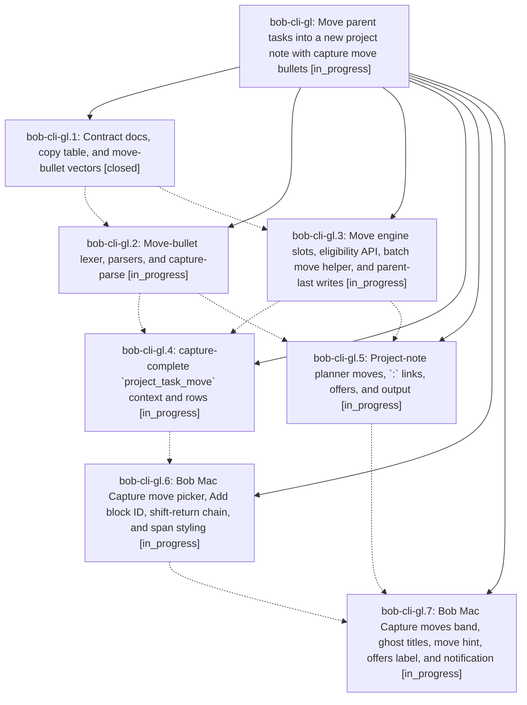

# Bead: bob-cli-gl — Move parent tasks into a new project note with capture move bullets

[Bead Pages](../README.md) / bob-cli-gl

**Status:** ◐ in_progress · **Type:** ▸ plan · **Tier:** epic
**Owner:** `bryanbugyi34@gmail.com` · **Created by:** [bbugyi200.apollo.research.35.linker.w0](https://github.com/bobs-org/bob-cli--agents/blob/main/sessions/bbugyi200.apollo.research.35.linker.w0.md) · **Assignee:** `bob-cli-gl.land`
**Created:** 2026-11-03 13:39:31 EST
**Plan:** [202611/capture\_move\_bullets.md](https://github.com/bobs-org/bob-cli--plans/blob/main/202611/capture_move_bullets.md)

<!-- sase:links:start -->

## Links

| Relation | Artifact | Why |
| --- | --- | --- |
| implemented-by | [plan:202611/capture_move_bullets.md][1] | derived from the plan's `bead_id:` frontmatter field |

[1]: https://github.com/bobs-org/bob-cli--plans/blob/main/202611/capture_move_bullets.md

<!-- sase:links:end -->

## Description

When a capture item creates a project note with `@foo^bar@` or `@foo:bar@`, a first-level bullet that holds only `^<id>` (or `:<id>`) moves that open task, with its whole block, from the parent note `foo.md` into the new `foo_bar.md`. The task lands in draft order, and `:` also makes it Next and links it. Typing `^` or `:` after `- ` in such an item opens a Bob Mac Capture move picker that lists the parent's open tasks, including tasks without a block ID. The preview names every move before submit. The batch is atomic and replaces the parent last, so an interrupted write can duplicate a task but never lose one.

## Phases

| Bead | Title | Status | Size | Created | Agents | Commits |
|---|---|---|---|---|---:|---:|
| [bob-cli-gl.1](bob-cli-gl.1.md) | Contract docs, copy table, and move-bullet vectors | ✓ closed | medium | 2026-11-03 | 1 | 1 |
| [bob-cli-gl.2](bob-cli-gl.2.md) | Move-bullet lexer, parsers, and capture-parse | ◐ in_progress | medium | 2026-11-03 | 1 | 0 |
| [bob-cli-gl.3](bob-cli-gl.3.md) | Move engine slots, eligibility API, batch move helper, and parent-last writes | ◐ in_progress | medium | 2026-11-03 | 1 | 0 |
| [bob-cli-gl.4](bob-cli-gl.4.md) | capture-complete \`project\_task\_move\` context and rows | ◐ in_progress | medium | 2026-11-03 | 1 | 0 |
| [bob-cli-gl.5](bob-cli-gl.5.md) | Project-note planner moves, \`:\` links, offers, and output | ◐ in_progress | large | 2026-11-03 | 1 | 0 |
| [bob-cli-gl.6](bob-cli-gl.6.md) | Bob Mac Capture move picker, Add block ID, shift-return chain, and span styling | ◐ in_progress | medium | 2026-11-03 | 1 | 0 |
| [bob-cli-gl.7](bob-cli-gl.7.md) | Bob Mac Capture moves band, ghost titles, move hint, offers label, and notification | ◐ in_progress | medium | 2026-11-03 | 1 | 0 |

## Lineage

## Agents

| Agent | Bead | Commits |
|---|---|---:|
| [bbugyi200.apollo.bob-cli-gl.1](https://github.com/bobs-org/bob-cli--agents/blob/main/agents/bbugyi200.apollo.bob-cli-gl.1/README.md) | [bob-cli-gl.1](bob-cli-gl.1.md) | 1 |
| [bbugyi200.apollo.bob-cli-gl.2](https://github.com/bobs-org/bob-cli--agents/blob/main/agents/bbugyi200.apollo.bob-cli-gl.2/README.md) | [bob-cli-gl.2](bob-cli-gl.2.md) | 0 |
| [bbugyi200.apollo.bob-cli-gl.3](https://github.com/bobs-org/bob-cli--agents/blob/main/agents/bbugyi200.apollo.bob-cli-gl.3/README.md) | [bob-cli-gl.3](bob-cli-gl.3.md) | 0 |
| [bbugyi200.apollo.bob-cli-gl.4](https://github.com/bobs-org/bob-cli--agents/blob/main/agents/bbugyi200.apollo.bob-cli-gl.4/README.md) | [bob-cli-gl.4](bob-cli-gl.4.md) | 0 |
| [bbugyi200.apollo.bob-cli-gl.5](https://github.com/bobs-org/bob-cli--agents/blob/main/agents/bbugyi200.apollo.bob-cli-gl.5/README.md) | [bob-cli-gl.5](bob-cli-gl.5.md) | 0 |
| [bbugyi200.apollo.bob-cli-gl.6](https://github.com/bobs-org/bob-cli--agents/blob/main/agents/bbugyi200.apollo.bob-cli-gl.6/README.md) | [bob-cli-gl.6](bob-cli-gl.6.md) | 0 |
| [bbugyi200.apollo.bob-cli-gl.7](https://github.com/bobs-org/bob-cli--agents/blob/main/agents/bbugyi200.apollo.bob-cli-gl.7/README.md) | [bob-cli-gl.7](bob-cli-gl.7.md) | 0 |
| [bbugyi200.apollo.bob-cli-gl.land](https://github.com/bobs-org/bob-cli--agents/blob/main/agents/bbugyi200.apollo.bob-cli-gl.land/README.md) | [bob-cli-gl](README.md) | 0 |

## Commits

| Repo | Commit | Subject | Bead | Committed |
|---|---|---|---|---|
| bob-cli | [`27f508b`](https://github.com/bobs-org/bob-cli/commit/27f508bd2b3940a8efb2e44effc0e9ad13fe8e3f) | docs(capture): specify move-bullet contract | [bob-cli-gl.1](bob-cli-gl.1.md) | 2026-11-03 13:57:26 EST |
