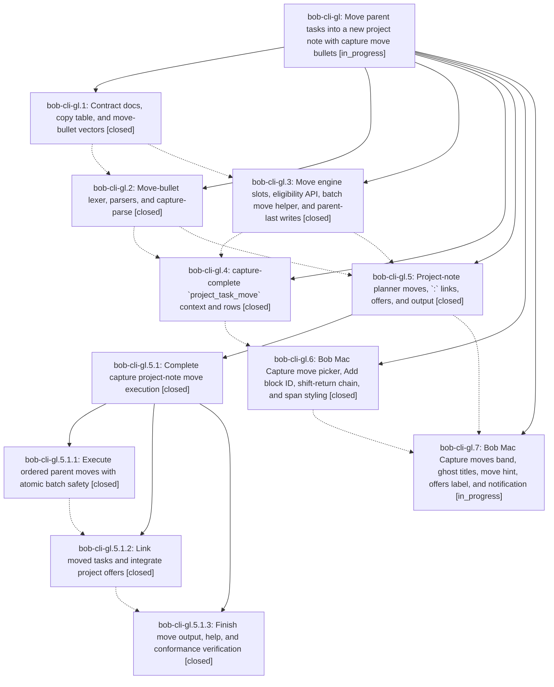

# Bead: bob-cli-gl — Move parent tasks into a new project note with capture move bullets

[Bead Pages](../README.md) / bob-cli-gl

**Status:** ◐ in_progress · **Type:** ▸ plan · **Tier:** epic
**Owner:** `bryanbugyi34@gmail.com` · **Created by:** [bbugyi200.apollo.research.35.linker.w0](https://github.com/bobs-org/bob-cli--agents/blob/main/sessions/bbugyi200.apollo.research.35.linker.w0.md) · **Assignee:** `bob-cli-gl.land`
**Created:** 2026-11-03 13:39:31 EST
**Plan:** [202611/capture\_move\_bullets.md](https://github.com/bobs-org/bob-cli--plans/blob/main/202611/capture_move_bullets.md)

<!-- sase:links:start -->

## Links

| Relation | Artifact | Why |
| --- | --- | --- |
| implemented-by | [plan:202611/capture_move_bullets.md][1] | derived from the plan's `bead_id:` frontmatter field |

_Plus 3 automatic references — see [Referenced By](#referenced-by)._

[1]: https://github.com/bobs-org/bob-cli--plans/blob/main/202611/capture_move_bullets.md

<!-- sase:links:end -->

## Description

When a capture item creates a project note with `@foo^bar@` or `@foo:bar@`, a first-level bullet that holds only `^<id>` (or `:<id>`) moves that open task, with its whole block, from the parent note `foo.md` into the new `foo_bar.md`. The task lands in draft order, and `:` also makes it Next and links it. Typing `^` or `:` after `- ` in such an item opens a Bob Mac Capture move picker that lists the parent's open tasks, including tasks without a block ID. The preview names every move before submit. The batch is atomic and replaces the parent last, so an interrupted write can duplicate a task but never lose one.

## Phases

| Bead | Title | Status | Size | Created | Agents | Commits |
|---|---|---|---|---|---:|---:|
| [bob-cli-gl.1](bob-cli-gl.1.md) | Contract docs, copy table, and move-bullet vectors | ✓ closed | medium | 2026-11-03 | 1 | 1 |
| [bob-cli-gl.2](bob-cli-gl.2.md) | Move-bullet lexer, parsers, and capture-parse | ✓ closed | medium | 2026-11-03 | 1 | 1 |
| [bob-cli-gl.3](bob-cli-gl.3.md) | Move engine slots, eligibility API, batch move helper, and parent-last writes | ✓ closed | medium | 2026-11-03 | 1 | 1 |
| [bob-cli-gl.4](bob-cli-gl.4.md) | capture-complete \`project\_task\_move\` context and rows | ✓ closed | medium | 2026-11-03 | 1 | 1 |
| [bob-cli-gl.5](bob-cli-gl.5.md) | Project-note planner moves, \`:\` links, offers, and output | ✓ closed | large | 2026-11-03 | 1 | 0 |
| [bob-cli-gl.6](bob-cli-gl.6.md) | Bob Mac Capture move picker, Add block ID, shift-return chain, and span styling | ✓ closed | medium | 2026-11-03 | 1 | 0 |
| [bob-cli-gl.7](bob-cli-gl.7.md) | Bob Mac Capture moves band, ghost titles, move hint, offers label, and notification | ◐ in_progress | medium | 2026-11-03 | 1 | 0 |

## Lineage

## Agents

| Agent | Bead | Commits |
|---|---|---:|
| [bbugyi200.apollo.bob-cli-gl.1](https://github.com/bobs-org/bob-cli--agents/blob/main/agents/bbugyi200.apollo.bob-cli-gl.1/README.md) | [bob-cli-gl.1](bob-cli-gl.1.md) | 1 |
| [bbugyi200.apollo.bob-cli-gl.2](https://github.com/bobs-org/bob-cli--agents/blob/main/agents/bbugyi200.apollo.bob-cli-gl.2/README.md) | [bob-cli-gl.2](bob-cli-gl.2.md) | 1 |
| [bbugyi200.apollo.bob-cli-gl.3](https://github.com/bobs-org/bob-cli--agents/blob/main/agents/bbugyi200.apollo.bob-cli-gl.3/README.md) | [bob-cli-gl.3](bob-cli-gl.3.md) | 1 |
| [bbugyi200.apollo.bob-cli-gl.4](https://github.com/bobs-org/bob-cli--agents/blob/main/agents/bbugyi200.apollo.bob-cli-gl.4/README.md) | [bob-cli-gl.4](bob-cli-gl.4.md) | 1 |
| [bbugyi200.apollo.bob-cli-gl.5](https://github.com/bobs-org/bob-cli--agents/blob/main/sessions/bbugyi200.apollo.bob-cli-gl.5.md) | [bob-cli-gl.5](bob-cli-gl.5.md) | 0 |
| [bbugyi200.apollo.bob-cli-gl.5.1.1](https://github.com/bobs-org/bob-cli--agents/blob/main/sessions/bbugyi200.apollo.bob-cli-gl.5.1.1.md) | [bob-cli-gl.5.1.1](bob-cli-gl.5.1.1.md) | 1 |
| [bbugyi200.apollo.bob-cli-gl.5.1.2](https://github.com/bobs-org/bob-cli--agents/blob/main/sessions/bbugyi200.apollo.bob-cli-gl.5.1.2.md) | [bob-cli-gl.5.1.2](bob-cli-gl.5.1.2.md) | 1 |
| [bbugyi200.apollo.bob-cli-gl.5.1.3](https://github.com/bobs-org/bob-cli--agents/blob/main/sessions/bbugyi200.apollo.bob-cli-gl.5.1.3.md) | [bob-cli-gl.5.1.3](bob-cli-gl.5.1.3.md) | 1 |
| [bbugyi200.apollo.bob-cli-gl.5.1.land](https://github.com/bobs-org/bob-cli--agents/blob/main/sessions/bbugyi200.apollo.bob-cli-gl.5.1.land.md) | [bob-cli-gl.5.1](bob-cli-gl.5.1.md) | 2 |
| [bbugyi200.apollo.bob-cli-gl.6](https://github.com/bobs-org/bob-cli--agents/blob/main/agents/bbugyi200.apollo.bob-cli-gl.6/README.md) | [bob-cli-gl.6](bob-cli-gl.6.md) | 0 |
| [bbugyi200.apollo.bob-cli-gl.7](https://github.com/bobs-org/bob-cli--agents/blob/main/agents/bbugyi200.apollo.bob-cli-gl.7/README.md) | [bob-cli-gl.7](bob-cli-gl.7.md) | 0 |
| [bbugyi200.apollo.bob-cli-gl.land](https://github.com/bobs-org/bob-cli--agents/blob/main/agents/bbugyi200.apollo.bob-cli-gl.land/README.md) | [bob-cli-gl](README.md) | 0 |

## Commits

| Repo | Commit | Subject | Bead | Committed |
|---|---|---|---|---|
| bob-cli | [`27f508b`](https://github.com/bobs-org/bob-cli/commit/27f508bd2b3940a8efb2e44effc0e9ad13fe8e3f) | docs(capture): specify move-bullet contract | [bob-cli-gl.1](bob-cli-gl.1.md) | 2026-11-03 13:57:26 EST |
| bob-cli | [`cf1e464`](https://github.com/bobs-org/bob-cli/commit/cf1e46442bf7dca5bedfeeba9571ca3b5b3bbc37) | feat(capture): add ordered batch task moves | [bob-cli-gl.3](bob-cli-gl.3.md) | 2026-11-03 14:28:20 EST |
| bob-cli | [`b94eec2`](https://github.com/bobs-org/bob-cli/commit/b94eec2c04ba7f9730ff605df4116f3928b62825) | feat(capture)!: parse move bullets in sealed project-note items | [bob-cli-gl.2](bob-cli-gl.2.md) | 2026-11-03 16:00:43 EST |
| bob-cli | [`b8688d9`](https://github.com/bobs-org/bob-cli/commit/b8688d9ef802f719d5ee46f02d3b87c1080fcaa2) | feat(capture)!: add project task move completion | [bob-cli-gl.4](bob-cli-gl.4.md) | 2026-11-03 17:02:59 EST |
| bob-cli | [`6650faa`](https://github.com/bobs-org/bob-cli/commit/6650faa30491c8f7f39c2657bdbe8676ec97c6f6) | feat(capture): execute ordered project-note moves | [bob-cli-gl.5.1.1](bob-cli-gl.5.1.1.md) | 2026-11-03 17:45:01 EST |
| bob-cli | [`14a5773`](https://github.com/bobs-org/bob-cli/commit/14a577321f81119ccb24dc41c81caa9aa9af8650) | feat(capture): link moved tasks and integrate project offers | [bob-cli-gl.5.1.2](bob-cli-gl.5.1.2.md) | 2026-11-03 19:29:57 EST |
| bob-cli | [`ddb0a73`](https://github.com/bobs-org/bob-cli/commit/ddb0a73f1ead67088b89f07ba81946efb08d5a11) | feat(capture): show project-note moves and eligibility hints | [bob-cli-gl.5.1.3](bob-cli-gl.5.1.3.md) | 2026-11-03 20:24:37 EST |
| bob-cli | [`b738d8f`](https://github.com/bobs-org/bob-cli/commit/b738d8f23b21ac855d83745bdd415af52dfbdc98) | feat(capture): repair project-note move landing integration | [bob-cli-gl.5.1](bob-cli-gl.5.1.md) | 2026-11-03 21:29:14 EST |
| bob-cli--plans | [`bob-cli--plans@551c233`](https://github.com/bobs-org/bob-cli--plans/commit/551c23375da88cc0a2a4d4e6a8c11bf615060f9d) | chore(plans): mark capture\_move\_execution done for gl.5.1 landing | [bob-cli-gl.5.1](bob-cli-gl.5.1.md) | 2026-11-03 21:30:05 EST |

<!-- sase:referenced-by:start -->

## Referenced By

| Relation | Artifact | Why | Uses |
| --- | --- | --- | ---: |
| read-by | [agent:bob-cli-gl.2][1] | epic scope and decisions | 1 |
| read-by | [agent:bob-cli-gl.6][2] | Need epic and phase scope, notes, and plan linkage | 1 |
| read-by | [agent:research.36.final][3] | Check move-bullets epic status since > move reuses the batch move adapter | 1 |

[1]: https://github.com/bobs-org/bob-cli--agents/blob/main/agents/bbugyi200.apollo.bob-cli-gl.2/README.md
[2]: https://github.com/bobs-org/bob-cli--agents/blob/main/agents/bbugyi200.apollo.bob-cli-gl.6/README.md
[3]: https://github.com/bobs-org/bob-cli--agents/blob/main/agents/bbugyi200.apollo.research.36.final/README.md

<!-- sase:referenced-by:end -->
