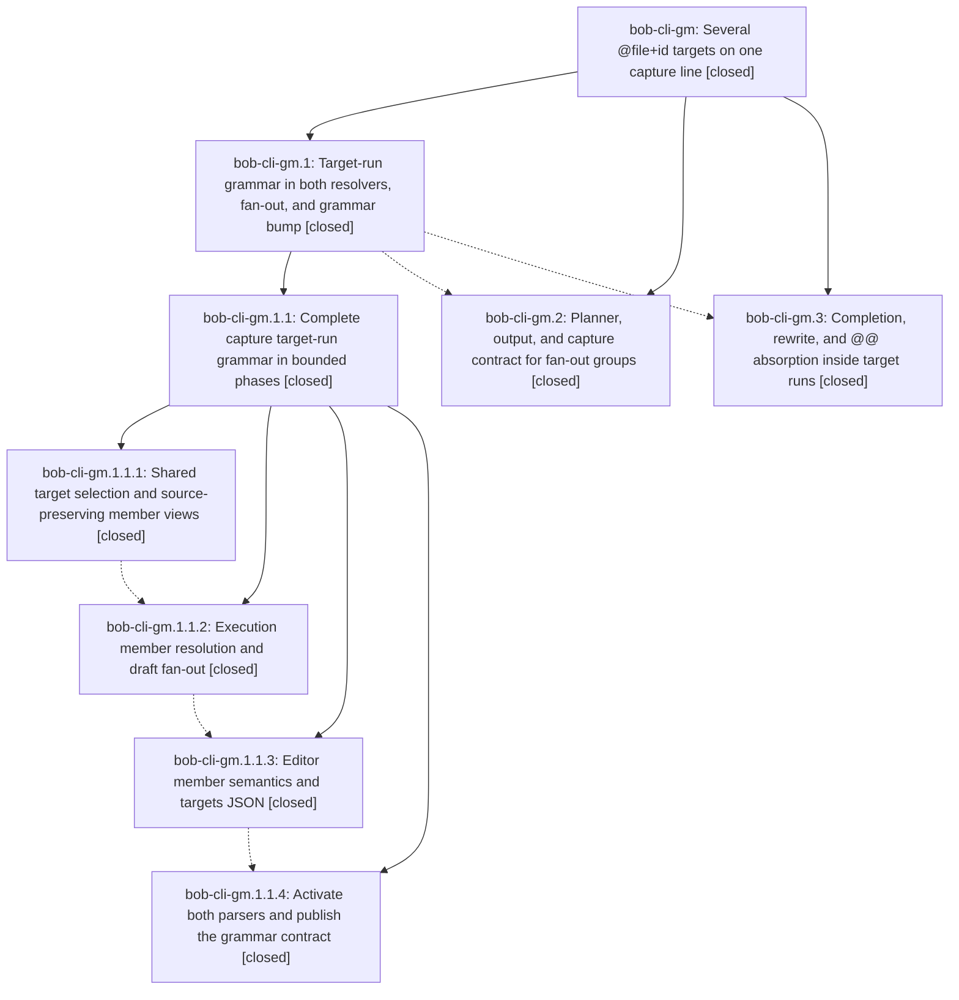

# Bead: bob-cli-gm — Several @file+id targets on one capture line

[Bead Pages](../README.md) / bob-cli-gm

**Status:** ✓ closed · **Resolution:** done · **Type:** ▸ plan · **Tier:** epic
**Owner:** `bryanbugyi34@gmail.com` · **Created by:** [bbugyi200.athena.17k](https://github.com/bobs-org/bob-cli--agents/blob/main/sessions/bbugyi200.athena.17k.md) · **Assignee:** `bob-cli-gm.land`
**Created:** 2026-11-03 13:55:33 EST · **Closed:** 2026-11-03 23:34:24 EST
**Plan:** [202611/capture\_multi\_target.md](https://github.com/bobs-org/bob-cli--plans/blob/main/202611/capture_multi_target.md)

<!-- sase:links:start -->

## Links

| Relation | Artifact | Why |
| --- | --- | --- |
| implemented-by | [plan:202611/capture_multi_target.md][1] | derived from the plan's `bead_id:` frontmatter field |

_Plus 3 automatic references — see [Referenced By](#referenced-by)._

[1]: https://github.com/bobs-org/bob-cli--plans/blob/main/202611/capture_multi_target.md

<!-- sase:links:end -->

## Description

One capture line may name several existing tasks with adjacent `@route+block-id` markers. Its note text, the bullets below it, and every operation on the line (clipboard notes, `s:`/`$`, `#type`, `&`/`*`/`~`, Ensure Next, `!` toggle, drawers) then apply to each named task in one atomic capture. `bob capture`, `capture-parse`, `capture-complete`, and `capture-rewrite` agree on the grammar, and Bob Mac Capture keeps working unchanged.

## Notes

[2026-11-04T03:39:55Z · bob-cli-gl.land] DISCOVERED ISSUE from bob-cli-gl.land: d19a8d92 (bob-cli-gm.3) committed docs/reference/cli/task.md with trailing whitespace on 8 blank help lines, so 'just check' failed docs_reference::cli_reference_is_current ('CLI reference drifted; run just docs-gen') on master d19a8d92 (3013 passed, 1 failed). The diff is whitespace-only (git diff -w is empty). bob-cli-gl.land regenerated the golden with BOB_UPDATE_GOLDENS=1 cargo test --test cli docs_reference and committed it in its landing commit; if gm.2 regenerates too, the content is identical. No separate task.

[2026-11-04T03:41:26Z · bob-cli-go.4.1.land] DISCOVERED ISSUE resolved during bob-cli-go.4.1 landing: d19a8d92 introduced eight whitespace-only blank lines in generated docs/reference/cli/task.md. Clean e253ce17 just check (ToolRun c518d637f694f3611f2960783de89349) failed only docs_reference::cli_reference_is_current (3013 other CLI tests passed). Regenerated through the canonical docs-reference test; retained only the eight-line task.md cleanup. The non-update golden test now passes. No task duplicate found by same-type and all-type searches; this is a small integration repair, not remaining gm or engine work.

[2026-11-04T03:51:08Z · bob-cli-gm.land] LAND AUDIT / FOLLOW-UP TRIAGE at 66828cfd: Read the epic, all three direct children, nested gm.1.1 and all four phases, every note, both approved plan artifacts, epic commits d1f34842/a7c4b07f/6a5b69b0/c341649a/ebedfca8/d19a8d92/66828cfd, and relevant current parser/planner/editor/output source. Final DECISIONS honored: split_edges=refuse, memory_bulk_capture=no, grammar 9 retained, no memory/version/changelog edits in gm commits. All PROPOSED FOLLOW-UP outcomes via sase_new_task: (1) gm.1 #1 incomplete-target example is resolved by the approved child plan explicitly preserving singleton Need::Task; declined an independent task. (2) gm.2 #1, gm.3 #2, gm.1.1.4 #1 are one glossary-format defect; uv run --project tools/docs bob-docs gen --check independently exits 2 on this clean tree for task-merge.md missing front matter. Corroborated causal active epic bob-cli-go, whose go.13 owns accepted glossary output; no separate task or memory edit. (3) gm.3 #1 task-split catalog/kinds/help/lint fallout is repaired in ebedfca8; gm.2 records a subsequent just check pass. Declined new stale CI task. (4) gm.1.1.4 #2 catalog counts are repaired by dd90f8c7 and ebedfca8 (now 70); appended resolution evidence to existing bob-cli-de, no stale +1 or duplicate. Same/all-type searches, last-week task sweep, and active-epic scope review completed. Epic notes #1-2 generated task.md whitespace is repaired by 66828cfd itself. Current epic-symbols is empty; no symvision recipe; epic has no parent.

[2026-11-04T03:51:12Z · bob-cli-gm.land] REMAINING WORK / INTEGRATION AUDIT: Source review found two epic defects despite closed phases. completion_field_at still calls singleton extract_terminal_markers and does not mask neighboring percent directives before completion_marker_index; for a valid leading run such as @work+a s:3 @dev+ note, the scan stops the run at s:3 and cannot offer dev tasks. The same gap applies to an interleaved %c, and leading $/trailing multi-member edge variants need regression coverage. validate_fanout_target_group lowercases resolved task block IDs, so distinct ^A and ^a in one note collide despite exact NoteTaskScan::by_block_id and exact lexical duplicate identity. print_fanout_summary also omits the approved dim styling. These are remaining gm work, not separate tasks. Runtime repro on current source still needed: this checkout has no compiled bob, and installed bob reports grammar 7, so it was rejected as evidence. Fetched origin; master and origin/master both 66828cfd with no PR divergence. Reviewed all 15 non-gm commits since d1f34842: note-pull ordering/net ownership; project move staging, tracker remaps and output; shared drawer/transplant and locator helpers; attachment path normalization; task split catalog/help; merge-offer additive metadata; period changes. Existing source retains these integrations, but remaining tale must exercise mixed note-pull/project-move plus fan-out batches against staged snapshots and preserve optional moved_from/merged_from omission. A medium tale will repair only identity/completion/header gaps, add focused regressions and those integration checks, run just check, and close gm itself in the same final coding turn. No check-full.

[2026-11-04T04:34:24Z · bob-cli-gm.land] Implemented and verified the approved multi-target capture closeout. Preserved grammar revision 9, singleton behavior, split_edges=refuse, memory_bulk_capture=no, staged atomic planning, clipboard/schedule behavior, and legacy first-member fields; no package version or CHANGELOG changes. Fixed case-sensitive resolved block identity so ^A and ^a remain distinct, selected-run completion across transparent schedule/priority/type/directive markers while preserving source byte offsets, and dimmed the human targets header. Added completion, rewrite, duplicate-refusal, NO_COLOR/forced-color, mixed note-pull, and mixed project-move integration coverage, including dry-run, staged destination reports, and rollback on a later failure. Verification: `sase tool run check` succeeded (ToolRun 0bcfc4eeece5d42bb9a9245eef6b12b8); focused completion unit tests 77 passed; target-run unit tests 42 passed; multi-target CLI tests 16 passed; interleaved rewrite CLI test 1 passed; scratch-vault public target-run parse/dry-run test passed; `git diff --check` passed. `just docs-check` passed bob-docs lint but its generator stage remains blocked by the known missing front matter in `sase/memory/glossary/task-merge.md`, owned by bob-cli-go go.13; no memory edit made. Resolved prior notes: gm.1 #1 is covered by the approved singleton contract; gm.3 #1 split fallout was fixed at ebedfca8 and current check passes; the duplicate catalog-count issue was fixed at dd90f8c7/ebedfca8 and recorded on bob-cli-de; generated task.md whitespace was fixed at 66828cfd; the docs generator issue remains with go.13. No new task or memory change was warranted. Post-audit commit 7cf07746 only removed now-unused allow attributes and does not conflict. `just symvision` has no recipe in this checkout. All direct phases and nested children are closed; no epic-symbol entries remain.

## Phases

| Bead | Title | Status | Size | Created | Agents | Commits |
|---|---|---|---|---|---:|---:|
| [bob-cli-gm.1](bob-cli-gm.1.md) | Target-run grammar in both resolvers, fan-out, and grammar bump | ✓ closed | large | 2026-11-03 | 1 | 0 |
| [bob-cli-gm.2](bob-cli-gm.2.md) | Planner, output, and capture contract for fan-out groups | ✓ closed | medium | 2026-11-03 | 1 | 1 |
| [bob-cli-gm.3](bob-cli-gm.3.md) | Completion, rewrite, and @@ absorption inside target runs | ✓ closed | medium | 2026-11-03 | 1 | 1 |

## Lineage

## Agents

| Agent | Bead | Commits |
|---|---|---:|
| [bbugyi200.athena.bob-cli-gm.1](https://github.com/bobs-org/bob-cli--agents/blob/main/sessions/bbugyi200.athena.bob-cli-gm.1.md) | [bob-cli-gm.1](bob-cli-gm.1.md) | 0 |
| [bbugyi200.athena.bob-cli-gm.1.1.1](https://github.com/bobs-org/bob-cli--agents/blob/main/agents/bbugyi200.athena.bob-cli-gm.1.1.1/README.md) | [bob-cli-gm.1.1.1](bob-cli-gm.1.1.1.md) | 1 |
| [bbugyi200.athena.bob-cli-gm.1.1.2](https://github.com/bobs-org/bob-cli--agents/blob/main/agents/bbugyi200.athena.bob-cli-gm.1.1.2/README.md) | [bob-cli-gm.1.1.2](bob-cli-gm.1.1.2.md) | 1 |
| [bbugyi200.athena.bob-cli-gm.1.1.3](https://github.com/bobs-org/bob-cli--agents/blob/main/agents/bbugyi200.athena.bob-cli-gm.1.1.3/README.md) | [bob-cli-gm.1.1.3](bob-cli-gm.1.1.3.md) | 1 |
| [bbugyi200.athena.bob-cli-gm.1.1.4](https://github.com/bobs-org/bob-cli--agents/blob/main/sessions/bbugyi200.athena.bob-cli-gm.1.1.4.md) | [bob-cli-gm.1.1.4](bob-cli-gm.1.1.4.md) | 1 |
| [bbugyi200.athena.bob-cli-gm.1.1.land](https://github.com/bobs-org/bob-cli--agents/blob/main/sessions/bbugyi200.athena.bob-cli-gm.1.1.land.md) | [bob-cli-gm.1.1](bob-cli-gm.1.1.md) | 2 |
| [bbugyi200.athena.bob-cli-gm.2](https://github.com/bobs-org/bob-cli--agents/blob/main/sessions/bbugyi200.athena.bob-cli-gm.2.md) | [bob-cli-gm.2](bob-cli-gm.2.md) | 1 |
| [bbugyi200.athena.bob-cli-gm.3](https://github.com/bobs-org/bob-cli--agents/blob/main/agents/bbugyi200.athena.bob-cli-gm.3/README.md) | [bob-cli-gm.3](bob-cli-gm.3.md) | 1 |
| [bbugyi200.athena.bob-cli-gm.land](https://github.com/bobs-org/bob-cli--agents/blob/main/sessions/bbugyi200.athena.bob-cli-gm.land.md) | [bob-cli-gm](README.md) | 2 |

## Commits

| Repo | Commit | Subject | Bead | Committed |
|---|---|---|---|---|
| bob-cli | [`d1f3484`](https://github.com/bobs-org/bob-cli/commit/d1f3484200081294a96bcd029654b7545d7b7305) | feat(capture): add shared target-run selection staging | [bob-cli-gm.1.1.1](bob-cli-gm.1.1.1.md) | 2026-11-03 17:24:23 EST |
| bob-cli | [`a7c4b07`](https://github.com/bobs-org/bob-cli/commit/a7c4b07fe07fa809a4f22b3aafdff94b0012134d) | feat(capture): fan out selected target runs | [bob-cli-gm.1.1.2](bob-cli-gm.1.1.2.md) | 2026-11-03 18:09:46 EST |
| bob-cli | [`6a5b69b`](https://github.com/bobs-org/bob-cli/commit/6a5b69b081ee8d11ebc191d233aebe6f4ebe15fd) | feat(capture): combine editor target runs into one item with targets | [bob-cli-gm.1.1.3](bob-cli-gm.1.1.3.md) | 2026-11-03 18:49:25 EST |
| bob-cli | [`c341649`](https://github.com/bobs-org/bob-cli/commit/c341649a46ad1dd58f81a0be4f3930b9315964c8) | feat(capture): activate multi-target capture runs | [bob-cli-gm.1.1.4](bob-cli-gm.1.1.4.md) | 2026-11-03 19:53:10 EST |
| bob-cli | [`ebedfca`](https://github.com/bobs-org/bob-cli/commit/ebedfca8e666a9a79e9cc2989aca0a6b78edd983) | feat(capture)!: complete target-run grammar and landing | [bob-cli-gm.1.1](bob-cli-gm.1.1.md) | 2026-11-03 21:13:52 EST |
| bob-cli--plans | [`bob-cli--plans@c7dd457`](https://github.com/bobs-org/bob-cli--plans/commit/c7dd4577898944f1a6e05ae31c3bff3e31802ef3) | docs(plan): mark target-run landing complete | [bob-cli-gm.1.1](bob-cli-gm.1.1.md) | 2026-11-03 21:14:17 EST |
| bob-cli | [`d19a8d9`](https://github.com/bobs-org/bob-cli/commit/d19a8d92f9641416d936697445deb19086af851c) | feat(capture): complete and rewrite inside target runs | [bob-cli-gm.3](bob-cli-gm.3.md) | 2026-11-03 21:59:49 EST |
| bob-cli | [`66828cf`](https://github.com/bobs-org/bob-cli/commit/66828cfd83236c78e2844926c12cd12c861c3c5c) | feat(capture): execute adjacent task target runs | [bob-cli-gm.2](bob-cli-gm.2.md) | 2026-11-03 22:28:47 EST |
| bob-cli | [`97b9d13`](https://github.com/bobs-org/bob-cli/commit/97b9d13108770debd96f1a9d19363cbfa02214d9) | fix(capture): handle multi-target completion edge cases | [bob-cli-gm](README.md) | 2026-11-03 23:37:03 EST |
| bob-cli--plans | [`bob-cli--plans@ac70c33`](https://github.com/bobs-org/bob-cli--plans/commit/ac70c336b29761ec4d12fccba302a41741391953) | docs(plans): mark multi-target capture implemented | [bob-cli-gm](README.md) | 2026-11-03 23:37:28 EST |

<!-- sase:referenced-by:start -->

## Referenced By

| Relation | Artifact | Why | Uses |
| --- | --- | --- | ---: |
| read-by | [agent:bob-cli-gl.land][1] | Check whether the target-run epic that caused CLI reference drift is still active | 1 |
| read-by | [agent:bob-cli-gm.3][2] | Need epic plan coordination for parallel phases | 2 |
| read-by | [agent:research.36.final][3] | Check multi-target epic decisions section for split_edges choice | 2 |

[1]: https://github.com/bobs-org/bob-cli--agents/blob/main/agents/bbugyi200.athena.bob-cli-gl.land/README.md
[2]: https://github.com/bobs-org/bob-cli--agents/blob/main/agents/bbugyi200.athena.bob-cli-gm.3/README.md
[3]: https://github.com/bobs-org/bob-cli--agents/blob/main/agents/bbugyi200.athena.research.36.final/README.md

<!-- sase:referenced-by:end -->
