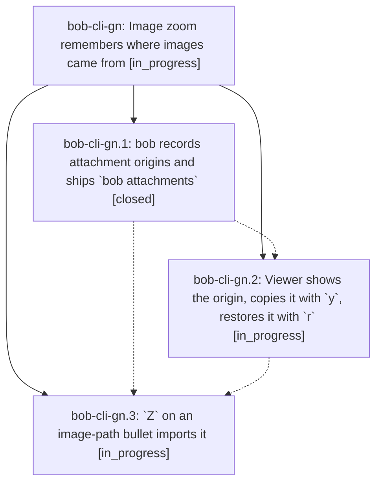

# Bead: bob-cli-gn — Image zoom remembers where images came from

[Bead Pages](../README.md) / bob-cli-gn

**Status:** ◐ in_progress · **Type:** ▸ plan · **Tier:** epic
**Owner:** `bryanbugyi34@gmail.com` · **Created by:** [bbugyi200.athena.17n](https://github.com/bobs-org/bob-cli--agents/blob/main/sessions/bbugyi200.athena.17n.md) · **Assignee:** `bob-cli-gn.land`
**Created:** 2026-11-03 14:53:40 EST
**Plan:** [202611/image\_zoom\_origins.md](https://github.com/bobs-org/bob-cli--plans/blob/main/202611/image_zoom_origins.md)

<!-- sase:links:start -->

## Links

| Relation | Artifact | Why |
| --- | --- | --- |
| implemented-by | [plan:202611/image_zoom_origins.md][1] | derived from the plan's `bead_id:` frontmatter field |

[1]: https://github.com/bobs-org/bob-cli--plans/blob/main/202611/image_zoom_origins.md

<!-- sase:links:end -->

## Description

Every image bob copies into the vault remembers its original file path. The `Z` viewer can copy that path (`y`) or turn the link back into it (`r`), and `Z` on a bullet holding only an image path imports it the way `%c` does. One beautiful, undoable loop: path → embed → path.

## Phases

| Bead | Title | Status | Size | Created | Agents | Commits |
|---|---|---|---|---|---:|---:|
| [bob-cli-gn.1](bob-cli-gn.1.md) | bob records attachment origins and ships \`bob attachments\` | ✓ closed | medium | 2026-11-03 | 1 | 1 |
| [bob-cli-gn.2](bob-cli-gn.2.md) | Viewer shows the origin, copies it with \`y\`, restores it with \`r\` | ◐ in_progress | medium | 2026-11-03 | 1 | 0 |
| [bob-cli-gn.3](bob-cli-gn.3.md) | \`Z\` on an image-path bullet imports it | ◐ in_progress | small | 2026-11-03 | 1 | 0 |

## Lineage

## Agents

| Agent | Bead | Commits |
|---|---|---:|
| [bbugyi200.athena.bob-cli-gn.1](https://github.com/bobs-org/bob-cli--agents/blob/main/sessions/bbugyi200.athena.bob-cli-gn.1.md) | [bob-cli-gn.1](bob-cli-gn.1.md) | 1 |
| [bbugyi200.athena.bob-cli-gn.2](https://github.com/bobs-org/bob-cli--agents/blob/main/agents/bbugyi200.athena.bob-cli-gn.2/README.md) | [bob-cli-gn.2](bob-cli-gn.2.md) | 0 |
| [bbugyi200.athena.bob-cli-gn.3](https://github.com/bobs-org/bob-cli--agents/blob/main/agents/bbugyi200.athena.bob-cli-gn.3/README.md) | [bob-cli-gn.3](bob-cli-gn.3.md) | 0 |
| [bbugyi200.athena.bob-cli-gn.land](https://github.com/bobs-org/bob-cli--agents/blob/main/agents/bbugyi200.athena.bob-cli-gn.land/README.md) | [bob-cli-gn](README.md) | 0 |

## Commits

| Repo | Commit | Subject | Bead | Committed |
|---|---|---|---|---|
| bob-cli | [`0b4cebd`](https://github.com/bobs-org/bob-cli/commit/0b4cebdf90cdd8fb8bb69ed60e07b2936c480906) | feat(attachments): record attachment origins and ship bob attachments | [bob-cli-gn.1](bob-cli-gn.1.md) | 2026-11-03 16:32:51 EST |
