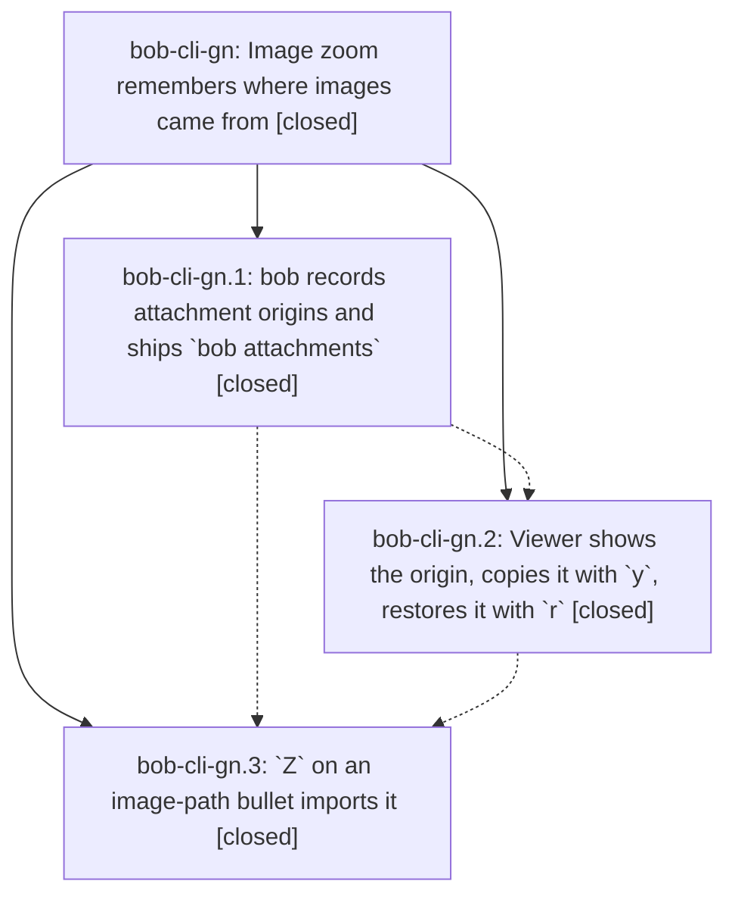

# Bead: bob-cli-gn — Image zoom remembers where images came from

[Bead Pages](../README.md) / bob-cli-gn

**Status:** ✓ closed · **Resolution:** done · **Type:** ▸ plan · **Tier:** epic
**Owner:** `bryanbugyi34@gmail.com` · **Created by:** [bbugyi200.athena.17n](https://github.com/bobs-org/bob-cli--agents/blob/main/sessions/bbugyi200.athena.17n.md) · **Assignee:** `bob-cli-gn.land`
**Created:** 2026-11-03 14:53:40 EST · **Closed:** 2026-11-03 19:06:27 EST
**Plan:** [202611/image\_zoom\_origins.md](https://github.com/bobs-org/bob-cli--plans/blob/main/202611/image_zoom_origins.md)

<!-- sase:links:start -->

## Links

| Relation | Artifact | Why |
| --- | --- | --- |
| implemented-by | [plan:202611/image_zoom_origins.md][1] | derived from the plan's `bead_id:` frontmatter field |
| related | file:explicit:2a36a78e87df1326774cd894 | attached via sase artifact create --bead |

_Plus 1 automatic references — see [Referenced By](#referenced-by)._

[1]: https://github.com/bobs-org/bob-cli--plans/blob/main/202611/image_zoom_origins.md

<!-- sase:links:end -->

## Description

Every image bob copies into the vault remembers its original file path. The `Z` viewer can copy that path (`y`) or turn the link back into it (`r`), and `Z` on a bullet holding only an image path imports it the way `%c` does. One beautiful, undoable loop: path → embed → path.

## Notes

[2026-11-03T22:32:13Z · bob-cli-gh.land] DISCOVERED ISSUE: bob-cli-gh.land's just check on master 0b4cebdf (+ unrelated period fixes) fails exactly two tests: native::catalog::tests::document_shape (src/native/catalog/tests.rs:395, left 69 right 67) and catalog::protocol_1_parses_with_schema_version_one (tests/cli/catalog.rs:42, 69 vs 67). gn.1 commit 0b4cebdf added the attachments-import and attachments-origin catalog entries in src/native/catalog/table.rs without updating both entry-count assertions (67 -> 69; same pattern as closed bob-cli-de). Every other lib (4789) and CLI (2970) test passes. Please update both counts during gn integration. Separately FYI: bob-cli_18's uncommitted deploy (22:10Z) of bob-ledger-tools and bob-navigation-hotkeys to athena's vault makes bob plugins sync refuse the gh landing's deploy; gh.land did not force it.

[2026-11-03T23:18:48Z · bob-cli-gn.land] LAND AUDIT / FOLLOW-UP TRIAGE (2026-11-03): Read the epic and all notes on gn.1/gn.2/gn.3, approved plan:202611/image_zoom_origins.md, CLI commit 0b4cebdf and plugin commits 1a2b572/7ad20f5. Baselines: bob-cli a7c4b07f; bob-plugins 7ad20f5. Reviewed journal resolution, shared copy/rollback, capture recording callers, additive attachments API, viewer actions/chrome, and path import. copy_form=tilde and decision_record=no are honored. All three phases are closed, no parent_bead, and epic-symbols has no entries. The authorized vault checkout confirms tracked attachment JSONL allowlist, merge=union and updated Z vimrc comment. Dry-run sync for both plugins is now allowed without force but would refresh main.js.

Integration: reviewed all eight non-epic bob-cli commits after 0b4cebdf (capture project moves, note-pull conformance, target-run grammar, shared task transplant, and periods). They preserve the common clip commit/origin recording path. Plugin 945d9fc adds periodNotes alongside attachments and fixes the unregistered midnight interval; retain it. Existing-task-link carries no clip plan and inbox-route's other commit caller is test-only.

Remaining epic work, to be completed by the validated medium tale sase_plan_image_zoom_origins_closeout.md: (1) two catalog tests still expect 67 instead of 69, confirming the epic's original discovered issue; (2) plugin accepts </path.png> but Bob's shared classifier only strips quotes, so real import returns not_absolute; (3) deferred r resolves after modal.close and still performs one editor transaction, with a similar late-y gap; (4) gn.2's attachments API line increases lifecycle split-newline length from 1000 to 1001 and causes the fragment-limit test. The last issue was incorrectly proposed as unrelated in gn.3 #5. These remain epic work, not new tasks.

Every proposal outcome: gn.1 #1 duplicate note_pull initializer is already removed by e74f4f08 and absent in current source/0b4cebdf parent; declined a new task. gn.2 #1 corroborated bob-cli-f8 with the phase's independent CPU-budget misses and explicit passing current isolated 5/5 control (no fresh miss claimed). gn.3 #1 independently reproduced and +1 bob-cli-f7 (32/1); #2 +1 bob-cli-et (8/1); #3 +1 bob-cli-ff (16/1); #4 and #7 consolidated into one +1 on bob-cli-eh (40/1 note-ready and 11/1 relation-index), matching the known onLayoutReady fake root cause. #5 retained above as epic-caused, not bob-cli-ej's different performance flake. #6 declined a new task because 945d9fc removes the orphan interval and navigation now exits in 3.2s with 23/23 passing. Searched same-type/all-type duplicates, swept last-week tasks, and inspected active epics; no other causal epic or genuinely new independent task remains.

Evidence file:explicit:2a36a78e87df1326774cd894 holds the focused results. All six attachment/image-zoom suites pass 109 tests, but extra probes expose the backend wrapper and late-restore defects. No just check-full was run. The tale must run just check, rebuild/test/deploy plugins, recheck drift and all notes, resolve/re-key any epic symbols, close this epic normally, run symvision if available, and mark its original plan done in the same turn as the repairs. Do not wait for those repairs' commit or CI before closeout.

[2026-11-04T00:06:27Z · bob-cli-gn.land--2] Closeout verified 2026-11-03. `just check` completed with exit 0; monitor verdict PASS, KNOWN 0, FLAKY 0. CLI focused classifier, attachments import/%c origin round-trip, and catalog checks passed. Plugin build and focused image-origin/API/lifecycle suites passed (150 tests); the full plugin suite had 5,389/5,395 passing and six failures, all matching existing reports: freshness-namespace -> bob-cli-et; keep-inbox forced-check -> bob-cli-f7; note-ready and relation-index -> bob-cli-eh; schedule-work-log -> bob-cli-ff; reduced-motion Chromium capture -> bob-cli-fz. No failure was caused by gn. docs:check passed lint then failed generated-drift validation because the fetched bob-cli 4db3200 context has glossary:task-merge without front matter; this was recorded on active epic bob-cli-go and is outside gn. Epic symbols remain clear.

Both plugin deployments completed: the pathz phase deployed bob-ledger-tools and bob-navigation-hotkeys, and the final repair deployment copied both again. A read-only sync dry run now reports all 22 managed files unchanged. Vault checks confirm `!/.bob/attachments/*.jsonl` is allowlisted, `.bob/attachments/*.jsonl` uses `merge=union`, and the `Z` image-path vimrc comment is present.

Proposal triage outcomes: gn.1 #1 duplicate `note_pull: None` was already removed by e74f4f08 and is absent from current source and the epic parent commit; no task was filed. gn.2 #1 CPU-budget evidence was routed to bob-cli-f8; the isolated current run passed 5/5, recorded without claiming a fresh miss. gn.3 #1 reproduced and corroborated bob-cli-f7 (32/1); #2 corroborated bob-cli-et (8/1); #3 corroborated bob-cli-ff (16/1). gn.3 #4 and #7 were consolidated into one corroboration of bob-cli-eh (40/1 note-ready, 11/1 relation-index), the same single-slot onLayoutReady fake root cause. gn.3 #5 was epic-caused lifecycle fragment length, fixed here, not bob-cli-ej's separate performance flake. gn.3 #6 needed no task: 945d9fc removed the orphan interval and the unchanged navigation suite passed 23/23 in about 3.2 seconds.

## Phases

| Bead | Title | Status | Size | Created | Agents | Commits |
|---|---|---|---|---|---:|---:|
| [bob-cli-gn.1](bob-cli-gn.1.md) | bob records attachment origins and ships \`bob attachments\` | ✓ closed | medium | 2026-11-03 | 1 | 1 |
| [bob-cli-gn.2](bob-cli-gn.2.md) | Viewer shows the origin, copies it with \`y\`, restores it with \`r\` | ✓ closed | medium | 2026-11-03 | 1 | 1 |
| [bob-cli-gn.3](bob-cli-gn.3.md) | \`Z\` on an image-path bullet imports it | ✓ closed | small | 2026-11-03 | 1 | 1 |

## Lineage

## Agents

| Agent | Bead | Commits |
|---|---|---:|
| [bbugyi200.athena.bob-cli-gn.1](https://github.com/bobs-org/bob-cli--agents/blob/main/sessions/bbugyi200.athena.bob-cli-gn.1.md) | [bob-cli-gn.1](bob-cli-gn.1.md) | 1 |
| [bbugyi200.athena.bob-cli-gn.2](https://github.com/bobs-org/bob-cli--agents/blob/main/agents/bbugyi200.athena.bob-cli-gn.2/README.md) | [bob-cli-gn.2](bob-cli-gn.2.md) | 1 |
| [bbugyi200.athena.bob-cli-gn.3](https://github.com/bobs-org/bob-cli--agents/blob/main/agents/bbugyi200.athena.bob-cli-gn.3/README.md) | [bob-cli-gn.3](bob-cli-gn.3.md) | 1 |
| [bbugyi200.athena.bob-cli-gn.land](https://github.com/bobs-org/bob-cli--agents/blob/main/sessions/bbugyi200.athena.bob-cli-gn.land.md) | [bob-cli-gn](README.md) | 3 |

## Commits

| Repo | Commit | Subject | Bead | Committed |
|---|---|---|---|---|
| bob-cli | [`0b4cebd`](https://github.com/bobs-org/bob-cli/commit/0b4cebdf90cdd8fb8bb69ed60e07b2936c480906) | feat(attachments): record attachment origins and ship bob attachments | [bob-cli-gn.1](bob-cli-gn.1.md) | 2026-11-03 16:32:51 EST |
| bob-plugins | [`bob-plugins@1a2b572`](https://github.com/bobs-org/bob-plugins/commit/1a2b5720c2db468709858d498f04259e71bb1b23) | feat(image-zoom): add attachment origin actions | [bob-cli-gn.2](bob-cli-gn.2.md) | 2026-11-03 17:16:17 EST |
| bob-plugins | [`bob-plugins@7ad20f5`](https://github.com/bobs-org/bob-plugins/commit/7ad20f50c8eb784d827ea41248a0d47ec8d2eb0d) | feat(image-zoom): Z on an image-path bullet imports it | [bob-cli-gn.3](bob-cli-gn.3.md) | 2026-11-03 18:03:13 EST |
| bob-cli | [`dd90f8c`](https://github.com/bobs-org/bob-cli/commit/dd90f8c781879a2f298127d33a88bf395f6113ca) | fix(attachments): handle wrapped paths and update catalog tests | [bob-cli-gn](README.md) | 2026-11-03 19:08:19 EST |
| bob-plugins | [`bob-plugins@d187f53`](https://github.com/bobs-org/bob-plugins/commit/d187f537c453a12020d1628a446241041552b08d) | fix(image-zoom): cancel deferred actions after close | [bob-cli-gn](README.md) | 2026-11-03 19:08:35 EST |
| bob-cli--plans | [`bob-cli--plans@3879676`](https://github.com/bobs-org/bob-cli--plans/commit/38796769d5e018eb607a67e19e4686c77aa42fdf) | docs(plan): mark image zoom origins complete | [bob-cli-gn](README.md) | 2026-11-03 19:08:49 EST |

<!-- sase:referenced-by:start -->

## Referenced By

| Relation | Artifact | Why | Uses |
| --- | --- | --- | ---: |
| read-by | [agent:bob-cli-gh.land][1] | Check whether the gn epic already notes the catalog entry-count test failures from its phase 1 commit 0b4cebdf | 2 |

[1]: https://github.com/bobs-org/bob-cli--agents/blob/main/agents/bbugyi200.athena.bob-cli-gh.land/README.md

<!-- sase:referenced-by:end -->
