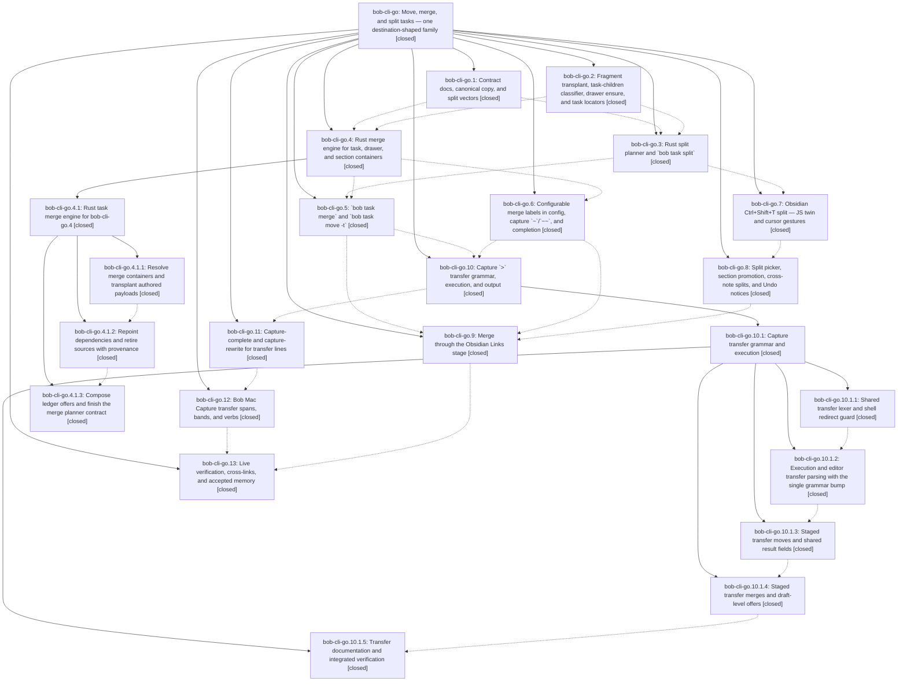

# Bead: bob-cli-go — Move, merge, and split tasks — one destination-shaped family

[Bead Pages](../README.md) / bob-cli-go

**Status:** ✓ closed · **Resolution:** done · **Type:** ▸ plan · **Tier:** epic
**Owner:** `bryanbugyi34@gmail.com` · **Created by:** [bbugyi200.apollo.research.36.linker.w0](https://github.com/bobs-org/bob-cli--agents/blob/main/sessions/bbugyi200.apollo.research.36.linker.w0.md) · **Assignee:** `bob-cli-go.land`
**Created:** 2026-11-03 16:11:30 EST · **Closed:** 2026-11-04 14:06:03 EST
**Plan:** [202611/task\_move\_merge\_split.md](https://github.com/bobs-org/bob-cli--plans/blob/main/202611/task_move_merge_split.md)

<!-- sase:links:start -->

## Links

| Relation | Artifact | Why |
| --- | --- | --- |
| implemented-by | [plan:202611/task_move_merge_split.md][1] | derived from the plan's `bead_id:` frontmatter field |

_Plus 13 automatic references — see [Referenced By](#referenced-by)._

[1]: https://github.com/bobs-org/bob-cli--plans/blob/main/202611/task_move_merge_split.md

<!-- sase:links:end -->

## Description

Bryan can move tasks between notes, merge tasks into another task, drawer, or note section, and split bullets out into new linked tasks, from capture (`@a+x @b+y > @c…`), the `merged into` relation label, Obsidian (Ctrl+Shift+T and the Links stage), and `bob task move|merge|split`. All of these share one Rust engine per operation. They never lose content or identity, leave `bob task reconcile` with nothing to do, and explain every consequence before and after they write.

## Notes

[2026-11-03T23:47:03Z · bob-cli-gn.land--1] DISCOVERED ISSUE: The 2026-11-03 bob-plugins npm run docs:check reached lint successfully, then generated-drift validation failed because the fetched bob-cli 4db3200 source context contains glossary:task-merge without required front matter. That strand is among this epic's accepted memory_glossary_strands outputs; the error is outside bob-cli-gn, so this landing left memory files untouched. Monitor evidence: file:monitor-retained-log:qbknfa4fxj8p.

[2026-11-04T01:04:37Z · bob-cli-gm.1.1.land] DISCOVERED ISSUE: bob-cli-gm.1.1 landing independently reproduced phase bob-cli-gm.1.1.4 note #1 on master 734214e9: uv run --project tools/docs bob-docs gen --check exits 2 with memory strand has no front matter for sase/memory/glossary/task-merge.md. This is the same blocker as go note #1 and is causally owned by go accepted glossary output, not target-run grammar. Per sase_new_task no separate task was created. Memory remains untouched by gm.

[2026-11-04T01:32:36Z · bob-cli-gl.5.1.land] DISCOVERED ISSUE: bob-cli-gl.5.1 landing independently reproduced the docs failure proposed by bob-cli-gl.5.1.3 note #1 on clean ddb0a73f: just docs-check passes lint, then exits 2 at generated drift because sase/memory/glossary/task-merge.md has no front matter. This is the same causal defect already recorded in go notes #1-2, introduced by aac3947c under this epic; no separate task, and no memory edits by the move landing.

[2026-11-04T01:38:07Z · bob-cli-gl.5.1.land] DISCOVERED ISSUE: bob-cli-gl.5.1 landing ran sase tool run check (just check), run 21a7758643f1dbbd1810737832a1c896, on unchanged ddb0a73f. Formatting passes; clippy exits 101 with five errors introduced by go.3 commit 734214e9: task_move/command.rs:354 useless_format; task_split/command.rs:236 collapsible_if; task_split/plan.rs:347 collapsible_if, :1063 bool_comparison, :1170 collapsible_str_replace. No task duplicate found by same-type error/file searches or recent task sweep. This is active go epic work; no standalone task. The earlier gl.5.1.3 unused prepare_task_merge import proposal is resolved by 672954d4 and does not recur.

[2026-11-04T03:29:07Z · bob-cli-go.4.1.land] DISCOVERED ISSUE corroboration from bob-cli-go.4.1.land: phase bob-cli-go.4.1.3 note #1 reports the same missing glossary:task-merge front matter already recorded in go notes #1-3. The accepted glossary output belongs to go, not the merge-engine child; no separate task or memory edit. Phase .3 note #2 Clippy proposal is resolved in current source by ebedfca8 (all five sites); preserve that repair.

[2026-11-04T03:39:50Z · bob-cli-gl.land] DISCOVERED ISSUE corroboration from bob-cli-gl.land (proposed by bob-cli-gl.7 note #1 and bob-cli-gl.5.1.3 note #1): on master d19a8d92, 'just docs-gen' and 'uv run --project tools/docs bob-docs check' still pass lint and then exit 2 with 'sase/memory/glossary/task-merge.md: memory strand has no front matter'. Same causal defect as go notes #1-#5 (accepted glossary output from aac3947c); no separate task, and gl made no memory edits (its DECISIONS forbid them).

[2026-11-04T03:48:45Z · bob-cli-gm.land] DISCOVERED ISSUE corroboration from bob-cli-gm.land: PROPOSED FOLLOW-UP notes gm.2 #1, gm.3 #2, and gm.1.1.4 #1 all identify the same task-merge glossary format failure already in go notes #1-6. On clean 66828cfd, uv run --project tools/docs bob-docs gen --check exits 2 with memory strand has no front matter for sase/memory/glossary/task-merge.md. Read go and go.13; accepted glossary output remains active go work. Same-type and all-type task searches and last-week task sweep found no separate matching task. No new task or memory edit.

[2026-11-04T13:35:39Z · bob-cli-go.10.1.land] DISCOVERED ISSUE corroboration from bob-cli-go.10.1 landing (proposed by bob-cli-go.10.1.5 note #2): on master d25080e1 plus landing fix, just docs-check passes lint then exits 2 at generated drift (sase/memory/glossary/task-merge.md: memory strand has no front matter), and tools/docs/tests/test_contracts.py::test_check_mode_reports_generated_page_drift_without_writing fails the same way; both reproduce identically on pre-epic 3741ce2e. Same defect as notes #1-6 (aac3947c, bob-cli-go.2); owned by this epic's memory closeout (bob-cli-go.13). No separate task, no memory edits by the transfer child epic.

[2026-11-04T15:01:06Z · bob-cli-gj.land] DISCOVERED ISSUE corroboration from bob-cli-gj.land, proposed by bob-cli-gj.3 note #2: uv run --project tools/docs bob-docs gen --check on clean bob-cli 27feff87 exits 2 because sase/memory/glossary/task-merge.md has no front matter. This matches go notes #1-8 and the accepted glossary output owned by go.13 (introduced under go.2), rather than note-pull work. Read go/go.13; same-type and all-type task searches plus the past-week task sweep found no separate duplicate. No task or memory edit created.

[2026-11-04T15:25:17Z · bryanbugyi34@gmail.com] The epic lander agent should make sure that we support triggering completion for tasks when the '+' character is pressed after the '>'. See the 🔒 20261104\_100954.png screenshot for context.

[2026-11-04T17:52:19Z · bob-cli-go.land] LANDING TRIAGE (bob-cli-go.land): Reviewed all 13 phases, child epics go.4.1/go.10.1 (their landers already triaged their own phase notes), and every note. Follow-up outcomes via /sase_new_task: go.13#1 short-flag swallow -> corroborated closed bob-cli-8a (+1 --verified-after-close; lander reproduced on a6c55cbb: 'bob capture --dry-run -o -- hello' files '-o -- hello', and capture-parse '-b /tmp' is read as text). go.11#1 timing flakes -> stats/stats_clock completion nodes +1 on bob-cli-gd (same unpinned 150 ms deadline root cause); capture-related perf gate +1 on closed bob-cli-bo (recurred after its 0e75ca56 fix). Declined: go.5#1 BLOCKS mirror vs [id::]-less dependents - lander could not reproduce in two scratch shapes (merge into a task whose dependent carries only [dependsOn::], and a hand-written cross-note id-less dependent); BLOCKS entries survived and reconcile converged, so no bug filed without a repro. go.7#2/go.9#2 bob-plugins npm failures - already tracked and heavily corroborated (bob-cli-eh, -et, -f1, -ff, -ej), no new evidence. go.1#1 published-URLs drift - resolved (docs/attachments.md shipped in 0b4cebdf; go.13 docs-check green). Glossary task-merge front matter (go.3#1, go.5#2, go.6#1, go.7#1, go.8#1, go.9#1, go.12#1, epic notes #1-9) - resolved by a6c55cbb. go.4#1 missing research artifact - resolved; research:202611/task_move_merge_split_design/task_move_merge_split_design.md now resolves after sidecar sync. Remaining epic work: Bryan's note #10 ('> +' must open the task picker) - capture-parse reports transfer_destination_marker with no needs, so Mac never requests completion; capture-complete already returns the vault task_parent picker but unscoped (lists the sources, no merge consequence). Planned as a closeout tale.

[2026-11-04T19:06:03Z · bob-cli-go.land--2] Closeout verified. Landing review checked all 13 phases and child epics bob-cli-go.4.1 and bob-cli-go.10.1 against source and commits 8d2eb09f through a6c55cbb. Follow-up triage from the latest landing note: go.13#1 corroborated closed bob-cli-8a; go.11#1 corroborated bob-cli-gd and bob-cli-bo; go.5#1 was declined after two scratch repros preserved BLOCKS and reconcile converged; go.7/go.9 plugin failures were already tracked; published URLs, glossary docs drift, and the research artifact were resolved. Integration review of bob-cli-gj, -gl, -gm, -h0, gcal, attachments, and periods found no transfer changes needed; h0's consequence builder covers project-note ^/: moves only. This closeout implemented > + transfer parsing as task_parent and filtered the picker to merge targets. Verified cargo test --test cli transfer and just check passed; just docs-check passed (447 docs tests, one optional asset test skipped); scratch-vault capture-parse returned task_parent, completion excluded the source and showed merge consequences, selecting @db+upgrade parsed and dry-ran as task_merge. bob-cli-go has no epic symbols. No just symvision recipe exists.

## Attachments

- 🔒 20261104\_100954.png · image/png · 2858×1728 · 372.309 KiB (private attachment)

## Phases

| Bead | Title | Status | Size | Created | Agents | Commits |
|---|---|---|---|---|---:|---:|
| [bob-cli-go.1](bob-cli-go.1.md) | Contract docs, canonical copy, and split vectors | ✓ closed | medium | 2026-11-03 | 1 | 1 |
| [bob-cli-go.10](bob-cli-go.10.md) | Capture \`\>\` transfer grammar, execution, and output | ✓ closed | large | 2026-11-03 | 1 | 0 |
| [bob-cli-go.11](bob-cli-go.11.md) | Capture-complete and capture-rewrite for transfer lines | ✓ closed | medium | 2026-11-03 | 1 | 1 |
| [bob-cli-go.12](bob-cli-go.12.md) | Bob Mac Capture transfer spans, bands, and verbs | ✓ closed | medium | 2026-11-03 | 1 | 1 |
| [bob-cli-go.13](bob-cli-go.13.md) | Live verification, cross-links, and accepted memory | ✓ closed | small | 2026-11-03 | 1 | 1 |
| [bob-cli-go.2](bob-cli-go.2.md) | Fragment transplant, task-children classifier, drawer ensure, and task locators | ✓ closed | medium | 2026-11-03 | 1 | 1 |
| [bob-cli-go.3](bob-cli-go.3.md) | Rust split planner and \`bob task split\` | ✓ closed | medium | 2026-11-03 | 1 | 1 |
| [bob-cli-go.4](bob-cli-go.4.md) | Rust merge engine for task, drawer, and section containers | ✓ closed | large | 2026-11-03 | 1 | 0 |
| [bob-cli-go.5](bob-cli-go.5.md) | \`bob task merge\` and \`bob task move -t\` | ✓ closed | medium | 2026-11-03 | 1 | 1 |
| [bob-cli-go.6](bob-cli-go.6.md) | Configurable merge labels in config, capture \`~\`/\`~~\`, and completion | ✓ closed | medium | 2026-11-03 | 1 | 1 |
| [bob-cli-go.7](bob-cli-go.7.md) | Obsidian Ctrl+Shift+T split — JS twin and cursor gestures | ✓ closed | medium | 2026-11-03 | 1 | 1 |
| [bob-cli-go.8](bob-cli-go.8.md) | Split picker, section promotion, cross-note splits, and Undo notices | ✓ closed | medium | 2026-11-03 | 1 | 2 |
| [bob-cli-go.9](bob-cli-go.9.md) | Merge through the Obsidian Links stage | ✓ closed | medium | 2026-11-03 | 1 | 1 |

## Lineage

## Agents

| Agent | Bead | Commits |
|---|---|---:|
| [bbugyi200.apollo.bob-cli-go.1](https://github.com/bobs-org/bob-cli--agents/blob/main/agents/bbugyi200.apollo.bob-cli-go.1/README.md) | [bob-cli-go.1](bob-cli-go.1.md) | 1 |
| [bbugyi200.apollo.bob-cli-go.10](https://github.com/bobs-org/bob-cli--agents/blob/main/sessions/bbugyi200.apollo.bob-cli-go.10.md) | [bob-cli-go.10](bob-cli-go.10.md) | 0 |
| [bbugyi200.apollo.bob-cli-go.10.1.1](https://github.com/bobs-org/bob-cli--agents/blob/main/agents/bbugyi200.apollo.bob-cli-go.10.1.1/README.md) | [bob-cli-go.10.1.1](bob-cli-go.10.1.1.md) | 1 |
| [bbugyi200.apollo.bob-cli-go.10.1.2](https://github.com/bobs-org/bob-cli--agents/blob/main/agents/bbugyi200.apollo.bob-cli-go.10.1.2/README.md) | [bob-cli-go.10.1.2](bob-cli-go.10.1.2.md) | 1 |
| [bbugyi200.apollo.bob-cli-go.10.1.3](https://github.com/bobs-org/bob-cli--agents/blob/main/agents/bbugyi200.apollo.bob-cli-go.10.1.3/README.md) | [bob-cli-go.10.1.3](bob-cli-go.10.1.3.md) | 1 |
| [bbugyi200.apollo.bob-cli-go.10.1.4](https://github.com/bobs-org/bob-cli--agents/blob/main/sessions/bbugyi200.apollo.bob-cli-go.10.1.4.md) | [bob-cli-go.10.1.4](bob-cli-go.10.1.4.md) | 1 |
| [bbugyi200.apollo.bob-cli-go.10.1.5](https://github.com/bobs-org/bob-cli--agents/blob/main/agents/bbugyi200.apollo.bob-cli-go.10.1.5/README.md) | [bob-cli-go.10.1.5](bob-cli-go.10.1.5.md) | 1 |
| [bbugyi200.apollo.bob-cli-go.10.1.land](https://github.com/bobs-org/bob-cli--agents/blob/main/agents/bbugyi200.apollo.bob-cli-go.10.1.land/README.md) | [bob-cli-go.10.1](bob-cli-go.10.1.md) | 2 |
| [bbugyi200.apollo.bob-cli-go.11](https://github.com/bobs-org/bob-cli--agents/blob/main/agents/bbugyi200.apollo.bob-cli-go.11/README.md) | [bob-cli-go.11](bob-cli-go.11.md) | 1 |
| [bbugyi200.apollo.bob-cli-go.12](https://github.com/bobs-org/bob-cli--agents/blob/main/sessions/bbugyi200.apollo.bob-cli-go.12.md) | [bob-cli-go.12](bob-cli-go.12.md) | 1 |
| [bbugyi200.apollo.bob-cli-go.13](https://github.com/bobs-org/bob-cli--agents/blob/main/agents/bbugyi200.apollo.bob-cli-go.13/README.md) | [bob-cli-go.13](bob-cli-go.13.md) | 1 |
| [bbugyi200.apollo.bob-cli-go.2](https://github.com/bobs-org/bob-cli--agents/blob/main/sessions/bbugyi200.apollo.bob-cli-go.2.md) | [bob-cli-go.2](bob-cli-go.2.md) | 1 |
| [bbugyi200.apollo.bob-cli-go.3](https://github.com/bobs-org/bob-cli--agents/blob/main/sessions/bbugyi200.apollo.bob-cli-go.3.md) | [bob-cli-go.3](bob-cli-go.3.md) | 1 |
| [bbugyi200.apollo.bob-cli-go.4](https://github.com/bobs-org/bob-cli--agents/blob/main/sessions/bbugyi200.apollo.bob-cli-go.4.md) | [bob-cli-go.4](bob-cli-go.4.md) | 0 |
| [bbugyi200.apollo.bob-cli-go.4.1.1](https://github.com/bobs-org/bob-cli--agents/blob/main/sessions/bbugyi200.apollo.bob-cli-go.4.1.1.md) | [bob-cli-go.4.1.1](bob-cli-go.4.1.1.md) | 2 |
| [bbugyi200.apollo.bob-cli-go.4.1.2](https://github.com/bobs-org/bob-cli--agents/blob/main/agents/bbugyi200.apollo.bob-cli-go.4.1.2/README.md) | [bob-cli-go.4.1.2](bob-cli-go.4.1.2.md) | 1 |
| [bbugyi200.apollo.bob-cli-go.4.1.3](https://github.com/bobs-org/bob-cli--agents/blob/main/sessions/bbugyi200.apollo.bob-cli-go.4.1.3.md) | [bob-cli-go.4.1.3](bob-cli-go.4.1.3.md) | 1 |
| [bbugyi200.apollo.bob-cli-go.4.1.land](https://github.com/bobs-org/bob-cli--agents/blob/main/sessions/bbugyi200.apollo.bob-cli-go.4.1.land.md) | [bob-cli-go.4.1](bob-cli-go.4.1.md) | 2 |
| [bbugyi200.apollo.bob-cli-go.5](https://github.com/bobs-org/bob-cli--agents/blob/main/agents/bbugyi200.apollo.bob-cli-go.5/README.md) | [bob-cli-go.5](bob-cli-go.5.md) | 1 |
| [bbugyi200.apollo.bob-cli-go.6](https://github.com/bobs-org/bob-cli--agents/blob/main/agents/bbugyi200.apollo.bob-cli-go.6/README.md) | [bob-cli-go.6](bob-cli-go.6.md) | 1 |
| [bbugyi200.apollo.bob-cli-go.7](https://github.com/bobs-org/bob-cli--agents/blob/main/agents/bbugyi200.apollo.bob-cli-go.7/README.md) | [bob-cli-go.7](bob-cli-go.7.md) | 1 |
| [bbugyi200.apollo.bob-cli-go.8](https://github.com/bobs-org/bob-cli--agents/blob/main/agents/bbugyi200.apollo.bob-cli-go.8/README.md) | [bob-cli-go.8](bob-cli-go.8.md) | 2 |
| [bbugyi200.apollo.bob-cli-go.9](https://github.com/bobs-org/bob-cli--agents/blob/main/agents/bbugyi200.apollo.bob-cli-go.9/README.md) | [bob-cli-go.9](bob-cli-go.9.md) | 1 |
| [bbugyi200.apollo.bob-cli-go.land](https://github.com/bobs-org/bob-cli--agents/blob/main/sessions/bbugyi200.apollo.bob-cli-go.land.md) | [bob-cli-go](README.md) | 2 |

## Commits

| Repo | Commit | Subject | Bead | Committed |
|---|---|---|---|---|
| bob-cli | [`8d2eb09`](https://github.com/bobs-org/bob-cli/commit/8d2eb09f6646faf3a17abb7998a7c1661a46044b) | docs(contract): task-merge and task-split contracts, merge-label relations, split vectors | [bob-cli-go.1](bob-cli-go.1.md) | 2026-11-03 17:12:02 EST |
| bob-cli | [`aac3947`](https://github.com/bobs-org/bob-cli/commit/aac3947c7f415b7037fdb7e10fa5e0322df4ade3) | feat(task-move): shared transplant API, children classifier, drawer ensure, task locator | [bob-cli-go.2](bob-cli-go.2.md) | 2026-11-03 18:04:52 EST |
| bob-cli | [`adf2082`](https://github.com/bobs-org/bob-cli/commit/adf20825f77d3adc059ae69e7809018e4b75bcbe) | fix(task-merge): resolve payload preparation failures | [bob-cli-go.4.1.1](bob-cli-go.4.1.1.md) | 2026-11-03 19:07:47 EST |
| bob-cli | [`672954d`](https://github.com/bobs-org/bob-cli/commit/672954d4bf2d740405230be9ee2e098ff33405e1) | test(task-merge): fix nested payload indentation assertion | [bob-cli-go.4.1.1](bob-cli-go.4.1.1.md) | 2026-11-03 19:48:45 EST |
| bob-cli | [`734214e`](https://github.com/bobs-org/bob-cli/commit/734214e92c5495fa34a9d02818b9e820d21f004f) | feat(task): add task split planner and CLI | [bob-cli-go.3](bob-cli-go.3.md) | 2026-11-03 19:54:52 EST |
| bob-plugins | [`bob-plugins@60045f2`](https://github.com/bobs-org/bob-plugins/commit/60045f279de3dc35337c5fbee4ab0646dd3863e0) | feat(nav-split): port split planner to JS and register Ctrl+Shift+T | [bob-cli-go.7](bob-cli-go.7.md) | 2026-11-03 20:25:18 EST |
| bob-cli | [`751c769`](https://github.com/bobs-org/bob-cli/commit/751c769f02147873f0b2d2dacf092636e9190ec7) | feat(task-merge)!: retire sources with repointing and provenance | [bob-cli-go.4.1.2](bob-cli-go.4.1.2.md) | 2026-11-03 20:33:26 EST |
| bob-cli | [`a3d44f2`](https://github.com/bobs-org/bob-cli/commit/a3d44f27e75654561673ad1ce8ac71e76a26993c) | feat(task-split): complete picker and guarded undo | [bob-cli-go.8](bob-cli-go.8.md) | 2026-11-03 21:00:29 EST |
| bob-plugins | [`bob-plugins@1dc272a`](https://github.com/bobs-org/bob-plugins/commit/1dc272ada2c91bdd7def63c36531b7e11a47793a) | feat(navigation): add task split picker and guarded undo | [bob-cli-go.8](bob-cli-go.8.md) | 2026-11-03 21:01:14 EST |
| bob-cli | [`e253ce1`](https://github.com/bobs-org/bob-cli/commit/e253ce17c96fe2ce485931e841f18c8fbedccf0b) | feat(task-merge): complete planner integration | [bob-cli-go.4.1.3](bob-cli-go.4.1.3.md) | 2026-11-03 22:19:57 EST |
| bob-cli--plans | [`bob-cli--plans@4c6e638`](https://github.com/bobs-org/bob-cli--plans/commit/4c6e6383157ffca1e37f3ca2fd0cd4abdaf87f37) | docs(plan): mark task merge engine complete | [bob-cli-go.4.1](bob-cli-go.4.1.md) | 2026-11-04 00:20:51 EST |
| bob-cli | [`c892b0c`](https://github.com/bobs-org/bob-cli/commit/c892b0cc0f6f3774bfb8a04c3b030c898e977c38) | fix(task-merge): repair landing edge cases | [bob-cli-go.4.1](bob-cli-go.4.1.md) | 2026-11-04 00:21:40 EST |
| bob-cli | [`497db44`](https://github.com/bobs-org/bob-cli/commit/497db446c52c4827bcd1d4955497a224b601e618) | feat(task-merge): ship bob task merge and bob task move -t | [bob-cli-go.5](bob-cli-go.5.md) | 2026-11-04 01:31:32 EST |
| bob-cli | [`3741ce2`](https://github.com/bobs-org/bob-cli/commit/3741ce2e79e5341942d2ff57cc536c8bd27c0799) | feat(capture): add configurable merge relations | [bob-cli-go.6](bob-cli-go.6.md) | 2026-11-04 01:37:01 EST |
| bob-plugins | [`bob-plugins@f392c88`](https://github.com/bobs-org/bob-plugins/commit/f392c88f9acd919da15c2e6de8e269e3d9a44588) | feat(navigation): merge tasks through the Obsidian Links stage | [bob-cli-go.9](bob-cli-go.9.md) | 2026-11-04 02:15:52 EST |
| bob-cli | [`e00f907`](https://github.com/bobs-org/bob-cli/commit/e00f90748429329d00b3bed3a7c0513c39e3b06d) | feat(capture): add transfer lexer and shell redirect guard | [bob-cli-go.10.1.1](bob-cli-go.10.1.1.md) | 2026-11-04 02:39:07 EST |
| bob-cli | [`706eab6`](https://github.com/bobs-org/bob-cli/commit/706eab6783fbe4ac2811647e4225f5a1d1fa9afc) | feat(capture)!: add transfer parsing contracts | [bob-cli-go.10.1.2](bob-cli-go.10.1.2.md) | 2026-11-04 03:22:42 EST |
| bob-cli | [`b9fe9d0`](https://github.com/bobs-org/bob-cli/commit/b9fe9d0c1208ca4a4670c6e886060621116b6286) | feat(capture): implement transfer-moves planner with typed batch moves | [bob-cli-go.10.1.3](bob-cli-go.10.1.3.md) | 2026-11-04 04:07:48 EST |
| bob-cli | [`dad9e66`](https://github.com/bobs-org/bob-cli/commit/dad9e660947ab77ecee1bf40432d73a954a2a7d7) | feat(capture): implement staged transfer merges | [bob-cli-go.10.1.4](bob-cli-go.10.1.4.md) | 2026-11-04 07:25:51 EST |
| bob-cli | [`d25080e`](https://github.com/bobs-org/bob-cli/commit/d25080e16cfa7f45f71ed285ae2739613069d7ab) | docs(capture): publish \> transfer contracts and grammar-10 references | [bob-cli-go.10.1.5](bob-cli-go.10.1.5.md) | 2026-11-04 08:05:40 EST |
| bob-cli | [`cb9dd8f`](https://github.com/bobs-org/bob-cli/commit/cb9dd8f9a956f8845724c0c428acd3d0c377a6a7) | fix(capture): stop transfer lexer claiming non-transfer arrows | [bob-cli-go.10.1](bob-cli-go.10.1.md) | 2026-11-04 08:37:35 EST |
| bob-cli--plans | [`bob-cli--plans@5f0c598`](https://github.com/bobs-org/bob-cli--plans/commit/5f0c5981216fe917e17be092453f3c9b0798ad4c) | chore(plans): mark capture\_transfer epic plan done | [bob-cli-go.10.1](bob-cli-go.10.1.md) | 2026-11-04 08:38:21 EST |
| bob-cli | [`96a3c74`](https://github.com/bobs-org/bob-cli/commit/96a3c744e63e1aef287fee630bb40c95d68e9c8f) | feat(capture): add transfer-assist completion, engine scoping, and rewrite | [bob-cli-go.11](bob-cli-go.11.md) | 2026-11-04 10:41:08 EST |
| bob-mac-capture | [`bob-mac-capture@81eb669`](https://github.com/bobs-org/bob-mac-capture/commit/81eb669406cc9a72d3eca8d936543617bbd450f7) | feat(capture): preview task transfers in Mac Capture | [bob-cli-go.12](bob-cli-go.12.md) | 2026-11-04 11:41:04 EST |
| bob-cli | [`a6c55cb`](https://github.com/bobs-org/bob-cli/commit/a6c55cbbd22823a96a24b5b057dccb3f998a0992) | docs(closeout): verify move/merge/split end to end, fix cross-links and accepted memory | [bob-cli-go.13](bob-cli-go.13.md) | 2026-11-04 12:24:37 EST |
| bob-cli | [`3e33c5c`](https://github.com/bobs-org/bob-cli/commit/3e33c5ce5d29fc6a3b4944c6bf28be077d09ea01) | feat(capture): support transfer task picker | [bob-cli-go](README.md) | 2026-11-04 14:21:04 EST |
| bob-cli--plans | [`bob-cli--plans@a818872`](https://github.com/bobs-org/bob-cli--plans/commit/a818872f33172d255cd79131850c7ac402aa1e35) | docs(plan): add task move merge split plan | [bob-cli-go](README.md) | 2026-11-04 14:22:41 EST |

<!-- sase:referenced-by:start -->

## Referenced By

| Relation | Artifact | Why | Uses |
| --- | --- | --- | ---: |
| read-by | [agent:bob-cli-gl.land][1] | Check whether the glossary task-merge front-matter docs-gen failure is still tracked | 1 |
| read-by | [agent:bob-cli-gn.land--2][2] | Confirm the cached docs-check memory-frontmatter issue was routed to its active epic | 1 |
| read-by | [agent:bob-cli-go.1][3] | Need epic DECISIONS and scope for phase 1 | 1 |
| read-by | [agent:bob-cli-go.10.1.land][4] | Check whether the parent epic already tracks the glossary task-merge frontmatter docs-gate failure | 1 |
| read-by | [agent:bob-cli-go.13][5] | epic status for closeout | 1 |
| read-by | [agent:bob-cli-go.4.1.land--1][6] | Verify the upstream epic remains open as required after child landing | 2 |
| read-by | [agent:bob-cli-go.7][7] | parent epic context | 1 |
| read-by | [agent:bob-cli-go.8][8] | Check whether the clean-base glossary/task-merge docs failure is already tracked before recording the phase follow-up | 1 |
| read-by | [agent:bob-cli-go.9][9] | Need parent epic status and plan context | 1 |
| read-by | [agent:bob-cli-h0.1][10] | Need to cite the active existing tracker for the pre-existing docs-check failure | 1 |
| read-by | [agent:bob-cli-h0.2][11] | check in-flight transfer work overlap with lexer grammar | 1 |
| read-by | [agent:research.37.cld][12] | Check in-flight transfer grammar epic that touches capture move semantics, to avoid conflicts with ^^ design | 1 |
| read-by | [agent:research.37.final][13] | Check in-flight transfer epic overlap with ^^ design | 1 |

[1]: https://github.com/bobs-org/bob-cli--agents/blob/main/agents/bbugyi200.apollo.bob-cli-gl.land/README.md
[2]: https://github.com/bobs-org/bob-cli--agents/blob/main/sessions/bbugyi200.apollo.bob-cli-gn.land.md
[3]: https://github.com/bobs-org/bob-cli--agents/blob/main/agents/bbugyi200.apollo.bob-cli-go.1/README.md
[4]: https://github.com/bobs-org/bob-cli--agents/blob/main/agents/bbugyi200.apollo.bob-cli-go.10.1.land/README.md
[5]: https://github.com/bobs-org/bob-cli--agents/blob/main/agents/bbugyi200.apollo.bob-cli-go.13/README.md
[6]: https://github.com/bobs-org/bob-cli--agents/blob/main/sessions/bbugyi200.apollo.bob-cli-go.4.1.land.md
[7]: https://github.com/bobs-org/bob-cli--agents/blob/main/agents/bbugyi200.apollo.bob-cli-go.7/README.md
[8]: https://github.com/bobs-org/bob-cli--agents/blob/main/agents/bbugyi200.apollo.bob-cli-go.8/README.md
[9]: https://github.com/bobs-org/bob-cli--agents/blob/main/agents/bbugyi200.apollo.bob-cli-go.9/README.md
[10]: https://github.com/bobs-org/bob-cli--agents/blob/main/agents/bbugyi200.apollo.bob-cli-h0.1/README.md
[11]: https://github.com/bobs-org/bob-cli--agents/blob/main/agents/bbugyi200.apollo.bob-cli-h0.2/README.md
[12]: https://github.com/bobs-org/bob-cli--agents/blob/main/agents/bbugyi200.apollo.research.37.cld/README.md
[13]: https://github.com/bobs-org/bob-cli--agents/blob/main/agents/bbugyi200.apollo.research.37.final/README.md

<!-- sase:referenced-by:end -->
