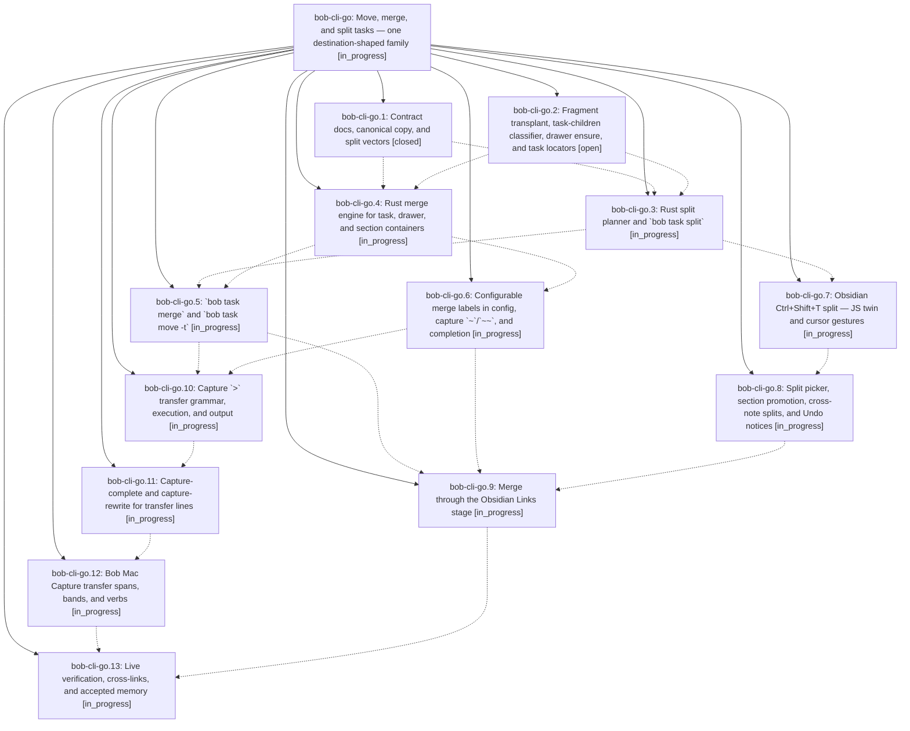

# Bead: bob-cli-go — Move, merge, and split tasks — one destination-shaped family

[Bead Pages](../README.md) / bob-cli-go

**Status:** ◐ in_progress · **Type:** ▸ plan · **Tier:** epic
**Owner:** `bryanbugyi34@gmail.com` · **Created by:** [bbugyi200.apollo.research.36.linker.w0](https://github.com/bobs-org/bob-cli--agents/blob/main/sessions/bbugyi200.apollo.research.36.linker.w0.md) · **Assignee:** `bob-cli-go.land`
**Created:** 2026-11-03 16:11:30 EST
**Plan:** [202611/task\_move\_merge\_split.md](https://github.com/bobs-org/bob-cli--plans/blob/main/202611/task_move_merge_split.md)

<!-- sase:links:start -->

## Links

| Relation | Artifact | Why |
| --- | --- | --- |
| implemented-by | [plan:202611/task_move_merge_split.md][1] | derived from the plan's `bead_id:` frontmatter field |

[1]: https://github.com/bobs-org/bob-cli--plans/blob/main/202611/task_move_merge_split.md

<!-- sase:links:end -->

## Description

Bryan can move tasks between notes, merge tasks into another task, drawer, or note section, and split bullets out into new linked tasks, from capture (`@a+x @b+y > @c…`), the `merged into` relation label, Obsidian (Ctrl+Shift+T and the Links stage), and `bob task move|merge|split`. All of these share one Rust engine per operation. They never lose content or identity, leave `bob task reconcile` with nothing to do, and explain every consequence before and after they write.

## Phases

| Bead | Title | Status | Size | Created | Agents | Commits |
|---|---|---|---|---|---:|---:|
| [bob-cli-go.1](bob-cli-go.1.md) | Contract docs, canonical copy, and split vectors | ✓ closed | medium | 2026-11-03 | 1 | 1 |
| [bob-cli-go.10](bob-cli-go.10.md) | Capture \`\>\` transfer grammar, execution, and output | ◐ in_progress | large | 2026-11-03 | 1 | 0 |
| [bob-cli-go.11](bob-cli-go.11.md) | Capture-complete and capture-rewrite for transfer lines | ◐ in_progress | medium | 2026-11-03 | 1 | 0 |
| [bob-cli-go.12](bob-cli-go.12.md) | Bob Mac Capture transfer spans, bands, and verbs | ◐ in_progress | medium | 2026-11-03 | 1 | 0 |
| [bob-cli-go.13](bob-cli-go.13.md) | Live verification, cross-links, and accepted memory | ◐ in_progress | small | 2026-11-03 | 1 | 0 |
| [bob-cli-go.2](bob-cli-go.2.md) | Fragment transplant, task-children classifier, drawer ensure, and task locators | ○ open | medium | 2026-11-03 | 1 | 0 |
| [bob-cli-go.3](bob-cli-go.3.md) | Rust split planner and \`bob task split\` | ◐ in_progress | medium | 2026-11-03 | 1 | 0 |
| [bob-cli-go.4](bob-cli-go.4.md) | Rust merge engine for task, drawer, and section containers | ◐ in_progress | large | 2026-11-03 | 1 | 0 |
| [bob-cli-go.5](bob-cli-go.5.md) | \`bob task merge\` and \`bob task move -t\` | ◐ in_progress | medium | 2026-11-03 | 1 | 0 |
| [bob-cli-go.6](bob-cli-go.6.md) | Configurable merge labels in config, capture \`~\`/\`~~\`, and completion | ◐ in_progress | medium | 2026-11-03 | 1 | 0 |
| [bob-cli-go.7](bob-cli-go.7.md) | Obsidian Ctrl+Shift+T split — JS twin and cursor gestures | ◐ in_progress | medium | 2026-11-03 | 1 | 0 |
| [bob-cli-go.8](bob-cli-go.8.md) | Split picker, section promotion, cross-note splits, and Undo notices | ◐ in_progress | medium | 2026-11-03 | 1 | 0 |
| [bob-cli-go.9](bob-cli-go.9.md) | Merge through the Obsidian Links stage | ◐ in_progress | medium | 2026-11-03 | 1 | 0 |

## Lineage

## Agents

| Agent | Bead | Commits |
|---|---|---:|
| [bbugyi200.apollo.bob-cli-go.1](https://github.com/bobs-org/bob-cli--agents/blob/main/agents/bbugyi200.apollo.bob-cli-go.1/README.md) | [bob-cli-go.1](bob-cli-go.1.md) | 1 |
| [bbugyi200.apollo.bob-cli-go.10](https://github.com/bobs-org/bob-cli--agents/blob/main/agents/bbugyi200.apollo.bob-cli-go.10/README.md) | [bob-cli-go.10](bob-cli-go.10.md) | 0 |
| [bbugyi200.apollo.bob-cli-go.11](https://github.com/bobs-org/bob-cli--agents/blob/main/agents/bbugyi200.apollo.bob-cli-go.11/README.md) | [bob-cli-go.11](bob-cli-go.11.md) | 0 |
| [bbugyi200.apollo.bob-cli-go.12](https://github.com/bobs-org/bob-cli--agents/blob/main/agents/bbugyi200.apollo.bob-cli-go.12/README.md) | [bob-cli-go.12](bob-cli-go.12.md) | 0 |
| [bbugyi200.apollo.bob-cli-go.13](https://github.com/bobs-org/bob-cli--agents/blob/main/agents/bbugyi200.apollo.bob-cli-go.13/README.md) | [bob-cli-go.13](bob-cli-go.13.md) | 0 |
| [bbugyi200.apollo.bob-cli-go.2](https://github.com/bobs-org/bob-cli--agents/blob/main/sessions/bbugyi200.apollo.bob-cli-go.2.md) | [bob-cli-go.2](bob-cli-go.2.md) | 0 |
| [bbugyi200.apollo.bob-cli-go.3](https://github.com/bobs-org/bob-cli--agents/blob/main/agents/bbugyi200.apollo.bob-cli-go.3/README.md) | [bob-cli-go.3](bob-cli-go.3.md) | 0 |
| [bbugyi200.apollo.bob-cli-go.4](https://github.com/bobs-org/bob-cli--agents/blob/main/agents/bbugyi200.apollo.bob-cli-go.4/README.md) | [bob-cli-go.4](bob-cli-go.4.md) | 0 |
| [bbugyi200.apollo.bob-cli-go.5](https://github.com/bobs-org/bob-cli--agents/blob/main/agents/bbugyi200.apollo.bob-cli-go.5/README.md) | [bob-cli-go.5](bob-cli-go.5.md) | 0 |
| [bbugyi200.apollo.bob-cli-go.6](https://github.com/bobs-org/bob-cli--agents/blob/main/agents/bbugyi200.apollo.bob-cli-go.6/README.md) | [bob-cli-go.6](bob-cli-go.6.md) | 0 |
| [bbugyi200.apollo.bob-cli-go.7](https://github.com/bobs-org/bob-cli--agents/blob/main/agents/bbugyi200.apollo.bob-cli-go.7/README.md) | [bob-cli-go.7](bob-cli-go.7.md) | 0 |
| [bbugyi200.apollo.bob-cli-go.8](https://github.com/bobs-org/bob-cli--agents/blob/main/agents/bbugyi200.apollo.bob-cli-go.8/README.md) | [bob-cli-go.8](bob-cli-go.8.md) | 0 |
| [bbugyi200.apollo.bob-cli-go.9](https://github.com/bobs-org/bob-cli--agents/blob/main/agents/bbugyi200.apollo.bob-cli-go.9/README.md) | [bob-cli-go.9](bob-cli-go.9.md) | 0 |
| [bbugyi200.apollo.bob-cli-go.land](https://github.com/bobs-org/bob-cli--agents/blob/main/agents/bbugyi200.apollo.bob-cli-go.land/README.md) | [bob-cli-go](README.md) | 0 |

## Commits

| Repo | Commit | Subject | Bead | Committed |
|---|---|---|---|---|
| bob-cli | [`8d2eb09`](https://github.com/bobs-org/bob-cli/commit/8d2eb09f6646faf3a17abb7998a7c1661a46044b) | docs(contract): task-merge and task-split contracts, merge-label relations, split vectors | [bob-cli-go.1](bob-cli-go.1.md) | 2026-11-03 17:12:02 EST |
