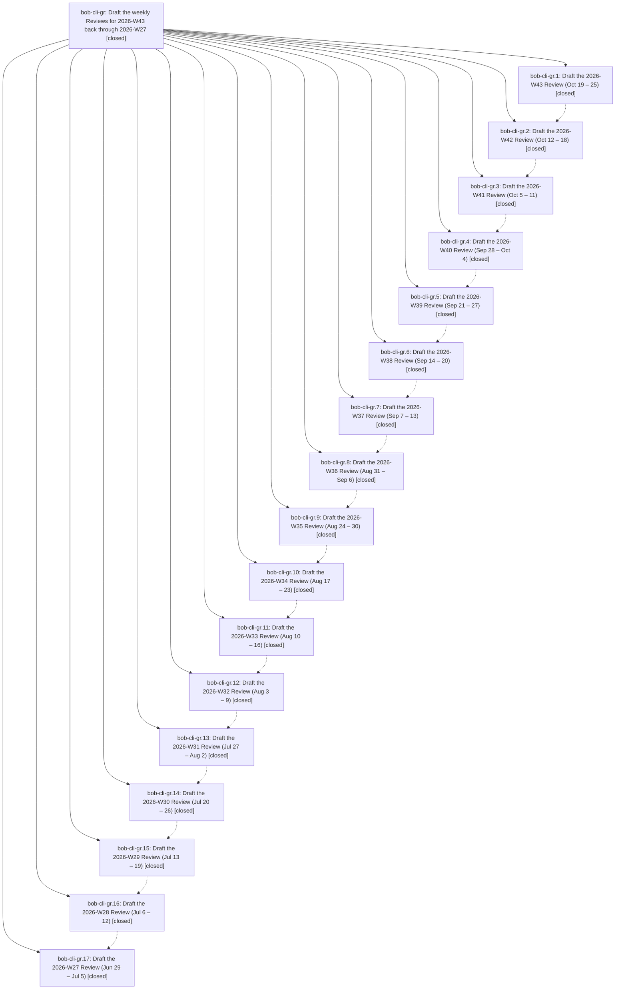

# Bead: bob-cli-gr — Draft the weekly Reviews for 2026-W43 back through 2026-W27

[Bead Pages](../README.md) / bob-cli-gr

**Status:** ✓ closed · **Resolution:** done · **Type:** ▸ plan · **Tier:** epic
**Owner:** `bryanbugyi34@gmail.com` · **Created by:** [bbugyi200.athena.17u--1](https://github.com/bobs-org/bob-cli--agents/blob/main/sessions/bbugyi200.athena.17u.md) · **Assignee:** `bob-cli-gr.land`
**Created:** 2026-11-03 19:08:08 EST · **Closed:** 2026-11-03 22:32:54 EST
**Plan:** [202611/weekly\_reviews\_w43\_to\_w27.md](https://github.com/bobs-org/bob-cli--plans/blob/main/202611/weekly_reviews_w43_to_w27.md)

<!-- sase:links:start -->

## Links

| Relation | Artifact | Why |
| --- | --- | --- |
| implemented-by | [plan:202611/weekly_reviews_w43_to_w27.md][1] | derived from the plan's `bead_id:` frontmatter field |

[1]: https://github.com/bobs-org/bob-cli--plans/blob/main/202611/weekly_reviews_w43_to_w27.md

<!-- sase:links:end -->

## Description

Each of the 17 closed weekly notes 2026-W43 back to 2026-W27 has a `## Review` drafted through `bob periods draft`, following that note's own "weekly v1" agent instructions, and committed on its own. Nothing else in the vault changes.

## Notes

[2026-11-04T03:32:54Z · bob-cli-gr.land] VERIFIED: All 17 phases (gr.1–gr.17) are closed, and all their notes were read. `bob periods brief 2026-W27..W43 -f md` reports `closed · drafted` for every week. W44 is still `closed · drafted` and untouched, W45 is open/empty, and W46 is future/empty. Q3/Q4 have no commits since the epic began. Each week has exactly one vault-sync commit touching only its own note (W43 9d359b4f2 through W27 240dccbe9), and each diff is pure additions: the bob-written review_digest/review_drafted frontmatter plus the ## Review block. No line was removed, and the callout and other sections are unchanged. A script check found every Review contains a Headline and no Intentions part, and every [[note#^block]] link in all 17 Reviews resolves to an existing note and block. Word counts match the phase reports (155–241, all ≤250). The drafted state proves the digest still matches what `bob periods draft` validated. There are no bob-cli commits for this epic, as planned.

FIXED (caused by the epic): phases w43 and w42 committed their tale-plan archives into the vault through /sase_git_commit (ec8ae84c5/326abcfb4 and 7d84dcb46/cd2e540c1), which violated "Nothing else in the vault changes". I confirmed these were stale duplicates of the bob-cli--plans copies and removed ~/bob/sdd/plans/; vault sync committed and pushed the removal as 6fb387ad5. Since the epic began, the vault's net change is the 17 week notes plus Bryan's own edits from other hosts (2026/20261103.md from the MacBook, .obsidian/hotkeys.json from apollo). The empty, gitignored sdd/beads/issues.jsonl mtime was touched at 19:34 but is untracked; I left it alone.

INTEGRATION: the bob-cli commits since the epic began (capture target runs, task-merge, task-split, attachments) don't touch src/native/periods/. Task-merge repointing rewrites only open dependents' Depends-On lines and leaves tombstones, so it can't rewrite Review links or flip review_digest. Nothing needed changing.

FOLLOW-UPS (all pre-existing bob periods brief defects from bob-cli-gh, not caused by this epic; no duplicates found): bob-cli-gs (medium) archived done/ tasks lose minutes and print dead links: gr.1 #1, gr.5 #1, gr.17 #1. bob-cli-gt (medium) task minutes are unsplit vs root lanes: gr.3 #1, gr.16 #1, gr.17 #3. bob-cli-gu (large) Still open uses today's vault for closed periods: gr.1 #2, gr.1 #4, gr.2 #1. bob-cli-gv (small) no basis for +N more: gr.1 #3. bob-cli-gw (medium) Bryan's words dedup, order, truncation, and link mangling: gr.7 #1, gr.10 #1, gr.12 #1, gr.17 #2. bob-cli-gx (small) md rendering, empty Parts dates and raw block-id aliases: gr.3 #2, gr.14 #1. bob-cli-gy (large) /sase_git_commit from ~/bob leaks plan archives, the forward-looking prevention of gr.2 #2/#3; the epic-caused stray files themselves were fixed above. I added a note on bob-cli-gp, the Monday review automation, listing these defects. Declined as separate tasks: gr.16 #1 and gr.17 #3 duplicate gr.3 #1 (folded into gt), and gr.17 #1 duplicates gr.5 #1 (folded into gs). The corroboration-only notes on gr.5, 7–14 add evidence, not new follow-ups. epic-symbols: none.

## Phases

| Bead | Title | Status | Size | Created | Agents | Commits |
|---|---|---|---|---|---:|---:|
| [bob-cli-gr.1](bob-cli-gr.1.md) | Draft the 2026-W43 Review (Oct 19 – 25) | ✓ closed | xlarge | 2026-11-03 | 1 | 0 |
| [bob-cli-gr.10](bob-cli-gr.10.md) | Draft the 2026-W34 Review (Aug 17 – 23) | ✓ closed | xlarge | 2026-11-03 | 1 | 0 |
| [bob-cli-gr.11](bob-cli-gr.11.md) | Draft the 2026-W33 Review (Aug 10 – 16) | ✓ closed | xlarge | 2026-11-03 | 1 | 0 |
| [bob-cli-gr.12](bob-cli-gr.12.md) | Draft the 2026-W32 Review (Aug 3 – 9) | ✓ closed | xlarge | 2026-11-03 | 1 | 0 |
| [bob-cli-gr.13](bob-cli-gr.13.md) | Draft the 2026-W31 Review (Jul 27 – Aug 2) | ✓ closed | xlarge | 2026-11-03 | 1 | 0 |
| [bob-cli-gr.14](bob-cli-gr.14.md) | Draft the 2026-W30 Review (Jul 20 – 26) | ✓ closed | xlarge | 2026-11-03 | 1 | 0 |
| [bob-cli-gr.15](bob-cli-gr.15.md) | Draft the 2026-W29 Review (Jul 13 – 19) | ✓ closed | xlarge | 2026-11-03 | 1 | 0 |
| [bob-cli-gr.16](bob-cli-gr.16.md) | Draft the 2026-W28 Review (Jul 6 – 12) | ✓ closed | xlarge | 2026-11-03 | 1 | 0 |
| [bob-cli-gr.17](bob-cli-gr.17.md) | Draft the 2026-W27 Review (Jun 29 – Jul 5) | ✓ closed | xlarge | 2026-11-03 | 1 | 0 |
| [bob-cli-gr.2](bob-cli-gr.2.md) | Draft the 2026-W42 Review (Oct 12 – 18) | ✓ closed | xlarge | 2026-11-03 | 1 | 0 |
| [bob-cli-gr.3](bob-cli-gr.3.md) | Draft the 2026-W41 Review (Oct 5 – 11) | ✓ closed | xlarge | 2026-11-03 | 1 | 0 |
| [bob-cli-gr.4](bob-cli-gr.4.md) | Draft the 2026-W40 Review (Sep 28 – Oct 4) | ✓ closed | xlarge | 2026-11-03 | 1 | 0 |
| [bob-cli-gr.5](bob-cli-gr.5.md) | Draft the 2026-W39 Review (Sep 21 – 27) | ✓ closed | xlarge | 2026-11-03 | 1 | 0 |
| [bob-cli-gr.6](bob-cli-gr.6.md) | Draft the 2026-W38 Review (Sep 14 – 20) | ✓ closed | xlarge | 2026-11-03 | 1 | 0 |
| [bob-cli-gr.7](bob-cli-gr.7.md) | Draft the 2026-W37 Review (Sep 7 – 13) | ✓ closed | xlarge | 2026-11-03 | 1 | 0 |
| [bob-cli-gr.8](bob-cli-gr.8.md) | Draft the 2026-W36 Review (Aug 31 – Sep 6) | ✓ closed | xlarge | 2026-11-03 | 1 | 0 |
| [bob-cli-gr.9](bob-cli-gr.9.md) | Draft the 2026-W35 Review (Aug 24 – 30) | ✓ closed | xlarge | 2026-11-03 | 1 | 0 |

## Lineage

## Agents

| Agent | Bead | Commits |
|---|---|---:|
| [bbugyi200.athena.bob-cli-gr.1](https://github.com/bobs-org/bob-cli--agents/blob/main/sessions/bbugyi200.athena.bob-cli-gr.1.md) | [bob-cli-gr.1](bob-cli-gr.1.md) | 0 |
| [bbugyi200.athena.bob-cli-gr.10](https://github.com/bobs-org/bob-cli--agents/blob/main/sessions/bbugyi200.athena.bob-cli-gr.10.md) | [bob-cli-gr.10](bob-cli-gr.10.md) | 0 |
| [bbugyi200.athena.bob-cli-gr.11](https://github.com/bobs-org/bob-cli--agents/blob/main/sessions/bbugyi200.athena.bob-cli-gr.11.md) | [bob-cli-gr.11](bob-cli-gr.11.md) | 0 |
| [bbugyi200.athena.bob-cli-gr.12](https://github.com/bobs-org/bob-cli--agents/blob/main/sessions/bbugyi200.athena.bob-cli-gr.12.md) | [bob-cli-gr.12](bob-cli-gr.12.md) | 0 |
| [bbugyi200.athena.bob-cli-gr.13](https://github.com/bobs-org/bob-cli--agents/blob/main/sessions/bbugyi200.athena.bob-cli-gr.13.md) | [bob-cli-gr.13](bob-cli-gr.13.md) | 0 |
| [bbugyi200.athena.bob-cli-gr.14](https://github.com/bobs-org/bob-cli--agents/blob/main/sessions/bbugyi200.athena.bob-cli-gr.14.md) | [bob-cli-gr.14](bob-cli-gr.14.md) | 0 |
| [bbugyi200.athena.bob-cli-gr.15](https://github.com/bobs-org/bob-cli--agents/blob/main/sessions/bbugyi200.athena.bob-cli-gr.15.md) | [bob-cli-gr.15](bob-cli-gr.15.md) | 0 |
| [bbugyi200.athena.bob-cli-gr.16](https://github.com/bobs-org/bob-cli--agents/blob/main/sessions/bbugyi200.athena.bob-cli-gr.16.md) | [bob-cli-gr.16](bob-cli-gr.16.md) | 0 |
| [bbugyi200.athena.bob-cli-gr.17](https://github.com/bobs-org/bob-cli--agents/blob/main/sessions/bbugyi200.athena.bob-cli-gr.17.md) | [bob-cli-gr.17](bob-cli-gr.17.md) | 0 |
| [bbugyi200.athena.bob-cli-gr.2](https://github.com/bobs-org/bob-cli--agents/blob/main/sessions/bbugyi200.athena.bob-cli-gr.2.md) | [bob-cli-gr.2](bob-cli-gr.2.md) | 0 |
| [bbugyi200.athena.bob-cli-gr.3](https://github.com/bobs-org/bob-cli--agents/blob/main/sessions/bbugyi200.athena.bob-cli-gr.3.md) | [bob-cli-gr.3](bob-cli-gr.3.md) | 0 |
| [bbugyi200.athena.bob-cli-gr.4](https://github.com/bobs-org/bob-cli--agents/blob/main/sessions/bbugyi200.athena.bob-cli-gr.4.md) | [bob-cli-gr.4](bob-cli-gr.4.md) | 0 |
| [bbugyi200.athena.bob-cli-gr.5](https://github.com/bobs-org/bob-cli--agents/blob/main/sessions/bbugyi200.athena.bob-cli-gr.5.md) | [bob-cli-gr.5](bob-cli-gr.5.md) | 0 |
| [bbugyi200.athena.bob-cli-gr.6](https://github.com/bobs-org/bob-cli--agents/blob/main/sessions/bbugyi200.athena.bob-cli-gr.6.md) | [bob-cli-gr.6](bob-cli-gr.6.md) | 0 |
| [bbugyi200.athena.bob-cli-gr.7](https://github.com/bobs-org/bob-cli--agents/blob/main/sessions/bbugyi200.athena.bob-cli-gr.7.md) | [bob-cli-gr.7](bob-cli-gr.7.md) | 0 |
| [bbugyi200.athena.bob-cli-gr.8](https://github.com/bobs-org/bob-cli--agents/blob/main/sessions/bbugyi200.athena.bob-cli-gr.8.md) | [bob-cli-gr.8](bob-cli-gr.8.md) | 0 |
| [bbugyi200.athena.bob-cli-gr.9](https://github.com/bobs-org/bob-cli--agents/blob/main/sessions/bbugyi200.athena.bob-cli-gr.9.md) | [bob-cli-gr.9](bob-cli-gr.9.md) | 0 |
| [bbugyi200.athena.bob-cli-gr.land](https://github.com/bobs-org/bob-cli--agents/blob/main/agents/bbugyi200.athena.bob-cli-gr.land/README.md) | [bob-cli-gr](README.md) | 1 |

## Commits

| Repo | Commit | Subject | Bead | Committed |
|---|---|---|---|---|
| bob-cli--plans | [`bob-cli--plans@0b7d34f`](https://github.com/bobs-org/bob-cli--plans/commit/0b7d34f4d4869133b519caa744374da4269e156a) | chore(plans): mark weekly\_reviews\_w43\_to\_w27 done after landing bob-cli-gr | [bob-cli-gr](README.md) | 2026-11-03 22:33:34 EST |
