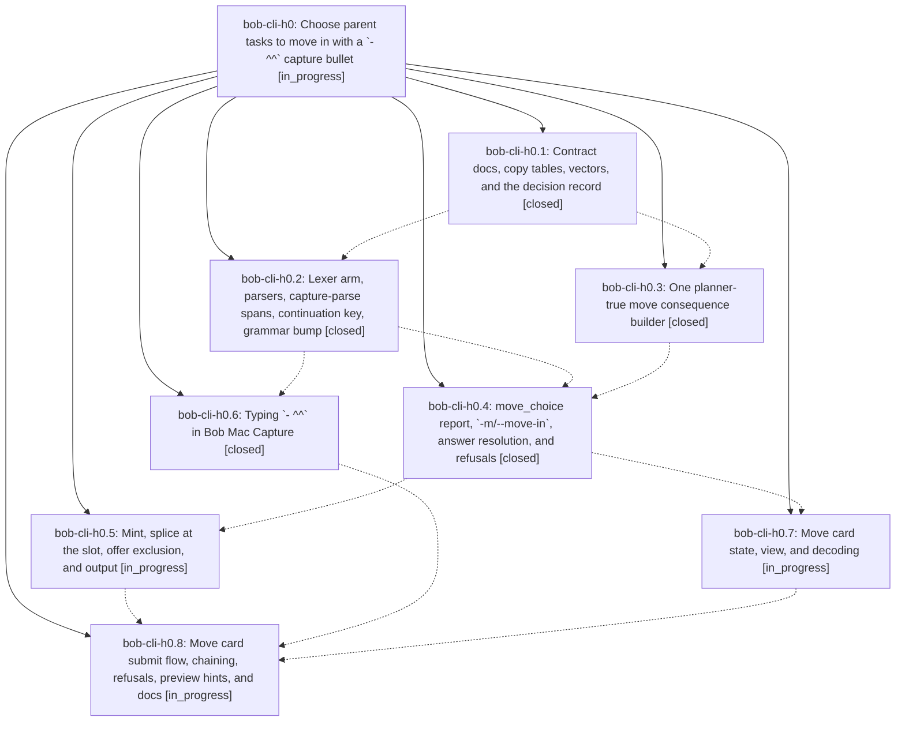

# Bead: bob-cli-h0 — Choose parent tasks to move in with a \`- ^^\` capture bullet

[Bead Pages](../README.md) / bob-cli-h0

**Status:** ◐ in_progress · **Type:** ▸ plan · **Tier:** epic
**Owner:** `bryanbugyi34@gmail.com` · **Created by:** [bbugyi200.apollo.research.37.linker.w0](https://github.com/bobs-org/bob-cli--agents/blob/main/sessions/bbugyi200.apollo.research.37.linker.w0.md) · **Assignee:** `bob-cli-h0.land`
**Created:** 2026-11-04 08:50:23 EST
**Plan:** [202611/move\_choice.md](https://github.com/bobs-org/bob-cli--plans/blob/main/202611/move_choice.md)

<!-- sase:links:start -->

## Links

| Relation | Artifact | Why |
| --- | --- | --- |
| implemented-by | [plan:202611/move_choice.md][1] | derived from the plan's `bead_id:` frontmatter field |

_Plus 2 automatic references — see [Referenced By](#referenced-by)._

[1]: https://github.com/bobs-org/bob-cli--plans/blob/main/202611/move_choice.md

<!-- sase:links:end -->

## Description

In a project-note capture sealed with `@foo^bar@` or `@foo:bar@`, a first-level `- ^^` bullet lets Bryan sort the parent note after Return and before anything is written. A three-state Move card (Leave by default, `^` move, `:` move & link) or `bob capture -m` answers it. The picks land at the `^^` slot in parent order with exactly the vault result that authored `- ^id` / `- :id` bullets produce, in one guarded batch.

## Phases

| Bead | Title | Status | Size | Created | Agents | Commits |
|---|---|---|---|---|---:|---:|
| [bob-cli-h0.1](bob-cli-h0.1.md) | Contract docs, copy tables, vectors, and the decision record | ✓ closed | medium | 2026-11-04 | 1 | 1 |
| [bob-cli-h0.2](bob-cli-h0.2.md) | Lexer arm, parsers, capture-parse spans, continuation key, grammar bump | ✓ closed | medium | 2026-11-04 | 1 | 1 |
| [bob-cli-h0.3](bob-cli-h0.3.md) | One planner-true move consequence builder | ✓ closed | medium | 2026-11-04 | 1 | 1 |
| [bob-cli-h0.4](bob-cli-h0.4.md) | move\_choice report, \`-m/--move-in\`, answer resolution, and refusals | ✓ closed | medium | 2026-11-04 | 1 | 1 |
| [bob-cli-h0.5](bob-cli-h0.5.md) | Mint, splice at the slot, offer exclusion, and output | ◐ in_progress | medium | 2026-11-04 | 1 | 0 |
| [bob-cli-h0.6](bob-cli-h0.6.md) | Typing \`- ^^\` in Bob Mac Capture | ✓ closed | small | 2026-11-04 | 1 | 0 |
| [bob-cli-h0.7](bob-cli-h0.7.md) | Move card state, view, and decoding | ◐ in_progress | medium | 2026-11-04 | 1 | 0 |
| [bob-cli-h0.8](bob-cli-h0.8.md) | Move card submit flow, chaining, refusals, preview hints, and docs | ◐ in_progress | medium | 2026-11-04 | 1 | 0 |

## Lineage

## Agents

| Agent | Bead | Commits |
|---|---|---:|
| [bbugyi200.apollo.bob-cli-h0.1](https://github.com/bobs-org/bob-cli--agents/blob/main/agents/bbugyi200.apollo.bob-cli-h0.1/README.md) | [bob-cli-h0.1](bob-cli-h0.1.md) | 1 |
| [bbugyi200.apollo.bob-cli-h0.2](https://github.com/bobs-org/bob-cli--agents/blob/main/agents/bbugyi200.apollo.bob-cli-h0.2/README.md) | [bob-cli-h0.2](bob-cli-h0.2.md) | 1 |
| [bbugyi200.apollo.bob-cli-h0.3](https://github.com/bobs-org/bob-cli--agents/blob/main/sessions/bbugyi200.apollo.bob-cli-h0.3.md) | [bob-cli-h0.3](bob-cli-h0.3.md) | 1 |
| [bbugyi200.apollo.bob-cli-h0.4](https://github.com/bobs-org/bob-cli--agents/blob/main/agents/bbugyi200.apollo.bob-cli-h0.4/README.md) | [bob-cli-h0.4](bob-cli-h0.4.md) | 1 |
| [bbugyi200.apollo.bob-cli-h0.5](https://github.com/bobs-org/bob-cli--agents/blob/main/agents/bbugyi200.apollo.bob-cli-h0.5/README.md) | [bob-cli-h0.5](bob-cli-h0.5.md) | 0 |
| [bbugyi200.apollo.bob-cli-h0.6](https://github.com/bobs-org/bob-cli--agents/blob/main/agents/bbugyi200.apollo.bob-cli-h0.6/README.md) | [bob-cli-h0.6](bob-cli-h0.6.md) | 0 |
| [bbugyi200.apollo.bob-cli-h0.7](https://github.com/bobs-org/bob-cli--agents/blob/main/agents/bbugyi200.apollo.bob-cli-h0.7/README.md) | [bob-cli-h0.7](bob-cli-h0.7.md) | 0 |
| [bbugyi200.apollo.bob-cli-h0.8](https://github.com/bobs-org/bob-cli--agents/blob/main/agents/bbugyi200.apollo.bob-cli-h0.8/README.md) | [bob-cli-h0.8](bob-cli-h0.8.md) | 0 |
| [bbugyi200.apollo.bob-cli-h0.land](https://github.com/bobs-org/bob-cli--agents/blob/main/agents/bbugyi200.apollo.bob-cli-h0.land/README.md) | [bob-cli-h0](README.md) | 0 |

## Commits

| Repo | Commit | Subject | Bead | Committed |
|---|---|---|---|---|
| bob-cli | [`d216f7e`](https://github.com/bobs-org/bob-cli/commit/d216f7eb3bdefeaa233b5d0ed288b4c653f2df1a) | docs(capture): specify parent move choice contract | [bob-cli-h0.1](bob-cli-h0.1.md) | 2026-11-04 09:15:50 EST |
| bob-cli | [`bfbf482`](https://github.com/bobs-org/bob-cli/commit/bfbf482fd696fbb406fb33a0fb4231a8112dd83d) | feat(capture)!: claim - ^^ move-choice marker with teaching errors | [bob-cli-h0.2](bob-cli-h0.2.md) | 2026-11-04 10:21:20 EST |
| bob-cli | [`abf427c`](https://github.com/bobs-org/bob-cli/commit/abf427c211d5f8ee7c1ed7cbbc1a983418dc89bd) | feat(capture): share one planner-true move consequence builder | [bob-cli-h0.3](bob-cli-h0.3.md) | 2026-11-04 10:57:02 EST |
| bob-cli | [`cf2e3c9`](https://github.com/bobs-org/bob-cli/commit/cf2e3c9f8b1b61a7bd20e9886e08446ef65ccd81) | feat(capture): add move\_choice report, -m/--move-in and refusals | [bob-cli-h0.4](bob-cli-h0.4.md) | 2026-11-04 12:58:50 EST |

<!-- sase:referenced-by:start -->

## Referenced By

| Relation | Artifact | Why | Uses |
| --- | --- | --- | ---: |
| read-by | [agent:bob-cli-go.13][1] | known docs-check memory-format blocker | 1 |
| read-by | [agent:bob-cli-h0.2][2] | need epic scope and decisions | 1 |

[1]: https://github.com/bobs-org/bob-cli--agents/blob/main/agents/bbugyi200.apollo.bob-cli-go.13/README.md
[2]: https://github.com/bobs-org/bob-cli--agents/blob/main/agents/bbugyi200.apollo.bob-cli-h0.2/README.md

<!-- sase:referenced-by:end -->
