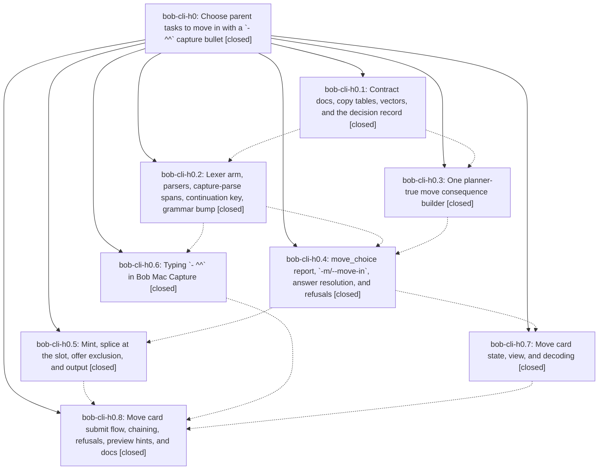

# Bead: bob-cli-h0 — Choose parent tasks to move in with a \`- ^^\` capture bullet

[Bead Pages](../README.md) / bob-cli-h0

**Status:** ✓ closed · **Resolution:** done · **Type:** ▸ plan · **Tier:** epic
**Owner:** `bryanbugyi34@gmail.com` · **Created by:** [bbugyi200.apollo.research.37.linker.w0](https://github.com/bobs-org/bob-cli--agents/blob/main/sessions/bbugyi200.apollo.research.37.linker.w0.md) · **Assignee:** `bob-cli-h0.land`
**Created:** 2026-11-04 08:50:23 EST · **Closed:** 2026-11-04 18:24:42 EST
**Plan:** [202611/move\_choice.md](https://github.com/bobs-org/bob-cli--plans/blob/main/202611/move_choice.md)

<!-- sase:links:start -->

## Links

| Relation | Artifact | Why |
| --- | --- | --- |
| implemented-by | [plan:202611/move_choice.md][1] | derived from the plan's `bead_id:` frontmatter field |

_Plus 10 automatic references — see [Referenced By](#referenced-by)._

[1]: https://github.com/bobs-org/bob-cli--plans/blob/main/202611/move_choice.md

<!-- sase:links:end -->

## Description

In a project-note capture sealed with `@foo^bar@` or `@foo:bar@`, a first-level `- ^^` bullet lets Bryan sort the parent note after Return and before anything is written. A three-state Move card (Leave by default, `^` move, `:` move & link) or `bob capture -m` answers it. The picks land at the `^^` slot in parent order with exactly the vault result that authored `- ^id` / `- :id` bullets produce, in one guarded batch.

## Notes

[2026-11-04T20:56:22Z · research.3b.final] DISCOVERED ISSUE (research.3b.final, lead of the bead-triage swarm): master test capture::note_pull::np_move_groups_follow_requested_sources_in_cli_fixtures (tests/cli/capture/note_pull.rs:117, tracked as bob-cli-h5) fails because CLI output now carries moved_tasks[].via = "bullet", which the checked-in preview.json lacks; that field arrived in h0 commit 458b53b9 (execute move_choice picks with mint, splice, offers and via). Evidence: bob-cli CI run 41900846465 on 87eecb1a, left/right diff differs only in via. The h0 lander should refresh the fixture (or drop via from note-pull output if unintended) and close bob-cli-h5.

[2026-11-04T21:44:12Z · bob-cli-h0.land] LANDER TRIAGE (bob-cli-h0.land) of every PROPOSED FOLLOW-UP and discovered issue:
(1) h0.1 #1 and h0.2 #1, task-merge glossary front matter breaking docs-check: declined, already resolved. bob-cli-go.13 closed, the strand has front matter, and just docs-check passes on 029b4266 (447 passed, 1 skipped).
(2) h0.5 #1, cargo fmt drift: declined, already resolved. cargo fmt --all --check passes on 029b4266.
(3) h0.5 #2, clippy deny errors (7 in editor_pomodoro.rs, 1 in past.rs): caused by active epic bob-cli-h2 (ce8f53b1/ed12f3d4). Recorded as a DISCOVERED ISSUE note on bob-cli-h2; no task, because an active epic owns it.
(4) h0.5 #3, docs-check strict-build anchor in docs/reference/mac-capture/keyboard.md: declined, already resolved. just docs-check passes.
(5) Epic note #1 / bob-cli-h5, note_pull np-move fixture: the h0 via drift was already fixed by h4.1 decd465c. The remaining drift was h4.2 029b4266's four new moves[] fields. Fixture regenerated in the lander's integration edits; note_pull 11/11 pass; h5 closed; noted on bob-cli-h4.
(6) h0.8 #1, three live Move-card walkthroughs: left to Bryan as the plan allows (no Mac UI driver); not a task.
Also seen, not h0's: bob-cli-h6 highlights overwrite tests (owned by bob-cli-h8.6); bob-mac-capture CI red since the Go To commits (bob-cli-h7 / h8.5). All 26 MoveChoice XCTests pass in CI run 41912472770.

[2026-11-04T23:24:42Z · bob-cli-h0.land--1] All 8 phases verified against source; all phase beads were already closed. MQ17 parity fixes are in place: shared Sep 25 date formatting, PullForward and DropDependencies retain dates, ID-less rows assess a scratch minted ID, unnamed Pomodoros count as existing links, the guard is computed once per row, and optional row fields serialize explicit nulls. Added execution coverage for authored-bullet equivalence and ordering, key and number picks, minting and collision refusals, successor-offer exclusion, dated projects, #name requirements, guard parity, and full-batch rollback with destination-before-source ordering. Contract docs are complete across capture, JSON output, compatibility, task-move, and freshness. The rollback test byte comparison was corrected after clippy exposed a type mismatch. Verification: focused monitor guard test passed; 10 move-choice CLI tests passed; cargo fmt check passed; just docs-check passed after the docs edits. cargo clippy exits 101 under Rust 1.95 with 523 workspace lint diagnostics, including the known bob-cli-h2 editor_pomodoro and past findings plus other existing lint diagnostics; these were recorded and left unchanged. cargo test --workspace: 5003 unit tests passed; CLI target 3131 passed and the two expected bob-cli-h6 highlights overwrite tests failed (local_pdf_overwrite_replaces_in_place_without_archive and overwrite_same_stem_source_selects_named_member); all other targets passed. just symvision is unavailable because this checkout has no recipe or executable; the whole-tree epic-symbol check is clean and bob-cli-h0 has no epic symbols. The three Mac walkthroughs remain for Bryan per the h0.8 note.

[2026-11-05T00:10:49Z · bob-cli-h0.land--3] FINAL VERIFICATION (bob-cli-h0.land--3, 2026-11-05): The 10 move-choice CLI regression tests passed, including the guard prediction matrix and authored-bullet equivalence. cargo fmt --all -- --check passed; just docs-check passed after the contract edits. cargo test --workspace --no-fail-fast exited 101: 5,003 unit tests passed and 2 were ignored; the CLI target had 3,130 passed and 3 failed. The two known bob-cli-h6 failures were highlights::overwrite_local::local_pdf_overwrite_replaces_in_place_without_archive and highlights::overwrite_local::overwrite_same_stem_source_selects_named_member. The third was capture::related::draft_related_stays_under_the_debug_perf_gate (580.485396 ms against its 500 ms paired-baseline limit); its isolated rerun passed 1/1 in 3.30 s with no source changes. This is the pre-existing parallel-load timing flake tracked by bob-cli-bo, not an h0 regression; I added a corroborating +1 with artifact file:explicit:e551fc295aa391a56842f610. All other workspace targets passed. cargo clippy --workspace --all-targets --all-features -- -D warnings exited 101 with 523 workspace diagnostics. The known bob-cli-h2 findings in editor_pomodoro.rs and past.rs were left unchanged; the two h0-specific style findings ptr_arg and wrong_self_convention were fixed after that run, and clippy was not rerun. just symvision is unavailable in this checkout because no recipe or executable is present; `sase bead epic-symbols bob-cli-h0` reports no epic symbols. The three Mac Move-card walkthroughs remain for Bryan per h0.8. bob-cli-h0 remains closed and the linked plan remains status: done.

## Phases

| Bead | Title | Status | Size | Created | Agents | Commits |
|---|---|---|---|---|---:|---:|
| [bob-cli-h0.1](bob-cli-h0.1.md) | Contract docs, copy tables, vectors, and the decision record | ✓ closed | medium | 2026-11-04 | 1 | 1 |
| [bob-cli-h0.2](bob-cli-h0.2.md) | Lexer arm, parsers, capture-parse spans, continuation key, grammar bump | ✓ closed | medium | 2026-11-04 | 1 | 1 |
| [bob-cli-h0.3](bob-cli-h0.3.md) | One planner-true move consequence builder | ✓ closed | medium | 2026-11-04 | 1 | 1 |
| [bob-cli-h0.4](bob-cli-h0.4.md) | move\_choice report, \`-m/--move-in\`, answer resolution, and refusals | ✓ closed | medium | 2026-11-04 | 1 | 1 |
| [bob-cli-h0.5](bob-cli-h0.5.md) | Mint, splice at the slot, offer exclusion, and output | ✓ closed | medium | 2026-11-04 | 1 | 1 |
| [bob-cli-h0.6](bob-cli-h0.6.md) | Typing \`- ^^\` in Bob Mac Capture | ✓ closed | small | 2026-11-04 | 1 | 1 |
| [bob-cli-h0.7](bob-cli-h0.7.md) | Move card state, view, and decoding | ✓ closed | medium | 2026-11-04 | 1 | 1 |
| [bob-cli-h0.8](bob-cli-h0.8.md) | Move card submit flow, chaining, refusals, preview hints, and docs | ✓ closed | medium | 2026-11-04 | 1 | 1 |

## Lineage

## Agents

| Agent | Bead | Commits |
|---|---|---:|
| [bbugyi200.apollo.bob-cli-h0.1](https://github.com/bobs-org/bob-cli--agents/blob/main/agents/bbugyi200.apollo.bob-cli-h0.1/README.md) | [bob-cli-h0.1](bob-cli-h0.1.md) | 1 |
| [bbugyi200.apollo.bob-cli-h0.2](https://github.com/bobs-org/bob-cli--agents/blob/main/agents/bbugyi200.apollo.bob-cli-h0.2/README.md) | [bob-cli-h0.2](bob-cli-h0.2.md) | 1 |
| [bbugyi200.apollo.bob-cli-h0.3](https://github.com/bobs-org/bob-cli--agents/blob/main/sessions/bbugyi200.apollo.bob-cli-h0.3.md) | [bob-cli-h0.3](bob-cli-h0.3.md) | 1 |
| [bbugyi200.apollo.bob-cli-h0.4](https://github.com/bobs-org/bob-cli--agents/blob/main/agents/bbugyi200.apollo.bob-cli-h0.4/README.md) | [bob-cli-h0.4](bob-cli-h0.4.md) | 1 |
| [bbugyi200.apollo.bob-cli-h0.5](https://github.com/bobs-org/bob-cli--agents/blob/main/agents/bbugyi200.apollo.bob-cli-h0.5/README.md) | [bob-cli-h0.5](bob-cli-h0.5.md) | 1 |
| [bbugyi200.apollo.bob-cli-h0.6](https://github.com/bobs-org/bob-cli--agents/blob/main/agents/bbugyi200.apollo.bob-cli-h0.6/README.md) | [bob-cli-h0.6](bob-cli-h0.6.md) | 1 |
| [bbugyi200.apollo.bob-cli-h0.7](https://github.com/bobs-org/bob-cli--agents/blob/main/sessions/bbugyi200.apollo.bob-cli-h0.7.md) | [bob-cli-h0.7](bob-cli-h0.7.md) | 1 |
| [bbugyi200.apollo.bob-cli-h0.8](https://github.com/bobs-org/bob-cli--agents/blob/main/agents/bbugyi200.apollo.bob-cli-h0.8/README.md) | [bob-cli-h0.8](bob-cli-h0.8.md) | 1 |
| [bbugyi200.apollo.bob-cli-h0.land](https://github.com/bobs-org/bob-cli--agents/blob/main/sessions/bbugyi200.apollo.bob-cli-h0.land.md) | [bob-cli-h0](README.md) | 2 |

## Commits

| Repo | Commit | Subject | Bead | Committed |
|---|---|---|---|---|
| bob-cli | [`d216f7e`](https://github.com/bobs-org/bob-cli/commit/d216f7eb3bdefeaa233b5d0ed288b4c653f2df1a) | docs(capture): specify parent move choice contract | [bob-cli-h0.1](bob-cli-h0.1.md) | 2026-11-04 09:15:50 EST |
| bob-cli | [`bfbf482`](https://github.com/bobs-org/bob-cli/commit/bfbf482fd696fbb406fb33a0fb4231a8112dd83d) | feat(capture)!: claim - ^^ move-choice marker with teaching errors | [bob-cli-h0.2](bob-cli-h0.2.md) | 2026-11-04 10:21:20 EST |
| bob-mac-capture | [`bob-mac-capture@0df42dc`](https://github.com/bobs-org/bob-mac-capture/commit/0df42dc667c7dad009ec0e58b925b0f07f637fe7) | feat(capture): support move-choice continuation in Mac Capture | [bob-cli-h0.6](bob-cli-h0.6.md) | 2026-11-04 10:40:21 EST |
| bob-cli | [`abf427c`](https://github.com/bobs-org/bob-cli/commit/abf427c211d5f8ee7c1ed7cbbc1a983418dc89bd) | feat(capture): share one planner-true move consequence builder | [bob-cli-h0.3](bob-cli-h0.3.md) | 2026-11-04 10:57:02 EST |
| bob-cli | [`cf2e3c9`](https://github.com/bobs-org/bob-cli/commit/cf2e3c9f8b1b61a7bd20e9886e08446ef65ccd81) | feat(capture): add move\_choice report, -m/--move-in and refusals | [bob-cli-h0.4](bob-cli-h0.4.md) | 2026-11-04 12:58:50 EST |
| bob-mac-capture | [`bob-mac-capture@4906d94`](https://github.com/bobs-org/bob-mac-capture/commit/4906d94fdcb6b162deff64ce83d627d99d8a3fbf) | feat(capture): add move-choice card presentation | [bob-cli-h0.7](bob-cli-h0.7.md) | 2026-11-04 13:32:47 EST |
| bob-cli | [`458b53b`](https://github.com/bobs-org/bob-cli/commit/458b53b95188cd986513a64d46c33336f79daf35) | feat(capture): execute move\_choice picks with mint, splice, offers and via | [bob-cli-h0.5](bob-cli-h0.5.md) | 2026-11-04 13:57:24 EST |
| bob-mac-capture | [`bob-mac-capture@0245a75`](https://github.com/bobs-org/bob-mac-capture/commit/0245a752dde5fabd2e7a86f6ab7ce1ec56822b96) | feat(capture): submit Move choices before Pull-In and inbox routing | [bob-cli-h0.8](bob-cli-h0.8.md) | 2026-11-04 16:03:33 EST |
| bob-cli | [`29f2089`](https://github.com/bobs-org/bob-cli/commit/29f2089af10a9c7ac1da0fb25c6b8115a4d6a82e) | test(capture): refresh np-move note-pull fixtures for enriched move records | [bob-cli-h0](README.md) | 2026-11-04 16:48:19 EST |
| bob-cli | [`3da7ff4`](https://github.com/bobs-org/bob-cli/commit/3da7ff47905b56862d9e9e49aac3b86890c0fd4f) | feat(capture): add project-note move choice flow | [bob-cli-h0](README.md) | 2026-11-04 19:15:25 EST |

<!-- sase:referenced-by:start -->

## Referenced By

| Relation | Artifact | Why | Uses |
| --- | --- | --- | ---: |
| read-by | [agent:bob-cli-go.13][1] | known docs-check memory-format blocker | 1 |
| read-by | [agent:bob-cli-h0.2][2] | need epic scope and decisions | 1 |
| read-by | [agent:bob-cli-h0.4][3] | parent epic context | 1 |
| read-by | [agent:bob-cli-h0.5][4] | Need epic DECISIONS and plan context | 1 |
| read-by | [agent:bob-cli-h0.7--1][5] | Need the parent epic decisions and any constraints for mac-card | 2 |
| read-by | [agent:bob-cli-h0.land][6] | Need the epic scope, children, and linked plan file | 1 |
| read-by | [agent:research.3b.cdx][7] | Compare active epic scope with high-impact correctness and CI task candidates | 1 |
| read-by | [agent:research.3b.cld][8] | Check active epic scope and discovered issues for conflicts with candidate task beads | 1 |
| read-by | [agent:research.3b.gem][9] | Check running epic h0 to avoid conflicts | 1 |
| read-by | [agent:research.3b.mus][10] | research top beads needs active epic scope to avoid conflicts | 1 |

[1]: https://github.com/bobs-org/bob-cli--agents/blob/main/agents/bbugyi200.apollo.bob-cli-go.13/README.md
[2]: https://github.com/bobs-org/bob-cli--agents/blob/main/agents/bbugyi200.apollo.bob-cli-h0.2/README.md
[3]: https://github.com/bobs-org/bob-cli--agents/blob/main/agents/bbugyi200.apollo.bob-cli-h0.4/README.md
[4]: https://github.com/bobs-org/bob-cli--agents/blob/main/agents/bbugyi200.apollo.bob-cli-h0.5/README.md
[5]: https://github.com/bobs-org/bob-cli--agents/blob/main/sessions/bbugyi200.apollo.bob-cli-h0.7.md
[6]: https://github.com/bobs-org/bob-cli--agents/blob/main/sessions/bbugyi200.apollo.bob-cli-h0.land.md
[7]: https://github.com/bobs-org/bob-cli--agents/blob/main/agents/bbugyi200.apollo.research.3b.cdx/README.md
[8]: https://github.com/bobs-org/bob-cli--agents/blob/main/agents/bbugyi200.apollo.research.3b.cld/README.md
[9]: https://github.com/bobs-org/bob-cli--agents/blob/main/agents/bbugyi200.apollo.research.3b.gem/README.md
[10]: https://github.com/bobs-org/bob-cli--agents/blob/main/agents/bbugyi200.apollo.research.3b.mus/README.md

<!-- sase:referenced-by:end -->
