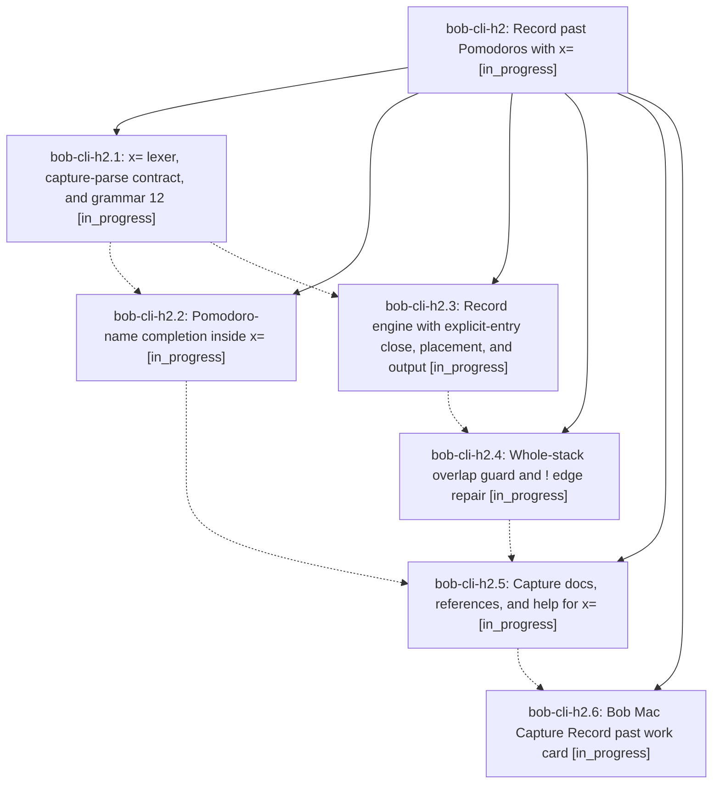

# Bead: bob-cli-h2 — Record past Pomodoros with x=

[Bead Pages](../README.md) / bob-cli-h2

**Status:** ◐ in_progress · **Type:** ▸ plan · **Tier:** epic
**Owner:** `bryanbugyi34@gmail.com` · **Created by:** [bbugyi200.apollo.research.38.linker.w0](https://github.com/bobs-org/bob-cli--agents/blob/main/sessions/bbugyi200.apollo.research.38.linker.w0.md) · **Assignee:** `bob-cli-h2.land`
**Created:** 2026-11-04 11:11:57 EST
**Plan:** [202611/past\_pomodoro\_recording.md](https://github.com/bobs-org/bob-cli--plans/blob/main/202611/past_pomodoro_recording.md)

<!-- sase:links:start -->

## Links

| Relation | Artifact | Why |
| --- | --- | --- |
| implemented-by | [plan:202611/past_pomodoro_recording.md][1] | derived from the plan's `bead_id:` frontmatter field |

[1]: https://github.com/bobs-org/bob-cli--plans/blob/main/202611/past_pomodoro_recording.md

<!-- sase:links:end -->

## Description

Capture gains `x=<E>[!][=<X>]`, which records already-finished Pomodoros in one step. Each token starts and closes a past session that ends at the current 5-minute block. Consecutive tokens stack back to back. A token never overlaps history, except that `!` trims an edge of an older closed row and warns. bob previews, completes, and documents the token, and the Mac app renders it.

## Phases

| Bead | Title | Status | Size | Created | Agents | Commits |
|---|---|---|---|---|---:|---:|
| [bob-cli-h2.1](bob-cli-h2.1.md) | x= lexer, capture-parse contract, and grammar 12 | ◐ in_progress | large | 2026-11-04 | 1 | 1 |
| [bob-cli-h2.2](bob-cli-h2.2.md) | Pomodoro-name completion inside x= | ◐ in_progress | small | 2026-11-04 | 1 | 0 |
| [bob-cli-h2.3](bob-cli-h2.3.md) | Record engine with explicit-entry close, placement, and output | ◐ in_progress | large | 2026-11-04 | 1 | 0 |
| [bob-cli-h2.4](bob-cli-h2.4.md) | Whole-stack overlap guard and ! edge repair | ◐ in_progress | medium | 2026-11-04 | 1 | 0 |
| [bob-cli-h2.5](bob-cli-h2.5.md) | Capture docs, references, and help for x= | ◐ in_progress | medium | 2026-11-04 | 1 | 0 |
| [bob-cli-h2.6](bob-cli-h2.6.md) | Bob Mac Capture Record past work card | ◐ in_progress | large | 2026-11-04 | 1 | 0 |

## Lineage

## Agents

| Agent | Bead | Commits |
|---|---|---:|
| [bbugyi200.apollo.bob-cli-h2.1](https://github.com/bobs-org/bob-cli--agents/blob/main/sessions/bbugyi200.apollo.bob-cli-h2.1.md) | [bob-cli-h2.1](bob-cli-h2.1.md) | 1 |
| [bbugyi200.apollo.bob-cli-h2.2](https://github.com/bobs-org/bob-cli--agents/blob/main/agents/bbugyi200.apollo.bob-cli-h2.2/README.md) | [bob-cli-h2.2](bob-cli-h2.2.md) | 0 |
| [bbugyi200.apollo.bob-cli-h2.3](https://github.com/bobs-org/bob-cli--agents/blob/main/agents/bbugyi200.apollo.bob-cli-h2.3/README.md) | [bob-cli-h2.3](bob-cli-h2.3.md) | 0 |
| [bbugyi200.apollo.bob-cli-h2.4](https://github.com/bobs-org/bob-cli--agents/blob/main/agents/bbugyi200.apollo.bob-cli-h2.4/README.md) | [bob-cli-h2.4](bob-cli-h2.4.md) | 0 |
| [bbugyi200.apollo.bob-cli-h2.5](https://github.com/bobs-org/bob-cli--agents/blob/main/agents/bbugyi200.apollo.bob-cli-h2.5/README.md) | [bob-cli-h2.5](bob-cli-h2.5.md) | 0 |
| [bbugyi200.apollo.bob-cli-h2.6](https://github.com/bobs-org/bob-cli--agents/blob/main/agents/bbugyi200.apollo.bob-cli-h2.6/README.md) | [bob-cli-h2.6](bob-cli-h2.6.md) | 0 |
| [bbugyi200.apollo.bob-cli-h2.land](https://github.com/bobs-org/bob-cli--agents/blob/main/agents/bbugyi200.apollo.bob-cli-h2.land/README.md) | [bob-cli-h2](README.md) | 0 |

## Commits

| Repo | Commit | Subject | Bead | Committed |
|---|---|---|---|---|
| bob-cli | [`ce8f53b`](https://github.com/bobs-org/bob-cli/commit/ce8f53b187701003446ad65b350510374b2c161e) | feat(capture)!: record past Pomodoro grammar (x= lexer, capture-parse, refusal) | [bob-cli-h2.1](bob-cli-h2.1.md) | 2026-11-04 12:57:37 EST |
