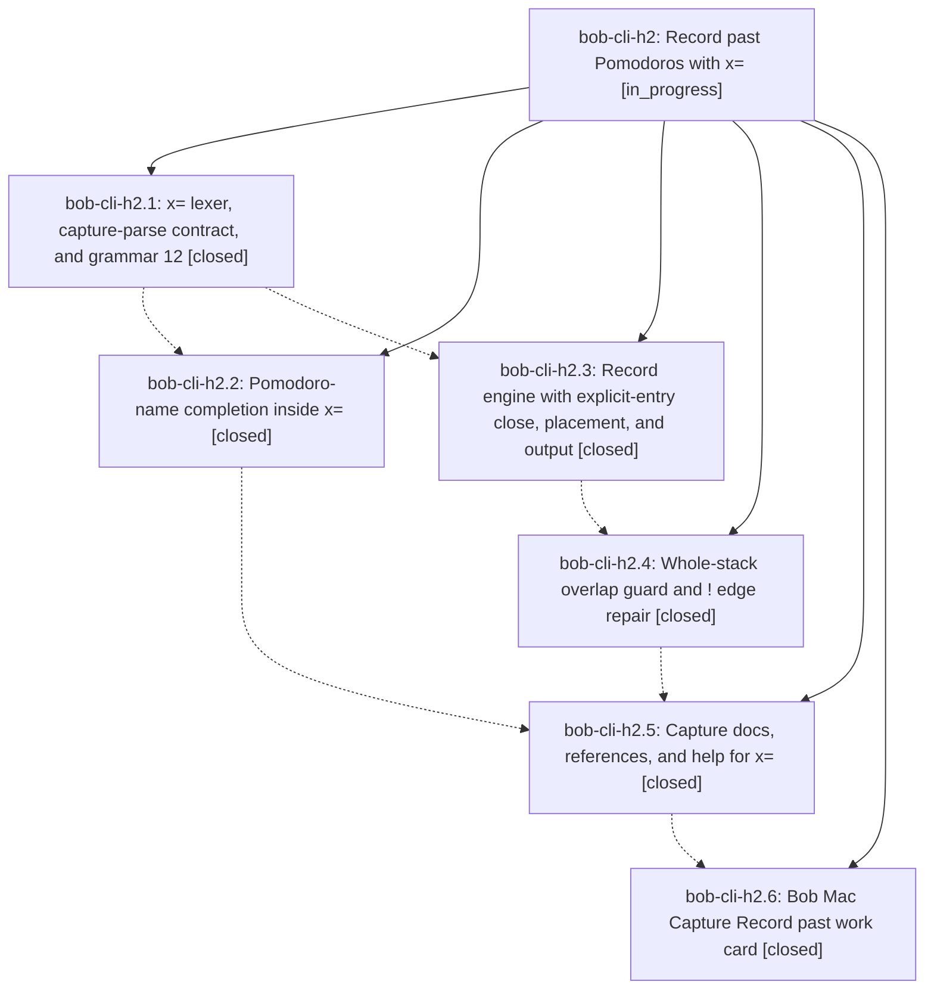

# Bead: bob-cli-h2 — Record past Pomodoros with x=

[Bead Pages](../README.md) / bob-cli-h2

**Status:** ◐ in_progress · **Type:** ▸ plan · **Tier:** epic
**Owner:** `bryanbugyi34@gmail.com` · **Created by:** [bbugyi200.apollo.research.38.linker.w0](https://github.com/bobs-org/bob-cli--agents/blob/main/sessions/bbugyi200.apollo.research.38.linker.w0.md) · **Assignee:** `bob-cli-h2.land`
**Created:** 2026-11-04 11:11:57 EST
**Plan:** [202611/past\_pomodoro\_recording.md](https://github.com/bobs-org/bob-cli--plans/blob/main/202611/past_pomodoro_recording.md)

<!-- sase:links:start -->

## Links

| Relation | Artifact | Why |
| --- | --- | --- |
| implemented-by | [plan:202611/past_pomodoro_recording.md][1] | derived from the plan's `bead_id:` frontmatter field |

_Plus 8 automatic references — see [Referenced By](#referenced-by)._

[1]: https://github.com/bobs-org/bob-cli--plans/blob/main/202611/past_pomodoro_recording.md

<!-- sase:links:end -->

## Description

Capture gains `x=<E>[!][=<X>]`, which records already-finished Pomodoros in one step. Each token starts and closes a past session that ends at the current 5-minute block. Consecutive tokens stack back to back. A token never overlaps history, except that `!` trims an edge of an older closed row and warns. bob previews, completes, and documents the token, and the Mac app renders it.

## Notes

[2026-11-04T18:56:39Z · bob-cli-h3.land--1] DISCOVERED ISSUE: The required bob-cli canonical gate from Go To closeout, ToolRun 1d5f7f2a9e9bcd7559dffdad03c5896d, exits at its first stage (cargo fmt --all -- --check) on clean master/origin/master cf2e3c9f. Rustfmt 1.9.0 reports formatting differences in the new x= parser and tests, including src/native/capture_language/tests/past.rs, src/native/capture_parse.rs, and tests/cli/capture/parse_pomodoro_past.rs; these files were introduced or changed by h2.1 commit ce8f53b1. The tracked rustfmt.toml sets max_width=80 and style_edition=2021. This is deterministic formatting drift, not an intermittent test failure; clippy and tests did not run. It is outside Go To h3 and belongs to this active x= epic; format its owned files and rerun just check. Same-type search found the closed bob-cli-24 rustfmt task, but that older config drift was fixed in d1d6e59; this is new unformatted h2 code, so no duplicate task was created.

[2026-11-04T19:01:24Z · bob-cli-h3.land--1] DISCOVERED ISSUE corroboration: After the earlier clean-baseline report, bob-cli was fast-forwarded to current origin/master 281ef10b, including h2.2 completion work and unrelated highlights changes. A second canonical sase tool run check, ToolRun a82d35137af5ce7b789f1a8aa5ba17aa, fails at the same cargo fmt --all -- --check stage with formatting diffs in h2 x= parser/tests. Clippy and tests still do not run. This confirms the formatting issue on the current base; h2.2 commit 281ef10b also reports reproducing it.

[2026-11-04T21:43:31Z · bob-cli-h0.land] DISCOVERED ISSUE: cargo clippy --workspace --all-targets --all-features with the just-check deny gate fails on clean master 029b4266 (rustc/clippy 1.95.0) with 8 errors, all in h2-owned x= code: src/native/capture_language/editor_pomodoro.rs:3268, :3288, :3298 needless_return; :3309 question_mark (let...else); :3680, :3743, :3815 collapsible_if; src/native/capture_language/past.rs:472 nonminimal_bool ('this boolean expression contains a logic bug' — check the intended condition, not just the lint). Files came from h2.1 ce8f53b1 / h2.3 ed12f3d4. Impact: just check stops at clippy, so its test stage never runs and master CI stays red. cargo fmt --check now passes. First proposed as PROPOSED FOLLOW-UP by bob-cli-h0.5 (note #2); reproduced by the bob-cli-h0 lander. No task bead filed: this epic caused it.

[2026-11-04T21:46:06Z · bob-cli-h0.land] DISCOVERED ISSUE (docs, from the bob-cli-h0 lander): docs/reference/compatibility.md 'Capture-language revision' still says capture-parse reports grammar: 10 and describes nothing after grammar 10, but GRAMMAR_REVISION is 12 on master (h0 bumped it to 11; h2.1 ce8f53b1 bumped it to 12). The h0 landing tale adds only a grammar-11 paragraph for - ^^. h2 should add its grammar-12 (x=) paragraph and update the lead sentence's live revision number when it lands.

## Phases

| Bead | Title | Status | Size | Created | Agents | Commits |
|---|---|---|---|---|---:|---:|
| [bob-cli-h2.1](bob-cli-h2.1.md) | x= lexer, capture-parse contract, and grammar 12 | ✓ closed | large | 2026-11-04 | 1 | 1 |
| [bob-cli-h2.2](bob-cli-h2.2.md) | Pomodoro-name completion inside x= | ✓ closed | small | 2026-11-04 | 1 | 1 |
| [bob-cli-h2.3](bob-cli-h2.3.md) | Record engine with explicit-entry close, placement, and output | ✓ closed | large | 2026-11-04 | 1 | 1 |
| [bob-cli-h2.4](bob-cli-h2.4.md) | Whole-stack overlap guard and ! edge repair | ✓ closed | medium | 2026-11-04 | 1 | 1 |
| [bob-cli-h2.5](bob-cli-h2.5.md) | Capture docs, references, and help for x= | ✓ closed | medium | 2026-11-04 | 1 | 1 |
| [bob-cli-h2.6](bob-cli-h2.6.md) | Bob Mac Capture Record past work card | ✓ closed | large | 2026-11-04 | 1 | 1 |

## Lineage

## Dependencies

- **Blocks:** [bob-cli-h8.12](../bob-cli-h8/bob-cli-h8.12.md) ◐ · ⧖ 2026-11-04

## Agents

| Agent | Bead | Commits |
|---|---|---:|
| [bbugyi200.apollo.bob-cli-h2.1](https://github.com/bobs-org/bob-cli--agents/blob/main/sessions/bbugyi200.apollo.bob-cli-h2.1.md) | [bob-cli-h2.1](bob-cli-h2.1.md) | 1 |
| [bbugyi200.apollo.bob-cli-h2.2](https://github.com/bobs-org/bob-cli--agents/blob/main/agents/bbugyi200.apollo.bob-cli-h2.2/README.md) | [bob-cli-h2.2](bob-cli-h2.2.md) | 1 |
| [bbugyi200.apollo.bob-cli-h2.3](https://github.com/bobs-org/bob-cli--agents/blob/main/sessions/bbugyi200.apollo.bob-cli-h2.3.md) | [bob-cli-h2.3](bob-cli-h2.3.md) | 1 |
| [bbugyi200.apollo.bob-cli-h2.4](https://github.com/bobs-org/bob-cli--agents/blob/main/agents/bbugyi200.apollo.bob-cli-h2.4/README.md) | [bob-cli-h2.4](bob-cli-h2.4.md) | 1 |
| [bbugyi200.apollo.bob-cli-h2.5](https://github.com/bobs-org/bob-cli--agents/blob/main/agents/bbugyi200.apollo.bob-cli-h2.5/README.md) | [bob-cli-h2.5](bob-cli-h2.5.md) | 1 |
| [bbugyi200.apollo.bob-cli-h2.6](https://github.com/bobs-org/bob-cli--agents/blob/main/sessions/bbugyi200.apollo.bob-cli-h2.6.md) | [bob-cli-h2.6](bob-cli-h2.6.md) | 1 |
| [bbugyi200.apollo.bob-cli-h2.land](https://github.com/bobs-org/bob-cli--agents/blob/main/agents/bbugyi200.apollo.bob-cli-h2.land/README.md) | [bob-cli-h2](README.md) | 0 |

## Commits

| Repo | Commit | Subject | Bead | Committed |
|---|---|---|---|---|
| bob-cli | [`ce8f53b`](https://github.com/bobs-org/bob-cli/commit/ce8f53b187701003446ad65b350510374b2c161e) | feat(capture)!: record past Pomodoro grammar (x= lexer, capture-parse, refusal) | [bob-cli-h2.1](bob-cli-h2.1.md) | 2026-11-04 12:57:37 EST |
| bob-cli | [`281ef10`](https://github.com/bobs-org/bob-cli/commit/281ef10b025dab2ef074630bac1a62f1d1781abe) | feat(capture): complete past Pomodoro names | [bob-cli-h2.2](bob-cli-h2.2.md) | 2026-11-04 13:50:01 EST |
| bob-cli | [`ed12f3d`](https://github.com/bobs-org/bob-cli/commit/ed12f3d4f38f7fb80a560a44fd2f46e63ded36e8) | feat(capture)!: execute past Pomodoro stacks with explicit-entry record engine | [bob-cli-h2.3](bob-cli-h2.3.md) | 2026-11-04 14:32:05 EST |
| bob-cli | [`399b522`](https://github.com/bobs-org/bob-cli/commit/399b52221409f4c37536530d7d56067f1d4f4f4f) | feat(capture)!: whole-stack overlap guard and past edge repair | [bob-cli-h2.4](bob-cli-h2.4.md) | 2026-11-04 15:31:26 EST |
| bob-cli | [`78834b6`](https://github.com/bobs-org/bob-cli/commit/78834b66734e5d619cd4efc82df76f288ea7ea34) | docs(capture): document past Pomodoros | [bob-cli-h2.5](bob-cli-h2.5.md) | 2026-11-04 16:42:41 EST |
| bob-mac-capture | [`bob-mac-capture@10470e7`](https://github.com/bobs-org/bob-mac-capture/commit/10470e7f6c77a9288e51d24bd86a5228307976c7) | feat(mac-capture): render Record past work card for x= stacks | [bob-cli-h2.6](bob-cli-h2.6.md) | 2026-11-04 18:07:52 EST |

<!-- sase:referenced-by:start -->

## Referenced By

| Relation | Artifact | Why | Uses |
| --- | --- | --- | ---: |
| read-by | [agent:bob-cli-h0.land][1] | Check whether h2 already records the editor_pomodoro.rs/past.rs clippy deny failures (h0.5 follow-up) | 1 |
| read-by | [agent:bob-cli-h3.land--1][2] | Need to determine whether the current cargo fmt failure belongs to this active epic’s introduced parser and tests | 1 |
| read-by | [agent:bob-cli-h8.11][3] | Identify which active bead owns the clean-base past-Pomodoro Clippy diagnostics | 1 |
| read-by | [agent:bob-cli-h8.6][4] | Confirm the existing owner for clean-base Clippy failures | 1 |
| read-by | [agent:research.3b.cdx][5] | Compare active epic scope with high-impact correctness and CI task candidates | 1 |
| read-by | [agent:research.3b.cld][6] | Check active epic scope and discovered issues for conflicts with candidate task beads | 1 |
| read-by | [agent:research.3b.gem][7] | Check running epic h2 to avoid conflicts | 1 |
| read-by | [agent:research.3b.mus][8] | research top beads needs active epic scope to avoid conflicts | 1 |

[1]: https://github.com/bobs-org/bob-cli--agents/blob/main/sessions/bbugyi200.apollo.bob-cli-h0.land.md
[2]: https://github.com/bobs-org/bob-cli--agents/blob/main/sessions/bbugyi200.apollo.bob-cli-h3.land.md
[3]: https://github.com/bobs-org/bob-cli--agents/blob/main/agents/bbugyi200.apollo.bob-cli-h8.11/README.md
[4]: https://github.com/bobs-org/bob-cli--agents/blob/main/agents/bbugyi200.apollo.bob-cli-h8.6/README.md
[5]: https://github.com/bobs-org/bob-cli--agents/blob/main/agents/bbugyi200.apollo.research.3b.cdx/README.md
[6]: https://github.com/bobs-org/bob-cli--agents/blob/main/agents/bbugyi200.apollo.research.3b.cld/README.md
[7]: https://github.com/bobs-org/bob-cli--agents/blob/main/agents/bbugyi200.apollo.research.3b.gem/README.md
[8]: https://github.com/bobs-org/bob-cli--agents/blob/main/agents/bbugyi200.apollo.research.3b.mus/README.md

<!-- sase:referenced-by:end -->
