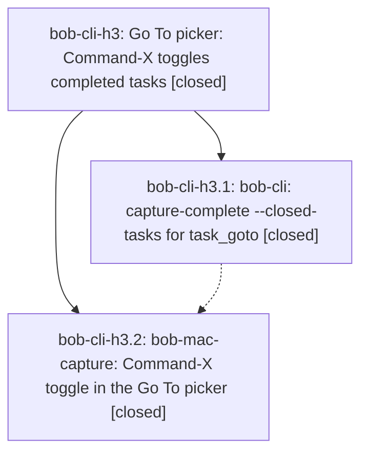

# Bead: bob-cli-h3 — Go To picker: Command-X toggles completed tasks

[Bead Pages](../README.md) / bob-cli-h3

**Status:** ✓ closed · **Resolution:** done · **Type:** ▸ plan · **Tier:** epic
**Owner:** `bryanbugyi34@gmail.com` · **Created by:** [bbugyi200.athena.180](https://github.com/bobs-org/bob-cli--agents/blob/main/sessions/bbugyi200.athena.180.md) · **Assignee:** `bob-cli-h3.land`
**Created:** 2026-11-04 11:50:53 EST · **Closed:** 2026-11-04 13:57:14 EST
**Plan:** [202611/goto\_completed\_toggle.md](https://github.com/bobs-org/bob-cli--plans/blob/main/202611/goto_completed_toggle.md)

<!-- sase:links:start -->

## Links

| Relation | Artifact | Why |
| --- | --- | --- |
| implemented-by | [plan:202611/goto_completed_toggle.md][1] | derived from the plan's `bead_id:` frontmatter field |

_Plus 1 automatic references — see [Referenced By](#referenced-by)._

[1]: https://github.com/bobs-org/bob-cli--plans/blob/main/202611/goto_completed_toggle.md

<!-- sase:links:end -->

## Description

In Bob Mac Capture's `/` Go To picker, Command-X toggles whether completed tasks appear in the results. bob supplies them through a new additive `capture-complete --closed-tasks` flag, and the Mac app renders them.

## Notes

[2026-11-04T18:10:37Z · bob-cli-h3.land] LANDING REVIEW: Read the epic, both closed phase scopes and every note, and plan:202611/goto_completed_toggle.md; reviewed Rust commit f54a352c and Mac commit 78df1c9 plus the actual catalog, sort/serialization, process-client, key router, presentation, state, and tests. Accepted vault-wide scope and canceled rows are implemented; new sessions default off and settled chip reopen works. Phase h3.1 notes #1/#3 have matching implementation/tests and recorded runtime evidence. Phase h3.2 note #2 correctly limits its 2100 portable tests to CaptureCore/RefsCore; Package.swift excludes the AppKit panel tests on Linux, and native macOS verification remains outstanding/best-effort per the approved plan. Found remaining epic work in Mac CapturePanelModel: toggleGotoClosedTasks changes includesClosedTasks before receiving data; cancelPicker invalidates the request but chips that desired bit with the old candidate array, and a bare-slash chip reopens without refetch. Thus toggle-on then immediate Escape/reopen yields +Completed with open-only rows (reverse direction keeps completed rows under off). Also on/off overlapping requests followed by failure of the last request restore !includesClosedTasks, not the scope of the last successful rows, causing the same mismatch. Existing tests wait for success before chip dismissal and test only a successful second request. These are h3-caused defects; plan a medium tale for state/async regression repair and this epic closeout, not standalone tasks. No --epic-symbol entries were found; no parent bead exists.

[2026-11-04T18:10:41Z · bob-cli-h3.land] FOLLOW-UP TRIAGE via /sase_new_task: h3.1 note #2 (task-merge glossary missing frontmatter) declined as already resolved by a6c55cbb from go.13, corroborated by go/go.13 notes and current just docs-check progressing past memory parsing. No task created. h3.2 note #1 (stale docs/develop/decisions.md) independently reproduced on cf2e3c9f: lint passes, generated drift exits 1 naming that page only. Corroborated closed bob-cli-b6 with +1 --verified-after-close, citing h3.2; missing generated-page refresh is the same remediation, so no duplicate task. The new source drift is the standalone gcal bbb5856f decision addition, not h3. Same-type and broad task searches, all last-week tasks, and the 14 active epic scopes were checked. No causal active epic owns that gcal commit. These outcomes must be carried into the eventual close note. INTEGRATION REVIEW: master and origin/master agree at cf2e3c9f; post-f54a352c commits a6c55cbb (docs/glossary fix), ce8f53b1 (grammar 12), and cf2e3c9f (move-in guard) do not replace or conflict with Go To. Also reviewed bbb5856f, which landed after epic creation but before its first code commit: newly done daily event rows use the existing completion field and are naturally included by the vault catalog. Mac master/origin/master agree at 78df1c9 with no later commits; prior transfer UI is already incorporated. No additional integration code was needed.

[2026-11-04T18:57:14Z · bob-cli-h3.land--1] Closed after completing the approved Go To scope and snapshot race repair in bob-mac-capture commit 70c0839. Bob remains the sole capture semantic authority. Completed results still cover the whole vault and include canceled tasks; fresh slash sessions start open-only, while Escape and chip reopen preserve the session choice. The Mac now separates requested scope from the scope of its last applied candidates, and guards toggle and chip fetches by session and generation. Success, failure, cancellation, stale replies, and reopen preserve a coherent scope and row snapshot. Added portable CaptureCore state tests and panel regressions.

Rechecked integration from bob-cli baseline cf2e3c9f and Mac baseline 78df1c9: bob-cli remains equal to origin/master at cf2e3c9f; intervening glossary, grammar 12, move-in, and daily calendar row changes coexist with Go To. Mac master and origin/master contain repair commit 70c0839. The portable Mac gate passed 2,104 tests, 1 skipped, 0 failures. On the Mac scratch copy, Scripts/bundle.sh and just typecheck-tests passed; all test targets type-checked against a stub, but AppKit panel tests did not execute. Existing Swift warnings remain. The required bob-cli sase tool run check failed at cargo fmt --all -- --check on clean cf2e3c9f because of newly unformatted x= files owned by active bob-cli-h2; clippy and tests did not run. Recorded this on bob-cli-h2; no duplicate task was created, and the issue does not belong to this Go To epic.

Follow-up outcomes: bob-cli-h3.1 note #2, missing task-merge glossary frontmatter, was declined as resolved by a6c55cbb under bob-cli-go.13; current docs parsing passes that point and go/go.13 record the repair, so no task was created. bob-cli-h3.2 note #1, stale docs/develop/decisions.md, was reproduced on cf2e3c9f as generated drift only; its source is standalone gcal commit bbb5856f, unrelated to h3. Existing bob-cli-b6 received +1 --verified-after-close with phase attribution, and no duplicate task was created. No epic-symbol entries exist. The plan had no parent, both phase beads are closed, and neither inspected justfile defines symvision.

[2026-11-04T19:01:23Z · bob-cli-h3.land--1] POST-CLOSE INTEGRATION CHECK: origin/master advanced after the initial close from cf2e3c9f through 5c9b6e42 (highlights timestamp work) and 281ef10b (h2.2 PomodoroPastName completion). Reviewed the new capture-completion and language diff: it adds only PomodoroPastName behavior and does not touch task_goto, --closed-tasks, or Mac Go To state. The clean bob-cli checkout was fast-forwarded to 281ef10b. The canonical sase tool run check on that current base (ToolRun a82d35137af5ce7b789f1a8aa5ba17aa) fails at the same cargo fmt stage on h2-owned x= files; clippy/tests did not run, and this was corroborated on bob-cli-h2. No Go To conflict or additional integration work was found. Mac master and origin/master remain at 70c0839.

## Phases

| Bead | Title | Status | Size | Created | Agents | Commits |
|---|---|---|---|---|---:|---:|
| [bob-cli-h3.1](bob-cli-h3.1.md) | bob-cli: capture-complete --closed-tasks for task\_goto | ✓ closed | medium | 2026-11-04 | 1 | 1 |
| [bob-cli-h3.2](bob-cli-h3.2.md) | bob-mac-capture: Command-X toggle in the Go To picker | ✓ closed | medium | 2026-11-04 | 1 | 1 |

## Lineage

## Agents

| Agent | Bead | Commits |
|---|---|---:|
| [bbugyi200.athena.bob-cli-h3.1](https://github.com/bobs-org/bob-cli--agents/blob/main/agents/bbugyi200.athena.bob-cli-h3.1/README.md) | [bob-cli-h3.1](bob-cli-h3.1.md) | 1 |
| [bbugyi200.athena.bob-cli-h3.2](https://github.com/bobs-org/bob-cli--agents/blob/main/sessions/bbugyi200.athena.bob-cli-h3.2.md) | [bob-cli-h3.2](bob-cli-h3.2.md) | 1 |
| [bbugyi200.athena.bob-cli-h3.land](https://github.com/bobs-org/bob-cli--agents/blob/main/sessions/bbugyi200.athena.bob-cli-h3.land.md) | [bob-cli-h3](README.md) | 2 |

## Commits

| Repo | Commit | Subject | Bead | Committed |
|---|---|---|---|---|
| bob-cli | [`f54a352`](https://github.com/bobs-org/bob-cli/commit/f54a352c06ed32f8d1e954eef74108eaa79f4fa5) | feat(capture): add capture-complete -C/--closed-tasks for task\_goto | [bob-cli-h3.1](bob-cli-h3.1.md) | 2026-11-04 12:16:54 EST |
| bob-mac-capture | [`bob-mac-capture@78df1c9`](https://github.com/bobs-org/bob-mac-capture/commit/78df1c9173a91b754949d648a9a96bbd2a8f3bd8) | feat(capture): toggle completed tasks in Go To picker | [bob-cli-h3.2](bob-cli-h3.2.md) | 2026-11-04 13:03:24 EST |
| bob-mac-capture | [`bob-mac-capture@70c0839`](https://github.com/bobs-org/bob-mac-capture/commit/70c0839736427bfc664a70ab83db4810a9351654) | fix(capture): synchronize Go To scope snapshots | [bob-cli-h3](README.md) | 2026-11-04 13:43:43 EST |
| bob-cli--plans | [`bob-cli--plans@9eb417a`](https://github.com/bobs-org/bob-cli--plans/commit/9eb417a110c7874d0efc100dcaaa6bb672d52bda) | docs(plan): mark Go To epic plan done | [bob-cli-h3](README.md) | 2026-11-04 14:02:36 EST |

<!-- sase:referenced-by:start -->

## Referenced By

| Relation | Artifact | Why | Uses |
| --- | --- | --- | ---: |
| read-by | [agent:bob-cli-h3.1][1] | epic context | 1 |

[1]: https://github.com/bobs-org/bob-cli--agents/blob/main/agents/bbugyi200.athena.bob-cli-h3.1/README.md

<!-- sase:referenced-by:end -->
