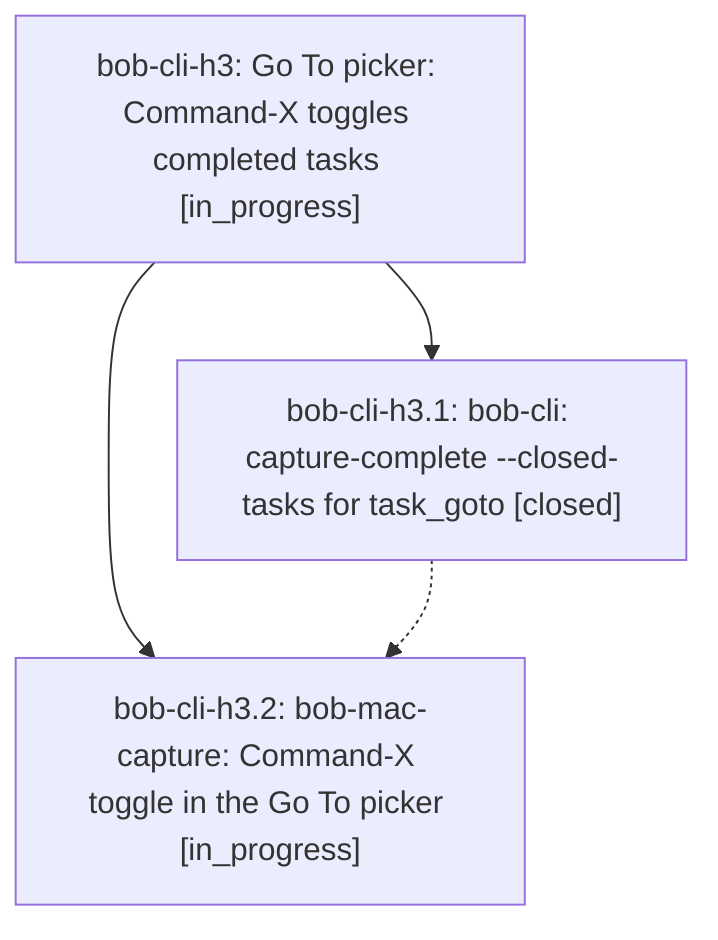

# Bead: bob-cli-h3 — Go To picker: Command-X toggles completed tasks

[Bead Pages](../README.md) / bob-cli-h3

**Status:** ◐ in_progress · **Type:** ▸ plan · **Tier:** epic
**Owner:** `bryanbugyi34@gmail.com` · **Created by:** [bbugyi200.athena.180](https://github.com/bobs-org/bob-cli--agents/blob/main/sessions/bbugyi200.athena.180.md) · **Assignee:** `bob-cli-h3.land`
**Created:** 2026-11-04 11:50:53 EST
**Plan:** [202611/goto\_completed\_toggle.md](https://github.com/bobs-org/bob-cli--plans/blob/main/202611/goto_completed_toggle.md)

## Description

In Bob Mac Capture's `/` Go To picker, Command-X toggles whether completed tasks appear in the results. bob supplies them through a new additive `capture-complete --closed-tasks` flag, and the Mac app renders them.

## Phases

| Bead | Title | Status | Size | Created | Agents | Commits |
|---|---|---|---|---|---:|---:|
| [bob-cli-h3.1](bob-cli-h3.1.md) | bob-cli: capture-complete --closed-tasks for task\_goto | ✓ closed | medium | 2026-11-04 | 1 | 1 |
| [bob-cli-h3.2](bob-cli-h3.2.md) | bob-mac-capture: Command-X toggle in the Go To picker | ◐ in_progress | medium | 2026-11-04 | 1 | 0 |

## Lineage

## Agents

| Agent | Bead | Commits |
|---|---|---:|
| [bbugyi200.athena.bob-cli-h3.1](https://github.com/bobs-org/bob-cli--agents/blob/main/agents/bbugyi200.athena.bob-cli-h3.1/README.md) | [bob-cli-h3.1](bob-cli-h3.1.md) | 1 |
| [bbugyi200.athena.bob-cli-h3.2](https://github.com/bobs-org/bob-cli--agents/blob/main/agents/bbugyi200.athena.bob-cli-h3.2/README.md) | [bob-cli-h3.2](bob-cli-h3.2.md) | 0 |
| [bbugyi200.athena.bob-cli-h3.land](https://github.com/bobs-org/bob-cli--agents/blob/main/agents/bbugyi200.athena.bob-cli-h3.land/README.md) | [bob-cli-h3](README.md) | 0 |

## Commits

| Repo | Commit | Subject | Bead | Committed |
|---|---|---|---|---|
| bob-cli | [`f54a352`](https://github.com/bobs-org/bob-cli/commit/f54a352c06ed32f8d1e954eef74108eaa79f4fa5) | feat(capture): add capture-complete -C/--closed-tasks for task\_goto | [bob-cli-h3.1](bob-cli-h3.1.md) | 2026-11-04 12:16:54 EST |
