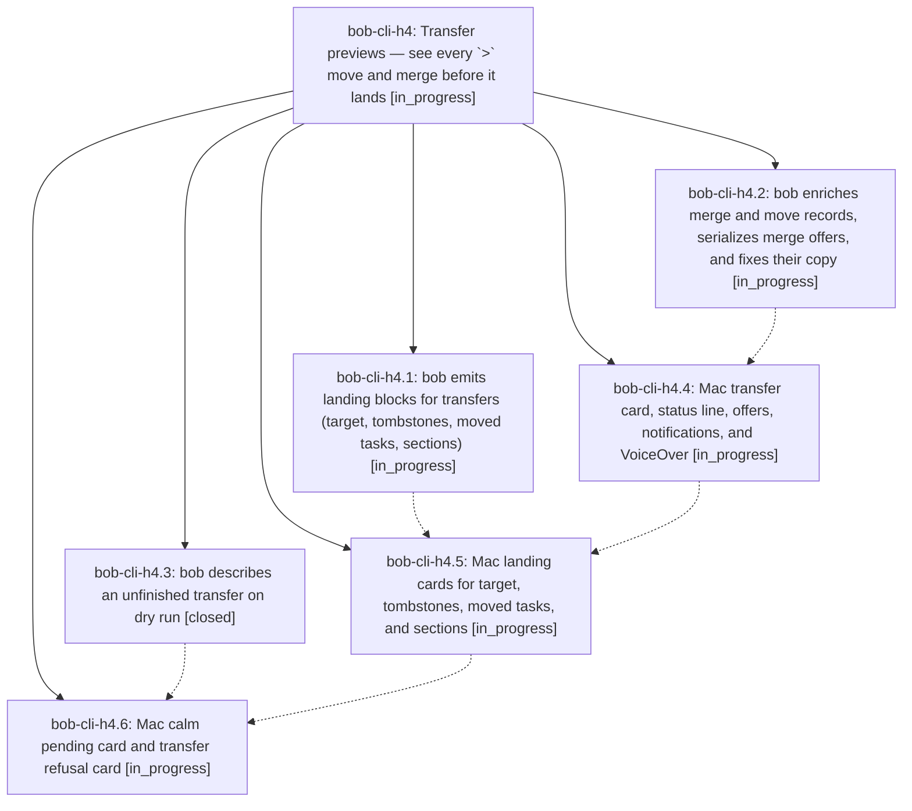

# Bead: bob-cli-h4 — Transfer previews — see every \`\>\` move and merge before it lands

[Bead Pages](../README.md) / bob-cli-h4

**Status:** ◐ in_progress · **Type:** ▸ plan · **Tier:** epic
**Owner:** `bryanbugyi34@gmail.com` · **Created by:** [bbugyi200.athena.188](https://github.com/bobs-org/bob-cli--agents/blob/main/sessions/bbugyi200.athena.188.md) · **Assignee:** `bob-cli-h4.land`
**Created:** 2026-11-04 14:57:18 EST
**Plan:** [202611/transfer\_previews.md](https://github.com/bobs-org/bob-cli--plans/blob/main/202611/transfer_previews.md)

<!-- sase:links:start -->

## Links

| Relation | Artifact | Why |
| --- | --- | --- |
| implemented-by | [plan:202611/transfer_previews.md][1] | derived from the plan's `bead_id:` frontmatter field |

[1]: https://github.com/bobs-org/bob-cli--plans/blob/main/202611/transfer_previews.md

<!-- sase:links:end -->

## Description

When Bryan types a `>` transfer line (`@a+x @b+y > @c…`) in Bob Mac Capture, the preview reads like the draft: the tasks he named, an arrow, and where they go. Every source shows its real title and fate, the destination shows its real title and container, and every ripple (dependents, warnings, today's links, offers, repairs) is one plain sentence that bob wrote. Below that, landing cards show the exact bytes bob will write to the target, the tombstones, and moved tasks. While the destination is unfinished the panel stays calm and teaches the four destination forms. A refusal reads as a refusal, not as red noise. The Mac app still parses nothing: every fact comes from bob's JSON.

## Phases

| Bead | Title | Status | Size | Created | Agents | Commits |
|---|---|---|---|---|---:|---:|
| [bob-cli-h4.1](bob-cli-h4.1.md) | bob emits landing blocks for transfers (target, tombstones, moved tasks, sections) | ◐ in_progress | medium | 2026-11-04 | 1 | 0 |
| [bob-cli-h4.2](bob-cli-h4.2.md) | bob enriches merge and move records, serializes merge offers, and fixes their copy | ◐ in_progress | medium | 2026-11-04 | 1 | 0 |
| [bob-cli-h4.3](bob-cli-h4.3.md) | bob describes an unfinished transfer on dry run | ✓ closed | small | 2026-11-04 | 1 | 1 |
| [bob-cli-h4.4](bob-cli-h4.4.md) | Mac transfer card, status line, offers, notifications, and VoiceOver | ◐ in_progress | medium | 2026-11-04 | 1 | 0 |
| [bob-cli-h4.5](bob-cli-h4.5.md) | Mac landing cards for target, tombstones, moved tasks, and sections | ◐ in_progress | medium | 2026-11-04 | 1 | 0 |
| [bob-cli-h4.6](bob-cli-h4.6.md) | Mac calm pending card and transfer refusal card | ◐ in_progress | medium | 2026-11-04 | 1 | 0 |

## Lineage

## Agents

| Agent | Bead | Commits |
|---|---|---:|
| [bbugyi200.athena.bob-cli-h4.1](https://github.com/bobs-org/bob-cli--agents/blob/main/agents/bbugyi200.athena.bob-cli-h4.1/README.md) | [bob-cli-h4.1](bob-cli-h4.1.md) | 0 |
| [bbugyi200.athena.bob-cli-h4.2](https://github.com/bobs-org/bob-cli--agents/blob/main/agents/bbugyi200.athena.bob-cli-h4.2/README.md) | [bob-cli-h4.2](bob-cli-h4.2.md) | 0 |
| [bbugyi200.athena.bob-cli-h4.3](https://github.com/bobs-org/bob-cli--agents/blob/main/agents/bbugyi200.athena.bob-cli-h4.3/README.md) | [bob-cli-h4.3](bob-cli-h4.3.md) | 1 |
| [bbugyi200.athena.bob-cli-h4.4](https://github.com/bobs-org/bob-cli--agents/blob/main/agents/bbugyi200.athena.bob-cli-h4.4/README.md) | [bob-cli-h4.4](bob-cli-h4.4.md) | 0 |
| [bbugyi200.athena.bob-cli-h4.5](https://github.com/bobs-org/bob-cli--agents/blob/main/agents/bbugyi200.athena.bob-cli-h4.5/README.md) | [bob-cli-h4.5](bob-cli-h4.5.md) | 0 |
| [bbugyi200.athena.bob-cli-h4.6](https://github.com/bobs-org/bob-cli--agents/blob/main/agents/bbugyi200.athena.bob-cli-h4.6/README.md) | [bob-cli-h4.6](bob-cli-h4.6.md) | 0 |
| [bbugyi200.athena.bob-cli-h4.land](https://github.com/bobs-org/bob-cli--agents/blob/main/agents/bbugyi200.athena.bob-cli-h4.land/README.md) | [bob-cli-h4](README.md) | 0 |

## Commits

| Repo | Commit | Subject | Bead | Committed |
|---|---|---|---|---|
| bob-cli | [`3ad23a7`](https://github.com/bobs-org/bob-cli/commit/3ad23a73d5f281bdbc7e892a66a261be8fb67c75) | feat(capture): describe unfinished transfers in dry-run failures | [bob-cli-h4.3](bob-cli-h4.3.md) | 2026-11-04 15:26:41 EST |
