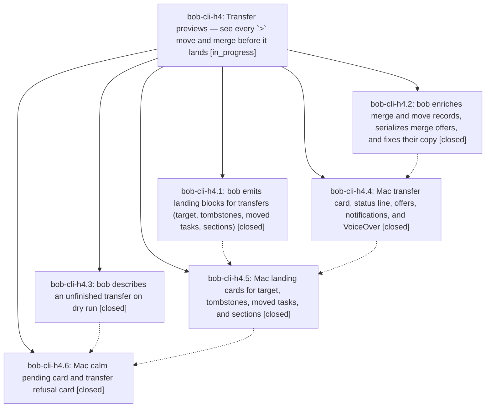

# Bead: bob-cli-h4 — Transfer previews — see every \`\>\` move and merge before it lands

[Bead Pages](../README.md) / bob-cli-h4

**Status:** ◐ in_progress · **Type:** ▸ plan · **Tier:** epic
**Owner:** `bryanbugyi34@gmail.com` · **Created by:** [bbugyi200.athena.188](https://github.com/bobs-org/bob-cli--agents/blob/main/sessions/bbugyi200.athena.188.md) · **Assignee:** `bob-cli-h4.land`
**Created:** 2026-11-04 14:57:18 EST
**Plan:** [202611/transfer\_previews.md](https://github.com/bobs-org/bob-cli--plans/blob/main/202611/transfer_previews.md)

<!-- sase:links:start -->

## Links

| Relation | Artifact | Why |
| --- | --- | --- |
| implemented-by | [plan:202611/transfer_previews.md][1] | derived from the plan's `bead_id:` frontmatter field |

_Plus 6 automatic references — see [Referenced By](#referenced-by)._

[1]: https://github.com/bobs-org/bob-cli--plans/blob/main/202611/transfer_previews.md

<!-- sase:links:end -->

## Description

When Bryan types a `>` transfer line (`@a+x @b+y > @c…`) in Bob Mac Capture, the preview reads like the draft: the tasks he named, an arrow, and where they go. Every source shows its real title and fate, the destination shows its real title and container, and every ripple (dependents, warnings, today's links, offers, repairs) is one plain sentence that bob wrote. Below that, landing cards show the exact bytes bob will write to the target, the tombstones, and moved tasks. While the destination is unfinished the panel stays calm and teaches the four destination forms. A refusal reads as a refusal, not as red noise. The Mac app still parses nothing: every fact comes from bob's JSON.

## Notes

[2026-11-04T21:43:38Z · bob-cli-h0.land] DISCOVERED ISSUE (resolved by the bob-cli-h0 lander): h4.2 commit 029b4266 added destination_line, destination_section, status_name and status_symbol to transfer moves[] records, which made tests/cli/capture/note_pull.rs np_move_groups_follow_requested_sources_in_cli_fixtures fail (tracked as bob-cli-h5). The h0 lander regenerated tests/fixtures/note_pull/np-move/{preview,picked}.json with tests/fixtures/note_pull/generate.py. The diff is only those four additive fields on captures[2..3].moves[0], and all 11 note_pull tests pass. No action needed unless h4 changes those records again.

## Phases

| Bead | Title | Status | Size | Created | Agents | Commits |
|---|---|---|---|---|---:|---:|
| [bob-cli-h4.1](bob-cli-h4.1.md) | bob emits landing blocks for transfers (target, tombstones, moved tasks, sections) | ✓ closed | medium | 2026-11-04 | 1 | 1 |
| [bob-cli-h4.2](bob-cli-h4.2.md) | bob enriches merge and move records, serializes merge offers, and fixes their copy | ✓ closed | medium | 2026-11-04 | 1 | 1 |
| [bob-cli-h4.3](bob-cli-h4.3.md) | bob describes an unfinished transfer on dry run | ✓ closed | small | 2026-11-04 | 1 | 1 |
| [bob-cli-h4.4](bob-cli-h4.4.md) | Mac transfer card, status line, offers, notifications, and VoiceOver | ✓ closed | medium | 2026-11-04 | 1 | 1 |
| [bob-cli-h4.5](bob-cli-h4.5.md) | Mac landing cards for target, tombstones, moved tasks, and sections | ✓ closed | medium | 2026-11-04 | 1 | 1 |
| [bob-cli-h4.6](bob-cli-h4.6.md) | Mac calm pending card and transfer refusal card | ✓ closed | medium | 2026-11-04 | 1 | 1 |

## Lineage

## Dependencies

- **Blocks:** [bob-cli-h8.12](../bob-cli-h8/bob-cli-h8.12.md) ◐ · ⧖ 2026-11-04

## Agents

| Agent | Bead | Commits |
|---|---|---:|
| [bbugyi200.athena.bob-cli-h4.1](https://github.com/bobs-org/bob-cli--agents/blob/main/agents/bbugyi200.athena.bob-cli-h4.1/README.md) | [bob-cli-h4.1](bob-cli-h4.1.md) | 1 |
| [bbugyi200.athena.bob-cli-h4.2](https://github.com/bobs-org/bob-cli--agents/blob/main/agents/bbugyi200.athena.bob-cli-h4.2/README.md) | [bob-cli-h4.2](bob-cli-h4.2.md) | 1 |
| [bbugyi200.athena.bob-cli-h4.3](https://github.com/bobs-org/bob-cli--agents/blob/main/agents/bbugyi200.athena.bob-cli-h4.3/README.md) | [bob-cli-h4.3](bob-cli-h4.3.md) | 1 |
| [bbugyi200.athena.bob-cli-h4.4](https://github.com/bobs-org/bob-cli--agents/blob/main/sessions/bbugyi200.athena.bob-cli-h4.4.md) | [bob-cli-h4.4](bob-cli-h4.4.md) | 1 |
| [bbugyi200.athena.bob-cli-h4.5](https://github.com/bobs-org/bob-cli--agents/blob/main/agents/bbugyi200.athena.bob-cli-h4.5/README.md) | [bob-cli-h4.5](bob-cli-h4.5.md) | 1 |
| [bbugyi200.athena.bob-cli-h4.6](https://github.com/bobs-org/bob-cli--agents/blob/main/sessions/bbugyi200.athena.bob-cli-h4.6.md) | [bob-cli-h4.6](bob-cli-h4.6.md) | 1 |
| [bbugyi200.athena.bob-cli-h4.land](https://github.com/bobs-org/bob-cli--agents/blob/main/agents/bbugyi200.athena.bob-cli-h4.land/README.md) | [bob-cli-h4](README.md) | 0 |

## Commits

| Repo | Commit | Subject | Bead | Committed |
|---|---|---|---|---|
| bob-cli | [`3ad23a7`](https://github.com/bobs-org/bob-cli/commit/3ad23a73d5f281bdbc7e892a66a261be8fb67c75) | feat(capture): describe unfinished transfers in dry-run failures | [bob-cli-h4.3](bob-cli-h4.3.md) | 2026-11-04 15:26:41 EST |
| bob-cli | [`decd465`](https://github.com/bobs-org/bob-cli/commit/decd465c2f2f0f2f1dbea7feb444e28c97a2751c) | feat(capture): emit transfer landing blocks | [bob-cli-h4.1](bob-cli-h4.1.md) | 2026-11-04 15:59:06 EST |
| bob-cli | [`029b426`](https://github.com/bobs-org/bob-cli/commit/029b426601d6ef840e33cc24e1472b3a985ef7fe) | feat(capture): enrich merge and move records, serialize merge offers, fix copy | [bob-cli-h4.2](bob-cli-h4.2.md) | 2026-11-04 16:07:48 EST |
| bob-mac-capture | [`bob-mac-capture@e9dc5bd`](https://github.com/bobs-org/bob-mac-capture/commit/e9dc5bd91253cf0ad09671eb8c724cb5a37453a5) | feat(capture): render transfer previews as cards | [bob-cli-h4.4](bob-cli-h4.4.md) | 2026-11-04 19:42:16 EST |
| bob-mac-capture | [`bob-mac-capture@dd4a8bf`](https://github.com/bobs-org/bob-mac-capture/commit/dd4a8bf909da9d10ba53253f579363722a9460cc) | feat(capture): render transfer landing cards | [bob-cli-h4.5](bob-cli-h4.5.md) | 2026-11-05 07:31:42 EST |
| bob-mac-capture | [`bob-mac-capture@6e09f2c`](https://github.com/bobs-org/bob-mac-capture/commit/6e09f2c7fabfdda0e337da63a6bb48b28c32747f) | feat(capture): render pending transfer and refusal cards | [bob-cli-h4.6](bob-cli-h4.6.md) | 2026-11-05 12:54:44 EST |

<!-- sase:referenced-by:start -->

## Referenced By

| Relation | Artifact | Why | Uses |
| --- | --- | --- | ---: |
| read-by | [agent:bob-cli-h0.land][1] | Check whether h4 owns the current note_pull fixture drift from h4.2 | 1 |
| read-by | [agent:bob-cli-h4.2][2] | Need epic decisions and scope | 1 |
| read-by | [agent:research.3b.cdx][3] | Compare active epic scope with high-impact correctness and CI task candidates | 1 |
| read-by | [agent:research.3b.cld][4] | Check active epic scope and discovered issues for conflicts with candidate task beads | 1 |
| read-by | [agent:research.3b.gem][5] | Check running epic h4 to avoid conflicts | 1 |
| read-by | [agent:research.3b.mus][6] | research top beads needs active epic scope to avoid conflicts | 1 |

[1]: https://github.com/bobs-org/bob-cli--agents/blob/main/agents/bbugyi200.athena.bob-cli-h0.land/README.md
[2]: https://github.com/bobs-org/bob-cli--agents/blob/main/agents/bbugyi200.athena.bob-cli-h4.2/README.md
[3]: https://github.com/bobs-org/bob-cli--agents/blob/main/agents/bbugyi200.athena.research.3b.cdx/README.md
[4]: https://github.com/bobs-org/bob-cli--agents/blob/main/agents/bbugyi200.athena.research.3b.cld/README.md
[5]: https://github.com/bobs-org/bob-cli--agents/blob/main/agents/bbugyi200.athena.research.3b.gem/README.md
[6]: https://github.com/bobs-org/bob-cli--agents/blob/main/agents/bbugyi200.athena.research.3b.mus/README.md

<!-- sase:referenced-by:end -->
