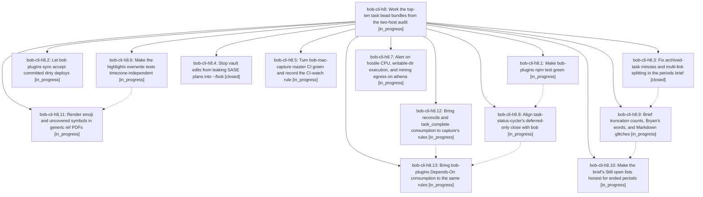

# Bead: bob-cli-h8 — Work the top-ten task bead bundles from the two-host audit

[Bead Pages](../README.md) / bob-cli-h8

**Status:** ◐ in_progress · **Type:** ▸ plan · **Tier:** epic
**Owner:** `bryanbugyi34@gmail.com` · **Created by:** [bbugyi200.athena.18c](https://github.com/bobs-org/bob-cli--agents/blob/main/sessions/bbugyi200.athena.18c.md) · **Assignee:** `bob-cli-h8.land`
**Created:** 2026-11-04 16:39:09 EST
**Plan:** [202611/top\_ten\_bead\_bundles.md](https://github.com/bobs-org/bob-cli--plans/blob/main/202611/top_ten_bead_bundles.md)

## Description

Every work item ranked by the 2026-11-04 two-host bead audit is done. bob-plugins `npm test` is green under UTC and New York time. `bob plugins sync` accepts a dirty deploy once its exact bundle is committed, so the vault stops running stale plugins. Obsidian closes keep recorded Pomodoro time. `bob periods brief` attributes archived and multi-link minutes correctly before the 2026-11-09 weekly Review. Vault edits stop leaking SASE plans. bob-mac-capture and bob-cli master CI are green again for the failures nobody else owns. athena alerts on hostile CPU, exec, and egress. Every link-consuming writer keeps notes, and generic ref PDFs render emoji.

## Phases

| Bead | Title | Status | Size | Created | Agents | Commits |
|---|---|---|---|---|---:|---:|
| [bob-cli-h8.1](bob-cli-h8.1.md) | Make bob-plugins npm test green | ◐ in_progress | medium | 2026-11-04 | 1 | 0 |
| [bob-cli-h8.10](bob-cli-h8.10.md) | Make the brief's Still open lists honest for ended periods | ◐ in_progress | medium | 2026-11-04 | 1 | 0 |
| [bob-cli-h8.11](bob-cli-h8.11.md) | Render emoji and uncovered symbols in generic ref PDFs | ◐ in_progress | medium | 2026-11-04 | 1 | 0 |
| [bob-cli-h8.12](bob-cli-h8.12.md) | Bring reconcile and task\_complete consumption to capture's rules | ◐ in_progress | medium | 2026-11-04 | 1 | 0 |
| [bob-cli-h8.13](bob-cli-h8.13.md) | Bring bob-plugins Depends-On consumption to the same rules | ◐ in_progress | medium | 2026-11-04 | 1 | 0 |
| [bob-cli-h8.2](bob-cli-h8.2.md) | Let bob plugins sync accept committed dirty deploys | ◐ in_progress | medium | 2026-11-04 | 1 | 0 |
| [bob-cli-h8.3](bob-cli-h8.3.md) | Fix archived-task minutes and multi-link splitting in the periods brief | ✓ closed | medium | 2026-11-04 | 1 | 1 |
| [bob-cli-h8.4](bob-cli-h8.4.md) | Stop vault edits from leaking SASE plans into ~/bob | ✓ closed | small | 2026-11-04 | 1 | 0 |
| [bob-cli-h8.5](bob-cli-h8.5.md) | Turn bob-mac-capture master CI green and record the CI-watch rule | ◐ in_progress | medium | 2026-11-04 | 1 | 0 |
| [bob-cli-h8.6](bob-cli-h8.6.md) | Make the highlights overwrite tests timezone-independent | ◐ in_progress | small | 2026-11-04 | 1 | 0 |
| [bob-cli-h8.7](bob-cli-h8.7.md) | Alert on hostile CPU, writable-dir execution, and mining egress on athena | ◐ in_progress | medium | 2026-11-04 | 1 | 0 |
| [bob-cli-h8.8](bob-cli-h8.8.md) | Align task-status-cycler's deferred-only close with bob | ◐ in_progress | small | 2026-11-04 | 1 | 0 |
| [bob-cli-h8.9](bob-cli-h8.9.md) | Brief truncation counts, Bryan's words, and Markdown glitches | ◐ in_progress | medium | 2026-11-04 | 1 | 0 |

## Lineage

## Agents

| Agent | Bead | Commits |
|---|---|---:|
| [bbugyi200.athena.bob-cli-h8.1](https://github.com/bobs-org/bob-cli--agents/blob/main/agents/bbugyi200.athena.bob-cli-h8.1/README.md) | [bob-cli-h8.1](bob-cli-h8.1.md) | 0 |
| [bbugyi200.athena.bob-cli-h8.10](https://github.com/bobs-org/bob-cli--agents/blob/main/agents/bbugyi200.athena.bob-cli-h8.10/README.md) | [bob-cli-h8.10](bob-cli-h8.10.md) | 0 |
| [bbugyi200.athena.bob-cli-h8.11](https://github.com/bobs-org/bob-cli--agents/blob/main/agents/bbugyi200.athena.bob-cli-h8.11/README.md) | [bob-cli-h8.11](bob-cli-h8.11.md) | 0 |
| [bbugyi200.athena.bob-cli-h8.12](https://github.com/bobs-org/bob-cli--agents/blob/main/agents/bbugyi200.athena.bob-cli-h8.12/README.md) | [bob-cli-h8.12](bob-cli-h8.12.md) | 0 |
| [bbugyi200.athena.bob-cli-h8.13](https://github.com/bobs-org/bob-cli--agents/blob/main/agents/bbugyi200.athena.bob-cli-h8.13/README.md) | [bob-cli-h8.13](bob-cli-h8.13.md) | 0 |
| [bbugyi200.athena.bob-cli-h8.2](https://github.com/bobs-org/bob-cli--agents/blob/main/agents/bbugyi200.athena.bob-cli-h8.2/README.md) | [bob-cli-h8.2](bob-cli-h8.2.md) | 0 |
| [bbugyi200.athena.bob-cli-h8.3](https://github.com/bobs-org/bob-cli--agents/blob/main/agents/bbugyi200.athena.bob-cli-h8.3/README.md) | [bob-cli-h8.3](bob-cli-h8.3.md) | 1 |
| [bbugyi200.athena.bob-cli-h8.4](https://github.com/bobs-org/bob-cli--agents/blob/main/agents/bbugyi200.athena.bob-cli-h8.4/README.md) | [bob-cli-h8.4](bob-cli-h8.4.md) | 0 |
| [bbugyi200.athena.bob-cli-h8.5](https://github.com/bobs-org/bob-cli--agents/blob/main/agents/bbugyi200.athena.bob-cli-h8.5/README.md) | [bob-cli-h8.5](bob-cli-h8.5.md) | 0 |
| [bbugyi200.athena.bob-cli-h8.6](https://github.com/bobs-org/bob-cli--agents/blob/main/agents/bbugyi200.athena.bob-cli-h8.6/README.md) | [bob-cli-h8.6](bob-cli-h8.6.md) | 0 |
| [bbugyi200.athena.bob-cli-h8.7](https://github.com/bobs-org/bob-cli--agents/blob/main/agents/bbugyi200.athena.bob-cli-h8.7/README.md) | [bob-cli-h8.7](bob-cli-h8.7.md) | 0 |
| [bbugyi200.athena.bob-cli-h8.8](https://github.com/bobs-org/bob-cli--agents/blob/main/agents/bbugyi200.athena.bob-cli-h8.8/README.md) | [bob-cli-h8.8](bob-cli-h8.8.md) | 0 |
| [bbugyi200.athena.bob-cli-h8.9](https://github.com/bobs-org/bob-cli--agents/blob/main/agents/bbugyi200.athena.bob-cli-h8.9/README.md) | [bob-cli-h8.9](bob-cli-h8.9.md) | 0 |
| [bbugyi200.athena.bob-cli-h8.land](https://github.com/bobs-org/bob-cli--agents/blob/main/agents/bbugyi200.athena.bob-cli-h8.land/README.md) | [bob-cli-h8](README.md) | 0 |

## Commits

| Repo | Commit | Subject | Bead | Committed |
|---|---|---|---|---|
| bob-cli | [`ea015b6`](https://github.com/bobs-org/bob-cli/commit/ea015b665311e384c0daa6ce451c7350e72a4aa0) | fix(periods): attribute archived tasks and split multi-link minutes in brief | [bob-cli-h8.3](bob-cli-h8.3.md) | 2026-11-04 17:05:30 EST |

<!-- sase:referenced-by:start -->

## Referenced By

| Relation | Artifact | Why | Uses |
| --- | --- | --- | ---: |
| read-by | [agent:bob-cli-h0.land][1] | Check whether the new audit epic already covers h5/h6/clippy and the h0 lander scope | 1 |

[1]: https://github.com/bobs-org/bob-cli--agents/blob/main/agents/bbugyi200.athena.bob-cli-h0.land/README.md

<!-- sase:referenced-by:end -->
