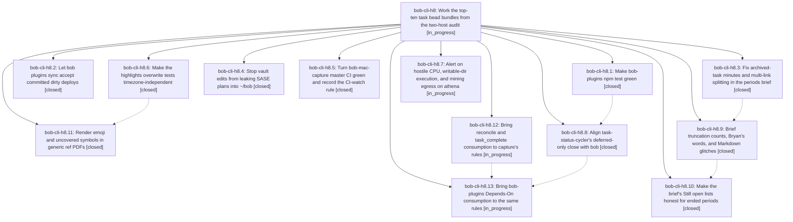

# Bead: bob-cli-h8 — Work the top-ten task bead bundles from the two-host audit

[Bead Pages](../README.md) / bob-cli-h8

**Status:** ◐ in_progress · **Type:** ▸ plan · **Tier:** epic
**Owner:** `bryanbugyi34@gmail.com` · **Created by:** [bbugyi200.athena.18c](https://github.com/bobs-org/bob-cli--agents/blob/main/sessions/bbugyi200.athena.18c.md) · **Assignee:** `bob-cli-h8.land`
**Created:** 2026-11-04 16:39:09 EST
**Plan:** [202611/top\_ten\_bead\_bundles.md](https://github.com/bobs-org/bob-cli--plans/blob/main/202611/top_ten_bead_bundles.md)

<!-- sase:links:start -->

## Links

| Relation | Artifact | Why |
| --- | --- | --- |
| implemented-by | [plan:202611/top_ten_bead_bundles.md][1] | derived from the plan's `bead_id:` frontmatter field |

_Plus 6 automatic references — see [Referenced By](#referenced-by)._

[1]: https://github.com/bobs-org/bob-cli--plans/blob/main/202611/top_ten_bead_bundles.md

<!-- sase:links:end -->

## Description

Every work item ranked by the 2026-11-04 two-host bead audit is done. bob-plugins `npm test` is green under UTC and New York time. `bob plugins sync` accepts a dirty deploy once its exact bundle is committed, so the vault stops running stale plugins. Obsidian closes keep recorded Pomodoro time. `bob periods brief` attributes archived and multi-link minutes correctly before the 2026-11-09 weekly Review. Vault edits stop leaking SASE plans. bob-mac-capture and bob-cli master CI are green again for the failures nobody else owns. athena alerts on hostile CPU, exec, and egress. Every link-consuming writer keeps notes, and generic ref PDFs render emoji.

## Notes

[2026-11-05T00:37:20Z · bob-cli-h4.4--5] DISCOVERED ISSUE: Exact-SHA macOS CI run 41940043128 on snapshot 9593ec6730a99c5b1e164d8ada7c878533c6fd53 still fails the Test step; lint and Build pass, and no test-hang artifact was produced. The preceding master run 41937019961 on base edb2f487c0ddf122961f8c6ae95f9c0d0df82038 fails the same nine editor/key-alias tests, so these failures predate the transfer integration. Failures: CaptureBackslashGotoTests.testInsertHelperDeclinesWhileComposingSubmittingOrLocked; CaptureEditorWordMotionTests.testMotionsLeaveTextAndUndoUntouched; CaptureSeparatorToggleTests.testBackslashAliasAfterTaskTypeOpensTypeMenuAndDoubleTapCloses, testDelayedAcceptedAliasSupersedesGatedCompletion, testNativeUndoRestoresLiteralSigilAliasWithoutRetriggering, testPeriodAliasAfterRouteOpensNewIDBlockPicker, testPeriodAliasOnMoveBulletOpensMovePicker, testSemicolonAliasOnOfferMoveBulletOpensMoveAndLinkPicker, and testUndoAfterMoveAliasRestoresLiteralWithoutRetriggering. Three alias failures were already noted by h8.5 as a follow-up; the backslash helper failure is corroborated on h7.

[2026-11-05T15:45:08Z · cl--1] DISCOVERED ISSUE: The approved x= capture change was verified on exact snapshot a77fbb8 by run 42052432463. The Test step again fails 13 editor, picker, and separator-alias cases also failed on exact base d206803 in run 42040970042; two other base failures passed on the snapshot, while one relation-picker test timed out only in the snapshot. The x= assist tests are absent from the failed-test list. This confirms the macOS 26 suite remains red from the previously tracked CI cluster, with at least one timing-sensitive test variation.

[2026-11-05T16:32:59Z · bob-cli-ha.land] DISCOVERED ISSUE / corroboration from bob-cli-ha.4 proposal #1: lander inspected CI 42037793376 on phase snapshot 0f1ed3b and clean-base 42040643751 on b2f3b61. The same 12 editor/backslash/comma/separator cases fail both runs despite green lint/Build; added +1 to bob-cli-h7 with file:explicit:158794c224e27f034e87d84c. This supplements existing h8 notes #1-2 and h8.5 scope; no duplicate CI task. Base-only CaptureMoveChoiceModelTests.testMoveThenPullInBackAndInboxCarryOneAnswerAndSeed repeats the seed-count issue already proposed by h8.5 #1; record as corroborating observation, not a confirmed same-tree flake. Do not include the phase-only testNamedStartChainTokenRequestsStartNameCompletion in the unrelated CI cluster: its mismatched x =de versus x =#de fixture/test dispatch is retained as bob-cli-ha epic work.

[2026-11-05T19:35:23Z · bob-cli-hd.land] DISCOVERED ISSUE (from bob-cli-hd lander triage of bob-cli-hd.8 note #1): after h8.1 closed bob-cli-ej, scripts/test-ledger-tools-task-link-marks-live.cjs still fails its CPU-time budgets (cold viewport <100 ms, warm/keystroke <25 ms, full <500 ms; lines ~1216-1248) intermittently under full bob-plugins npm test on 2026-11-05 (phase tree and clean base, assertion not recorded), so the h8 goal 'bob-plugins npm test is green' is not yet met for this file. ej's own fix only made freshness-mark-surfaces deterministic, although an ej +1 cited task-link-marks-live. Lander isolated reruns on bob-plugins 7b7c52f passed 2/2, consistent with load sensitivity. The wikilink-index budget half is tracked by bob-cli-f8 (+1 recorded).

## Phases

| Bead | Title | Status | Size | Created | Agents | Commits |
|---|---|---|---|---|---:|---:|
| [bob-cli-h8.1](bob-cli-h8.1.md) | Make bob-plugins npm test green | ✓ closed | medium | 2026-11-04 | 1 | 0 |
| [bob-cli-h8.10](bob-cli-h8.10.md) | Make the brief's Still open lists honest for ended periods | ✓ closed | medium | 2026-11-04 | 1 | 1 |
| [bob-cli-h8.11](bob-cli-h8.11.md) | Render emoji and uncovered symbols in generic ref PDFs | ✓ closed | medium | 2026-11-04 | 1 | 1 |
| [bob-cli-h8.12](bob-cli-h8.12.md) | Bring reconcile and task\_complete consumption to capture's rules | ◐ in_progress | medium | 2026-11-04 | 1 | 1 |
| [bob-cli-h8.13](bob-cli-h8.13.md) | Bring bob-plugins Depends-On consumption to the same rules | ◐ in_progress | medium | 2026-11-04 | 1 | 0 |
| [bob-cli-h8.2](bob-cli-h8.2.md) | Let bob plugins sync accept committed dirty deploys | ✓ closed | medium | 2026-11-04 | 1 | 1 |
| [bob-cli-h8.3](bob-cli-h8.3.md) | Fix archived-task minutes and multi-link splitting in the periods brief | ✓ closed | medium | 2026-11-04 | 1 | 1 |
| [bob-cli-h8.4](bob-cli-h8.4.md) | Stop vault edits from leaking SASE plans into ~/bob | ✓ closed | small | 2026-11-04 | 1 | 0 |
| [bob-cli-h8.5](bob-cli-h8.5.md) | Turn bob-mac-capture master CI green and record the CI-watch rule | ✓ closed | medium | 2026-11-04 | 1 | 1 |
| [bob-cli-h8.6](bob-cli-h8.6.md) | Make the highlights overwrite tests timezone-independent | ✓ closed | small | 2026-11-04 | 1 | 1 |
| [bob-cli-h8.7](bob-cli-h8.7.md) | Alert on hostile CPU, writable-dir execution, and mining egress on athena | ◐ in_progress | medium | 2026-11-04 | 1 | 0 |
| [bob-cli-h8.8](bob-cli-h8.8.md) | Align task-status-cycler's deferred-only close with bob | ✓ closed | small | 2026-11-04 | 1 | 0 |
| [bob-cli-h8.9](bob-cli-h8.9.md) | Brief truncation counts, Bryan's words, and Markdown glitches | ✓ closed | medium | 2026-11-04 | 1 | 1 |

## Lineage

## Agents

| Agent | Bead | Commits |
|---|---|---:|
| [bbugyi200.athena.bob-cli-h8.1](https://github.com/bobs-org/bob-cli--agents/blob/main/sessions/bbugyi200.athena.bob-cli-h8.1.md) | [bob-cli-h8.1](bob-cli-h8.1.md) | 0 |
| [bbugyi200.athena.bob-cli-h8.10](https://github.com/bobs-org/bob-cli--agents/blob/main/agents/bbugyi200.athena.bob-cli-h8.10/README.md) | [bob-cli-h8.10](bob-cli-h8.10.md) | 1 |
| [bbugyi200.athena.bob-cli-h8.11](https://github.com/bobs-org/bob-cli--agents/blob/main/agents/bbugyi200.athena.bob-cli-h8.11/README.md) | [bob-cli-h8.11](bob-cli-h8.11.md) | 1 |
| [bbugyi200.athena.bob-cli-h8.12](https://github.com/bobs-org/bob-cli--agents/blob/main/sessions/bbugyi200.athena.bob-cli-h8.12.md) | [bob-cli-h8.12](bob-cli-h8.12.md) | 1 |
| [bbugyi200.athena.bob-cli-h8.13](https://github.com/bobs-org/bob-cli--agents/blob/main/agents/bbugyi200.athena.bob-cli-h8.13/README.md) | [bob-cli-h8.13](bob-cli-h8.13.md) | 0 |
| [bbugyi200.athena.bob-cli-h8.2](https://github.com/bobs-org/bob-cli--agents/blob/main/agents/bbugyi200.athena.bob-cli-h8.2/README.md) | [bob-cli-h8.2](bob-cli-h8.2.md) | 1 |
| [bbugyi200.athena.bob-cli-h8.3](https://github.com/bobs-org/bob-cli--agents/blob/main/agents/bbugyi200.athena.bob-cli-h8.3/README.md) | [bob-cli-h8.3](bob-cli-h8.3.md) | 1 |
| [bbugyi200.athena.bob-cli-h8.4](https://github.com/bobs-org/bob-cli--agents/blob/main/agents/bbugyi200.athena.bob-cli-h8.4/README.md) | [bob-cli-h8.4](bob-cli-h8.4.md) | 0 |
| [bbugyi200.athena.bob-cli-h8.5](https://github.com/bobs-org/bob-cli--agents/blob/main/sessions/bbugyi200.athena.bob-cli-h8.5.md) | [bob-cli-h8.5](bob-cli-h8.5.md) | 1 |
| [bbugyi200.athena.bob-cli-h8.6](https://github.com/bobs-org/bob-cli--agents/blob/main/agents/bbugyi200.athena.bob-cli-h8.6/README.md) | [bob-cli-h8.6](bob-cli-h8.6.md) | 1 |
| [bbugyi200.athena.bob-cli-h8.7](https://github.com/bobs-org/bob-cli--agents/blob/main/sessions/bbugyi200.athena.bob-cli-h8.7.md) | [bob-cli-h8.7](bob-cli-h8.7.md) | 0 |
| [bbugyi200.athena.bob-cli-h8.8](https://github.com/bobs-org/bob-cli--agents/blob/main/agents/bbugyi200.athena.bob-cli-h8.8/README.md) | [bob-cli-h8.8](bob-cli-h8.8.md) | 0 |
| [bbugyi200.athena.bob-cli-h8.9](https://github.com/bobs-org/bob-cli--agents/blob/main/sessions/bbugyi200.athena.bob-cli-h8.9.md) | [bob-cli-h8.9](bob-cli-h8.9.md) | 1 |
| [bbugyi200.athena.bob-cli-h8.land](https://github.com/bobs-org/bob-cli--agents/blob/main/agents/bbugyi200.athena.bob-cli-h8.land/README.md) | [bob-cli-h8](README.md) | 0 |

## Commits

| Repo | Commit | Subject | Bead | Committed |
|---|---|---|---|---|
| bob-cli | [`ea015b6`](https://github.com/bobs-org/bob-cli/commit/ea015b665311e384c0daa6ce451c7350e72a4aa0) | fix(periods): attribute archived tasks and split multi-link minutes in brief | [bob-cli-h8.3](bob-cli-h8.3.md) | 2026-11-04 17:05:30 EST |
| bob-cli | [`53bf947`](https://github.com/bobs-org/bob-cli/commit/53bf94721d638a02106ff7a142b216a4b80e2b7f) | test(highlights): pin overwrite timezone and document recapture stamp | [bob-cli-h8.6](bob-cli-h8.6.md) | 2026-11-04 17:12:34 EST |
| bob-cli | [`d32e858`](https://github.com/bobs-org/bob-cli/commit/d32e858d581e5d2a4b7699dd622d0fb9cd518582) | feat(plugins)!: accept committed dirty deploys via inclusion proof | [bob-cli-h8.2](bob-cli-h8.2.md) | 2026-11-04 17:14:19 EST |
| bob-cli | [`0e11f8b`](https://github.com/bobs-org/bob-cli/commit/0e11f8b0e8c3974da3113fe15fd19fa3839c2368) | fix(highlights): preserve fallback glyphs in generic ref PDFs | [bob-cli-h8.11](bob-cli-h8.11.md) | 2026-11-04 17:42:48 EST |
| bob-cli | [`75bb6c6`](https://github.com/bobs-org/bob-cli/commit/75bb6c62e82526445576872e5542de2ad53bd914) | feat(periods): report brief truncation totals and clean words and aliases | [bob-cli-h8.9](bob-cli-h8.9.md) | 2026-11-04 18:39:00 EST |
| bob-cli | [`20c58da`](https://github.com/bobs-org/bob-cli/commit/20c58da9d62d034036bd6cfb0c8ceb17cac0496c) | docs(agents): tell agents to watch exact-SHA macOS CI after pushes | [bob-cli-h8.5](bob-cli-h8.5.md) | 2026-11-04 18:49:38 EST |
| bob-cli | [`a3aa214`](https://github.com/bobs-org/bob-cli/commit/a3aa2149bced74d8e98090a89e5d5d954deb8411) | feat(periods): rebuild brief Still open for ended periods | [bob-cli-h8.10](bob-cli-h8.10.md) | 2026-11-04 19:18:19 EST |
| bob-cli | [`ff1a752`](https://github.com/bobs-org/bob-cli/commit/ff1a7524cf9954c5fa2683009b1e166f5a6697a0) | fix(consumption): align reconcile and completion cleanup | [bob-cli-h8.12](bob-cli-h8.12.md) | 2026-11-05 16:52:34 EST |

<!-- sase:referenced-by:start -->

## Referenced By

| Relation | Artifact | Why | Uses |
| --- | --- | --- | ---: |
| read-by | [agent:bob-cli-h0.land][1] | Check whether the new audit epic already covers h5/h6/clippy and the h0 lander scope | 1 |
| read-by | [agent:bob-cli-h4.4--5][2] | Assess whether the active CI-green epic owns the newly confirmed baseline editor and alias test failures | 1 |
| read-by | [agent:bob-cli-h8.10][3] | need parent epic context | 1 |
| read-by | [agent:bob-cli-h8.8][4] | need epic context and g4 reference | 1 |
| read-by | [agent:bob-cli-hd.land][5] | Need the epic scope to judge causal link to residual plugin perf flakes | 1 |
| read-by | [agent:cl--1][6] | Check whether the active top-ten epic owns the current macOS CI failures | 1 |

[1]: https://github.com/bobs-org/bob-cli--agents/blob/main/agents/bbugyi200.athena.bob-cli-h0.land/README.md
[2]: https://github.com/bobs-org/bob-cli--agents/blob/main/sessions/bbugyi200.athena.bob-cli-h4.4.md
[3]: https://github.com/bobs-org/bob-cli--agents/blob/main/agents/bbugyi200.athena.bob-cli-h8.10/README.md
[4]: https://github.com/bobs-org/bob-cli--agents/blob/main/agents/bbugyi200.athena.bob-cli-h8.8/README.md
[5]: https://github.com/bobs-org/bob-cli--agents/blob/main/agents/bbugyi200.athena.bob-cli-hd.land/README.md
[6]: https://github.com/bobs-org/bob-cli--agents/blob/main/sessions/bbugyi200.athena.cl.md

<!-- sase:referenced-by:end -->
