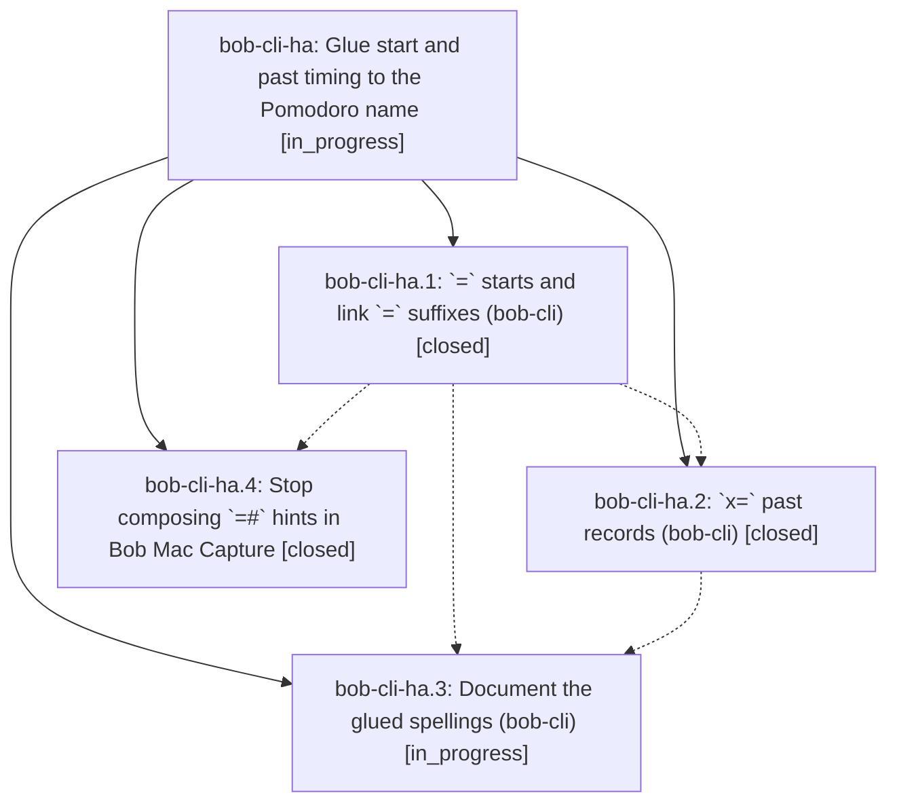

# Bead: bob-cli-ha — Glue start and past timing to the Pomodoro name

[Bead Pages](../README.md) / bob-cli-ha

**Status:** ◐ in_progress · **Type:** ▸ plan · **Tier:** epic
**Owner:** `bryanbugyi34@gmail.com` · **Created by:** [bbugyi200.apollo.cf](https://github.com/bobs-org/bob-cli--agents/blob/main/sessions/bbugyi200.apollo.cf.md) · **Assignee:** `bob-cli-ha.land`
**Created:** 2026-11-05 05:23:37 EST
**Plan:** [202611/glued\_start\_timing.md](https://github.com/bobs-org/bob-cli--plans/blob/main/202611/glued_start_timing.md)

<!-- sase:links:start -->

## Links

| Relation | Artifact | Why |
| --- | --- | --- |
| implemented-by | [plan:202611/glued_start_timing.md][1] | derived from the plan's `bead_id:` frontmatter field |

[1]: https://github.com/bobs-org/bob-cli--plans/blob/main/202611/glued_start_timing.md

<!-- sase:links:end -->

## Description

Capture `=` and `x=` tokens take their timing glued to a bare Pomodoro name (`=build-`, `=10-3fix`, `x=fix3`); the `@` and `<X>#` separators are retired with teaching errors, and every client, doc, and test teaches only the shorter spellings.

## Phases

| Bead | Title | Status | Size | Created | Agents | Commits |
|---|---|---|---|---|---:|---:|
| [bob-cli-ha.1](bob-cli-ha.1.md) | \`=\` starts and link \`=\` suffixes (bob-cli) | ✓ closed | medium | 2026-11-05 | 1 | 1 |
| [bob-cli-ha.2](bob-cli-ha.2.md) | \`x=\` past records (bob-cli) | ✓ closed | medium | 2026-11-05 | 1 | 1 |
| [bob-cli-ha.3](bob-cli-ha.3.md) | Document the glued spellings (bob-cli) | ◐ in_progress | medium | 2026-11-05 | 1 | 0 |
| [bob-cli-ha.4](bob-cli-ha.4.md) | Stop composing \`=#\` hints in Bob Mac Capture | ✓ closed | small | 2026-11-05 | 1 | 0 |

## Lineage

## Agents

| Agent | Bead | Commits |
|---|---|---:|
| [bbugyi200.apollo.bob-cli-ha.1](https://github.com/bobs-org/bob-cli--agents/blob/main/sessions/bbugyi200.apollo.bob-cli-ha.1.md) | [bob-cli-ha.1](bob-cli-ha.1.md) | 1 |
| [bbugyi200.apollo.bob-cli-ha.2](https://github.com/bobs-org/bob-cli--agents/blob/main/agents/bbugyi200.apollo.bob-cli-ha.2/README.md) | [bob-cli-ha.2](bob-cli-ha.2.md) | 1 |
| [bbugyi200.apollo.bob-cli-ha.3](https://github.com/bobs-org/bob-cli--agents/blob/main/agents/bbugyi200.apollo.bob-cli-ha.3/README.md) | [bob-cli-ha.3](bob-cli-ha.3.md) | 0 |
| [bbugyi200.apollo.bob-cli-ha.4](https://github.com/bobs-org/bob-cli--agents/blob/main/sessions/bbugyi200.apollo.bob-cli-ha.4.md) | [bob-cli-ha.4](bob-cli-ha.4.md) | 0 |
| [bbugyi200.apollo.bob-cli-ha.land](https://github.com/bobs-org/bob-cli--agents/blob/main/agents/bbugyi200.apollo.bob-cli-ha.land/README.md) | [bob-cli-ha](README.md) | 0 |

## Commits

| Repo | Commit | Subject | Bead | Committed |
|---|---|---|---|---|
| bob-cli | [`01cb7b5`](https://github.com/bobs-org/bob-cli/commit/01cb7b5c3eb75d7353ef4a57014cc5ada1178bf6) | feat(capture): add glued Pomodoro start grammar | [bob-cli-ha.1](bob-cli-ha.1.md) | 2026-11-05 08:11:16 EST |
| bob-cli | [`d012e78`](https://github.com/bobs-org/bob-cli/commit/d012e782bd3b399021027e58f833ed7ce31bd298) | feat(capture)!: glue past timing to the Pomodoro name | [bob-cli-ha.2](bob-cli-ha.2.md) | 2026-11-05 09:29:58 EST |
