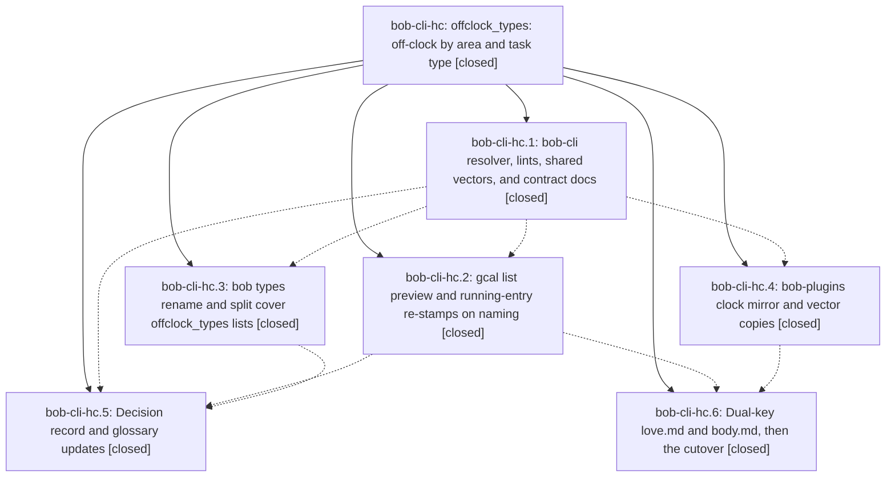

# Bead: bob-cli-hc — offclock\_types: off-clock by area and task type

[Bead Pages](../README.md) / bob-cli-hc

**Status:** ✓ closed · **Resolution:** done · **Type:** ▸ plan · **Tier:** epic
**Owner:** `bryanbugyi34@gmail.com` · **Created by:** [bbugyi200.apollo.research.3c.linker.w0](https://github.com/bobs-org/bob-cli--agents/blob/main/sessions/bbugyi200.apollo.research.3c.linker.w0.md) · **Assignee:** `bob-cli-hc.land`
**Created:** 2026-11-05 10:03:53 EST · **Closed:** 2026-11-05 18:40:32 EST
**Plan:** [202611/offclock\_types.md](https://github.com/bobs-org/bob-cli--plans/blob/main/202611/offclock_types.md)

<!-- sase:links:start -->

## Links

| Relation | Artifact | Why |
| --- | --- | --- |
| implemented-by | [plan:202611/offclock_types.md][1] | derived from the plan's `bead_id:` frontmatter field |

_Plus 1 automatic references — see [Referenced By](#referenced-by)._

[1]: https://github.com/bobs-org/bob-cli--plans/blob/main/202611/offclock_types.md

<!-- sase:links:end -->

## Description

Area and project notes accept an `offclock_types` list that sends only tasks of the listed effective types off the clock, with the same result in bob-cli and the Obsidian plugins, and the vault's love.md and body.md are migrated so that only their MEET tasks are off-clock.

## Notes

[2026-11-05T18:34:13Z · bob-cli-h4.land] DISCOVERED ISSUE (bob-cli-h4 lander, on master 84da37ba): just docs-check fails generated drift because docs/reference/glossary.md is out of date after the memory commits 44d129a4 (hc.5) and f36cc039 (hd.8); just docs-gen should regenerate it. Also recorded on bob-cli-hd with the hd-caused fmt, clippy, and test failures.

[2026-11-05T22:29:46Z · bob-cli-hc.land] Land triage of PROPOSED FOLLOW-UPs: (1) hc.1 docs first-day tutorial '=#focus' fence-12 failure: declined, already fixed on master by 2e91d45b (tutorial now runs '=focus'). (2) hc.3 capture::related::draft_related_stays_under_the_debug_perf_gate timing flake: semantic duplicate of bob-cli-bo, corroborated with +1 (not caused by this epic). (3) hc.4 Obsidian block-id-prompt naming has no clock re-stamp: plan explicitly deferred it, filed as feature task bob-cli-hk (medium, ready, related to hc.4). Also corroborated bob-cli-hf (+1) for the highlights ingest minute-boundary flake seen in the land test run. Land findings so far: bob-cli-hd's own regressions (2 cli tests, fmt drift, clippy collapsible_if) were bisected to 3c2d9622/cccdf94e and are fixed on master by hd's lander 5235d292, not this epic. Remaining epic work found: capture landing retypes (MEET destinations and same-run created entries, A10) are written after the start/lineup clock stamp, so e.g. '^love:dinner=meet' on a CHORE love task under offclock_types [MEET] stamps the running entry [t::] while its own plan_budget counts the link off-clock (close later corrects it); planned as a tale.

[2026-11-05T23:40:32Z · bob-cli-hc.land--1] Verified all six phases against the approved plan and DECISIONS; all six phase beads are closed. Land integration edits included keyword and accepted metadata on decisions:off-clock-note-defaults-filter-by-task-type, plus TypeRules injection in the gcal clock unit test. bob-cli-hd's fmt, clippy, and two CLI-test regressions were bisected to 3c2d9622/cccdf94e and fixed by hd's lander 5235d292, not this epic. This tale fixes capture landing retypes by re-stamping from post-retype links and updating reports; pomodoro_clock CLI suite passed 19/19, and just docs-check passed (447 passed, 1 skipped; generated contract content up to date). just check's clippy and 5,165 library tests passed; the full CLI target still reports only the known generated docs/reference/cli/capture-parse.md drift, left untouched per the approved tale. Follow-up triage: tutorial =#focus failure was fixed by 2e91d45b; the related perf flake was corroborated on bob-cli-bo; Obsidian naming re-stamp is filed as bob-cli-hk. Vault cutover gate custom-74557157 was confirmed but aborted because apollo's installed bob predates offclock_types; love.md and body.md retain the dual keys. Bryan should run just install-all on athena, apollo, and Mac after this fix ships, then restart the gate.

## Phases

| Bead | Title | Status | Size | Created | Agents | Commits |
|---|---|---|---|---|---:|---:|
| [bob-cli-hc.1](bob-cli-hc.1.md) | bob-cli resolver, lints, shared vectors, and contract docs | ✓ closed | medium | 2026-11-05 | 1 | 1 |
| [bob-cli-hc.2](bob-cli-hc.2.md) | gcal list preview and running-entry re-stamps on naming | ✓ closed | medium | 2026-11-05 | 1 | 1 |
| [bob-cli-hc.3](bob-cli-hc.3.md) | bob types rename and split cover offclock\_types lists | ✓ closed | medium | 2026-11-05 | 1 | 1 |
| [bob-cli-hc.4](bob-cli-hc.4.md) | bob-plugins clock mirror and vector copies | ✓ closed | medium | 2026-11-05 | 1 | 1 |
| [bob-cli-hc.5](bob-cli-hc.5.md) | Decision record and glossary updates | ✓ closed | small | 2026-11-05 | 1 | 1 |
| [bob-cli-hc.6](bob-cli-hc.6.md) | Dual-key love.md and body.md, then the cutover | ✓ closed | small | 2026-11-05 | 1 | 0 |

## Lineage

## Agents

| Agent | Bead | Commits |
|---|---|---:|
| [bbugyi200.apollo.bob-cli-hc.1](https://github.com/bobs-org/bob-cli--agents/blob/main/agents/bbugyi200.apollo.bob-cli-hc.1/README.md) | [bob-cli-hc.1](bob-cli-hc.1.md) | 1 |
| [bbugyi200.apollo.bob-cli-hc.2](https://github.com/bobs-org/bob-cli--agents/blob/main/sessions/bbugyi200.apollo.bob-cli-hc.2.md) | [bob-cli-hc.2](bob-cli-hc.2.md) | 1 |
| [bbugyi200.apollo.bob-cli-hc.3](https://github.com/bobs-org/bob-cli--agents/blob/main/agents/bbugyi200.apollo.bob-cli-hc.3/README.md) | [bob-cli-hc.3](bob-cli-hc.3.md) | 1 |
| [bbugyi200.apollo.bob-cli-hc.4](https://github.com/bobs-org/bob-cli--agents/blob/main/sessions/bbugyi200.apollo.bob-cli-hc.4.md) | [bob-cli-hc.4](bob-cli-hc.4.md) | 1 |
| [bbugyi200.apollo.bob-cli-hc.5](https://github.com/bobs-org/bob-cli--agents/blob/main/agents/bbugyi200.apollo.bob-cli-hc.5/README.md) | [bob-cli-hc.5](bob-cli-hc.5.md) | 1 |
| [bbugyi200.apollo.bob-cli-hc.6](https://github.com/bobs-org/bob-cli--agents/blob/main/agents/bbugyi200.apollo.bob-cli-hc.6/README.md) | [bob-cli-hc.6](bob-cli-hc.6.md) | 0 |
| [bbugyi200.apollo.bob-cli-hc.land](https://github.com/bobs-org/bob-cli--agents/blob/main/sessions/bbugyi200.apollo.bob-cli-hc.land.md) | [bob-cli-hc](README.md) | 3 |

## Commits

| Repo | Commit | Subject | Bead | Committed |
|---|---|---|---|---|
| bob-cli | [`ecc3d32`](https://github.com/bobs-org/bob-cli/commit/ecc3d32d27d199f962d37d89bf954e6b7efa8168) | feat(clock): add clock-type filter with strict offclock\_types reader | [bob-cli-hc.1](bob-cli-hc.1.md) | 2026-11-05 11:22:27 EST |
| bob-cli | [`e6122f7`](https://github.com/bobs-org/bob-cli/commit/e6122f7a3859d3070469adcf34d1c6235cd77e1b) | fix(capture): restamp relocated pomodoros and align gcal clocks | [bob-cli-hc.2](bob-cli-hc.2.md) | 2026-11-05 12:18:17 EST |
| bob-plugins | [`bob-plugins@d751cf3`](https://github.com/bobs-org/bob-plugins/commit/d751cf37adb92a6f2bc8858d576a2f749f5be162) | feat(plugins): mirror offclock type resolution | [bob-cli-hc.4](bob-cli-hc.4.md) | 2026-11-05 12:23:55 EST |
| bob-cli | [`832e124`](https://github.com/bobs-org/bob-cli/commit/832e124645585118f9c7e42633e05814f70ec59c) | feat(types): cover offclock lists in rename and split | [bob-cli-hc.3](bob-cli-hc.3.md) | 2026-11-05 12:31:33 EST |
| bob-cli | [`44d129a`](https://github.com/bobs-org/bob-cli/commit/44d129a415074fbb4c614e804614778c5285f129) | docs(memory): record off-clock type policies | [bob-cli-hc.5](bob-cli-hc.5.md) | 2026-11-05 13:00:12 EST |
| bob-cli | [`82f6cb9`](https://github.com/bobs-org/bob-cli/commit/82f6cb9bea196af48a18796481e8bfe09b395b79) | fix(memory): complete the offclock\_types decision record and isolate its gcal clock test | [bob-cli-hc](README.md) | 2026-11-05 17:32:03 EST |
| bob-cli | [`e816bce`](https://github.com/bobs-org/bob-cli/commit/e816bcec947e1141184899beade24534fbfab4f4) | fix(capture): restamp clocks after landing retypes | [bob-cli-hc](README.md) | 2026-11-05 18:42:37 EST |
| bob-cli--plans | [`bob-cli--plans@cf9c4d6`](https://github.com/bobs-org/bob-cli--plans/commit/cf9c4d64e6b2492dbca17cb63f1a7ca7c1695065) | chore(plans): mark epic plan complete | [bob-cli-hc](README.md) | 2026-11-05 18:43:09 EST |

<!-- sase:referenced-by:start -->

## Referenced By

| Relation | Artifact | Why | Uses |
| --- | --- | --- | ---: |
| read-by | [agent:bob-cli-hc.land][1] | Need the epic scope, children, and linked plan file | 1 |

[1]: https://github.com/bobs-org/bob-cli--agents/blob/main/sessions/bbugyi200.apollo.bob-cli-hc.land.md

<!-- sase:referenced-by:end -->
