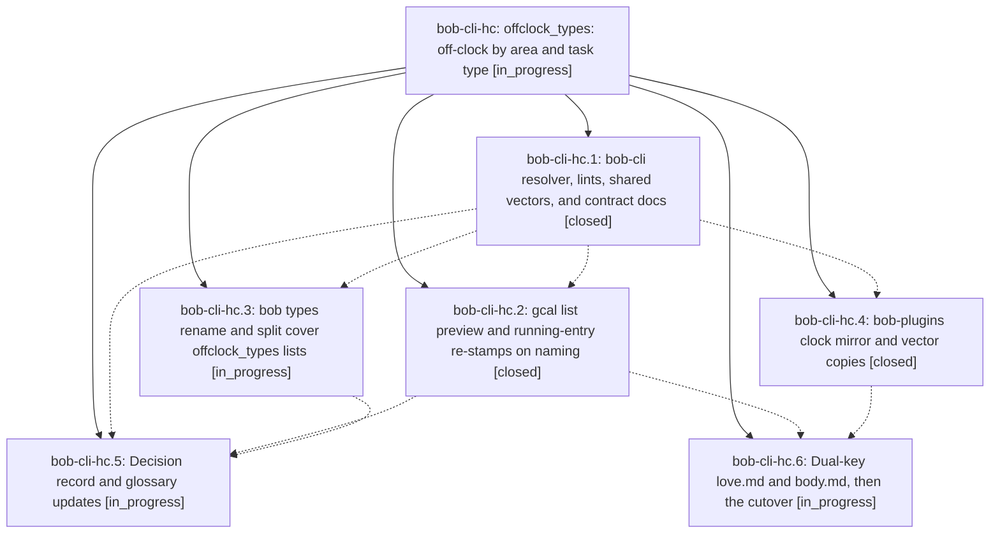

# Bead: bob-cli-hc — offclock\_types: off-clock by area and task type

[Bead Pages](../README.md) / bob-cli-hc

**Status:** ◐ in_progress · **Type:** ▸ plan · **Tier:** epic
**Owner:** `bryanbugyi34@gmail.com` · **Created by:** [bbugyi200.apollo.research.3c.linker.w0](https://github.com/bobs-org/bob-cli--agents/blob/main/sessions/bbugyi200.apollo.research.3c.linker.w0.md) · **Assignee:** `bob-cli-hc.land`
**Created:** 2026-11-05 10:03:53 EST
**Plan:** [202611/offclock\_types.md](https://github.com/bobs-org/bob-cli--plans/blob/main/202611/offclock_types.md)

<!-- sase:links:start -->

## Links

| Relation | Artifact | Why |
| --- | --- | --- |
| implemented-by | [plan:202611/offclock_types.md][1] | derived from the plan's `bead_id:` frontmatter field |

[1]: https://github.com/bobs-org/bob-cli--plans/blob/main/202611/offclock_types.md

<!-- sase:links:end -->

## Description

Area and project notes accept an `offclock_types` list that sends only tasks of the listed effective types off the clock, with the same result in bob-cli and the Obsidian plugins, and the vault's love.md and body.md are migrated so that only their MEET tasks are off-clock.

## Phases

| Bead | Title | Status | Size | Created | Agents | Commits |
|---|---|---|---|---|---:|---:|
| [bob-cli-hc.1](bob-cli-hc.1.md) | bob-cli resolver, lints, shared vectors, and contract docs | ✓ closed | medium | 2026-11-05 | 1 | 1 |
| [bob-cli-hc.2](bob-cli-hc.2.md) | gcal list preview and running-entry re-stamps on naming | ✓ closed | medium | 2026-11-05 | 1 | 0 |
| [bob-cli-hc.3](bob-cli-hc.3.md) | bob types rename and split cover offclock\_types lists | ◐ in_progress | medium | 2026-11-05 | 1 | 0 |
| [bob-cli-hc.4](bob-cli-hc.4.md) | bob-plugins clock mirror and vector copies | ✓ closed | medium | 2026-11-05 | 1 | 1 |
| [bob-cli-hc.5](bob-cli-hc.5.md) | Decision record and glossary updates | ◐ in_progress | small | 2026-11-05 | 1 | 0 |
| [bob-cli-hc.6](bob-cli-hc.6.md) | Dual-key love.md and body.md, then the cutover | ◐ in_progress | small | 2026-11-05 | 1 | 0 |

## Lineage

## Agents

| Agent | Bead | Commits |
|---|---|---:|
| [bbugyi200.apollo.bob-cli-hc.1](https://github.com/bobs-org/bob-cli--agents/blob/main/agents/bbugyi200.apollo.bob-cli-hc.1/README.md) | [bob-cli-hc.1](bob-cli-hc.1.md) | 1 |
| [bbugyi200.apollo.bob-cli-hc.2](https://github.com/bobs-org/bob-cli--agents/blob/main/sessions/bbugyi200.apollo.bob-cli-hc.2.md) | [bob-cli-hc.2](bob-cli-hc.2.md) | 0 |
| [bbugyi200.apollo.bob-cli-hc.3](https://github.com/bobs-org/bob-cli--agents/blob/main/agents/bbugyi200.apollo.bob-cli-hc.3/README.md) | [bob-cli-hc.3](bob-cli-hc.3.md) | 0 |
| [bbugyi200.apollo.bob-cli-hc.4](https://github.com/bobs-org/bob-cli--agents/blob/main/sessions/bbugyi200.apollo.bob-cli-hc.4.md) | [bob-cli-hc.4](bob-cli-hc.4.md) | 1 |
| [bbugyi200.apollo.bob-cli-hc.5](https://github.com/bobs-org/bob-cli--agents/blob/main/agents/bbugyi200.apollo.bob-cli-hc.5/README.md) | [bob-cli-hc.5](bob-cli-hc.5.md) | 0 |
| [bbugyi200.apollo.bob-cli-hc.6](https://github.com/bobs-org/bob-cli--agents/blob/main/agents/bbugyi200.apollo.bob-cli-hc.6/README.md) | [bob-cli-hc.6](bob-cli-hc.6.md) | 0 |
| [bbugyi200.apollo.bob-cli-hc.land](https://github.com/bobs-org/bob-cli--agents/blob/main/agents/bbugyi200.apollo.bob-cli-hc.land/README.md) | [bob-cli-hc](README.md) | 0 |

## Commits

| Repo | Commit | Subject | Bead | Committed |
|---|---|---|---|---|
| bob-cli | [`ecc3d32`](https://github.com/bobs-org/bob-cli/commit/ecc3d32d27d199f962d37d89bf954e6b7efa8168) | feat(clock): add clock-type filter with strict offclock\_types reader | [bob-cli-hc.1](bob-cli-hc.1.md) | 2026-11-05 11:22:27 EST |
| bob-plugins | [`bob-plugins@d751cf3`](https://github.com/bobs-org/bob-plugins/commit/d751cf37adb92a6f2bc8858d576a2f749f5be162) | feat(plugins): mirror offclock type resolution | [bob-cli-hc.4](bob-cli-hc.4.md) | 2026-11-05 12:23:55 EST |
