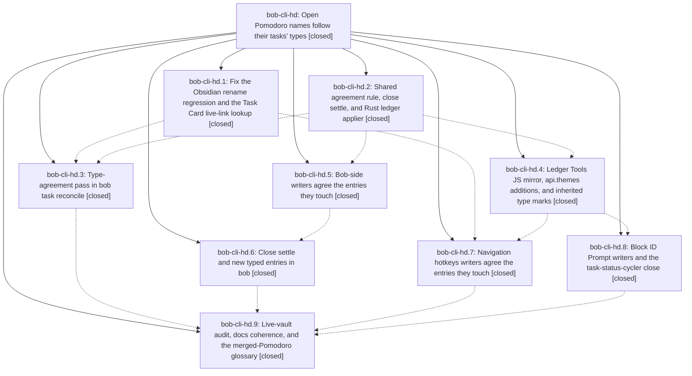

# Bead: bob-cli-hd — Open Pomodoro names follow their tasks' types

[Bead Pages](../README.md) / bob-cli-hd

**Status:** ✓ closed · **Resolution:** done · **Type:** ▸ plan · **Tier:** epic
**Owner:** `bryanbugyi34@gmail.com` · **Created by:** [bbugyi200.athena.research.5q.linker.w0](https://github.com/bobs-org/bob-cli--agents/blob/main/sessions/bbugyi200.athena.research.5q.linker.w0.md) · **Assignee:** `bob-cli-hd.land`
**Created:** 2026-11-05 10:26:34 EST · **Closed:** 2026-11-05 14:36:52 EST
**Plan:** [202611/pomodoro\_names\_follow\_task\_types.md](https://github.com/bobs-org/bob-cli--plans/blob/main/202611/pomodoro_names_follow_task_types.md)

<!-- sase:links:start -->

## Links

| Relation | Artifact | Why |
| --- | --- | --- |
| implemented-by | [plan:202611/pomodoro_names_follow_task_types.md][1] | derived from the plan's `bead_id:` frontmatter field |

_Plus 5 automatic references — see [Referenced By](#referenced-by)._

[1]: https://github.com/bobs-org/bob-cli--plans/blob/main/202611/pomodoro_names_follow_task_types.md

<!-- sase:links:end -->

## Description

Every live Task Link under one of today's open, typed Pomodoros has a task type that the entry's name contains, and the name holds no type that none of its links carry. Gestures keep this true at their shared write paths, the close settles each finished session's name, and `bob task reconcile` is the safety net. It repairs open names in both directions and never writes a `[type::]` field.

## Notes

[2026-11-05T18:34:07Z · bob-cli-h4.land] DISCOVERED ISSUE (bob-cli-h4 lander, on master 84da37ba): just check is red from hd commits. (1) cargo fmt --check drift in src/native/task_status_hooks/sync.rs (7 hunks, 1620-1710) and src/native/plan_budget/mod.rs:1385, both blamed to 3c2d9622 (hd.3); (2) just lint denies clippy::collapsible_if at task_status_hooks/sync.rs:1625 (hd.3), the only denied lint left in the workspace; (3) cargo test --test cli fails plan::plan_reports_full_budget_as_json (6 unexpected type_mismatch warnings; already proposed by hd.6) and task_move::move_without_field_relocates_live_link_to_new_inherited_type (tests/cli/task_move.rs:1004, relocated[] is empty, so the D8 relocation no longer finds [[dev#^dev1]]; most likely cccdf94e's (hd.5) switch to the path-aware apply_to_day_contents_for_task); (4) just docs-check generated drift: docs/reference/glossary.md is out of date after the memory commits f36cc039 (hd.8) and 44d129a4 (hc.5), so run just docs-gen. The lib suite passes (5110), and the other 3164 CLI tests pass.

[2026-11-05T19:36:52Z · bob-cli-hd.land] Verified all 9 phases against the plan and DECISIONS (apply, merge, decision record, task-type + merged-pomodoro strands): Rust agree_entry/settle_closed/agree_apply, reconcile pass (guarded read-set = all vault notes + config), capture/task-move writers, close settle + A10 retype; bob-plugins commits 811f650, b5bdd73, 6e30934, 8e82734, 7b7c52f wire rename retype, api.themes agree/settle/agreeLedgerEntries, shared cleanup agreement in every planDeferredPomodoroLinkCleanup writer, cycler settleClosed, prompt retype; vectors byte-identical. Landing fixed epic-caused red gates: cargo fmt drift (hd.3 sync.rs/plan_budget, hd.6 capture/plan.rs, plus he's config/mod.rs), clippy collapsible_if + dead index in reconcile sync.rs (hd.3); type_mismatch lint no longer flags untyped tasks (hd.3 regression vs documented agrees(); fixes plan::plan_reports_full_budget_as_json, regenerated docs plan.svg that showed the bogus warning, unit test + docs/plan.md row); live-link identity now resolves targets through the vault link index and accepts the moved task's post-repair dest or source (hd.5 regression; fixes task_move::move_without_field_relocates_live_link_to_new_inherited_type), and capture #type retype now uses the same path-aware lookup (completes hd.5 step 3; ID-only applier is test-only). Integration: reviewed ha.3, hc.1-5 (offclock_types/restamp), he.1-3, hg.2 since 1f2b28b0; agreement renames never change task types so hc.2 clock restamp needs no hook; no duplication. Gates: just check green (fmt, clippy, all test binaries), just docs-check green. Follow-ups: hd.6 #1-3 + h4 lander note = epic-caused, fixed here; hd.2 #1 tutorial fence no longer reproduces (declined); hd.7 #1 / hd.8 #1 wikilink-index budget = dup, +1 on bob-cli-f8; task-link-marks-live CPU budgets = DISCOVERED ISSUE note on active epic bob-cli-h8 (npm-test-green goal); hd.9 #1 corroboration only. No epic symbols.

## Phases

| Bead | Title | Status | Size | Created | Agents | Commits |
|---|---|---|---|---|---:|---:|
| [bob-cli-hd.1](bob-cli-hd.1.md) | Fix the Obsidian rename regression and the Task Card live-link lookup | ✓ closed | medium | 2026-11-05 | 1 | 1 |
| [bob-cli-hd.2](bob-cli-hd.2.md) | Shared agreement rule, close settle, and Rust ledger applier | ✓ closed | medium | 2026-11-05 | 1 | 1 |
| [bob-cli-hd.3](bob-cli-hd.3.md) | Type-agreement pass in bob task reconcile | ✓ closed | medium | 2026-11-05 | 1 | 1 |
| [bob-cli-hd.4](bob-cli-hd.4.md) | Ledger Tools JS mirror, api.themes additions, and inherited type marks | ✓ closed | medium | 2026-11-05 | 1 | 1 |
| [bob-cli-hd.5](bob-cli-hd.5.md) | Bob-side writers agree the entries they touch | ✓ closed | medium | 2026-11-05 | 1 | 1 |
| [bob-cli-hd.6](bob-cli-hd.6.md) | Close settle and new typed entries in bob | ✓ closed | medium | 2026-11-05 | 1 | 1 |
| [bob-cli-hd.7](bob-cli-hd.7.md) | Navigation hotkeys writers agree the entries they touch | ✓ closed | medium | 2026-11-05 | 1 | 1 |
| [bob-cli-hd.8](bob-cli-hd.8.md) | Block ID Prompt writers and the task-status-cycler close | ✓ closed | medium | 2026-11-05 | 1 | 2 |
| [bob-cli-hd.9](bob-cli-hd.9.md) | Live-vault audit, docs coherence, and the merged-Pomodoro glossary | ✓ closed | small | 2026-11-05 | 1 | 2 |

## Lineage

## Agents

| Agent | Bead | Commits |
|---|---|---:|
| [bbugyi200.athena.bob-cli-hd.1](https://github.com/bobs-org/bob-cli--agents/blob/main/sessions/bbugyi200.athena.bob-cli-hd.1.md) | [bob-cli-hd.1](bob-cli-hd.1.md) | 1 |
| [bbugyi200.athena.bob-cli-hd.2](https://github.com/bobs-org/bob-cli--agents/blob/main/agents/bbugyi200.athena.bob-cli-hd.2/README.md) | [bob-cli-hd.2](bob-cli-hd.2.md) | 1 |
| [bbugyi200.athena.bob-cli-hd.3](https://github.com/bobs-org/bob-cli--agents/blob/main/agents/bbugyi200.athena.bob-cli-hd.3/README.md) | [bob-cli-hd.3](bob-cli-hd.3.md) | 1 |
| [bbugyi200.athena.bob-cli-hd.4](https://github.com/bobs-org/bob-cli--agents/blob/main/sessions/bbugyi200.athena.bob-cli-hd.4.md) | [bob-cli-hd.4](bob-cli-hd.4.md) | 1 |
| [bbugyi200.athena.bob-cli-hd.5](https://github.com/bobs-org/bob-cli--agents/blob/main/agents/bbugyi200.athena.bob-cli-hd.5/README.md) | [bob-cli-hd.5](bob-cli-hd.5.md) | 1 |
| [bbugyi200.athena.bob-cli-hd.6](https://github.com/bobs-org/bob-cli--agents/blob/main/agents/bbugyi200.athena.bob-cli-hd.6/README.md) | [bob-cli-hd.6](bob-cli-hd.6.md) | 1 |
| [bbugyi200.athena.bob-cli-hd.7](https://github.com/bobs-org/bob-cli--agents/blob/main/sessions/bbugyi200.athena.bob-cli-hd.7.md) | [bob-cli-hd.7](bob-cli-hd.7.md) | 1 |
| [bbugyi200.athena.bob-cli-hd.8](https://github.com/bobs-org/bob-cli--agents/blob/main/sessions/bbugyi200.athena.bob-cli-hd.8.md) | [bob-cli-hd.8](bob-cli-hd.8.md) | 2 |
| [bbugyi200.athena.bob-cli-hd.9](https://github.com/bobs-org/bob-cli--agents/blob/main/agents/bbugyi200.athena.bob-cli-hd.9/README.md) | [bob-cli-hd.9](bob-cli-hd.9.md) | 1 |
| [bbugyi200.athena.bob-cli-hd.land](https://github.com/bobs-org/bob-cli--agents/blob/main/agents/bbugyi200.athena.bob-cli-hd.land/README.md) | [bob-cli-hd](README.md) | 1 |

## Commits

| Repo | Commit | Subject | Bead | Committed |
|---|---|---|---|---|
| bob-plugins | [`bob-plugins@811f650`](https://github.com/bobs-org/bob-plugins/commit/811f6508eec5781a1c824e8e1afc66f3c0e92bbe) | fix(navigation): repair pomodoro type rename and live-link lookup | [bob-cli-hd.1](bob-cli-hd.1.md) | 2026-11-05 10:54:39 EST |
| bob-cli | [`1f2b28b`](https://github.com/bobs-org/bob-cli/commit/1f2b28b03b514a4d72ed313c146a78ef51bd271e) | feat(task-types): shared agreement rule, close settle, and Rust ledger applier | [bob-cli-hd.2](bob-cli-hd.2.md) | 2026-11-05 11:08:25 EST |
| bob-cli | [`3c2d962`](https://github.com/bobs-org/bob-cli/commit/3c2d9622f213c47158890d16089bb4479c6c28dd) | feat(task-reconcile): type-agreement pass in bob task reconcile | [bob-cli-hd.3](bob-cli-hd.3.md) | 2026-11-05 11:42:01 EST |
| bob-cli | [`cccdf94`](https://github.com/bobs-org/bob-cli/commit/cccdf94e0474992712e1e5f262c2cda47bd4449e) | feat(capture): agree touched Pomodoro entries via shared applier | [bob-cli-hd.5](bob-cli-hd.5.md) | 2026-11-05 11:56:03 EST |
| bob-plugins | [`bob-plugins@b5bdd73`](https://github.com/bobs-org/bob-plugins/commit/b5bdd7354ab8acb7c05fc85ab1472d6aba42c84f) | feat(bob-ledger-tools): mirror ledger agree/settle planners, async api.themes applier, and inherited type marks | [bob-cli-hd.4](bob-cli-hd.4.md) | 2026-11-05 12:00:11 EST |
| bob-cli | [`f36cc03`](https://github.com/bobs-org/bob-cli/commit/f36cc0396a7739941ef2ce85b61608c70f3d7333) | docs(memory): clarify merged Pomodoro type agreement | [bob-cli-hd.8](bob-cli-hd.8.md) | 2026-11-05 12:44:01 EST |
| bob-plugins | [`bob-plugins@6e30934`](https://github.com/bobs-org/bob-plugins/commit/6e30934999a89effab88776403e3cbba5af8b74f) | feat(pomodoro): align task types across prompt and close | [bob-cli-hd.8](bob-cli-hd.8.md) | 2026-11-05 12:44:22 EST |
| bob-cli | [`bfd7b00`](https://github.com/bobs-org/bob-cli/commit/bfd7b00570d4eaea7eb6a2ff8021b9a1186619c8) | feat(capture)!: settle close names and retype tasks landing in created entries | [bob-cli-hd.6](bob-cli-hd.6.md) | 2026-11-05 13:07:49 EST |
| bob-plugins | [`bob-plugins@8e82734`](https://github.com/bobs-org/bob-plugins/commit/8e82734121e803c42260ee6bcf3c1cdebd1e5b81) | fix(navigation): keep Pomodoro entry names aligned | [bob-cli-hd.7](bob-cli-hd.7.md) | 2026-11-05 13:10:08 EST |
| bob-plugins | [`bob-plugins@7b7c52f`](https://github.com/bobs-org/bob-plugins/commit/7b7c52f10f42f1b38553e991a0750852d2a46761) | chore(ledger-tools): resync pomodoro theme vectors with bob-cli | [bob-cli-hd.9](bob-cli-hd.9.md) | 2026-11-05 13:24:28 EST |
| bob-cli | [`58e9855`](https://github.com/bobs-org/bob-cli/commit/58e98558fb2c85c438ab866d992123531a90ed53) | docs(memory): link merged-Pomodoro strand to names-follow-types decision and regen glossary | [bob-cli-hd.9](bob-cli-hd.9.md) | 2026-11-05 13:38:12 EST |
| bob-cli | [`5235d29`](https://github.com/bobs-org/bob-cli/commit/5235d2927739e4839f8cd327a749113f332d9182) | fix(task-types): land Pomodoro name agreement with green gates | [bob-cli-hd](README.md) | 2026-11-05 14:37:52 EST |

<!-- sase:referenced-by:start -->

## Referenced By

| Relation | Artifact | Why | Uses |
| --- | --- | --- | ---: |
| read-by | [agent:bob-cli-hd.2][1] | need epic overview for agree-rule context | 1 |
| read-by | [agent:bob-cli-hd.3][2] | epic context | 1 |
| read-by | [agent:bob-cli-hd.5][3] | Need epic DECISIONS and plan context | 1 |
| read-by | [agent:bob-cli-hd.6][4] | Check epic status and remaining phases for close phase | 1 |
| read-by | [agent:bob-cli-hd.9][5] | Need parent epic scope and plan | 1 |

[1]: https://github.com/bobs-org/bob-cli--agents/blob/main/agents/bbugyi200.athena.bob-cli-hd.2/README.md
[2]: https://github.com/bobs-org/bob-cli--agents/blob/main/agents/bbugyi200.athena.bob-cli-hd.3/README.md
[3]: https://github.com/bobs-org/bob-cli--agents/blob/main/agents/bbugyi200.athena.bob-cli-hd.5/README.md
[4]: https://github.com/bobs-org/bob-cli--agents/blob/main/agents/bbugyi200.athena.bob-cli-hd.6/README.md
[5]: https://github.com/bobs-org/bob-cli--agents/blob/main/agents/bbugyi200.athena.bob-cli-hd.9/README.md

<!-- sase:referenced-by:end -->
