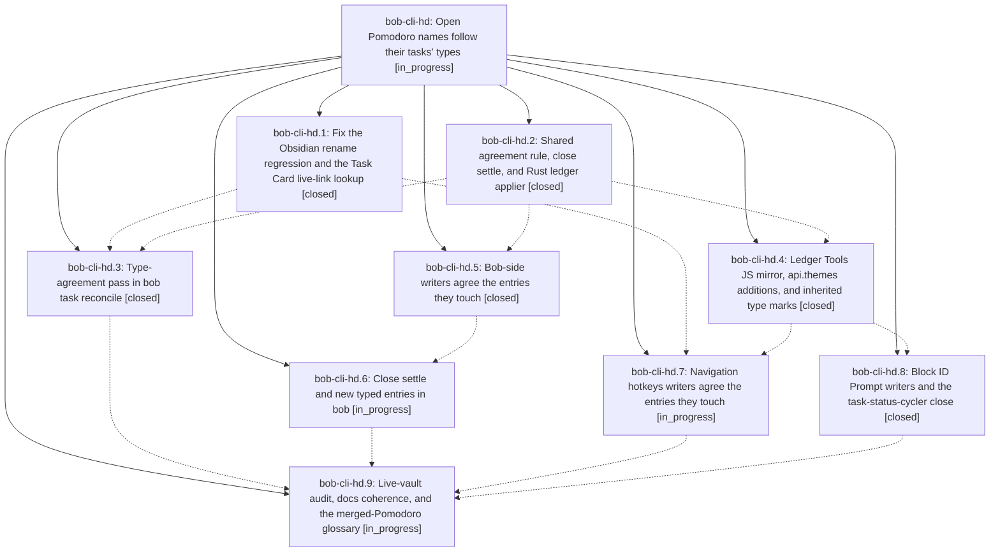

# Bead: bob-cli-hd — Open Pomodoro names follow their tasks' types

[Bead Pages](../README.md) / bob-cli-hd

**Status:** ◐ in_progress · **Type:** ▸ plan · **Tier:** epic
**Owner:** `bryanbugyi34@gmail.com` · **Created by:** [bbugyi200.athena.research.5q.linker.w0](https://github.com/bobs-org/bob-cli--agents/blob/main/sessions/bbugyi200.athena.research.5q.linker.w0.md) · **Assignee:** `bob-cli-hd.land`
**Created:** 2026-11-05 10:26:34 EST
**Plan:** [202611/pomodoro\_names\_follow\_task\_types.md](https://github.com/bobs-org/bob-cli--plans/blob/main/202611/pomodoro_names_follow_task_types.md)

<!-- sase:links:start -->

## Links

| Relation | Artifact | Why |
| --- | --- | --- |
| implemented-by | [plan:202611/pomodoro_names_follow_task_types.md][1] | derived from the plan's `bead_id:` frontmatter field |

_Plus 3 automatic references — see [Referenced By](#referenced-by)._

[1]: https://github.com/bobs-org/bob-cli--plans/blob/main/202611/pomodoro_names_follow_task_types.md

<!-- sase:links:end -->

## Description

Every live Task Link under one of today's open, typed Pomodoros has a task type that the entry's name contains, and the name holds no type that none of its links carry. Gestures keep this true at their shared write paths, the close settles each finished session's name, and `bob task reconcile` is the safety net. It repairs open names in both directions and never writes a `[type::]` field.

## Phases

| Bead | Title | Status | Size | Created | Agents | Commits |
|---|---|---|---|---|---:|---:|
| [bob-cli-hd.1](bob-cli-hd.1.md) | Fix the Obsidian rename regression and the Task Card live-link lookup | ✓ closed | medium | 2026-11-05 | 1 | 1 |
| [bob-cli-hd.2](bob-cli-hd.2.md) | Shared agreement rule, close settle, and Rust ledger applier | ✓ closed | medium | 2026-11-05 | 1 | 1 |
| [bob-cli-hd.3](bob-cli-hd.3.md) | Type-agreement pass in bob task reconcile | ✓ closed | medium | 2026-11-05 | 1 | 1 |
| [bob-cli-hd.4](bob-cli-hd.4.md) | Ledger Tools JS mirror, api.themes additions, and inherited type marks | ✓ closed | medium | 2026-11-05 | 1 | 1 |
| [bob-cli-hd.5](bob-cli-hd.5.md) | Bob-side writers agree the entries they touch | ✓ closed | medium | 2026-11-05 | 1 | 1 |
| [bob-cli-hd.6](bob-cli-hd.6.md) | Close settle and new typed entries in bob | ◐ in_progress | medium | 2026-11-05 | 1 | 0 |
| [bob-cli-hd.7](bob-cli-hd.7.md) | Navigation hotkeys writers agree the entries they touch | ◐ in_progress | medium | 2026-11-05 | 1 | 0 |
| [bob-cli-hd.8](bob-cli-hd.8.md) | Block ID Prompt writers and the task-status-cycler close | ✓ closed | medium | 2026-11-05 | 1 | 2 |
| [bob-cli-hd.9](bob-cli-hd.9.md) | Live-vault audit, docs coherence, and the merged-Pomodoro glossary | ◐ in_progress | small | 2026-11-05 | 1 | 0 |

## Lineage

## Agents

| Agent | Bead | Commits |
|---|---|---:|
| [bbugyi200.athena.bob-cli-hd.1](https://github.com/bobs-org/bob-cli--agents/blob/main/sessions/bbugyi200.athena.bob-cli-hd.1.md) | [bob-cli-hd.1](bob-cli-hd.1.md) | 1 |
| [bbugyi200.athena.bob-cli-hd.2](https://github.com/bobs-org/bob-cli--agents/blob/main/agents/bbugyi200.athena.bob-cli-hd.2/README.md) | [bob-cli-hd.2](bob-cli-hd.2.md) | 1 |
| [bbugyi200.athena.bob-cli-hd.3](https://github.com/bobs-org/bob-cli--agents/blob/main/agents/bbugyi200.athena.bob-cli-hd.3/README.md) | [bob-cli-hd.3](bob-cli-hd.3.md) | 1 |
| [bbugyi200.athena.bob-cli-hd.4](https://github.com/bobs-org/bob-cli--agents/blob/main/sessions/bbugyi200.athena.bob-cli-hd.4.md) | [bob-cli-hd.4](bob-cli-hd.4.md) | 1 |
| [bbugyi200.athena.bob-cli-hd.5](https://github.com/bobs-org/bob-cli--agents/blob/main/agents/bbugyi200.athena.bob-cli-hd.5/README.md) | [bob-cli-hd.5](bob-cli-hd.5.md) | 1 |
| [bbugyi200.athena.bob-cli-hd.6](https://github.com/bobs-org/bob-cli--agents/blob/main/agents/bbugyi200.athena.bob-cli-hd.6/README.md) | [bob-cli-hd.6](bob-cli-hd.6.md) | 0 |
| [bbugyi200.athena.bob-cli-hd.7](https://github.com/bobs-org/bob-cli--agents/blob/main/sessions/bbugyi200.athena.bob-cli-hd.7.md) | [bob-cli-hd.7](bob-cli-hd.7.md) | 0 |
| [bbugyi200.athena.bob-cli-hd.8](https://github.com/bobs-org/bob-cli--agents/blob/main/sessions/bbugyi200.athena.bob-cli-hd.8.md) | [bob-cli-hd.8](bob-cli-hd.8.md) | 2 |
| [bbugyi200.athena.bob-cli-hd.9](https://github.com/bobs-org/bob-cli--agents/blob/main/agents/bbugyi200.athena.bob-cli-hd.9/README.md) | [bob-cli-hd.9](bob-cli-hd.9.md) | 0 |
| [bbugyi200.athena.bob-cli-hd.land](https://github.com/bobs-org/bob-cli--agents/blob/main/agents/bbugyi200.athena.bob-cli-hd.land/README.md) | [bob-cli-hd](README.md) | 0 |

## Commits

| Repo | Commit | Subject | Bead | Committed |
|---|---|---|---|---|
| bob-plugins | [`bob-plugins@811f650`](https://github.com/bobs-org/bob-plugins/commit/811f6508eec5781a1c824e8e1afc66f3c0e92bbe) | fix(navigation): repair pomodoro type rename and live-link lookup | [bob-cli-hd.1](bob-cli-hd.1.md) | 2026-11-05 10:54:39 EST |
| bob-cli | [`1f2b28b`](https://github.com/bobs-org/bob-cli/commit/1f2b28b03b514a4d72ed313c146a78ef51bd271e) | feat(task-types): shared agreement rule, close settle, and Rust ledger applier | [bob-cli-hd.2](bob-cli-hd.2.md) | 2026-11-05 11:08:25 EST |
| bob-cli | [`3c2d962`](https://github.com/bobs-org/bob-cli/commit/3c2d9622f213c47158890d16089bb4479c6c28dd) | feat(task-reconcile): type-agreement pass in bob task reconcile | [bob-cli-hd.3](bob-cli-hd.3.md) | 2026-11-05 11:42:01 EST |
| bob-cli | [`cccdf94`](https://github.com/bobs-org/bob-cli/commit/cccdf94e0474992712e1e5f262c2cda47bd4449e) | feat(capture): agree touched Pomodoro entries via shared applier | [bob-cli-hd.5](bob-cli-hd.5.md) | 2026-11-05 11:56:03 EST |
| bob-plugins | [`bob-plugins@b5bdd73`](https://github.com/bobs-org/bob-plugins/commit/b5bdd7354ab8acb7c05fc85ab1472d6aba42c84f) | feat(bob-ledger-tools): mirror ledger agree/settle planners, async api.themes applier, and inherited type marks | [bob-cli-hd.4](bob-cli-hd.4.md) | 2026-11-05 12:00:11 EST |
| bob-cli | [`f36cc03`](https://github.com/bobs-org/bob-cli/commit/f36cc0396a7739941ef2ce85b61608c70f3d7333) | docs(memory): clarify merged Pomodoro type agreement | [bob-cli-hd.8](bob-cli-hd.8.md) | 2026-11-05 12:44:01 EST |
| bob-plugins | [`bob-plugins@6e30934`](https://github.com/bobs-org/bob-plugins/commit/6e30934999a89effab88776403e3cbba5af8b74f) | feat(pomodoro): align task types across prompt and close | [bob-cli-hd.8](bob-cli-hd.8.md) | 2026-11-05 12:44:22 EST |

<!-- sase:referenced-by:start -->

## Referenced By

| Relation | Artifact | Why | Uses |
| --- | --- | --- | ---: |
| read-by | [agent:bob-cli-hd.2][1] | need epic overview for agree-rule context | 1 |
| read-by | [agent:bob-cli-hd.3][2] | epic context | 1 |
| read-by | [agent:bob-cli-hd.5][3] | Need epic DECISIONS and plan context | 1 |

[1]: https://github.com/bobs-org/bob-cli--agents/blob/main/agents/bbugyi200.athena.bob-cli-hd.2/README.md
[2]: https://github.com/bobs-org/bob-cli--agents/blob/main/agents/bbugyi200.athena.bob-cli-hd.3/README.md
[3]: https://github.com/bobs-org/bob-cli--agents/blob/main/agents/bbugyi200.athena.bob-cli-hd.5/README.md

<!-- sase:referenced-by:end -->
