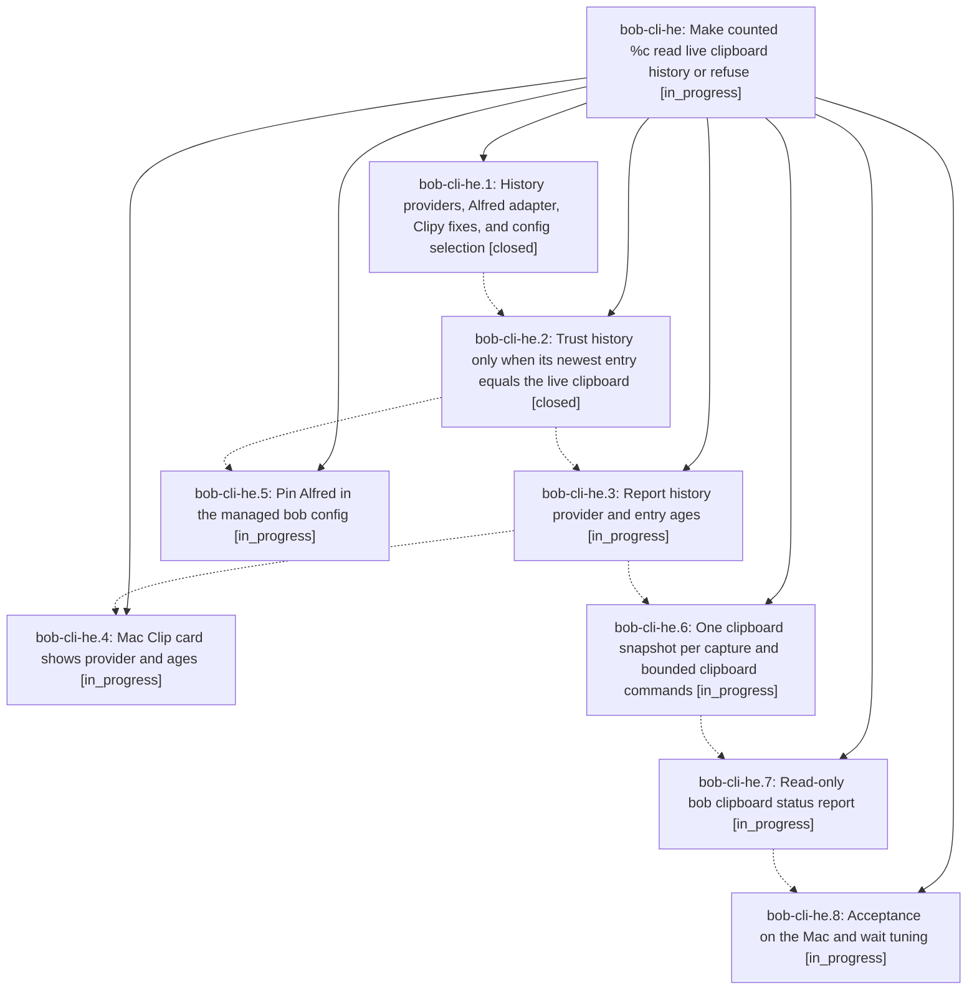

# Bead: bob-cli-he — Make counted %c read live clipboard history or refuse

[Bead Pages](../README.md) / bob-cli-he

**Status:** ◐ in_progress · **Type:** ▸ plan · **Tier:** epic
**Owner:** `bryanbugyi34@gmail.com` · **Created by:** [bbugyi200.athena.research.5r.linker.w0](https://github.com/bobs-org/bob-cli--agents/blob/main/sessions/bbugyi200.athena.research.5r.linker.w0.md) · **Assignee:** `bob-cli-he.land`
**Created:** 2026-11-05 10:29:53 EST
**Plan:** [202611/percent\_c\_history\_agreement.md](https://github.com/bobs-org/bob-cli--plans/blob/main/202611/percent_c_history_agreement.md)

<!-- sase:links:start -->

## Links

| Relation | Artifact | Why |
| --- | --- | --- |
| implemented-by | [plan:202611/percent_c_history_agreement.md][1] | derived from the plan's `bead_id:` frontmatter field |

[1]: https://github.com/bobs-org/bob-cli--plans/blob/main/202611/percent_c_history_agreement.md

<!-- sase:links:end -->

## Description

Counted `%c<N>` reads the clipboard manager that is actually running (Alfred on the Mac), trusts its history only when the newest entry equals the live clipboard, refuses loudly and writes nothing otherwise, and reports which provider supplied each entry and how old it is — in bob's JSON, its human output, a `bob clipboard` status report, and the Mac Clip card.

## Phases

| Bead | Title | Status | Size | Created | Agents | Commits |
|---|---|---|---|---|---:|---:|
| [bob-cli-he.1](bob-cli-he.1.md) | History providers, Alfred adapter, Clipy fixes, and config selection | ✓ closed | medium | 2026-11-05 | 1 | 1 |
| [bob-cli-he.2](bob-cli-he.2.md) | Trust history only when its newest entry equals the live clipboard | ✓ closed | medium | 2026-11-05 | 1 | 1 |
| [bob-cli-he.3](bob-cli-he.3.md) | Report history provider and entry ages | ◐ in_progress | small | 2026-11-05 | 1 | 0 |
| [bob-cli-he.4](bob-cli-he.4.md) | Mac Clip card shows provider and ages | ◐ in_progress | small | 2026-11-05 | 1 | 0 |
| [bob-cli-he.5](bob-cli-he.5.md) | Pin Alfred in the managed bob config | ◐ in_progress | xsmall | 2026-11-05 | 1 | 0 |
| [bob-cli-he.6](bob-cli-he.6.md) | One clipboard snapshot per capture and bounded clipboard commands | ◐ in_progress | medium | 2026-11-05 | 1 | 0 |
| [bob-cli-he.7](bob-cli-he.7.md) | Read-only bob clipboard status report | ◐ in_progress | medium | 2026-11-05 | 1 | 0 |
| [bob-cli-he.8](bob-cli-he.8.md) | Acceptance on the Mac and wait tuning | ◐ in_progress | small | 2026-11-05 | 1 | 0 |

## Lineage

## Agents

| Agent | Bead | Commits |
|---|---|---:|
| [bbugyi200.athena.bob-cli-he.1](https://github.com/bobs-org/bob-cli--agents/blob/main/agents/bbugyi200.athena.bob-cli-he.1/README.md) | [bob-cli-he.1](bob-cli-he.1.md) | 1 |
| [bbugyi200.athena.bob-cli-he.2](https://github.com/bobs-org/bob-cli--agents/blob/main/sessions/bbugyi200.athena.bob-cli-he.2.md) | [bob-cli-he.2](bob-cli-he.2.md) | 1 |
| [bbugyi200.athena.bob-cli-he.3](https://github.com/bobs-org/bob-cli--agents/blob/main/agents/bbugyi200.athena.bob-cli-he.3/README.md) | [bob-cli-he.3](bob-cli-he.3.md) | 0 |
| [bbugyi200.athena.bob-cli-he.4](https://github.com/bobs-org/bob-cli--agents/blob/main/agents/bbugyi200.athena.bob-cli-he.4/README.md) | [bob-cli-he.4](bob-cli-he.4.md) | 0 |
| [bbugyi200.athena.bob-cli-he.5](https://github.com/bobs-org/bob-cli--agents/blob/main/agents/bbugyi200.athena.bob-cli-he.5/README.md) | [bob-cli-he.5](bob-cli-he.5.md) | 0 |
| [bbugyi200.athena.bob-cli-he.6](https://github.com/bobs-org/bob-cli--agents/blob/main/agents/bbugyi200.athena.bob-cli-he.6/README.md) | [bob-cli-he.6](bob-cli-he.6.md) | 0 |
| [bbugyi200.athena.bob-cli-he.7](https://github.com/bobs-org/bob-cli--agents/blob/main/agents/bbugyi200.athena.bob-cli-he.7/README.md) | [bob-cli-he.7](bob-cli-he.7.md) | 0 |
| [bbugyi200.athena.bob-cli-he.8](https://github.com/bobs-org/bob-cli--agents/blob/main/agents/bbugyi200.athena.bob-cli-he.8/README.md) | [bob-cli-he.8](bob-cli-he.8.md) | 0 |
| [bbugyi200.athena.bob-cli-he.land](https://github.com/bobs-org/bob-cli--agents/blob/main/agents/bbugyi200.athena.bob-cli-he.land/README.md) | [bob-cli-he](README.md) | 0 |

## Commits

| Repo | Commit | Subject | Bead | Committed |
|---|---|---|---|---|
| bob-cli | [`5a6519f`](https://github.com/bobs-org/bob-cli/commit/5a6519f1914714fca543ead8c1e4a39d3832a1e9) | feat(capture): add clipboard history providers (history boundary, Alfred and Clipy adapters) | [bob-cli-he.1](bob-cli-he.1.md) | 2026-11-05 11:47:33 EST |
| bob-cli | [`84da37b`](https://github.com/bobs-org/bob-cli/commit/84da37ba2dc438f56ce6a4f7cbc1a0ceb3ef3067) | feat(capture): trust counted clipboard history only on live agreement | [bob-cli-he.2](bob-cli-he.2.md) | 2026-11-05 13:03:21 EST |
