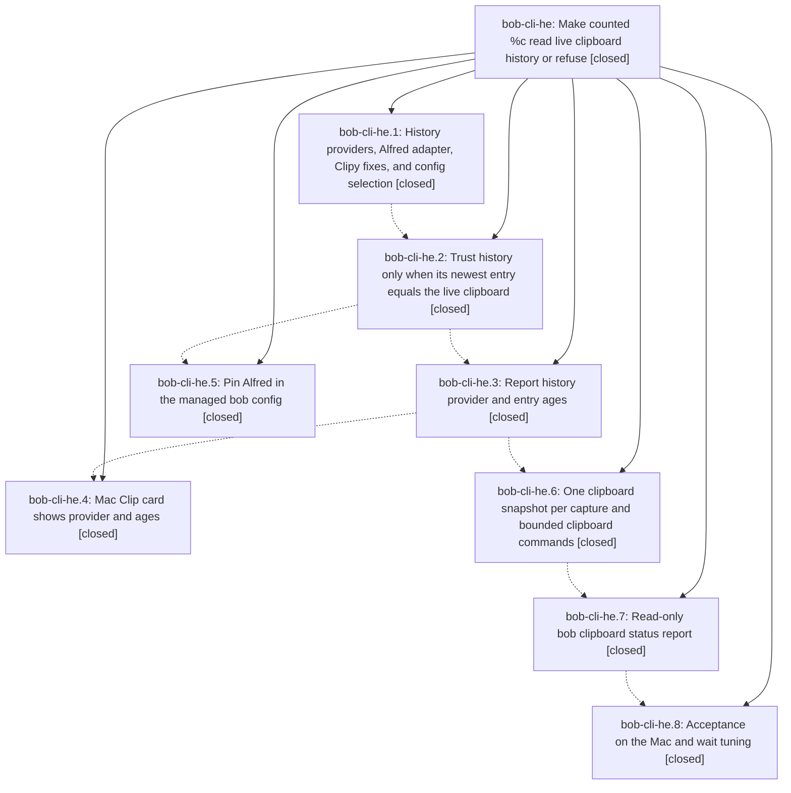

# Bead: bob-cli-he — Make counted %c read live clipboard history or refuse

[Bead Pages](../README.md) / bob-cli-he

**Status:** ✓ closed · **Resolution:** done · **Type:** ▸ plan · **Tier:** epic
**Owner:** `bryanbugyi34@gmail.com` · **Created by:** [bbugyi200.athena.research.5r.linker.w0](https://github.com/bobs-org/bob-cli--agents/blob/main/sessions/bbugyi200.athena.research.5r.linker.w0.md) · **Assignee:** `bob-cli-he.land`
**Created:** 2026-11-05 10:29:53 EST · **Closed:** 2026-11-05 16:57:00 EST
**Plan:** [202611/percent\_c\_history\_agreement.md](https://github.com/bobs-org/bob-cli--plans/blob/main/202611/percent_c_history_agreement.md)

<!-- sase:links:start -->

## Links

| Relation | Artifact | Why |
| --- | --- | --- |
| implemented-by | [plan:202611/percent_c_history_agreement.md][1] | derived from the plan's `bead_id:` frontmatter field |

_Plus 1 automatic references — see [Referenced By](#referenced-by)._

[1]: https://github.com/bobs-org/bob-cli--plans/blob/main/202611/percent_c_history_agreement.md

<!-- sase:links:end -->

## Description

Counted `%c<N>` reads the clipboard manager that is actually running (Alfred on the Mac), trusts its history only when the newest entry equals the live clipboard, refuses loudly and writes nothing otherwise, and reports which provider supplied each entry and how old it is — in bob's JSON, its human output, a `bob clipboard` status report, and the Mac Clip card.

## Notes

[2026-11-05T18:34:19Z · bob-cli-h4.land] DISCOVERED ISSUE (bob-cli-h4 lander, on master 84da37ba): cargo fmt --check (the first just check stage) reports drift at src/native/config/mod.rs:18-23, the pub(crate) use block that 5a6519f1/84da37ba edited. The other fmt drift (task_status_hooks/sync.rs, plan_budget/mod.rs) is hd.3's and is recorded on bob-cli-hd.

[2026-11-05T21:57:00Z · bob-cli-he.land] Landed by bob-cli-he.land. VERIFIED (step 1): read all 8 phases and their notes plus the epic commits 5a6519f1 (providers), 84da37ba (agreement), 89192e8b (provenance), dd3cfd8c (read-hardening), ea2a6365 (bob clipboard), bob-mac-capture 9714a56 (Clip card: tolerant clip.history decode, provider and ages in header, dividers, and accessibility summary) and chezmoi af323fbe (capture.clipboard_history: alfred; paste_parts drops killall Clipy and the relaunch trap, per paste_parts=drop_clipy). Source matches the plan contract: read-only Alfred/Clipy adapters (Cocoa epoch, ts/rowid order, Clipy rowid tie-break, one canonical flavor, concealed/transient skipped and uncounted), pure env > config > auto selection, a 1.5 s/150 ms agreement poll with typed refusal codes and per-provider diagnosis, clip.history provenance, one live read plus one largest-count history read per invocation, bounded clipboard subprocesses (5 s, 16 MiB, process-group reaping), and a content-free bob clipboard report. history_decision_record=no was honored: no memory edits. Epic note #1 (config/mod.rs fmt drift) was already fixed by 5235d292.
EPIC-CAUSED DEFECTS FIXED IN THIS LANDING: ea2a6365 left master CI red. (a) bob clipboard was registered without updating the catalog, completion kinds, canonical-path, and root-help snapshot tests. It now has a read-only 'clipboard' catalog row (72 entries), a FreeText kinds decision for clipboard:count, an entry in the NativeCommand canonical list, and refreshed root-short/root-long fixtures. (b) clippy redundant_closure in clipboard_status.rs. (c) A macOS-only unreachable_code error in live_source_name, which now uses cfg! and also reports the tmux fallback on non-Linux platforms. Also fixed an agreement bug: a provider whose read started inside the wait, finished after the deadline, and agreed was thrown away and reported as "doesn't match the live clipboard". It is now accepted, with a regression unit test. Removed the dead read_clipboard_history and stale dead_code allows, refreshed the history.rs module docs, and documented in configuration.md that a history command's first entry must be the live clipboard. Phases 1-2 shipped that contract break without the planned '!', so the landing commit carries '!' to put it in the changelog's Breaking group.
CHECKS: cargo fmt --check is clean. just lint passes on the full workspace once the unrelated gmail derivable_impls line is applied temporarily (not committed; see triage). cargo test --workspace --no-fail-fast: every binary green; the one catalog count it caught was updated, and that test passes. just docs-check passes. macos-ci-check snapshot run 42106421875: 'Lint macOS-only targets' ok. The macOS Run tests step was still running at the 60 min check deadline, and ubuntu failed only on the known highlights minute-boundary flake (bob-cli-hf).
MAC ACCEPTANCE (the Mac came back online during landing; scratch release bob built under /tmp and deleted; output filtered to codes, ages, and booleans). Row 1: bob clipboard -f json under auto selects auto -> alfred, clipy; would_succeed=true via alfred, history ages 643/826/3138 s. Alfred is running and its head agrees. Clipy is not running, its newest entry is 1398781 s (~16 d) old, and its head disagrees. Row 2 (original failure replay, clipboard_history: clipy): exit 1, clipboard_history_mismatch, with the diagnosis 'Clipy · newest entry 16 days old · process is not running', a 1.6 s wait, and the scratch vault unchanged. Row 3 (auto %c3 dry run): agreement held, but the capture refused classifying entry 1 because the current live clipboard is a path to a nonexistent file (the existing attachment rule, not this epic); the vault was unchanged. The plan's example draft 'x %c3' now parses as a Pomodoro close, so the rows used 'task %c3'. Idle-gated rows a-f and wait tuning were NOT run: HIDIdleTime was 0-25 s (Bryan was actively using the Mac), and mac_acceptance=idle_gated forbids clipboard writes unless the Mac has been idle 10+ min. They remain on Bryan's checklist, and the 1.5 s wait is unchanged.
FOLLOW-UP TRIAGE: (1) he.1 docs-check tutorial gate: resolved, just docs-check passes. (2) he.2 #1/#2, he.3 #1, he.6 #1, and he.7 #1 (fmt drift, clippy collapsible_if and the redundant binding, plan budget JSON and task_move CLI tests) were resolved on master by 5235d292 and the hd landing; fmt is clean, the only remaining clippy error is the gmail one, and the full test suite passes. No task. (3) he.4 #1/#3/#4 (bob-mac-capture macOS CI hang after WorkBadgeToneTests and 13 separator/comma/backslash/word-motion XCTests on the clean base): +1 on the duplicate bob-cli-h7. (4) The newly found clippy derivable_impls error at gmail/body/mime.rs:27 from bob-cli-hg.3.1.1 (df9178df) blocks just lint/check and CI; recorded as a DISCOVERED ISSUE note on the active epic bob-cli-hg. (5) The highlights::ingest::create_keeps_intake_for_flag_config_env_and_dry_run minute-boundary failure seen in run 42106421875: +1 on the duplicate bob-cli-hf. (6) Idle-gated Mac acceptance rows: declined as a task. This is not a defect and is the plan's anticipated outcome of the idle gate, so it stays a manual checklist item for Bryan in the final report. No epic-symbol entries.

## Phases

| Bead | Title | Status | Size | Created | Agents | Commits |
|---|---|---|---|---|---:|---:|
| [bob-cli-he.1](bob-cli-he.1.md) | History providers, Alfred adapter, Clipy fixes, and config selection | ✓ closed | medium | 2026-11-05 | 1 | 1 |
| [bob-cli-he.2](bob-cli-he.2.md) | Trust history only when its newest entry equals the live clipboard | ✓ closed | medium | 2026-11-05 | 1 | 1 |
| [bob-cli-he.3](bob-cli-he.3.md) | Report history provider and entry ages | ✓ closed | small | 2026-11-05 | 1 | 1 |
| [bob-cli-he.4](bob-cli-he.4.md) | Mac Clip card shows provider and ages | ✓ closed | small | 2026-11-05 | 1 | 0 |
| [bob-cli-he.5](bob-cli-he.5.md) | Pin Alfred in the managed bob config | ✓ closed | xsmall | 2026-11-05 | 1 | 1 |
| [bob-cli-he.6](bob-cli-he.6.md) | One clipboard snapshot per capture and bounded clipboard commands | ✓ closed | medium | 2026-11-05 | 1 | 1 |
| [bob-cli-he.7](bob-cli-he.7.md) | Read-only bob clipboard status report | ✓ closed | medium | 2026-11-05 | 1 | 1 |
| [bob-cli-he.8](bob-cli-he.8.md) | Acceptance on the Mac and wait tuning | ✓ closed | small | 2026-11-05 | 1 | 0 |

## Lineage

## Agents

| Agent | Bead | Commits |
|---|---|---:|
| [bbugyi200.athena.bob-cli-he.1](https://github.com/bobs-org/bob-cli--agents/blob/main/agents/bbugyi200.athena.bob-cli-he.1/README.md) | [bob-cli-he.1](bob-cli-he.1.md) | 1 |
| [bbugyi200.athena.bob-cli-he.2](https://github.com/bobs-org/bob-cli--agents/blob/main/sessions/bbugyi200.athena.bob-cli-he.2.md) | [bob-cli-he.2](bob-cli-he.2.md) | 1 |
| [bbugyi200.athena.bob-cli-he.3](https://github.com/bobs-org/bob-cli--agents/blob/main/agents/bbugyi200.athena.bob-cli-he.3/README.md) | [bob-cli-he.3](bob-cli-he.3.md) | 1 |
| [bbugyi200.athena.bob-cli-he.4](https://github.com/bobs-org/bob-cli--agents/blob/main/sessions/bbugyi200.athena.bob-cli-he.4.md) | [bob-cli-he.4](bob-cli-he.4.md) | 0 |
| [bbugyi200.athena.bob-cli-he.5](https://github.com/bobs-org/bob-cli--agents/blob/main/agents/bbugyi200.athena.bob-cli-he.5/README.md) | [bob-cli-he.5](bob-cli-he.5.md) | 1 |
| [bbugyi200.athena.bob-cli-he.6](https://github.com/bobs-org/bob-cli--agents/blob/main/agents/bbugyi200.athena.bob-cli-he.6/README.md) | [bob-cli-he.6](bob-cli-he.6.md) | 1 |
| [bbugyi200.athena.bob-cli-he.7](https://github.com/bobs-org/bob-cli--agents/blob/main/agents/bbugyi200.athena.bob-cli-he.7/README.md) | [bob-cli-he.7](bob-cli-he.7.md) | 1 |
| [bbugyi200.athena.bob-cli-he.8](https://github.com/bobs-org/bob-cli--agents/blob/main/agents/bbugyi200.athena.bob-cli-he.8/README.md) | [bob-cli-he.8](bob-cli-he.8.md) | 0 |
| [bbugyi200.athena.bob-cli-he.land](https://github.com/bobs-org/bob-cli--agents/blob/main/agents/bbugyi200.athena.bob-cli-he.land/README.md) | [bob-cli-he](README.md) | 1 |

## Commits

| Repo | Commit | Subject | Bead | Committed |
|---|---|---|---|---|
| bob-cli | [`5a6519f`](https://github.com/bobs-org/bob-cli/commit/5a6519f1914714fca543ead8c1e4a39d3832a1e9) | feat(capture): add clipboard history providers (history boundary, Alfred and Clipy adapters) | [bob-cli-he.1](bob-cli-he.1.md) | 2026-11-05 11:47:33 EST |
| bob-cli | [`84da37b`](https://github.com/bobs-org/bob-cli/commit/84da37ba2dc438f56ce6a4f7cbc1a0ceb3ef3067) | feat(capture): trust counted clipboard history only on live agreement | [bob-cli-he.2](bob-cli-he.2.md) | 2026-11-05 13:03:21 EST |
| chezmoi | [`chezmoi@af323fb`](https://github.com/bbugyi200/dotfiles/commit/af323fbeb09713d2357995fd13b2aa001162a1fa) | feat(bob): pin Alfred as the counted clipboard history provider | [bob-cli-he.5](bob-cli-he.5.md) | 2026-11-05 13:09:22 EST |
| bob-cli | [`89192e8`](https://github.com/bobs-org/bob-cli/commit/89192e8bada62cd46fc990b1ca9e78a469c68d37) | feat(capture): report clipboard history provider and entry ages | [bob-cli-he.3](bob-cli-he.3.md) | 2026-11-05 13:29:34 EST |
| bob-cli | [`dd3cfd8`](https://github.com/bobs-org/bob-cli/commit/dd3cfd8cb5d9a0fdba8b8e86c8985ee0f7c6570a) | fix(capture): read the clipboard once per capture and bound clipboard commands | [bob-cli-he.6](bob-cli-he.6.md) | 2026-11-05 14:24:07 EST |
| bob-cli | [`ea2a636`](https://github.com/bobs-org/bob-cli/commit/ea2a63654ee7721d71fb3194908e5aed9bb0dd63) | feat(clipboard): add bob clipboard status | [bob-cli-he.7](bob-cli-he.7.md) | 2026-11-05 15:00:53 EST |
| bob-cli | [`12e3684`](https://github.com/bobs-org/bob-cli/commit/12e36842d60f193302532d0ee93ba7298d3b2e05) | fix(capture)!: counted %c history commands must list the live clipboard first | [bob-cli-he](README.md) | 2026-11-05 16:58:15 EST |

<!-- sase:referenced-by:start -->

## Referenced By

| Relation | Artifact | Why | Uses |
| --- | --- | --- | ---: |
| read-by | [agent:bob-cli-he.5][1] | epic context | 1 |

[1]: https://github.com/bobs-org/bob-cli--agents/blob/main/agents/bbugyi200.athena.bob-cli-he.5/README.md

<!-- sase:referenced-by:end -->
