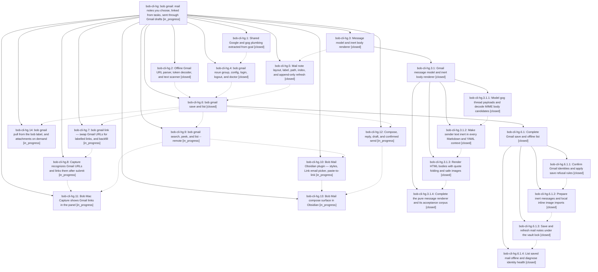

# Bead: bob-cli-hg — bob gmail: mail notes you choose, linked from tasks, sent through Gmail drafts

[Bead Pages](../README.md) / bob-cli-hg

**Status:** ◐ in_progress · **Type:** ▸ plan · **Tier:** epic
**Owner:** `bryanbugyi34@gmail.com` · **Created by:** [bbugyi200.apollo.cn](https://github.com/bobs-org/bob-cli--agents/blob/main/sessions/bbugyi200.apollo.cn.md) · **Assignee:** `bob-cli-hg.land`
**Created:** 2026-11-05 12:37:49 EST
**Plan:** [202611/bob\_gmail.md](https://github.com/bobs-org/bob-cli--plans/blob/main/202611/bob_gmail.md)

<!-- sase:links:start -->

## Links

| Relation | Artifact | Why |
| --- | --- | --- |
| implemented-by | [plan:202611/bob_gmail.md][1] | derived from the plan's `bead_id:` frontmatter field |

_Plus 7 automatic references — see [Referenced By](#referenced-by)._

[1]: https://github.com/bobs-org/bob-cli--plans/blob/main/202611/bob_gmail.md

<!-- sase:links:end -->

## Description

A Gmail link in a capture, a paste, or a picker becomes a labelled link to an inert, beautifully rendered, append-only mail note in the vault; replies and new mail are written in Obsidian and sent only through a previewed, confirmed Gmail draft; the phone feeds the vault through a `bob` label — all without capture ever touching the network and without sender text ever executing in the vault.

## Notes

[2026-11-05T21:56:07Z · bob-cli-he.land] DISCOVERED ISSUE (found by bob-cli-he.land on master 16c6356d): clippy derivable_impls is denied by the just lint/just check gate and fires at src/native/gmail/body/mime.rs:27 (manual impl Default for MimeInventory whose fields are all Vec::new()), introduced by df9178df (bob-cli-hg.3.1.1, 'feat(gmail): model gog threads and decode MIME bodies'). It fails master CI's lint job and the macOS 'Lint macOS-only targets' step (runs 42099348798, 42102050266), and because it stops cargo clippy before the integration-test targets, just check never reaches cargo test. Fix: add Default to the #[derive] and drop the manual impl; verified locally that this one change makes just lint pass on the full workspace (applied temporarily, not committed by he.land).

[2026-11-06T02:15:47Z · bob-cli-hg.3.1.land] DISCOVERED ISSUE: Landing bob-cli-hg.3.1 triaged bob-cli-hg.3.1.4 follow-up #2. Gmail shell commit 88907074 / bob-cli-hg.4 adds gmail to root help and a 73rd catalog entry, but tests/fixtures/help/root-short.txt and root-long.txt omit gmail and tests/cli/catalog.rs:42 still requires 72 entries (lib catalog tests already expect 73). The child reproduced root help and CLI catalog failures on its clean base; current source confirms the stale expectations. This is caused by active outer Gmail shell work, not the renderer child epic. Please refresh these expectations in outer integration. No separate task created. The older MimeInventory Default issue is resolved by 06d6c32e.

[2026-11-06T06:29:25Z · bob-cli-hl.3.1.land] DISCOVERED ISSUE (corroboration by bob-cli-hl.3.1.land on master 6af313b4): help::root_help_matches_sectioned_short_and_long_snapshots still fails because generated root help lists 'gmail  Save Gmail threads as inert mail notes, linked from tasks' under Integrations while tests/fixtures/help/root-short.txt omits it (bob-cli-hl.3.1.3 note #4 misattributed this to gkeep; gkeep is already in the snapshot). catalog::protocol_1_parses_with_schema_version_one still fails 73 vs 72; +1 recorded on bob-cli-de. Same remediation as note #2; no new task created.

[2026-11-06T10:21:51Z · bob-cli-hg.6.1.land] DISCOVERED ISSUE: bob-cli-hg.6.1 landing corroborates root-help drift from hg.6.1.1 #1, .2 #2, .3 #1, and .4 #2. hg.4 added Gmail to root help while root-short/root-long fixtures omit it; same causal defect as hg notes #2-3. No separate task: the bounded gmail_save_closeout tale will refresh these snapshots as Gmail integration. Catalog-count drift from those reports is already repaired by b70a8fbf/fcc4efa5; no stale failure +1 on bob-cli-de.

## Phases

| Bead | Title | Status | Size | Created | Agents | Commits |
|---|---|---|---|---|---:|---:|
| [bob-cli-hg.1](bob-cli-hg.1.md) | Shared Google and gog plumbing extracted from gcal | ✓ closed | medium | 2026-11-05 | 1 | 1 |
| [bob-cli-hg.10](bob-cli-hg.10.md) | Bob Mail Obsidian plugin — styles, Link email picker, paste-to-link | ◐ in_progress | medium | 2026-11-05 | 1 | 0 |
| [bob-cli-hg.11](bob-cli-hg.11.md) | Bob Mac Capture shows Gmail links in the panel | ◐ in_progress | medium | 2026-11-05 | 1 | 0 |
| [bob-cli-hg.12](bob-cli-hg.12.md) | Compose, reply, draft, and confirmed send | ◐ in_progress | large | 2026-11-05 | 1 | 0 |
| [bob-cli-hg.13](bob-cli-hg.13.md) | Bob Mail compose surface in Obsidian | ◐ in_progress | medium | 2026-11-05 | 1 | 0 |
| [bob-cli-hg.14](bob-cli-hg.14.md) | bob gmail pull from the bob label, and attachments on demand | ◐ in_progress | medium | 2026-11-05 | 1 | 0 |
| [bob-cli-hg.2](bob-cli-hg.2.md) | Offline Gmail URL parser, token decoder, and text scanner | ✓ closed | small | 2026-11-05 | 1 | 1 |
| [bob-cli-hg.3](bob-cli-hg.3.md) | Message model and inert body renderer | ✓ closed | large | 2026-11-05 | 1 | 0 |
| [bob-cli-hg.4](bob-cli-hg.4.md) | bob gmail noun group, config, login, logout, and doctor | ✓ closed | medium | 2026-11-05 | 1 | 1 |
| [bob-cli-hg.5](bob-cli-hg.5.md) | Mail note layout, label, path, index, and append-only refresh | ✓ closed | medium | 2026-11-05 | 1 | 1 |
| [bob-cli-hg.6](bob-cli-hg.6.md) | bob gmail save and list | ✓ closed | large | 2026-11-05 | 1 | 0 |
| [bob-cli-hg.7](bob-cli-hg.7.md) | bob gmail link — swap Gmail URLs for labelled links, and backfill | ◐ in_progress | medium | 2026-11-05 | 1 | 0 |
| [bob-cli-hg.8](bob-cli-hg.8.md) | Capture recognizes Gmail URLs and links them after submit | ◐ in_progress | medium | 2026-11-05 | 1 | 0 |
| [bob-cli-hg.9](bob-cli-hg.9.md) | bob gmail search, peek, and list --remote | ◐ in_progress | medium | 2026-11-05 | 1 | 0 |

## Lineage

## Agents

| Agent | Bead | Commits |
|---|---|---:|
| [bbugyi200.apollo.bob-cli-hg.1](https://github.com/bobs-org/bob-cli--agents/blob/main/sessions/bbugyi200.apollo.bob-cli-hg.1.md) | [bob-cli-hg.1](bob-cli-hg.1.md) | 1 |
| [bbugyi200.apollo.bob-cli-hg.10](https://github.com/bobs-org/bob-cli--agents/blob/main/agents/bbugyi200.apollo.bob-cli-hg.10/README.md) | [bob-cli-hg.10](bob-cli-hg.10.md) | 0 |
| [bbugyi200.apollo.bob-cli-hg.11](https://github.com/bobs-org/bob-cli--agents/blob/main/agents/bbugyi200.apollo.bob-cli-hg.11/README.md) | [bob-cli-hg.11](bob-cli-hg.11.md) | 0 |
| [bbugyi200.apollo.bob-cli-hg.12](https://github.com/bobs-org/bob-cli--agents/blob/main/agents/bbugyi200.apollo.bob-cli-hg.12/README.md) | [bob-cli-hg.12](bob-cli-hg.12.md) | 0 |
| [bbugyi200.apollo.bob-cli-hg.13](https://github.com/bobs-org/bob-cli--agents/blob/main/agents/bbugyi200.apollo.bob-cli-hg.13/README.md) | [bob-cli-hg.13](bob-cli-hg.13.md) | 0 |
| [bbugyi200.apollo.bob-cli-hg.14](https://github.com/bobs-org/bob-cli--agents/blob/main/agents/bbugyi200.apollo.bob-cli-hg.14/README.md) | [bob-cli-hg.14](bob-cli-hg.14.md) | 0 |
| [bbugyi200.apollo.bob-cli-hg.2](https://github.com/bobs-org/bob-cli--agents/blob/main/agents/bbugyi200.apollo.bob-cli-hg.2/README.md) | [bob-cli-hg.2](bob-cli-hg.2.md) | 1 |
| [bbugyi200.apollo.bob-cli-hg.3](https://github.com/bobs-org/bob-cli--agents/blob/main/sessions/bbugyi200.apollo.bob-cli-hg.3.md) | [bob-cli-hg.3](bob-cli-hg.3.md) | 0 |
| [bbugyi200.apollo.bob-cli-hg.3.1.1](https://github.com/bobs-org/bob-cli--agents/blob/main/agents/bbugyi200.apollo.bob-cli-hg.3.1.1/README.md) | [bob-cli-hg.3.1.1](bob-cli-hg.3.1.1.md) | 1 |
| [bbugyi200.apollo.bob-cli-hg.3.1.2](https://github.com/bobs-org/bob-cli--agents/blob/main/agents/bbugyi200.apollo.bob-cli-hg.3.1.2/README.md) | [bob-cli-hg.3.1.2](bob-cli-hg.3.1.2.md) | 1 |
| [bbugyi200.apollo.bob-cli-hg.3.1.3](https://github.com/bobs-org/bob-cli--agents/blob/main/agents/bbugyi200.apollo.bob-cli-hg.3.1.3/README.md) | [bob-cli-hg.3.1.3](bob-cli-hg.3.1.3.md) | 1 |
| [bbugyi200.apollo.bob-cli-hg.3.1.4](https://github.com/bobs-org/bob-cli--agents/blob/main/agents/bbugyi200.apollo.bob-cli-hg.3.1.4/README.md) | [bob-cli-hg.3.1.4](bob-cli-hg.3.1.4.md) | 1 |
| [bbugyi200.apollo.bob-cli-hg.3.1.land](https://github.com/bobs-org/bob-cli--agents/blob/main/sessions/bbugyi200.apollo.bob-cli-hg.3.1.land.md) | [bob-cli-hg.3.1](bob-cli-hg.3.1.md) | 2 |
| [bbugyi200.apollo.bob-cli-hg.4](https://github.com/bobs-org/bob-cli--agents/blob/main/agents/bbugyi200.apollo.bob-cli-hg.4/README.md) | [bob-cli-hg.4](bob-cli-hg.4.md) | 1 |
| [bbugyi200.apollo.bob-cli-hg.5](https://github.com/bobs-org/bob-cli--agents/blob/main/agents/bbugyi200.apollo.bob-cli-hg.5/README.md) | [bob-cli-hg.5](bob-cli-hg.5.md) | 1 |
| [bbugyi200.apollo.bob-cli-hg.6](https://github.com/bobs-org/bob-cli--agents/blob/main/sessions/bbugyi200.apollo.bob-cli-hg.6.md) | [bob-cli-hg.6](bob-cli-hg.6.md) | 0 |
| [bbugyi200.apollo.bob-cli-hg.6.1.1](https://github.com/bobs-org/bob-cli--agents/blob/main/sessions/bbugyi200.apollo.bob-cli-hg.6.1.1.md) | [bob-cli-hg.6.1.1](bob-cli-hg.6.1.1.md) | 1 |
| [bbugyi200.apollo.bob-cli-hg.6.1.2](https://github.com/bobs-org/bob-cli--agents/blob/main/agents/bbugyi200.apollo.bob-cli-hg.6.1.2/README.md) | [bob-cli-hg.6.1.2](bob-cli-hg.6.1.2.md) | 1 |
| [bbugyi200.apollo.bob-cli-hg.6.1.3](https://github.com/bobs-org/bob-cli--agents/blob/main/agents/bbugyi200.apollo.bob-cli-hg.6.1.3/README.md) | [bob-cli-hg.6.1.3](bob-cli-hg.6.1.3.md) | 1 |
| [bbugyi200.apollo.bob-cli-hg.6.1.4](https://github.com/bobs-org/bob-cli--agents/blob/main/agents/bbugyi200.apollo.bob-cli-hg.6.1.4/README.md) | [bob-cli-hg.6.1.4](bob-cli-hg.6.1.4.md) | 1 |
| [bbugyi200.apollo.bob-cli-hg.6.1.land](https://github.com/bobs-org/bob-cli--agents/blob/main/sessions/bbugyi200.apollo.bob-cli-hg.6.1.land.md) | [bob-cli-hg.6.1](bob-cli-hg.6.1.md) | 1 |
| [bbugyi200.apollo.bob-cli-hg.7](https://github.com/bobs-org/bob-cli--agents/blob/main/agents/bbugyi200.apollo.bob-cli-hg.7/README.md) | [bob-cli-hg.7](bob-cli-hg.7.md) | 0 |
| [bbugyi200.apollo.bob-cli-hg.8](https://github.com/bobs-org/bob-cli--agents/blob/main/agents/bbugyi200.apollo.bob-cli-hg.8/README.md) | [bob-cli-hg.8](bob-cli-hg.8.md) | 0 |
| [bbugyi200.apollo.bob-cli-hg.9](https://github.com/bobs-org/bob-cli--agents/blob/main/agents/bbugyi200.apollo.bob-cli-hg.9/README.md) | [bob-cli-hg.9](bob-cli-hg.9.md) | 0 |
| [bbugyi200.apollo.bob-cli-hg.land](https://github.com/bobs-org/bob-cli--agents/blob/main/agents/bbugyi200.apollo.bob-cli-hg.land/README.md) | [bob-cli-hg](README.md) | 0 |

## Commits

| Repo | Commit | Subject | Bead | Committed |
|---|---|---|---|---|
| bob-cli | [`4a2b7f5`](https://github.com/bobs-org/bob-cli/commit/4a2b7f50204ceec907bec7ec1f74a9ad2582bd51) | feat(gmail): add offline Gmail URL identity parsing | [bob-cli-hg.2](bob-cli-hg.2.md) | 2026-11-05 13:25:30 EST |
| bob-cli | [`df9178d`](https://github.com/bobs-org/bob-cli/commit/df9178df1b6e944c339073689af65ac022e80199) | feat(gmail): model gog threads and decode MIME bodies | [bob-cli-hg.3.1.1](bob-cli-hg.3.1.1.md) | 2026-11-05 14:18:07 EST |
| bob-cli | [`fe120a1`](https://github.com/bobs-org/bob-cli/commit/fe120a1edc7fc023e6572c46247a647324cb7887) | feat(gmail): extract shared Google plumbing for bob-cli-hg.1 | [bob-cli-hg.1](bob-cli-hg.1.md) | 2026-11-05 17:51:22 EST |
| bob-cli | [`1cbe970`](https://github.com/bobs-org/bob-cli/commit/1cbe9703e6989482906e7d6b8efed1238d69777a) | feat(gmail): add inert output serialization boundary for gmail body | [bob-cli-hg.3.1.2](bob-cli-hg.3.1.2.md) | 2026-11-05 18:53:03 EST |
| bob-cli | [`8890707`](https://github.com/bobs-org/bob-cli/commit/889070741f4fab7b118429ffa660696a84a84e8a) | feat(gmail): add bob gmail shell with config, login, logout, doctor | [bob-cli-hg.4](bob-cli-hg.4.md) | 2026-11-05 19:22:21 EST |
| bob-cli | [`540f3e6`](https://github.com/bobs-org/bob-cli/commit/540f3e6fda16bb88bf6c58c8f7ee551ed4916230) | feat(gmail): render HTML message bodies | [bob-cli-hg.3.1.3](bob-cli-hg.3.1.3.md) | 2026-11-05 19:59:05 EST |
| bob-cli | [`45118e1`](https://github.com/bobs-org/bob-cli/commit/45118e1b197b3c1c604c837d3b73a27d5e813aa8) | feat(gmail): complete the pure message renderer and its acceptance corpus | [bob-cli-hg.3.1.4](bob-cli-hg.3.1.4.md) | 2026-11-05 21:03:30 EST |
| bob-cli | [`232e94b`](https://github.com/bobs-org/bob-cli/commit/232e94bbf507e17b31790d434f4288ff31adbae6) | feat(gmail): repair renderer landing and finish hg.3.1 | [bob-cli-hg.3.1](bob-cli-hg.3.1.md) | 2026-11-05 22:20:04 EST |
| bob-cli--plans | [`bob-cli--plans@6e63268`](https://github.com/bobs-org/bob-cli--plans/commit/6e63268021e9c4abaef71269304926ff313cd40e) | docs(plans): mark gmail\_mail\_body done | [bob-cli-hg.3.1](bob-cli-hg.3.1.md) | 2026-11-05 22:21:01 EST |
| bob-cli | [`cfdb68c`](https://github.com/bobs-org/bob-cli/commit/cfdb68c17552da6e13fa0e2f918565bf0aca8f12) | feat(gmail): implement mail note layout and refresh | [bob-cli-hg.5](bob-cli-hg.5.md) | 2026-11-05 23:32:54 EST |
| bob-cli | [`cdc4003`](https://github.com/bobs-org/bob-cli/commit/cdc40030d9ebc5fcd422a6d430ac9c6c3412542b) | feat(gmail): implement identity resolution and save policy | [bob-cli-hg.6.1.1](bob-cli-hg.6.1.1.md) | 2026-11-06 00:57:28 EST |
| bob-cli | [`c0d877b`](https://github.com/bobs-org/bob-cli/commit/c0d877be16030b2d2527af869d47dbf845dbe35a) | feat(gmail): prepare thread with attachment\_bytes transport | [bob-cli-hg.6.1.2](bob-cli-hg.6.1.2.md) | 2026-11-06 02:35:56 EST |
| bob-cli | [`b70a8fb`](https://github.com/bobs-org/bob-cli/commit/b70a8fbffd809aed3aae33f4183de93d99ce3bf9) | feat(gmail): add transactional save and refresh | [bob-cli-hg.6.1.3](bob-cli-hg.6.1.3.md) | 2026-11-06 04:12:14 EST |
| bob-cli | [`fcc4efa`](https://github.com/bobs-org/bob-cli/commit/fcc4efa51f6f4cca2f0c5f7dd1d1cab2a4ffff24) | feat(gmail): list saved mail offline and diagnose identity health | [bob-cli-hg.6.1.4](bob-cli-hg.6.1.4.md) | 2026-11-06 05:07:42 EST |
| bob-cli | [`7825a98`](https://github.com/bobs-org/bob-cli/commit/7825a98f0eebbec5c05932aabe267773fe7915cd) | fix(gmail): close transactional save gaps | [bob-cli-hg.6.1](bob-cli-hg.6.1.md) | 2026-11-06 07:02:37 EST |

<!-- sase:referenced-by:start -->

## Referenced By

| Relation | Artifact | Why | Uses |
| --- | --- | --- | ---: |
| read-by | [agent:bob-cli-h8.land][1] | Check owner epic of theme vector drift | 1 |
| read-by | [agent:bob-cli-he.land][2] | Check whether the gmail epic (source of the derivable_impls clippy error in gmail/body/mime.rs) is still active | 2 |
| read-by | [agent:bob-cli-hg.3.1.2][3] | Need epic decisions | 1 |
| read-by | [agent:bob-cli-hg.3.1.3][4] | Need governing Gmail epic decisions for this renderer phase | 1 |
| read-by | [agent:bob-cli-hg.4][5] | Need epic scope for hg.4 work | 1 |
| read-by | [agent:bob-cli-hg.6.1.3][6] | Need the outer epic decisions inherited by the Gmail save work | 1 |
| read-by | [agent:bob-cli-hl.3.1.land][7] | Check whether the root-help gmail snapshot drift is already recorded on the active Gmail epic | 1 |

[1]: https://github.com/bobs-org/bob-cli--agents/blob/main/agents/bbugyi200.apollo.bob-cli-h8.land/README.md
[2]: https://github.com/bobs-org/bob-cli--agents/blob/main/agents/bbugyi200.apollo.bob-cli-he.land/README.md
[3]: https://github.com/bobs-org/bob-cli--agents/blob/main/agents/bbugyi200.apollo.bob-cli-hg.3.1.2/README.md
[4]: https://github.com/bobs-org/bob-cli--agents/blob/main/agents/bbugyi200.apollo.bob-cli-hg.3.1.3/README.md
[5]: https://github.com/bobs-org/bob-cli--agents/blob/main/agents/bbugyi200.apollo.bob-cli-hg.4/README.md
[6]: https://github.com/bobs-org/bob-cli--agents/blob/main/agents/bbugyi200.apollo.bob-cli-hg.6.1.3/README.md
[7]: https://github.com/bobs-org/bob-cli--agents/blob/main/agents/bbugyi200.apollo.bob-cli-hl.3.1.land/README.md

<!-- sase:referenced-by:end -->
