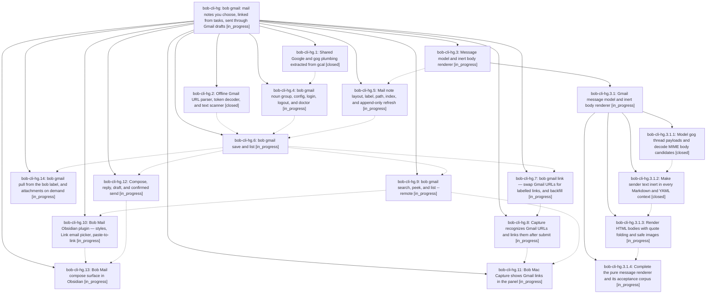

# Bead: bob-cli-hg — bob gmail: mail notes you choose, linked from tasks, sent through Gmail drafts

[Bead Pages](../README.md) / bob-cli-hg

**Status:** ◐ in_progress · **Type:** ▸ plan · **Tier:** epic
**Owner:** `bryanbugyi34@gmail.com` · **Created by:** [bbugyi200.apollo.cn](https://github.com/bobs-org/bob-cli--agents/blob/main/sessions/bbugyi200.apollo.cn.md) · **Assignee:** `bob-cli-hg.land`
**Created:** 2026-11-05 12:37:49 EST
**Plan:** [202611/bob\_gmail.md](https://github.com/bobs-org/bob-cli--plans/blob/main/202611/bob_gmail.md)

<!-- sase:links:start -->

## Links

| Relation | Artifact | Why |
| --- | --- | --- |
| implemented-by | [plan:202611/bob_gmail.md][1] | derived from the plan's `bead_id:` frontmatter field |

_Plus 1 automatic references — see [Referenced By](#referenced-by)._

[1]: https://github.com/bobs-org/bob-cli--plans/blob/main/202611/bob_gmail.md

<!-- sase:links:end -->

## Description

A Gmail link in a capture, a paste, or a picker becomes a labelled link to an inert, beautifully rendered, append-only mail note in the vault; replies and new mail are written in Obsidian and sent only through a previewed, confirmed Gmail draft; the phone feeds the vault through a `bob` label — all without capture ever touching the network and without sender text ever executing in the vault.

## Notes

[2026-11-05T21:56:07Z · bob-cli-he.land] DISCOVERED ISSUE (found by bob-cli-he.land on master 16c6356d): clippy derivable_impls is denied by the just lint/just check gate and fires at src/native/gmail/body/mime.rs:27 (manual impl Default for MimeInventory whose fields are all Vec::new()), introduced by df9178df (bob-cli-hg.3.1.1, 'feat(gmail): model gog threads and decode MIME bodies'). It fails master CI's lint job and the macOS 'Lint macOS-only targets' step (runs 42099348798, 42102050266), and because it stops cargo clippy before the integration-test targets, just check never reaches cargo test. Fix: add Default to the #[derive] and drop the manual impl; verified locally that this one change makes just lint pass on the full workspace (applied temporarily, not committed by he.land).

## Phases

| Bead | Title | Status | Size | Created | Agents | Commits |
|---|---|---|---|---|---:|---:|
| [bob-cli-hg.1](bob-cli-hg.1.md) | Shared Google and gog plumbing extracted from gcal | ✓ closed | medium | 2026-11-05 | 1 | 1 |
| [bob-cli-hg.10](bob-cli-hg.10.md) | Bob Mail Obsidian plugin — styles, Link email picker, paste-to-link | ◐ in_progress | medium | 2026-11-05 | 1 | 0 |
| [bob-cli-hg.11](bob-cli-hg.11.md) | Bob Mac Capture shows Gmail links in the panel | ◐ in_progress | medium | 2026-11-05 | 1 | 0 |
| [bob-cli-hg.12](bob-cli-hg.12.md) | Compose, reply, draft, and confirmed send | ◐ in_progress | large | 2026-11-05 | 1 | 0 |
| [bob-cli-hg.13](bob-cli-hg.13.md) | Bob Mail compose surface in Obsidian | ◐ in_progress | medium | 2026-11-05 | 1 | 0 |
| [bob-cli-hg.14](bob-cli-hg.14.md) | bob gmail pull from the bob label, and attachments on demand | ◐ in_progress | medium | 2026-11-05 | 1 | 0 |
| [bob-cli-hg.2](bob-cli-hg.2.md) | Offline Gmail URL parser, token decoder, and text scanner | ✓ closed | small | 2026-11-05 | 1 | 1 |
| [bob-cli-hg.3](bob-cli-hg.3.md) | Message model and inert body renderer | ◐ in_progress | large | 2026-11-05 | 1 | 0 |
| [bob-cli-hg.4](bob-cli-hg.4.md) | bob gmail noun group, config, login, logout, and doctor | ◐ in_progress | medium | 2026-11-05 | 1 | 0 |
| [bob-cli-hg.5](bob-cli-hg.5.md) | Mail note layout, label, path, index, and append-only refresh | ◐ in_progress | medium | 2026-11-05 | 1 | 0 |
| [bob-cli-hg.6](bob-cli-hg.6.md) | bob gmail save and list | ◐ in_progress | large | 2026-11-05 | 1 | 0 |
| [bob-cli-hg.7](bob-cli-hg.7.md) | bob gmail link — swap Gmail URLs for labelled links, and backfill | ◐ in_progress | medium | 2026-11-05 | 1 | 0 |
| [bob-cli-hg.8](bob-cli-hg.8.md) | Capture recognizes Gmail URLs and links them after submit | ◐ in_progress | medium | 2026-11-05 | 1 | 0 |
| [bob-cli-hg.9](bob-cli-hg.9.md) | bob gmail search, peek, and list --remote | ◐ in_progress | medium | 2026-11-05 | 1 | 0 |

## Lineage

## Agents

| Agent | Bead | Commits |
|---|---|---:|
| [bbugyi200.apollo.bob-cli-hg.1](https://github.com/bobs-org/bob-cli--agents/blob/main/sessions/bbugyi200.apollo.bob-cli-hg.1.md) | [bob-cli-hg.1](bob-cli-hg.1.md) | 1 |
| [bbugyi200.apollo.bob-cli-hg.10](https://github.com/bobs-org/bob-cli--agents/blob/main/agents/bbugyi200.apollo.bob-cli-hg.10/README.md) | [bob-cli-hg.10](bob-cli-hg.10.md) | 0 |
| [bbugyi200.apollo.bob-cli-hg.11](https://github.com/bobs-org/bob-cli--agents/blob/main/agents/bbugyi200.apollo.bob-cli-hg.11/README.md) | [bob-cli-hg.11](bob-cli-hg.11.md) | 0 |
| [bbugyi200.apollo.bob-cli-hg.12](https://github.com/bobs-org/bob-cli--agents/blob/main/agents/bbugyi200.apollo.bob-cli-hg.12/README.md) | [bob-cli-hg.12](bob-cli-hg.12.md) | 0 |
| [bbugyi200.apollo.bob-cli-hg.13](https://github.com/bobs-org/bob-cli--agents/blob/main/agents/bbugyi200.apollo.bob-cli-hg.13/README.md) | [bob-cli-hg.13](bob-cli-hg.13.md) | 0 |
| [bbugyi200.apollo.bob-cli-hg.14](https://github.com/bobs-org/bob-cli--agents/blob/main/agents/bbugyi200.apollo.bob-cli-hg.14/README.md) | [bob-cli-hg.14](bob-cli-hg.14.md) | 0 |
| [bbugyi200.apollo.bob-cli-hg.2](https://github.com/bobs-org/bob-cli--agents/blob/main/agents/bbugyi200.apollo.bob-cli-hg.2/README.md) | [bob-cli-hg.2](bob-cli-hg.2.md) | 1 |
| [bbugyi200.apollo.bob-cli-hg.3](https://github.com/bobs-org/bob-cli--agents/blob/main/sessions/bbugyi200.apollo.bob-cli-hg.3.md) | [bob-cli-hg.3](bob-cli-hg.3.md) | 0 |
| [bbugyi200.apollo.bob-cli-hg.3.1.1](https://github.com/bobs-org/bob-cli--agents/blob/main/agents/bbugyi200.apollo.bob-cli-hg.3.1.1/README.md) | [bob-cli-hg.3.1.1](bob-cli-hg.3.1.1.md) | 1 |
| [bbugyi200.apollo.bob-cli-hg.3.1.2](https://github.com/bobs-org/bob-cli--agents/blob/main/agents/bbugyi200.apollo.bob-cli-hg.3.1.2/README.md) | [bob-cli-hg.3.1.2](bob-cli-hg.3.1.2.md) | 1 |
| [bbugyi200.apollo.bob-cli-hg.3.1.3](https://github.com/bobs-org/bob-cli--agents/blob/main/agents/bbugyi200.apollo.bob-cli-hg.3.1.3/README.md) | [bob-cli-hg.3.1.3](bob-cli-hg.3.1.3.md) | 0 |
| [bbugyi200.apollo.bob-cli-hg.3.1.4](https://github.com/bobs-org/bob-cli--agents/blob/main/agents/bbugyi200.apollo.bob-cli-hg.3.1.4/README.md) | [bob-cli-hg.3.1.4](bob-cli-hg.3.1.4.md) | 0 |
| [bbugyi200.apollo.bob-cli-hg.3.1.land](https://github.com/bobs-org/bob-cli--agents/blob/main/agents/bbugyi200.apollo.bob-cli-hg.3.1.land/README.md) | [bob-cli-hg.3.1](bob-cli-hg.3.1.md) | 0 |
| [bbugyi200.apollo.bob-cli-hg.4](https://github.com/bobs-org/bob-cli--agents/blob/main/agents/bbugyi200.apollo.bob-cli-hg.4/README.md) | [bob-cli-hg.4](bob-cli-hg.4.md) | 0 |
| [bbugyi200.apollo.bob-cli-hg.5](https://github.com/bobs-org/bob-cli--agents/blob/main/agents/bbugyi200.apollo.bob-cli-hg.5/README.md) | [bob-cli-hg.5](bob-cli-hg.5.md) | 0 |
| [bbugyi200.apollo.bob-cli-hg.6](https://github.com/bobs-org/bob-cli--agents/blob/main/agents/bbugyi200.apollo.bob-cli-hg.6/README.md) | [bob-cli-hg.6](bob-cli-hg.6.md) | 0 |
| [bbugyi200.apollo.bob-cli-hg.7](https://github.com/bobs-org/bob-cli--agents/blob/main/agents/bbugyi200.apollo.bob-cli-hg.7/README.md) | [bob-cli-hg.7](bob-cli-hg.7.md) | 0 |
| [bbugyi200.apollo.bob-cli-hg.8](https://github.com/bobs-org/bob-cli--agents/blob/main/agents/bbugyi200.apollo.bob-cli-hg.8/README.md) | [bob-cli-hg.8](bob-cli-hg.8.md) | 0 |
| [bbugyi200.apollo.bob-cli-hg.9](https://github.com/bobs-org/bob-cli--agents/blob/main/agents/bbugyi200.apollo.bob-cli-hg.9/README.md) | [bob-cli-hg.9](bob-cli-hg.9.md) | 0 |
| [bbugyi200.apollo.bob-cli-hg.land](https://github.com/bobs-org/bob-cli--agents/blob/main/agents/bbugyi200.apollo.bob-cli-hg.land/README.md) | [bob-cli-hg](README.md) | 0 |

## Commits

| Repo | Commit | Subject | Bead | Committed |
|---|---|---|---|---|
| bob-cli | [`4a2b7f5`](https://github.com/bobs-org/bob-cli/commit/4a2b7f50204ceec907bec7ec1f74a9ad2582bd51) | feat(gmail): add offline Gmail URL identity parsing | [bob-cli-hg.2](bob-cli-hg.2.md) | 2026-11-05 13:25:30 EST |
| bob-cli | [`df9178d`](https://github.com/bobs-org/bob-cli/commit/df9178df1b6e944c339073689af65ac022e80199) | feat(gmail): model gog threads and decode MIME bodies | [bob-cli-hg.3.1.1](bob-cli-hg.3.1.1.md) | 2026-11-05 14:18:07 EST |
| bob-cli | [`fe120a1`](https://github.com/bobs-org/bob-cli/commit/fe120a1edc7fc023e6572c46247a647324cb7887) | feat(gmail): extract shared Google plumbing for bob-cli-hg.1 | [bob-cli-hg.1](bob-cli-hg.1.md) | 2026-11-05 17:51:22 EST |
| bob-cli | [`1cbe970`](https://github.com/bobs-org/bob-cli/commit/1cbe9703e6989482906e7d6b8efed1238d69777a) | feat(gmail): add inert output serialization boundary for gmail body | [bob-cli-hg.3.1.2](bob-cli-hg.3.1.2.md) | 2026-11-05 18:53:03 EST |

<!-- sase:referenced-by:start -->

## Referenced By

| Relation | Artifact | Why | Uses |
| --- | --- | --- | ---: |
| read-by | [agent:bob-cli-he.land][1] | Check whether the gmail epic (source of the derivable_impls clippy error in gmail/body/mime.rs) is still active | 2 |

[1]: https://github.com/bobs-org/bob-cli--agents/blob/main/agents/bbugyi200.apollo.bob-cli-he.land/README.md

<!-- sase:referenced-by:end -->
