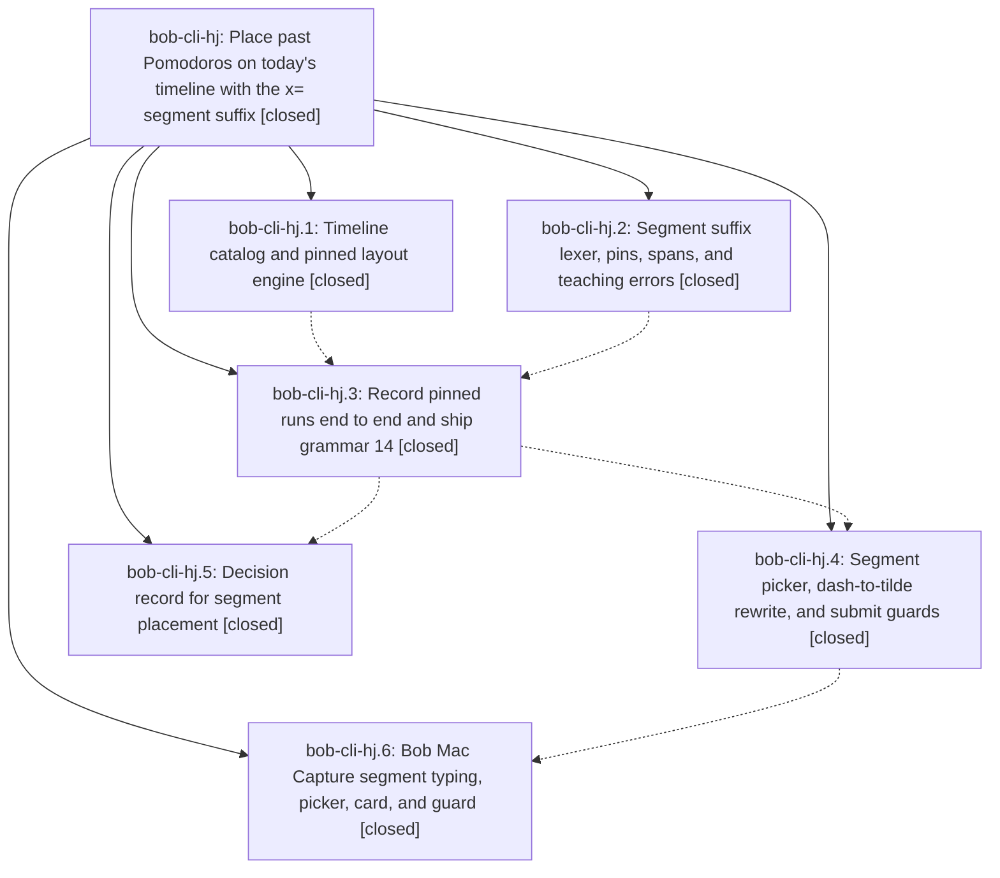

# Bead: bob-cli-hj — Place past Pomodoros on today's timeline with the x= segment suffix

[Bead Pages](../README.md) / bob-cli-hj

**Status:** ✓ closed · **Resolution:** done · **Type:** ▸ plan · **Tier:** epic
**Owner:** `bryanbugyi34@gmail.com` · **Created by:** [bbugyi200.athena.18s](https://github.com/bobs-org/bob-cli--agents/blob/main/sessions/bbugyi200.athena.18s.md) · **Assignee:** `bob-cli-hj.land`
**Created:** 2026-11-05 14:25:23 EST · **Closed:** 2026-11-06 07:48:18 EST
**Plan:** [202611/past\_pomodoro\_segment\_suffix.md](https://github.com/bobs-org/bob-cli--plans/blob/main/202611/past_pomodoro_segment_suffix.md)

<!-- sase:links:start -->

## Links

| Relation | Artifact | Why |
| --- | --- | --- |
| implemented-by | [plan:202611/past_pomodoro_segment_suffix.md][1] | derived from the plan's `bead_id:` frontmatter field |

_Plus 2 automatic references — see [Referenced By](#referenced-by)._

[1]: https://github.com/bobs-org/bob-cli--plans/blob/main/202611/past_pomodoro_segment_suffix.md

<!-- sase:links:end -->

## Description

`x=E[~|~n|~n+|~~][!][=X]` records past work against an edge of today's timeline (the tail since the last closed Pomodoro, a closed Pomodoro, a gap, or the head before the first row). Placement is exact and guarded, every cut is reported, and a plain `x=` stays byte-for-byte unchanged. bob ships a segment picker, a typed `-` to `~` assist, and a stale-preview guard. Bob Mac Capture renders the suffix, the picker, and a card that names the segment.

## Notes

[2026-11-06T12:48:18Z · bob-cli-hj.land] Verified: all six phases closed and every child note addressed; decision_record=no honored (no memory edited). Reviewed the four commits (ae330951, 6e816775, 86554bf6, 35c2a426) against the plan. Ran a hermetic debug bob at BOB_NOW 2026-11-04 09:13: the six requested examples write the contract ledger bytes and complete task 1. Every open case matches, including x=~~, gap fill and overflow hints, carve/erase hints, read4~ cut at now, wall cut, both run pins, x x=2~1! snapshot, and the x=~4 listing. Every lexical and timeline teaching row matches, as do the picker rows and filters, the dash rewrite swaps and non-swaps, and the --expect-past-windows match/mismatch/count/malformed refusals. Mac phase verified by hj.6 on exact-SHA macOS CI. The Mac grammar>=14 expect gate still holds at grammar 15.
Integration since start: the relation dash alias (060d97ed) and the = flip alias coexist with the past-segment arm (no = flip inside x= tokens). Merge-in grammar 15 keeps segment behavior.
Lander fixes: docs/reference/capture-syntax.md still showed x=E[!][=X] and listed x=~2/x=3~2 as retired close spellings, so it now has the x=E[s][!][=X] shape and placement text, the two-reading dash row, and the search_smoke query. Removed x=build@3-1 from the dash row in docs/capture.md. The shell-expanded-tilde refusal now quotes the draft with ~ restored (x=$HOME2! -> bob capture 'x=~2!'), replacing the dead unexpand helper, with unit and CLI tests. Dropped the stale dead_code allow on Timeline::picker_rows.
Gates: just check is green except bob-cli-hp's two clipboard lib tests. just docs-check is green except bob-cli-hs's README contract snapshot (clean-tree reproduction).
Follow-ups: hj.1#1, hj.2#1, and hj.3#1 declined (the clippy errors are already fixed on master). hj.2#2 declined (the binding retired-# rule teaches x=c++~1+ and no doc advertises #c++). hj.5#1 declined (a human reviewer set decision_record=no, so nothing is filed). hj.4#1 corroborated with a +1 on bob-cli-hp. hj.6#2 corroborated with a +1 on bob-cli-hs. hj.6#3: the footer test is a DISCOVERED ISSUE on in-progress epic bob-cli-hn (caused by hn.9's 6f4e279); the other Mac failures are tracked by bob-cli-h7. hj.6#1 filed as bob-cli-hx. Lander discoveries filed as bob-cli-ht (default_type rename debug panic in x= records, pre-existing) and bob-cli-hw (retired x=NAME@N-M teaching rewrites to an invalid token).

## Phases

| Bead | Title | Status | Size | Created | Agents | Commits |
|---|---|---|---|---|---:|---:|
| [bob-cli-hj.1](bob-cli-hj.1.md) | Timeline catalog and pinned layout engine | ✓ closed | medium | 2026-11-05 | 1 | 1 |
| [bob-cli-hj.2](bob-cli-hj.2.md) | Segment suffix lexer, pins, spans, and teaching errors | ✓ closed | medium | 2026-11-05 | 1 | 1 |
| [bob-cli-hj.3](bob-cli-hj.3.md) | Record pinned runs end to end and ship grammar 14 | ✓ closed | medium | 2026-11-05 | 1 | 1 |
| [bob-cli-hj.4](bob-cli-hj.4.md) | Segment picker, dash-to-tilde rewrite, and submit guards | ✓ closed | medium | 2026-11-05 | 1 | 1 |
| [bob-cli-hj.5](bob-cli-hj.5.md) | Decision record for segment placement | ✓ closed | small | 2026-11-05 | 1 | 0 |
| [bob-cli-hj.6](bob-cli-hj.6.md) | Bob Mac Capture segment typing, picker, card, and guard | ✓ closed | medium | 2026-11-05 | 1 | 2 |

## Lineage

## Agents

| Agent | Bead | Commits |
|---|---|---:|
| [bbugyi200.athena.bob-cli-hj.1](https://github.com/bobs-org/bob-cli--agents/blob/main/agents/bbugyi200.athena.bob-cli-hj.1/README.md) | [bob-cli-hj.1](bob-cli-hj.1.md) | 1 |
| [bbugyi200.athena.bob-cli-hj.2](https://github.com/bobs-org/bob-cli--agents/blob/main/agents/bbugyi200.athena.bob-cli-hj.2/README.md) | [bob-cli-hj.2](bob-cli-hj.2.md) | 1 |
| [bbugyi200.athena.bob-cli-hj.3](https://github.com/bobs-org/bob-cli--agents/blob/main/agents/bbugyi200.athena.bob-cli-hj.3/README.md) | [bob-cli-hj.3](bob-cli-hj.3.md) | 1 |
| [bbugyi200.athena.bob-cli-hj.4](https://github.com/bobs-org/bob-cli--agents/blob/main/agents/bbugyi200.athena.bob-cli-hj.4/README.md) | [bob-cli-hj.4](bob-cli-hj.4.md) | 1 |
| [bbugyi200.athena.bob-cli-hj.5](https://github.com/bobs-org/bob-cli--agents/blob/main/agents/bbugyi200.athena.bob-cli-hj.5/README.md) | [bob-cli-hj.5](bob-cli-hj.5.md) | 0 |
| [bbugyi200.athena.bob-cli-hj.6](https://github.com/bobs-org/bob-cli--agents/blob/main/sessions/bbugyi200.athena.bob-cli-hj.6.md) | [bob-cli-hj.6](bob-cli-hj.6.md) | 2 |
| [bbugyi200.athena.bob-cli-hj.land](https://github.com/bobs-org/bob-cli--agents/blob/main/agents/bbugyi200.athena.bob-cli-hj.land/README.md) | [bob-cli-hj](README.md) | 2 |

## Commits

| Repo | Commit | Subject | Bead | Committed |
|---|---|---|---|---|
| bob-cli | [`ae33095`](https://github.com/bobs-org/bob-cli/commit/ae330951b597c55360a854674bf5ba2f775411c1) | feat(capture): add timeline catalog and pinned layout engine | [bob-cli-hj.1](bob-cli-hj.1.md) | 2026-11-05 16:51:13 EST |
| bob-cli | [`6e81677`](https://github.com/bobs-org/bob-cli/commit/6e816775f0252b6bd68af2900699e6bd537168fb) | feat(capture): segment suffix lexer, pins, spans, and teaching errors | [bob-cli-hj.2](bob-cli-hj.2.md) | 2026-11-05 16:59:22 EST |
| bob-cli | [`86554bf`](https://github.com/bobs-org/bob-cli/commit/86554bf66551e6f44dd269295cfca19eba570a65) | feat(capture): record pinned past-Pomodoro segments and ship grammar 14 | [bob-cli-hj.3](bob-cli-hj.3.md) | 2026-11-05 17:42:43 EST |
| bob-cli | [`35c2a42`](https://github.com/bobs-org/bob-cli/commit/35c2a426c3411a91e7825c64adf1121fe013e9ac) | feat(capture): add past-Pomodoro segment picker, dash rewrite, and submit guards | [bob-cli-hj.4](bob-cli-hj.4.md) | 2026-11-05 18:50:38 EST |
| bob-mac-capture | [`bob-mac-capture@16c79f6`](https://github.com/bobs-org/bob-mac-capture/commit/16c79f6901b3cc070934ac8486adac3d00861f4a) | feat(capture): add past Pomodoro segment UI support | [bob-cli-hj.6](bob-cli-hj.6.md) | 2026-11-05 22:20:00 EST |
| bob-mac-capture | [`bob-mac-capture@9578c66`](https://github.com/bobs-org/bob-mac-capture/commit/9578c6634f345dd7d4d7563a8e0980d10b9c6fe0) | fix(capture): preserve past-segment submit after rewrite | [bob-cli-hj.6](bob-cli-hj.6.md) | 2026-11-06 06:18:40 EST |
| bob-cli | [`df5a6ca`](https://github.com/bobs-org/bob-cli/commit/df5a6ca47be157a8864729c1501185dc8d19e274) | fix(capture): land x= segment suffix docs and restore ~ in the shell-tilde refusal | [bob-cli-hj](README.md) | 2026-11-06 07:49:24 EST |
| bob-cli--plans | [`bob-cli--plans@b45c704`](https://github.com/bobs-org/bob-cli--plans/commit/b45c70476208a43e67b72649866b9e328f4a2c80) | chore(plans): mark past\_pomodoro\_segment\_suffix plan done after bob-cli-hj landing | [bob-cli-hj](README.md) | 2026-11-06 07:49:48 EST |

<!-- sase:referenced-by:start -->

## Referenced By

| Relation | Artifact | Why | Uses |
| --- | --- | --- | ---: |
| read-by | [agent:bob-cli-h8.land][1] | Check owner of clipboard catalog test failures | 1 |
| read-by | [agent:bob-cli-hj.3][2] | epic context for phase 3 | 1 |

[1]: https://github.com/bobs-org/bob-cli--agents/blob/main/agents/bbugyi200.athena.bob-cli-h8.land/README.md
[2]: https://github.com/bobs-org/bob-cli--agents/blob/main/agents/bbugyi200.athena.bob-cli-hj.3/README.md

<!-- sase:referenced-by:end -->
