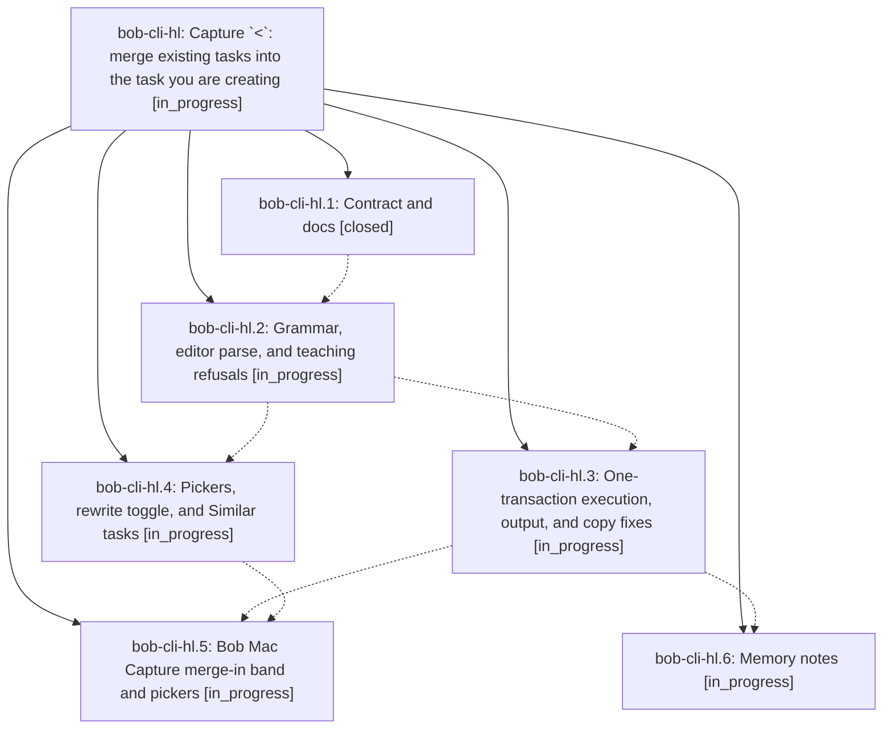

# Bead: bob-cli-hl — Capture \`\<\`: merge existing tasks into the task you are creating

[Bead Pages](../README.md) / bob-cli-hl

**Status:** ◐ in_progress · **Type:** ▸ plan · **Tier:** epic
**Owner:** `bryanbugyi34@gmail.com` · **Created by:** [bbugyi200.athena.190](https://github.com/bobs-org/bob-cli--agents/blob/main/sessions/bbugyi200.athena.190.md) · **Assignee:** `bob-cli-hl.land`
**Created:** 2026-11-05 18:05:39 EST
**Plan:** [202611/capture\_merge\_in\_arrow.md](https://github.com/bobs-org/bob-cli--plans/blob/main/202611/capture_merge_in_arrow.md)

<!-- sase:links:start -->

## Links

| Relation | Artifact | Why |
| --- | --- | --- |
| implemented-by | [plan:202611/capture_merge_in_arrow.md][1] | derived from the plan's `bead_id:` frontmatter field |

[1]: https://github.com/bobs-org/bob-cli--plans/blob/main/202611/capture_merge_in_arrow.md

<!-- sase:links:end -->

## Description

A capture line that creates one open task can end with `< @route+id …` to fold one or more existing tasks into that new task through the explicit merge engine, in one all-or-nothing capture whose vault bytes equal today's two-item `>` draft. Misuse teaches the right spelling with one-key rewrites, and Bob Mac Capture previews the merge as a calm, concise purple band inside the ordinary new-task card.

## Phases

| Bead | Title | Status | Size | Created | Agents | Commits |
|---|---|---|---|---|---:|---:|
| [bob-cli-hl.1](bob-cli-hl.1.md) | Contract and docs | ✓ closed | medium | 2026-11-05 | 1 | 1 |
| [bob-cli-hl.2](bob-cli-hl.2.md) | Grammar, editor parse, and teaching refusals | ◐ in_progress | large | 2026-11-05 | 1 | 1 |
| [bob-cli-hl.3](bob-cli-hl.3.md) | One-transaction execution, output, and copy fixes | ◐ in_progress | large | 2026-11-05 | 1 | 0 |
| [bob-cli-hl.4](bob-cli-hl.4.md) | Pickers, rewrite toggle, and Similar tasks | ◐ in_progress | medium | 2026-11-05 | 1 | 0 |
| [bob-cli-hl.5](bob-cli-hl.5.md) | Bob Mac Capture merge-in band and pickers | ◐ in_progress | large | 2026-11-05 | 1 | 0 |
| [bob-cli-hl.6](bob-cli-hl.6.md) | Memory notes | ◐ in_progress | small | 2026-11-05 | 1 | 0 |

## Lineage

## Agents

| Agent | Bead | Commits |
|---|---|---:|
| [bbugyi200.athena.bob-cli-hl.1](https://github.com/bobs-org/bob-cli--agents/blob/main/agents/bbugyi200.athena.bob-cli-hl.1/README.md) | [bob-cli-hl.1](bob-cli-hl.1.md) | 1 |
| [bbugyi200.athena.bob-cli-hl.2](https://github.com/bobs-org/bob-cli--agents/blob/main/sessions/bbugyi200.athena.bob-cli-hl.2.md) | [bob-cli-hl.2](bob-cli-hl.2.md) | 1 |
| [bbugyi200.athena.bob-cli-hl.3](https://github.com/bobs-org/bob-cli--agents/blob/main/agents/bbugyi200.athena.bob-cli-hl.3/README.md) | [bob-cli-hl.3](bob-cli-hl.3.md) | 0 |
| [bbugyi200.athena.bob-cli-hl.4](https://github.com/bobs-org/bob-cli--agents/blob/main/agents/bbugyi200.athena.bob-cli-hl.4/README.md) | [bob-cli-hl.4](bob-cli-hl.4.md) | 0 |
| [bbugyi200.athena.bob-cli-hl.5](https://github.com/bobs-org/bob-cli--agents/blob/main/agents/bbugyi200.athena.bob-cli-hl.5/README.md) | [bob-cli-hl.5](bob-cli-hl.5.md) | 0 |
| [bbugyi200.athena.bob-cli-hl.6](https://github.com/bobs-org/bob-cli--agents/blob/main/agents/bbugyi200.athena.bob-cli-hl.6/README.md) | [bob-cli-hl.6](bob-cli-hl.6.md) | 0 |
| [bbugyi200.athena.bob-cli-hl.land](https://github.com/bobs-org/bob-cli--agents/blob/main/agents/bbugyi200.athena.bob-cli-hl.land/README.md) | [bob-cli-hl](README.md) | 0 |

## Commits

| Repo | Commit | Subject | Bead | Committed |
|---|---|---|---|---|
| bob-cli | [`d9e3535`](https://github.com/bobs-org/bob-cli/commit/d9e353595582c3d1c647a1682d241b386fb2a2e0) | docs(capture): contract for merge-in \< capture | [bob-cli-hl.1](bob-cli-hl.1.md) | 2026-11-05 18:18:15 EST |
| bob-cli | [`53c1d1a`](https://github.com/bobs-org/bob-cli/commit/53c1d1ad4cbff2d8567718deb2175b887ebdb686) | feat(capture)!: complete merge-in grammar and teaching refusals | [bob-cli-hl.2](bob-cli-hl.2.md) | 2026-11-05 19:34:53 EST |
