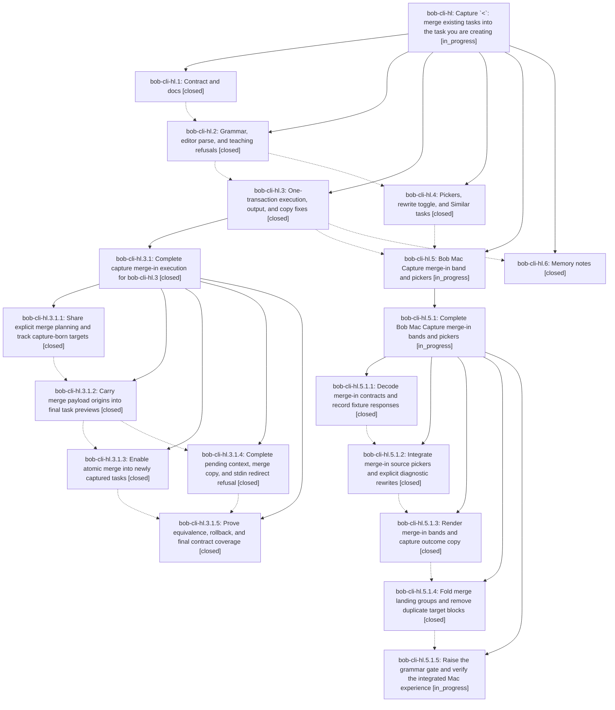

# Bead: bob-cli-hl — Capture \`\<\`: merge existing tasks into the task you are creating

[Bead Pages](../README.md) / bob-cli-hl

**Status:** ◐ in_progress · **Type:** ▸ plan · **Tier:** epic
**Owner:** `bryanbugyi34@gmail.com` · **Created by:** [bbugyi200.athena.190](https://github.com/bobs-org/bob-cli--agents/blob/main/sessions/bbugyi200.athena.190.md) · **Assignee:** `bob-cli-hl.land`
**Created:** 2026-11-05 18:05:39 EST
**Plan:** [202611/capture\_merge\_in\_arrow.md](https://github.com/bobs-org/bob-cli--plans/blob/main/202611/capture_merge_in_arrow.md)

<!-- sase:links:start -->

## Links

| Relation | Artifact | Why |
| --- | --- | --- |
| implemented-by | [plan:202611/capture_merge_in_arrow.md][1] | derived from the plan's `bead_id:` frontmatter field |

_Plus 2 automatic references — see [Referenced By](#referenced-by)._

[1]: https://github.com/bobs-org/bob-cli--plans/blob/main/202611/capture_merge_in_arrow.md

<!-- sase:links:end -->

## Description

A capture line that creates one open task can end with `< @route+id …` to fold one or more existing tasks into that new task through the explicit merge engine, in one all-or-nothing capture whose vault bytes equal today's two-item `>` draft. Misuse teaches the right spelling with one-key rewrites, and Bob Mac Capture previews the merge as a calm, concise purple band inside the ordinary new-task card.

## Notes

[2026-11-06T00:52:38Z · bob-cli-h8.land] DISCOVERED ISSUE: generated docs drift since bob-cli-hl.1 d9e35359 (merge-in < contract) edited the task-merge glossary strand without regenerating docs/reference/glossary.md. On master 723af324, 'uv run --project tools/docs bob-docs gen' rewrites the Task Merge paragraph ('capture's > or <'), and bob-plugins 'npm run docs:check' (which assembles cached bob-cli master) fails 'generated drift: out of date: docs/reference/glossary.md (run just docs-gen)'. Fix: run just docs-gen and commit the glossary. Found by the bob-cli-h8 land agent; left for hl because its phases are still editing that memory.

[2026-11-06T02:15:40Z · bob-cli-hg.3.1.land] DISCOVERED ISSUE: Landing bob-cli-hg.3.1 triaged child bob-cli-hg.3.1.4 PROPOSED FOLLOW-UP notes #1 and #3. At 6ea08f74, tests/cli/capture/merge_in.rs:8 declares TODAY with no uses (introduced by 53c1d1ad / bob-cli-hl.2); the child reproduced the denied unused lint on clean base. Also d9e35359 / bob-cli-hl.1 introduced links to #merging-tasks-into-a-new-task-with while the heading ends in code-formatted <; child .4 reproduced the broken fragment in just docs-check. Both remain visible in current source and belong to this active merge-in epic. No duplicate task found in all-status searches and the past-week task sweep; no new task created.

## Phases

| Bead | Title | Status | Size | Created | Agents | Commits |
|---|---|---|---|---|---:|---:|
| [bob-cli-hl.1](bob-cli-hl.1.md) | Contract and docs | ✓ closed | medium | 2026-11-05 | 1 | 1 |
| [bob-cli-hl.2](bob-cli-hl.2.md) | Grammar, editor parse, and teaching refusals | ✓ closed | large | 2026-11-05 | 1 | 1 |
| [bob-cli-hl.3](bob-cli-hl.3.md) | One-transaction execution, output, and copy fixes | ✓ closed | large | 2026-11-05 | 1 | 0 |
| [bob-cli-hl.4](bob-cli-hl.4.md) | Pickers, rewrite toggle, and Similar tasks | ✓ closed | medium | 2026-11-05 | 1 | 1 |
| [bob-cli-hl.5](bob-cli-hl.5.md) | Bob Mac Capture merge-in band and pickers | ◐ in_progress | large | 2026-11-05 | 1 | 0 |
| [bob-cli-hl.6](bob-cli-hl.6.md) | Memory notes | ✓ closed | small | 2026-11-05 | 1 | 0 |

## Lineage

## Agents

| Agent | Bead | Commits |
|---|---|---:|
| [bbugyi200.athena.bob-cli-hl.1](https://github.com/bobs-org/bob-cli--agents/blob/main/agents/bbugyi200.athena.bob-cli-hl.1/README.md) | [bob-cli-hl.1](bob-cli-hl.1.md) | 1 |
| [bbugyi200.athena.bob-cli-hl.2](https://github.com/bobs-org/bob-cli--agents/blob/main/sessions/bbugyi200.athena.bob-cli-hl.2.md) | [bob-cli-hl.2](bob-cli-hl.2.md) | 1 |
| [bbugyi200.athena.bob-cli-hl.3](https://github.com/bobs-org/bob-cli--agents/blob/main/sessions/bbugyi200.athena.bob-cli-hl.3.md) | [bob-cli-hl.3](bob-cli-hl.3.md) | 0 |
| [bbugyi200.athena.bob-cli-hl.3.1.1](https://github.com/bobs-org/bob-cli--agents/blob/main/sessions/bbugyi200.athena.bob-cli-hl.3.1.1.md) | [bob-cli-hl.3.1.1](bob-cli-hl.3.1.1.md) | 1 |
| [bbugyi200.athena.bob-cli-hl.3.1.2](https://github.com/bobs-org/bob-cli--agents/blob/main/agents/bbugyi200.athena.bob-cli-hl.3.1.2/README.md) | [bob-cli-hl.3.1.2](bob-cli-hl.3.1.2.md) | 1 |
| [bbugyi200.athena.bob-cli-hl.3.1.3](https://github.com/bobs-org/bob-cli--agents/blob/main/sessions/bbugyi200.athena.bob-cli-hl.3.1.3.md) | [bob-cli-hl.3.1.3](bob-cli-hl.3.1.3.md) | 1 |
| [bbugyi200.athena.bob-cli-hl.3.1.4](https://github.com/bobs-org/bob-cli--agents/blob/main/agents/bbugyi200.athena.bob-cli-hl.3.1.4/README.md) | [bob-cli-hl.3.1.4](bob-cli-hl.3.1.4.md) | 1 |
| [bbugyi200.athena.bob-cli-hl.3.1.5](https://github.com/bobs-org/bob-cli--agents/blob/main/sessions/bbugyi200.athena.bob-cli-hl.3.1.5.md) | [bob-cli-hl.3.1.5](bob-cli-hl.3.1.5.md) | 1 |
| [bbugyi200.athena.bob-cli-hl.3.1.land](https://github.com/bobs-org/bob-cli--agents/blob/main/agents/bbugyi200.athena.bob-cli-hl.3.1.land/README.md) | [bob-cli-hl.3.1](bob-cli-hl.3.1.md) | 2 |
| [bbugyi200.athena.bob-cli-hl.4](https://github.com/bobs-org/bob-cli--agents/blob/main/agents/bbugyi200.athena.bob-cli-hl.4/README.md) | [bob-cli-hl.4](bob-cli-hl.4.md) | 1 |
| [bbugyi200.athena.bob-cli-hl.5](https://github.com/bobs-org/bob-cli--agents/blob/main/sessions/bbugyi200.athena.bob-cli-hl.5.md) | [bob-cli-hl.5](bob-cli-hl.5.md) | 0 |
| [bbugyi200.athena.bob-cli-hl.5.1.1](https://github.com/bobs-org/bob-cli--agents/blob/main/agents/bbugyi200.athena.bob-cli-hl.5.1.1/README.md) | [bob-cli-hl.5.1.1](bob-cli-hl.5.1.1.md) | 1 |
| [bbugyi200.athena.bob-cli-hl.5.1.2](https://github.com/bobs-org/bob-cli--agents/blob/main/sessions/bbugyi200.athena.bob-cli-hl.5.1.2.md) | [bob-cli-hl.5.1.2](bob-cli-hl.5.1.2.md) | 1 |
| [bbugyi200.athena.bob-cli-hl.5.1.3](https://github.com/bobs-org/bob-cli--agents/blob/main/agents/bbugyi200.athena.bob-cli-hl.5.1.3/README.md) | [bob-cli-hl.5.1.3](bob-cli-hl.5.1.3.md) | 1 |
| [bbugyi200.athena.bob-cli-hl.5.1.4](https://github.com/bobs-org/bob-cli--agents/blob/main/sessions/bbugyi200.athena.bob-cli-hl.5.1.4.md) | [bob-cli-hl.5.1.4](bob-cli-hl.5.1.4.md) | 1 |
| [bbugyi200.athena.bob-cli-hl.5.1.5](https://github.com/bobs-org/bob-cli--agents/blob/main/agents/bbugyi200.athena.bob-cli-hl.5.1.5/README.md) | [bob-cli-hl.5.1.5](bob-cli-hl.5.1.5.md) | 0 |
| [bbugyi200.athena.bob-cli-hl.5.1.land](https://github.com/bobs-org/bob-cli--agents/blob/main/agents/bbugyi200.athena.bob-cli-hl.5.1.land/README.md) | [bob-cli-hl.5.1](bob-cli-hl.5.1.md) | 0 |
| [bbugyi200.athena.bob-cli-hl.6](https://github.com/bobs-org/bob-cli--agents/blob/main/agents/bbugyi200.athena.bob-cli-hl.6/README.md) | [bob-cli-hl.6](bob-cli-hl.6.md) | 0 |
| [bbugyi200.athena.bob-cli-hl.land](https://github.com/bobs-org/bob-cli--agents/blob/main/agents/bbugyi200.athena.bob-cli-hl.land/README.md) | [bob-cli-hl](README.md) | 0 |

## Commits

| Repo | Commit | Subject | Bead | Committed |
|---|---|---|---|---|
| bob-cli | [`d9e3535`](https://github.com/bobs-org/bob-cli/commit/d9e353595582c3d1c647a1682d241b386fb2a2e0) | docs(capture): contract for merge-in \< capture | [bob-cli-hl.1](bob-cli-hl.1.md) | 2026-11-05 18:18:15 EST |
| bob-cli | [`53c1d1a`](https://github.com/bobs-org/bob-cli/commit/53c1d1ad4cbff2d8567718deb2175b887ebdb686) | feat(capture)!: complete merge-in grammar and teaching refusals | [bob-cli-hl.2](bob-cli-hl.2.md) | 2026-11-05 19:34:53 EST |
| bob-cli | [`5ab0ec2`](https://github.com/bobs-org/bob-cli/commit/5ab0ec228cbdcaae59058e5fd0204f5cedff47ec) | feat(capture): add merge-in source picker assistance | [bob-cli-hl.4](bob-cli-hl.4.md) | 2026-11-05 20:19:56 EST |
| bob-cli | [`4282e71`](https://github.com/bobs-org/bob-cli/commit/4282e71222c8fcaaf76d158e7cbaa01cd0708ea7) | refactor(capture): share merge planning and track task births | [bob-cli-hl.3.1.1](bob-cli-hl.3.1.1.md) | 2026-11-05 20:37:36 EST |
| bob-cli | [`fd26fb2`](https://github.com/bobs-org/bob-cli/commit/fd26fb29655d1efba1639db2c5883d98302e3d59) | feat(capture): carry merge payload origins into task block previews | [bob-cli-hl.3.1.2](bob-cli-hl.3.1.2.md) | 2026-11-05 21:14:58 EST |
| bob-cli | [`fbb6da4`](https://github.com/bobs-org/bob-cli/commit/fbb6da46fdfff73a1b358e7087336806498a247c) | feat(capture): complete merge-in feedback — pending context, copy, and stdin guard | [bob-cli-hl.3.1.4](bob-cli-hl.3.1.4.md) | 2026-11-05 22:09:59 EST |
| bob-cli | [`3fe50bc`](https://github.com/bobs-org/bob-cli/commit/3fe50bc75ef4b6c7ef35d878b4f881b7df1d2128) | feat(capture): execute atomic merge-in captures | [bob-cli-hl.3.1.3](bob-cli-hl.3.1.3.md) | 2026-11-05 23:56:30 EST |
| bob-cli | [`6af313b`](https://github.com/bobs-org/bob-cli/commit/6af313b4d36460174ff6b951e208653ea0160afc) | test(capture): complete merge-in acceptance coverage | [bob-cli-hl.3.1.5](bob-cli-hl.3.1.5.md) | 2026-11-06 01:00:42 EST |
| bob-cli | [`248a2bf`](https://github.com/bobs-org/bob-cli/commit/248a2bfa3b53e68d02e5f4976f76c75e3575add1) | refactor(capture): share merge source eligibility with merge-in pending and picker | [bob-cli-hl.3.1](bob-cli-hl.3.1.md) | 2026-11-06 01:35:29 EST |
| bob-cli--plans | [`bob-cli--plans@1c331fb`](https://github.com/bobs-org/bob-cli--plans/commit/1c331fb6ad840c4f10f2b7834b60b640ddbde1e6) | chore(plans): mark capture\_merge\_in\_execution done | [bob-cli-hl.3.1](bob-cli-hl.3.1.md) | 2026-11-06 01:35:53 EST |
| bob-mac-capture | [`bob-mac-capture@b4b343f`](https://github.com/bobs-org/bob-mac-capture/commit/b4b343f81c206d5b378438cda8381ba916e41934) | feat(capture): add merge-in tolerant models, fixtures and decoding tests | [bob-cli-hl.5.1.1](bob-cli-hl.5.1.1.md) | 2026-11-06 02:10:15 EST |
| bob-mac-capture | [`bob-mac-capture@8c956ca`](https://github.com/bobs-org/bob-mac-capture/commit/8c956ca52b704bb4e3b0add118445470ae186eae) | feat(capture): add merge-in source picker and diagnostic rewrite actions | [bob-cli-hl.5.1.2](bob-cli-hl.5.1.2.md) | 2026-11-06 02:49:38 EST |
| bob-mac-capture | [`bob-mac-capture@e30a2f4`](https://github.com/bobs-org/bob-mac-capture/commit/e30a2f44437ead3ebedd7b38fb79b1065279dc13) | feat(capture): render merge-in bands and capture outcome copy | [bob-cli-hl.5.1.3](bob-cli-hl.5.1.3.md) | 2026-11-06 03:05:45 EST |
| bob-mac-capture | [`bob-mac-capture@6d659eb`](https://github.com/bobs-org/bob-mac-capture/commit/6d659eb244653c22fcc095914556e008ab311153) | feat(capture): fold merge targets in previews | [bob-cli-hl.5.1.4](bob-cli-hl.5.1.4.md) | 2026-11-06 04:47:39 EST |

<!-- sase:referenced-by:start -->

## Referenced By

| Relation | Artifact | Why | Uses |
| --- | --- | --- | ---: |
| read-by | [agent:bob-cli-hl.3.1.land][1] | Need sibling phase states to judge integration ownership | 1 |
| read-by | [agent:bob-cli-hl.4][2] | Check for already-recorded clean-base gate failures and follow-up trackers | 1 |

[1]: https://github.com/bobs-org/bob-cli--agents/blob/main/agents/bbugyi200.athena.bob-cli-hl.3.1.land/README.md
[2]: https://github.com/bobs-org/bob-cli--agents/blob/main/agents/bbugyi200.athena.bob-cli-hl.4/README.md

<!-- sase:referenced-by:end -->
