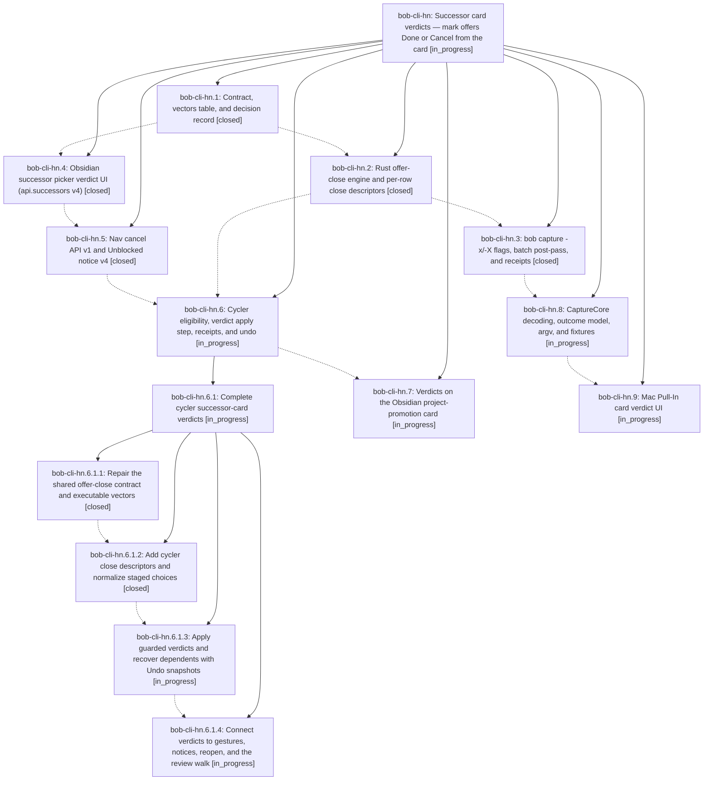

# Bead: bob-cli-hn — Successor card verdicts — mark offers Done or Cancel from the card

[Bead Pages](../README.md) / bob-cli-hn

**Status:** ◐ in_progress · **Type:** ▸ plan · **Tier:** epic
**Owner:** `bryanbugyi34@gmail.com` · **Created by:** [bbugyi200.athena.191](https://github.com/bobs-org/bob-cli--agents/blob/main/agents/bbugyi200.athena.191/README.md) · **Assignee:** `bob-cli-hn.land`
**Created:** 2026-11-05 18:41:46 EST
**Plan:** [202611/successor\_card\_verdicts.md](https://github.com/bobs-org/bob-cli--plans/blob/main/202611/successor_card_verdicts.md)

<!-- sase:links:start -->

## Links

| Relation | Artifact | Why |
| --- | --- | --- |
| implemented-by | [plan:202611/successor_card_verdicts.md][1] | derived from the plan's `bead_id:` frontmatter field |

_Plus 3 automatic references — see [Referenced By](#referenced-by)._

[1]: https://github.com/bobs-org/bob-cli--plans/blob/main/202611/successor_card_verdicts.md

<!-- sase:links:end -->

## Description

While reviewing a successor card in Obsidian, in Bob Mac Capture, or through `bob capture`, Bryan can stage Done (Ctrl+X) or Cancel (Ctrl+Shift+X, with an optional inline reason) on any eligible offer row. Those verdicts apply together with pull-ins in the gesture's existing write pass. The engine reports eligibility and consequences, closes are root-only, cascades are recover-only, failures are reported honestly, and the card uses Bob's existing ✓/⊘ visual grammar.

## Phases

| Bead | Title | Status | Size | Created | Agents | Commits |
|---|---|---|---|---|---:|---:|
| [bob-cli-hn.1](bob-cli-hn.1.md) | Contract, vectors table, and decision record | ✓ closed | medium | 2026-11-05 | 1 | 1 |
| [bob-cli-hn.2](bob-cli-hn.2.md) | Rust offer-close engine and per-row close descriptors | ✓ closed | medium | 2026-11-05 | 1 | 1 |
| [bob-cli-hn.3](bob-cli-hn.3.md) | bob capture -x/-X flags, batch post-pass, and receipts | ✓ closed | medium | 2026-11-05 | 1 | 0 |
| [bob-cli-hn.4](bob-cli-hn.4.md) | Obsidian successor picker verdict UI (api.successors v4) | ✓ closed | medium | 2026-11-05 | 1 | 1 |
| [bob-cli-hn.5](bob-cli-hn.5.md) | Nav cancel API v1 and Unblocked notice v4 | ✓ closed | small | 2026-11-05 | 1 | 1 |
| [bob-cli-hn.6](bob-cli-hn.6.md) | Cycler eligibility, verdict apply step, receipts, and undo | ◐ in_progress | large | 2026-11-05 | 1 | 0 |
| [bob-cli-hn.7](bob-cli-hn.7.md) | Verdicts on the Obsidian project-promotion card | ◐ in_progress | small | 2026-11-05 | 1 | 0 |
| [bob-cli-hn.8](bob-cli-hn.8.md) | CaptureCore decoding, outcome model, argv, and fixtures | ◐ in_progress | medium | 2026-11-05 | 1 | 0 |
| [bob-cli-hn.9](bob-cli-hn.9.md) | Mac Pull-In card verdict UI | ◐ in_progress | large | 2026-11-05 | 1 | 0 |

## Lineage

## Agents

| Agent | Bead | Commits |
|---|---|---:|
| [bbugyi200.athena.bob-cli-hn.1](https://github.com/bobs-org/bob-cli--agents/blob/main/agents/bbugyi200.athena.bob-cli-hn.1/README.md) | [bob-cli-hn.1](bob-cli-hn.1.md) | 1 |
| [bbugyi200.athena.bob-cli-hn.2](https://github.com/bobs-org/bob-cli--agents/blob/main/agents/bbugyi200.athena.bob-cli-hn.2/README.md) | [bob-cli-hn.2](bob-cli-hn.2.md) | 1 |
| [bbugyi200.athena.bob-cli-hn.3](https://github.com/bobs-org/bob-cli--agents/blob/main/agents/bbugyi200.athena.bob-cli-hn.3/README.md) | [bob-cli-hn.3](bob-cli-hn.3.md) | 0 |
| [bbugyi200.athena.bob-cli-hn.4](https://github.com/bobs-org/bob-cli--agents/blob/main/agents/bbugyi200.athena.bob-cli-hn.4/README.md) | [bob-cli-hn.4](bob-cli-hn.4.md) | 1 |
| [bbugyi200.athena.bob-cli-hn.5](https://github.com/bobs-org/bob-cli--agents/blob/main/agents/bbugyi200.athena.bob-cli-hn.5/README.md) | [bob-cli-hn.5](bob-cli-hn.5.md) | 1 |
| [bbugyi200.athena.bob-cli-hn.6](https://github.com/bobs-org/bob-cli--agents/blob/main/sessions/bbugyi200.athena.bob-cli-hn.6.md) | [bob-cli-hn.6](bob-cli-hn.6.md) | 0 |
| [bbugyi200.athena.bob-cli-hn.6.1.1](https://github.com/bobs-org/bob-cli--agents/blob/main/agents/bbugyi200.athena.bob-cli-hn.6.1.1/README.md) | [bob-cli-hn.6.1.1](bob-cli-hn.6.1.1.md) | 1 |
| [bbugyi200.athena.bob-cli-hn.6.1.2](https://github.com/bobs-org/bob-cli--agents/blob/main/sessions/bbugyi200.athena.bob-cli-hn.6.1.2.md) | [bob-cli-hn.6.1.2](bob-cli-hn.6.1.2.md) | 1 |
| [bbugyi200.athena.bob-cli-hn.6.1.3](https://github.com/bobs-org/bob-cli--agents/blob/main/agents/bbugyi200.athena.bob-cli-hn.6.1.3/README.md) | [bob-cli-hn.6.1.3](bob-cli-hn.6.1.3.md) | 0 |
| [bbugyi200.athena.bob-cli-hn.6.1.4](https://github.com/bobs-org/bob-cli--agents/blob/main/agents/bbugyi200.athena.bob-cli-hn.6.1.4/README.md) | [bob-cli-hn.6.1.4](bob-cli-hn.6.1.4.md) | 0 |
| [bbugyi200.athena.bob-cli-hn.6.1.land](https://github.com/bobs-org/bob-cli--agents/blob/main/agents/bbugyi200.athena.bob-cli-hn.6.1.land/README.md) | [bob-cli-hn.6.1](bob-cli-hn.6.1.md) | 0 |
| [bbugyi200.athena.bob-cli-hn.7](https://github.com/bobs-org/bob-cli--agents/blob/main/agents/bbugyi200.athena.bob-cli-hn.7/README.md) | [bob-cli-hn.7](bob-cli-hn.7.md) | 0 |
| [bbugyi200.athena.bob-cli-hn.8](https://github.com/bobs-org/bob-cli--agents/blob/main/agents/bbugyi200.athena.bob-cli-hn.8/README.md) | [bob-cli-hn.8](bob-cli-hn.8.md) | 0 |
| [bbugyi200.athena.bob-cli-hn.9](https://github.com/bobs-org/bob-cli--agents/blob/main/agents/bbugyi200.athena.bob-cli-hn.9/README.md) | [bob-cli-hn.9](bob-cli-hn.9.md) | 0 |
| [bbugyi200.athena.bob-cli-hn.land](https://github.com/bobs-org/bob-cli--agents/blob/main/agents/bbugyi200.athena.bob-cli-hn.land/README.md) | [bob-cli-hn](README.md) | 0 |

## Commits

| Repo | Commit | Subject | Bead | Committed |
|---|---|---|---|---|
| bob-cli | [`723af32`](https://github.com/bobs-org/bob-cli/commit/723af3246886bd84fba1899a4aa19f280314ca05) | feat(docs): define successor offer verdict contract | [bob-cli-hn.1](bob-cli-hn.1.md) | 2026-11-05 18:56:31 EST |
| bob-plugins | [`bob-plugins@8a16ebe`](https://github.com/bobs-org/bob-plugins/commit/8a16ebeab6e4e2e1069527575cdd5a97352e3bc1) | feat(nav-hotkeys): successor picker verdict UI (api.successors v4) | [bob-cli-hn.4](bob-cli-hn.4.md) | 2026-11-05 19:21:44 EST |
| bob-plugins | [`bob-plugins@996fc83`](https://github.com/bobs-org/bob-plugins/commit/996fc839a1e55b3e39265116cfc831170d6df225) | feat(navigation): add cancel and notice v4 APIs | [bob-cli-hn.5](bob-cli-hn.5.md) | 2026-11-05 19:47:11 EST |
| bob-cli | [`53f9c2c`](https://github.com/bobs-org/bob-cli/commit/53f9c2c758653cb54fbb1fd4d4339d18ae23d459) | feat(capture): add staged offer close descriptors | [bob-cli-hn.2](bob-cli-hn.2.md) | 2026-11-05 20:19:35 EST |
| bob-cli | [`44c5c8c`](https://github.com/bobs-org/bob-cli/commit/44c5c8c8fd44340dcfb7376fcd13464032131ee1) | fix(capture): repair shared offer-close contract and executable vectors | [bob-cli-hn.6.1.1](bob-cli-hn.6.1.1.md) | 2026-11-05 21:24:04 EST |
| bob-plugins | [`bob-plugins@ef9257d`](https://github.com/bobs-org/bob-plugins/commit/ef9257d7faac679fb80fab2a27da5ee654b5d202) | feat(task-status-cycler): add successor offer close descriptors | [bob-cli-hn.6.1.2](bob-cli-hn.6.1.2.md) | 2026-11-05 22:21:31 EST |

<!-- sase:referenced-by:start -->

## Referenced By

| Relation | Artifact | Why | Uses |
| --- | --- | --- | ---: |
| read-by | [agent:bob-cli-h8.land][1] | Check owner epic of theme vector drift | 1 |
| read-by | [agent:bob-cli-hn.3][2] | Need epic scope for cli phase | 1 |
| read-by | [agent:bob-cli-hn.4][3] | Need epic status and phase list | 1 |

[1]: https://github.com/bobs-org/bob-cli--agents/blob/main/agents/bbugyi200.athena.bob-cli-h8.land/README.md
[2]: https://github.com/bobs-org/bob-cli--agents/blob/main/agents/bbugyi200.athena.bob-cli-hn.3/README.md
[3]: https://github.com/bobs-org/bob-cli--agents/blob/main/agents/bbugyi200.athena.bob-cli-hn.4/README.md

<!-- sase:referenced-by:end -->
