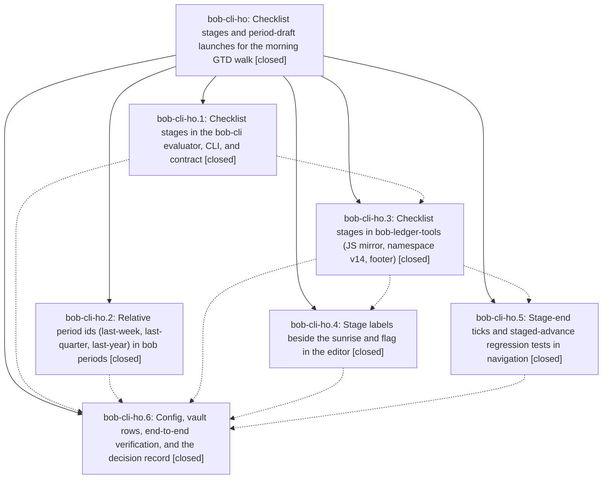

# Bead: bob-cli-ho — Checklist stages and period-draft launches for the morning GTD walk

[Bead Pages](../README.md) / bob-cli-ho

**Status:** ✓ closed · **Resolution:** done · **Type:** ▸ plan · **Tier:** epic
**Owner:** `bryanbugyi34@gmail.com` · **Created by:** [bbugyi200.athena.193](https://github.com/bobs-org/bob-cli--agents/blob/main/sessions/bbugyi200.athena.193.md) · **Assignee:** `bob-cli-ho.land`
**Created:** 2026-11-05 18:44:50 EST · **Closed:** 2026-11-05 22:14:54 EST
**Plan:** [202611/gtd\_checklist\_stages.md](https://github.com/bobs-org/bob-cli--plans/blob/main/202611/gtd_checklist_stages.md)

<!-- sase:links:start -->

## Links

| Relation | Artifact | Why |
| --- | --- | --- |
| implemented-by | [plan:202611/gtd_checklist_stages.md][1] | derived from the plan's `bead_id:` frontmatter field |

_Plus 2 automatic references — see [Referenced By](#referenced-by)._

[1]: https://github.com/bobs-org/bob-cli--plans/blob/main/202611/gtd_checklist_stages.md

<!-- sase:links:end -->

## Description

PRE and POST checklist rows walk in a deliberate, configured order of named stages (terminal → periods → browser → everything else in PRE; periods → Morning review in POST) that every review surface shows the same way, and three recurring PRE rows remind Bryan, on each period-review day, to launch the agents that draft last week's, quarter's, and year's period-note Reviews.

## Notes

[2026-11-06T02:47:31Z · bob-cli-ho.land] LAND TRIAGE (bob-cli-ho.land) of PROPOSED FOLLOW-UP notes: (1) clipboard:count duplicate completion-kinds / catalog lib failures (ho.1 #1, ho.2 #2): duplicate of bob-cli-hp; reproduced on master 44c5c8c8 and +1 recorded. (2) docs-check BOB_GMAIL_* undocumented env errors (ho.1 #1, ho.2 #1): declined, already fixed on master (just docs-check no longer reports them; docs/gmail.md documents the env names). (3) ref_library extra_pass_and_additive_id_resolution flake (ho.2 #3): new flake task bob-cli-hr (small; wall-clock 20x ratio assertion), linked related to bob-cli-gz. (4) bob-plugins warm snapshot/order, keystroke-rank, cold-build budget failures (ho.3 #1): duplicate of bob-cli-f8, +1 recorded. (5) docs/task-merge.md:9 broken link to capture#merging-tasks-into-a-new-task-with (ho.3 #1, ho.4 #1): caused by active epic bob-cli-hl (d9e35359, bob-cli-hl.1), which already carries this as a DISCOVERED ISSUE note; no new task, no duplicate note. None of these is caused by bob-cli-ho.

[2026-11-06T03:14:54Z · bob-cli-ho.land] Verified phases 1–6 against plan: walk_order (8eecf0c4), period_ids (8feca277), JS-mirror docs (bac41b5b), stage labels (6ea08f74), ledger_order (1017b38), ledger stage labels (4c748d9), and nav ticks (2d0348b). The prior land verification reports `cargo test --lib -- freshness` (161) and `cargo test --test cli -- freshness periods` (79) passing, plus the live `BOB_NOW=2026-11-09T07:00:00 cargo run -- freshness list` walk with PRE 1/2, 2/2 → periods → browser 1/3..3/3 → unstaged and `periods show last-week` resolving `2026-W45`.

Integration review found the intervening capture merge-in, gmail, and successor-offer commits did not touch freshness, periods, or checklist code, so no rewiring was needed. This closeout fixed FT4: staged POST rows now show `Ctrl+Enter done · ]s skip` and unstaged POST rows retain `closes the review` (ledger 1.101.1); added the stage-end `· STAGE ✓` tick on Ctrl+Alt+F and PRE group-end paths, with NT5/NT6 and Ctrl+Alt+F vectors (nav 2.75.0); updated nav, ledger, and freshness docs; and changed the generated contract summary to schema 16. `bob plugins sync` completed.

Plugin gates: build and build:check passed; the edited and companion Node suites passed (154 checklist cases; all selected suites green). Full `npm test` had only the three known timing-budget failures in `test-block-id-prompt-task-wikilink-index-performance.cjs` tracked by bob-cli-f8. `npm run docs:check` passed lint, inventory, generated drift, and strict site build; its sole error was the known `task-merge` → `capture#merging-tasks-into-a-new-task-with` link owned by bob-cli-hl.

CLI gates: `just docs-gen` passed and regenerated README/contracts from schema 16. `just check` passed formatting and Clippy after removing an unused `TODAY` constant in `tests/cli/capture/merge_in.rs`; the test run retained the two known lib failures tracked by bob-cli-hp (`every_table_entry_matches_the_tree`, `public_leaves_are_entries_or_excluded`) and also exposed seven unrelated stale CLI expectations: five capture note-pull fixture cases, catalog protocol schema count, and root help snapshot. `just docs-check` passed lint, generated drift, strict site build, and published URLs; its sole error was the bob-cli-hl task-merge link above. No `just check-full` was run.

Follow-up triage already recorded on the epic remains: bob-cli-hp +1, bob-cli-f8 +1, new flake bob-cli-hr; the gmail environment errors were declined as already fixed; and the task-merge link remains owned by bob-cli-hl.

## Phases

| Bead | Title | Status | Size | Created | Agents | Commits |
|---|---|---|---|---|---:|---:|
| [bob-cli-ho.1](bob-cli-ho.1.md) | Checklist stages in the bob-cli evaluator, CLI, and contract | ✓ closed | medium | 2026-11-05 | 1 | 1 |
| [bob-cli-ho.2](bob-cli-ho.2.md) | Relative period ids (last-week, last-quarter, last-year) in bob periods | ✓ closed | small | 2026-11-05 | 1 | 1 |
| [bob-cli-ho.3](bob-cli-ho.3.md) | Checklist stages in bob-ledger-tools (JS mirror, namespace v14, footer) | ✓ closed | medium | 2026-11-05 | 1 | 2 |
| [bob-cli-ho.4](bob-cli-ho.4.md) | Stage labels beside the sunrise and flag in the editor | ✓ closed | medium | 2026-11-05 | 1 | 2 |
| [bob-cli-ho.5](bob-cli-ho.5.md) | Stage-end ticks and staged-advance regression tests in navigation | ✓ closed | small | 2026-11-05 | 1 | 1 |
| [bob-cli-ho.6](bob-cli-ho.6.md) | Config, vault rows, end-to-end verification, and the decision record | ✓ closed | small | 2026-11-05 | 1 | 0 |

## Lineage

## Agents

| Agent | Bead | Commits |
|---|---|---:|
| [bbugyi200.athena.bob-cli-ho.1](https://github.com/bobs-org/bob-cli--agents/blob/main/agents/bbugyi200.athena.bob-cli-ho.1/README.md) | [bob-cli-ho.1](bob-cli-ho.1.md) | 1 |
| [bbugyi200.athena.bob-cli-ho.2](https://github.com/bobs-org/bob-cli--agents/blob/main/agents/bbugyi200.athena.bob-cli-ho.2/README.md) | [bob-cli-ho.2](bob-cli-ho.2.md) | 1 |
| [bbugyi200.athena.bob-cli-ho.3](https://github.com/bobs-org/bob-cli--agents/blob/main/agents/bbugyi200.athena.bob-cli-ho.3/README.md) | [bob-cli-ho.3](bob-cli-ho.3.md) | 2 |
| [bbugyi200.athena.bob-cli-ho.4](https://github.com/bobs-org/bob-cli--agents/blob/main/agents/bbugyi200.athena.bob-cli-ho.4/README.md) | [bob-cli-ho.4](bob-cli-ho.4.md) | 2 |
| [bbugyi200.athena.bob-cli-ho.5](https://github.com/bobs-org/bob-cli--agents/blob/main/agents/bbugyi200.athena.bob-cli-ho.5/README.md) | [bob-cli-ho.5](bob-cli-ho.5.md) | 1 |
| [bbugyi200.athena.bob-cli-ho.6](https://github.com/bobs-org/bob-cli--agents/blob/main/agents/bbugyi200.athena.bob-cli-ho.6/README.md) | [bob-cli-ho.6](bob-cli-ho.6.md) | 0 |
| [bbugyi200.athena.bob-cli-ho.land](https://github.com/bobs-org/bob-cli--agents/blob/main/sessions/bbugyi200.athena.bob-cli-ho.land.md) | [bob-cli-ho](README.md) | 3 |

## Commits

| Repo | Commit | Subject | Bead | Committed |
|---|---|---|---|---|
| bob-cli | [`8feca27`](https://github.com/bobs-org/bob-cli/commit/8feca277a8ada6108bef340c4cddaf3e62220b47) | feat(periods): support last-week, last-quarter, and last-year relative period ids | [bob-cli-ho.2](bob-cli-ho.2.md) | 2026-11-05 19:12:50 EST |
| bob-cli | [`8eecf0c`](https://github.com/bobs-org/bob-cli/commit/8eecf0c4ba01712cb8a7807439c622c484f17630) | feat(freshness): order PRE and POST review stages | [bob-cli-ho.1](bob-cli-ho.1.md) | 2026-11-05 19:39:18 EST |
| bob-cli | [`bac41b5`](https://github.com/bobs-org/bob-cli/commit/bac41b5baba6444f02fc2aa7946ae904a3c1ea9e) | docs(freshness): document checklist stages in JS mirror | [bob-cli-ho.3](bob-cli-ho.3.md) | 2026-11-05 20:40:23 EST |
| bob-plugins | [`bob-plugins@1017b38`](https://github.com/bobs-org/bob-plugins/commit/1017b388593966ec1482a77cd24ac6a20c3cca60) | feat(ledger-tools): mirror staged freshness checklist | [bob-cli-ho.3](bob-cli-ho.3.md) | 2026-11-05 20:40:45 EST |
| bob-plugins | [`bob-plugins@2d0348b`](https://github.com/bobs-org/bob-plugins/commit/2d0348b2d9e3b639142387417c4b7d1007afa48c) | feat(navigation): mark completed checklist stages | [bob-cli-ho.5](bob-cli-ho.5.md) | 2026-11-05 20:51:18 EST |
| bob-cli | [`6ea08f7`](https://github.com/bobs-org/bob-cli/commit/6ea08f74c0ba08e5c313ea8f9cce6e40edb109c4) | docs(marks): add checklist stage labels contract (SL1-SL12) | [bob-cli-ho.4](bob-cli-ho.4.md) | 2026-11-05 21:04:18 EST |
| bob-plugins | [`bob-plugins@4c748d9`](https://github.com/bobs-org/bob-plugins/commit/4c748d9343b26979fb9af55110ace085f3b1a0b5) | feat(ledger-tools): render quiet small-caps stage labels beside the sunrise and flag | [bob-cli-ho.4](bob-cli-ho.4.md) | 2026-11-05 21:04:38 EST |
| bob-cli | [`81e0d0c`](https://github.com/bobs-org/bob-cli/commit/81e0d0c2cdb45292599f3c76553be0647a1be5ac) | docs(freshness): finish checklist stage rollout | [bob-cli-ho](README.md) | 2026-11-05 22:18:41 EST |
| bob-plugins | [`bob-plugins@7a8dd15`](https://github.com/bobs-org/bob-plugins/commit/7a8dd15817b8c7c55bf22f2b1267b5e8061d3d05) | fix(navigation): finish checklist stage completion cues | [bob-cli-ho](README.md) | 2026-11-05 22:19:09 EST |
| bob-cli--plans | [`bob-cli--plans@e33de46`](https://github.com/bobs-org/bob-cli--plans/commit/e33de460fbdeab0013adf87c82ed6d0c37e5d4fc) | docs(plan): mark checklist stages epic complete | [bob-cli-ho](README.md) | 2026-11-05 22:19:30 EST |

<!-- sase:referenced-by:start -->

## Referenced By

| Relation | Artifact | Why | Uses |
| --- | --- | --- | ---: |
| read-by | [agent:bob-cli-ho.1][1] | need epic scope | 1 |
| read-by | [agent:bob-cli-ho.4][2] | Need parent epic decisions and phase status | 1 |

[1]: https://github.com/bobs-org/bob-cli--agents/blob/main/agents/bbugyi200.athena.bob-cli-ho.1/README.md
[2]: https://github.com/bobs-org/bob-cli--agents/blob/main/agents/bbugyi200.athena.bob-cli-ho.4/README.md

<!-- sase:referenced-by:end -->
