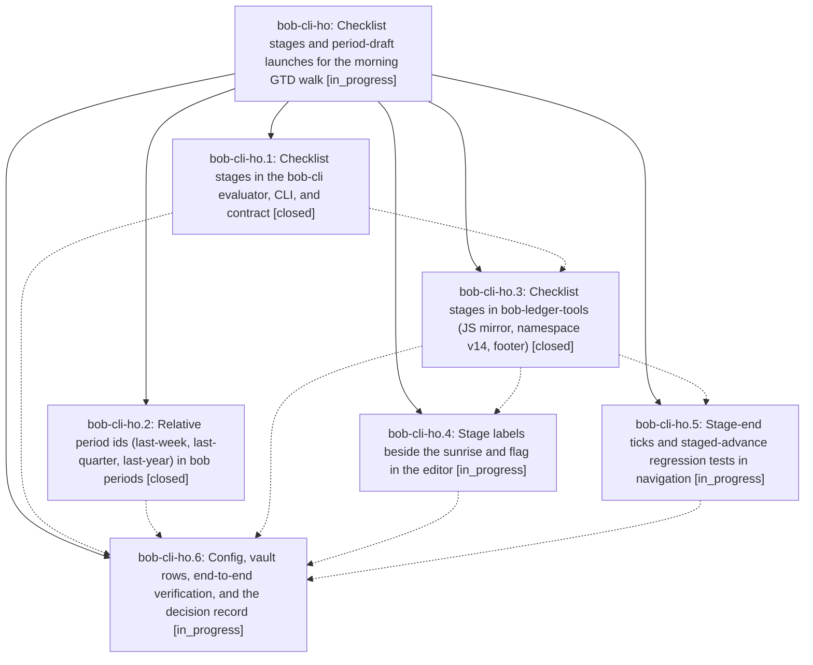

# Bead: bob-cli-ho — Checklist stages and period-draft launches for the morning GTD walk

[Bead Pages](../README.md) / bob-cli-ho

**Status:** ◐ in_progress · **Type:** ▸ plan · **Tier:** epic
**Owner:** `bryanbugyi34@gmail.com` · **Created by:** [bbugyi200.athena.193](https://github.com/bobs-org/bob-cli--agents/blob/main/sessions/bbugyi200.athena.193.md) · **Assignee:** `bob-cli-ho.land`
**Created:** 2026-11-05 18:44:50 EST
**Plan:** [202611/gtd\_checklist\_stages.md](https://github.com/bobs-org/bob-cli--plans/blob/main/202611/gtd_checklist_stages.md)

<!-- sase:links:start -->

## Links

| Relation | Artifact | Why |
| --- | --- | --- |
| implemented-by | [plan:202611/gtd_checklist_stages.md][1] | derived from the plan's `bead_id:` frontmatter field |

_Plus 1 automatic references — see [Referenced By](#referenced-by)._

[1]: https://github.com/bobs-org/bob-cli--plans/blob/main/202611/gtd_checklist_stages.md

<!-- sase:links:end -->

## Description

PRE and POST checklist rows walk in a deliberate, configured order of named stages (terminal → periods → browser → everything else in PRE; periods → Morning review in POST) that every review surface shows the same way, and three recurring PRE rows remind Bryan, on each period-review day, to launch the agents that draft last week's, quarter's, and year's period-note Reviews.

## Phases

| Bead | Title | Status | Size | Created | Agents | Commits |
|---|---|---|---|---|---:|---:|
| [bob-cli-ho.1](bob-cli-ho.1.md) | Checklist stages in the bob-cli evaluator, CLI, and contract | ✓ closed | medium | 2026-11-05 | 1 | 1 |
| [bob-cli-ho.2](bob-cli-ho.2.md) | Relative period ids (last-week, last-quarter, last-year) in bob periods | ✓ closed | small | 2026-11-05 | 1 | 1 |
| [bob-cli-ho.3](bob-cli-ho.3.md) | Checklist stages in bob-ledger-tools (JS mirror, namespace v14, footer) | ✓ closed | medium | 2026-11-05 | 1 | 2 |
| [bob-cli-ho.4](bob-cli-ho.4.md) | Stage labels beside the sunrise and flag in the editor | ◐ in_progress | medium | 2026-11-05 | 1 | 0 |
| [bob-cli-ho.5](bob-cli-ho.5.md) | Stage-end ticks and staged-advance regression tests in navigation | ◐ in_progress | small | 2026-11-05 | 1 | 0 |
| [bob-cli-ho.6](bob-cli-ho.6.md) | Config, vault rows, end-to-end verification, and the decision record | ◐ in_progress | small | 2026-11-05 | 1 | 0 |

## Lineage

## Agents

| Agent | Bead | Commits |
|---|---|---:|
| [bbugyi200.athena.bob-cli-ho.1](https://github.com/bobs-org/bob-cli--agents/blob/main/agents/bbugyi200.athena.bob-cli-ho.1/README.md) | [bob-cli-ho.1](bob-cli-ho.1.md) | 1 |
| [bbugyi200.athena.bob-cli-ho.2](https://github.com/bobs-org/bob-cli--agents/blob/main/agents/bbugyi200.athena.bob-cli-ho.2/README.md) | [bob-cli-ho.2](bob-cli-ho.2.md) | 1 |
| [bbugyi200.athena.bob-cli-ho.3](https://github.com/bobs-org/bob-cli--agents/blob/main/agents/bbugyi200.athena.bob-cli-ho.3/README.md) | [bob-cli-ho.3](bob-cli-ho.3.md) | 2 |
| [bbugyi200.athena.bob-cli-ho.4](https://github.com/bobs-org/bob-cli--agents/blob/main/agents/bbugyi200.athena.bob-cli-ho.4/README.md) | [bob-cli-ho.4](bob-cli-ho.4.md) | 0 |
| [bbugyi200.athena.bob-cli-ho.5](https://github.com/bobs-org/bob-cli--agents/blob/main/agents/bbugyi200.athena.bob-cli-ho.5/README.md) | [bob-cli-ho.5](bob-cli-ho.5.md) | 0 |
| [bbugyi200.athena.bob-cli-ho.6](https://github.com/bobs-org/bob-cli--agents/blob/main/agents/bbugyi200.athena.bob-cli-ho.6/README.md) | [bob-cli-ho.6](bob-cli-ho.6.md) | 0 |
| [bbugyi200.athena.bob-cli-ho.land](https://github.com/bobs-org/bob-cli--agents/blob/main/agents/bbugyi200.athena.bob-cli-ho.land/README.md) | [bob-cli-ho](README.md) | 0 |

## Commits

| Repo | Commit | Subject | Bead | Committed |
|---|---|---|---|---|
| bob-cli | [`8feca27`](https://github.com/bobs-org/bob-cli/commit/8feca277a8ada6108bef340c4cddaf3e62220b47) | feat(periods): support last-week, last-quarter, and last-year relative period ids | [bob-cli-ho.2](bob-cli-ho.2.md) | 2026-11-05 19:12:50 EST |
| bob-cli | [`8eecf0c`](https://github.com/bobs-org/bob-cli/commit/8eecf0c4ba01712cb8a7807439c622c484f17630) | feat(freshness): order PRE and POST review stages | [bob-cli-ho.1](bob-cli-ho.1.md) | 2026-11-05 19:39:18 EST |
| bob-cli | [`bac41b5`](https://github.com/bobs-org/bob-cli/commit/bac41b5baba6444f02fc2aa7946ae904a3c1ea9e) | docs(freshness): document checklist stages in JS mirror | [bob-cli-ho.3](bob-cli-ho.3.md) | 2026-11-05 20:40:23 EST |
| bob-plugins | [`bob-plugins@1017b38`](https://github.com/bobs-org/bob-plugins/commit/1017b388593966ec1482a77cd24ac6a20c3cca60) | feat(ledger-tools): mirror staged freshness checklist | [bob-cli-ho.3](bob-cli-ho.3.md) | 2026-11-05 20:40:45 EST |

<!-- sase:referenced-by:start -->

## Referenced By

| Relation | Artifact | Why | Uses |
| --- | --- | --- | ---: |
| read-by | [agent:bob-cli-ho.1][1] | need epic scope | 1 |

[1]: https://github.com/bobs-org/bob-cli--agents/blob/main/agents/bbugyi200.athena.bob-cli-ho.1/README.md

<!-- sase:referenced-by:end -->
