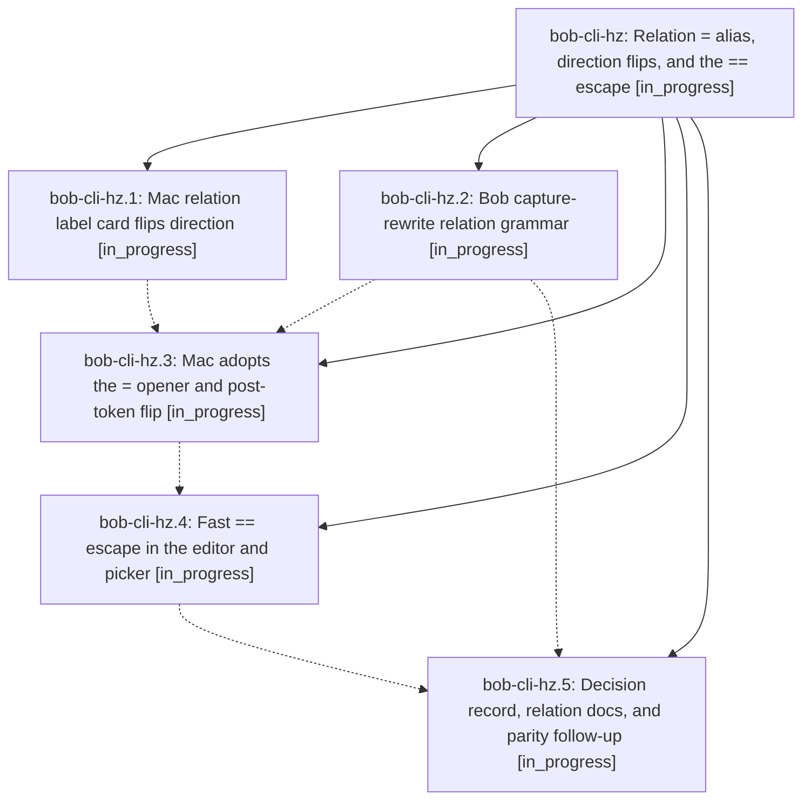

# Bead: bob-cli-hz — Relation = alias, direction flips, and the == escape

[Bead Pages](../README.md) / bob-cli-hz

**Status:** ◐ in_progress · **Type:** ▸ plan · **Tier:** epic
**Owner:** `bryanbugyi34@gmail.com` · **Created by:** [bbugyi200.athena.198](https://github.com/bobs-org/bob-cli--agents/blob/main/sessions/bbugyi200.athena.198.md) · **Assignee:** `bob-cli-hz.land`
**Created:** 2026-11-06 12:50:20 EST
**Plan:** [202611/relation\_equals\_alias\_and\_direction\_flips.md](https://github.com/bobs-org/bob-cli--plans/blob/main/202611/relation_equals_alias_and_direction_flips.md)

<!-- sase:links:start -->

## Links

| Relation | Artifact | Why |
| --- | --- | --- |
| implemented-by | [plan:202611/relation_equals_alias_and_direction_flips.md][1] | derived from the plan's `bead_id:` frontmatter field |

[1]: https://github.com/bobs-org/bob-cli--plans/blob/main/202611/relation_equals_alias_and_direction_flips.md

<!-- sase:links:end -->

## Description

In Bob Mac Capture, `=` is the only relation alias for `~`, and it opens Links To only where Bob's gate allows. A `~` or `=` glued to a complete `~note:id` / `~~note:id` flips its direction. The relation label card flips direction with `~` / `=` and re-asks Bob for the new direction. A fast `==` types one literal `=` on every surface where `=` stands for `~`. Bob stays the only grammar authority, and `bob capture` / `capture-parse` stay literal.

## Phases

| Bead | Title | Status | Size | Created | Agents | Commits |
|---|---|---|---|---|---:|---:|
| [bob-cli-hz.1](bob-cli-hz.1.md) | Mac relation label card flips direction | ◐ in_progress | medium | 2026-11-06 | 1 | 0 |
| [bob-cli-hz.2](bob-cli-hz.2.md) | Bob capture-rewrite relation grammar | ◐ in_progress | medium | 2026-11-06 | 1 | 1 |
| [bob-cli-hz.3](bob-cli-hz.3.md) | Mac adopts the = opener and post-token flip | ◐ in_progress | medium | 2026-11-06 | 1 | 0 |
| [bob-cli-hz.4](bob-cli-hz.4.md) | Fast == escape in the editor and picker | ◐ in_progress | medium | 2026-11-06 | 1 | 0 |
| [bob-cli-hz.5](bob-cli-hz.5.md) | Decision record, relation docs, and parity follow-up | ◐ in_progress | small | 2026-11-06 | 1 | 0 |

## Lineage

## Agents

| Agent | Bead | Commits |
|---|---|---:|
| [bbugyi200.athena.bob-cli-hz.1](https://github.com/bobs-org/bob-cli--agents/blob/main/sessions/bbugyi200.athena.bob-cli-hz.1.md) | [bob-cli-hz.1](bob-cli-hz.1.md) | 0 |
| [bbugyi200.athena.bob-cli-hz.2](https://github.com/bobs-org/bob-cli--agents/blob/main/sessions/bbugyi200.athena.bob-cli-hz.2.md) | [bob-cli-hz.2](bob-cli-hz.2.md) | 1 |
| [bbugyi200.athena.bob-cli-hz.3](https://github.com/bobs-org/bob-cli--agents/blob/main/agents/bbugyi200.athena.bob-cli-hz.3/README.md) | [bob-cli-hz.3](bob-cli-hz.3.md) | 0 |
| [bbugyi200.athena.bob-cli-hz.4](https://github.com/bobs-org/bob-cli--agents/blob/main/agents/bbugyi200.athena.bob-cli-hz.4/README.md) | [bob-cli-hz.4](bob-cli-hz.4.md) | 0 |
| [bbugyi200.athena.bob-cli-hz.5](https://github.com/bobs-org/bob-cli--agents/blob/main/agents/bbugyi200.athena.bob-cli-hz.5/README.md) | [bob-cli-hz.5](bob-cli-hz.5.md) | 0 |
| [bbugyi200.athena.bob-cli-hz.land](https://github.com/bobs-org/bob-cli--agents/blob/main/agents/bbugyi200.athena.bob-cli-hz.land/README.md) | [bob-cli-hz](README.md) | 0 |

## Commits

| Repo | Commit | Subject | Bead | Committed |
|---|---|---|---|---|
| bob-cli | [`0869f79`](https://github.com/bobs-org/bob-cli/commit/0869f7921a19b1e9b0e7e3bd6393f279d7d0567e) | feat(capture)!: rewrite relation directions | [bob-cli-hz.2](bob-cli-hz.2.md) | 2026-11-06 14:04:09 EST |
