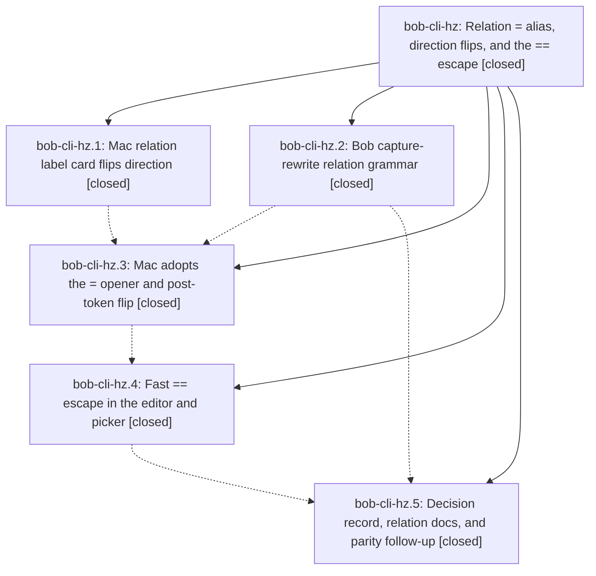

# Bead: bob-cli-hz — Relation = alias, direction flips, and the == escape

[Bead Pages](../README.md) / bob-cli-hz

**Status:** ✓ closed · **Resolution:** done · **Type:** ▸ plan · **Tier:** epic
**Owner:** `bryanbugyi34@gmail.com` · **Created by:** [bbugyi200.athena.198](https://github.com/bobs-org/bob-cli--agents/blob/main/sessions/bbugyi200.athena.198.md) · **Assignee:** `bob-cli-hz.land`
**Created:** 2026-11-06 12:50:20 EST · **Closed:** 2026-11-06 23:49:36 EST
**Plan:** [202611/relation\_equals\_alias\_and\_direction\_flips.md](https://github.com/bobs-org/bob-cli--plans/blob/main/202611/relation_equals_alias_and_direction_flips.md)

<!-- sase:links:start -->

## Links

| Relation | Artifact | Why |
| --- | --- | --- |
| implemented-by | [plan:202611/relation_equals_alias_and_direction_flips.md][1] | derived from the plan's `bead_id:` frontmatter field |

_Plus 1 automatic references — see [Referenced By](#referenced-by)._

[1]: https://github.com/bobs-org/bob-cli--plans/blob/main/202611/relation_equals_alias_and_direction_flips.md

<!-- sase:links:end -->

## Description

In Bob Mac Capture, `=` is the only relation alias for `~`, and it opens Links To only where Bob's gate allows. A `~` or `=` glued to a complete `~note:id` / `~~note:id` flips its direction. The relation label card flips direction with `~` / `=` and re-asks Bob for the new direction. A fast `==` types one literal `=` on every surface where `=` stands for `~`. Bob stays the only grammar authority, and `bob capture` / `capture-parse` stay literal.

## Notes

[2026-11-07T03:56:49Z · bob-cli-hz.land] LANDER FOLLOW-UP TRIAGE (bob-cli-hz.land): (1) hz.1 note #1 + hz.3 note #1, the 12 pre-existing bob-mac-capture macOS CI failures and 5s waitUntil flakes: semantic duplicate of bob-cli-h7 (the tracked 12-test baseline, red on master since before this epic: 11dcba7 run 42268256300), corroborated with sase bead +1 bob-cli-h7. (2) hz.5 note #1, Obsidian Task Card relation-label stage ~ flip parity: no existing bead; filed bob-cli-i9 (task(feature), medium, ready, related to bob-cli-bj). (3) hz.4 note #4, CLT-only mac cannot run swift test: declined. It is a known, documented environment limit (bob-mac-capture AGENTS.md: 'The Mac has only Command Line Tools, which ship no XCTest ... CI still runs the tests'), and Scripts/macos-ci-check (bob-cli-by) already gives Linux agents a precommit macOS gate. No new remediation is proposed.

[2026-11-07T03:59:10Z · bob-cli-hz.land] LANDER VERIFICATION (bob-cli-hz.land): bob-cli side complete. capture-rewrite matches every Bob contract row live; lib capture_language::tests::rewrite 66 passed; cli capture::rewrite 34 passed. Decision record and task-relations.md landed; post-epic docs commits e8b8ce73/2e3ccc90 already carry the new grammar into docs/reference/capture-syntax.md, and no later commit conflicts. Epic-symbols: none. REMAINING EPIC WORK: bob-mac-capture master 4fbbe84 macOS CI run 42323414005 fails 4 epic tests beyond the bob-cli-h7 baseline of 12. (a) CaptureEqualsGesture.isFastSecond accepts second<first. (b) testFastSecondEqualsUndoesOpenerAfterReply and testTripleEqualsGivesDoubleEquals: a fast = after the opener reply, with Links To open, is not consumed; undoEqualsGestureAndTypeLiteral refuses and leaves the arm set. This is a real contract break. (c) testLabeledRelationTildeFlipsAndEqualsStaysLiteral: the hz.3--4 record-wait race fix (green in snapshot run 42308430792) never reached master. Planned as a tale that also performs this epic's closeout.

[2026-11-07T04:49:36Z · bob-cli-hz.land--1] LANDER CLOSEOUT (bob-cli-hz.land): bob-cli side verified live: capture-rewrite matches every contract row (= opener, literal -, ~= / ~~= flips, toggle_relation_direction both ways, labelled ~ flips, labelled = stays literal, x=2-); lib capture_language::tests::rewrite 66 passed, cli capture::rewrite 34 passed. Four Mac fixes in 1e0a092: (1) isFastSecond requires second>=first, plus testEarlierSecondNeverQualifies; (2-3) shared equalsGestureUndoEligibility between routing and undo so fast = after opener reply with Links To open is consumed to Fix it = with picker dismissed and record cleared (root cause was editorInputLocked guard refusing while picker open, leaving arm set), plus sibling testTildeFlipFastEqualsAfterPickerRestoresTildeEquals; (4) re-applied dropped record race wait in testLabeledRelationTildeFlipsAndEqualsStaysLiteral. portable-check green twice, final: 2262 tests, 0 failures, 1 skipped. macos-ci-check: Lint green, Build green on snapshot run 42337610556 (snapshot 41b5e59 of 1e0a092 tree) and exact-SHA master run 42337582432 (1e0a092). Both runs: all hz suites green (EqualsAlias incl. new sibling, FlipAlias, Panel, EqualsGesture incl. new test) with only the 12 h7 baseline failures, plus one distinct singleton flake each that passes on the other run of the unchanged tree (snapshot: openAlias 10s waitUntil timeout, passes on master; master: testTypedCommaInCloseTaskList record-content race, passes on snapshot and all clean bases) — treated as flakes per plan step 5, h7-family waitUntil/record races, no new bead filed. Mac scratch typecheck skipped: mac offline per tailnet, macOS targets unverified beyond CI. Follow-ups per epic notes: h7 +1 done, i9 filed, CLT-only-mac proposal declined. epic-symbols clean, parent plan status done, just symvision has no recipe in bob-cli.

## Phases

| Bead | Title | Status | Size | Created | Agents | Commits |
|---|---|---|---|---|---:|---:|
| [bob-cli-hz.1](bob-cli-hz.1.md) | Mac relation label card flips direction | ✓ closed | medium | 2026-11-06 | 1 | 1 |
| [bob-cli-hz.2](bob-cli-hz.2.md) | Bob capture-rewrite relation grammar | ✓ closed | medium | 2026-11-06 | 1 | 1 |
| [bob-cli-hz.3](bob-cli-hz.3.md) | Mac adopts the = opener and post-token flip | ✓ closed | medium | 2026-11-06 | 1 | 2 |
| [bob-cli-hz.4](bob-cli-hz.4.md) | Fast == escape in the editor and picker | ✓ closed | medium | 2026-11-06 | 1 | 1 |
| [bob-cli-hz.5](bob-cli-hz.5.md) | Decision record, relation docs, and parity follow-up | ✓ closed | small | 2026-11-06 | 1 | 1 |

## Lineage

## Agents

| Agent | Bead | Commits |
|---|---|---:|
| [bbugyi200.athena.bob-cli-hz.1](https://github.com/bobs-org/bob-cli--agents/blob/main/sessions/bbugyi200.athena.bob-cli-hz.1.md) | [bob-cli-hz.1](bob-cli-hz.1.md) | 1 |
| [bbugyi200.athena.bob-cli-hz.2](https://github.com/bobs-org/bob-cli--agents/blob/main/sessions/bbugyi200.athena.bob-cli-hz.2.md) | [bob-cli-hz.2](bob-cli-hz.2.md) | 1 |
| [bbugyi200.athena.bob-cli-hz.3](https://github.com/bobs-org/bob-cli--agents/blob/main/sessions/bbugyi200.athena.bob-cli-hz.3.md) | [bob-cli-hz.3](bob-cli-hz.3.md) | 2 |
| [bbugyi200.athena.bob-cli-hz.4](https://github.com/bobs-org/bob-cli--agents/blob/main/sessions/bbugyi200.athena.bob-cli-hz.4.md) | [bob-cli-hz.4](bob-cli-hz.4.md) | 1 |
| [bbugyi200.athena.bob-cli-hz.5](https://github.com/bobs-org/bob-cli--agents/blob/main/agents/bbugyi200.athena.bob-cli-hz.5/README.md) | [bob-cli-hz.5](bob-cli-hz.5.md) | 1 |
| [bbugyi200.athena.bob-cli-hz.land](https://github.com/bobs-org/bob-cli--agents/blob/main/sessions/bbugyi200.athena.bob-cli-hz.land.md) | [bob-cli-hz](README.md) | 2 |

## Commits

| Repo | Commit | Subject | Bead | Committed |
|---|---|---|---|---|
| bob-cli | [`0869f79`](https://github.com/bobs-org/bob-cli/commit/0869f7921a19b1e9b0e7e3bd6393f279d7d0567e) | feat(capture)!: rewrite relation directions | [bob-cli-hz.2](bob-cli-hz.2.md) | 2026-11-06 14:04:09 EST |
| bob-mac-capture | [`bob-mac-capture@cbb50dc`](https://github.com/bobs-org/bob-mac-capture/commit/cbb50dc909f61f6ce4aacae86b394d11b43e02d2) | feat(capture): flip relation direction in the label card | [bob-cli-hz.1](bob-cli-hz.1.md) | 2026-11-06 14:15:29 EST |
| bob-mac-capture | [`bob-mac-capture@418604a`](https://github.com/bobs-org/bob-mac-capture/commit/418604a58a502ca6cadd8a7442eca0257901e66d) | feat(mac-capture)!: adopt = opener and post-token relation flips | [bob-cli-hz.3](bob-cli-hz.3.md) | 2026-11-06 17:04:07 EST |
| bob-cli--plans | [`bob-cli--plans@42f38ce`](https://github.com/bobs-org/bob-cli--plans/commit/42f38ce2198df5a0f0af799e04a4940904f8c5a4) | chore(plans): record successor card verdicts plan decisions | [bob-cli-hz.3](bob-cli-hz.3.md) | 2026-11-06 17:46:09 EST |
| bob-mac-capture | [`bob-mac-capture@4fbbe84`](https://github.com/bobs-org/bob-mac-capture/commit/4fbbe84c5ffb4e8d6d0a6934410cfe5533e69e9c) | feat(mac-capture): fast == escape in the editor and picker | [bob-cli-hz.4](bob-cli-hz.4.md) | 2026-11-06 20:19:10 EST |
| bob-cli | [`e9284fb`](https://github.com/bobs-org/bob-cli/commit/e9284fbf19621a5f30f1d9276ccc43aa1b30b983) | docs(records): relation = alias decision record and task-relations sentence | [bob-cli-hz.5](bob-cli-hz.5.md) | 2026-11-06 22:38:12 EST |
| bob-mac-capture | [`bob-mac-capture@1e0a092`](https://github.com/bobs-org/bob-mac-capture/commit/1e0a092441d0a2bc0a50fc5c42ec09fd7463ce89) | fix(mac-capture): repair fast == escape and record race (bob-cli-hz) | [bob-cli-hz](README.md) | 2026-11-06 23:14:43 EST |
| bob-cli--plans | [`bob-cli--plans@b1360a9`](https://github.com/bobs-org/bob-cli--plans/commit/b1360a9641b033470842156db6fabe0954b60469) | docs(plans): mark relation equals alias plan done (bob-cli-hz) | [bob-cli-hz](README.md) | 2026-11-06 23:56:33 EST |

<!-- sase:referenced-by:start -->

## Referenced By

| Relation | Artifact | Why | Uses |
| --- | --- | --- | ---: |
| read-by | [agent:bob-cli-hz.5][1] | Need parent epic context and plan | 1 |

[1]: https://github.com/bobs-org/bob-cli--agents/blob/main/agents/bbugyi200.athena.bob-cli-hz.5/README.md

<!-- sase:referenced-by:end -->
