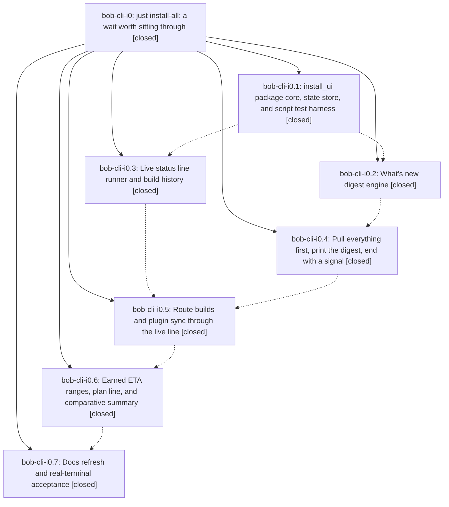

# Bead: bob-cli-i0 — just install-all: a wait worth sitting through

[Bead Pages](../README.md) / bob-cli-i0

**Status:** ✓ closed · **Resolution:** done · **Type:** ▸ plan · **Tier:** epic
**Owner:** `bryanbugyi34@gmail.com` · **Created by:** [bbugyi200.athena.199](https://github.com/bobs-org/bob-cli--agents/blob/main/sessions/bbugyi200.athena.199.md) · **Assignee:** `bob-cli-i0.land`
**Created:** 2026-11-06 15:11:24 EST · **Closed:** 2026-11-06 19:48:29 EST
**Plan:** [202611/install\_all\_wait\_and\_whats\_new.md](https://github.com/bobs-org/bob-cli--plans/blob/main/202611/install_all_wait_and_whats_new.md)

<!-- sase:links:start -->

## Links

| Relation | Artifact | Why |
| --- | --- | --- |
| implemented-by | [plan:202611/install_all_wait_and_whats_new.md][1] | derived from the plan's `bead_id:` frontmatter field |
| related | file:explicit:6a890c61c8d441a10ef03bd5 | attached via sase artifact create --bead |
| related | file:explicit:e490bba9ca8d65a7afe3cd32 | attached via sase artifact create --bead |

_Plus 1 automatic references — see [Referenced By](#referenced-by)._

[1]: https://github.com/bobs-org/bob-cli--plans/blob/main/202611/install_all_wait_and_whats_new.md

<!-- sase:links:end -->

## Description

`just install-all` (and plain `just install`) stop looking hung during their long bob-cli and Bob Mac Capture builds. All three repos are pulled first, then one fit-to-screen "What's new" digest shows the commits since each repo's last successful install on this host, with full messages when they fit. Each build then runs behind one live status line: activity, elapsed time, and an ETA that only per-host history of comparable builds can earn. Compiler chatter goes to a log, failures print an excerpt, and the run ends with a summary, a terminal bell, and on macOS a Notification Center banner. A missing or failing helper always falls back to today's behavior.

## Notes

[2026-11-06T23:10:32Z · bob-cli-i0.land] LANDING TRIAGE (bob-cli-i0.land): PROPOSED FOLLOW-UPs -> (a) bob-cli-i0.7 note #2 Mac acceptance: filed bob-cli-i6 (feature, small, ready). (b) bob-cli-i0.7 note #3 Mac build speed (R8): filed bob-cli-i7 (feature, large, ready). (c) plan docs-acceptance item 4c, never recorded by bob-cli-i0.7: filed bob-cli-i8 (feature, medium), snoozed to 2026-11-13 for a week of runs.jsonl history. Declined: bob-cli-i0.7 note #4 WORKSPACE NOTE (an accidental same-version just install into the default Cargo root) - informational, no action. No duplicates found by search or the 1-week sweep; no other active epic is causally related. REMAINING EPIC WORK found in verification (planned as a lander tale): (1) the cargo parser maps cargo install's opening 'Installing bob-obsidian vX (path)' line to the finish phase, so the forward-only phase clock records the whole build under finish and the label reads 'installing bob' (proof: /tmp/bob-cli-i0.7-state runs.jsonl and the i0.7 PTY attachment); 'Fetch [' progress frames and 'Replaced package' lines leak into scrollback; (2) runner/digest rows sit at column 0 instead of the plan's 2-space indent (Screens A-D); (3) the shim reruns the build when the started file is missing even after a successful runner exit, and post-spawn exceptions return 70 instead of the child's status; (4) the bob-cli summary duration includes sibling pulls and the digest; (5) the failure hint tells plain just install users to run install-all -v; (6) docs-acceptance item 1 not done (stale installed/synced sample rows, no escape-hatch table, no log/state locations) and the sandboxed install_all transcript was never attached. Integration: the only non-epic commits since the epic started (ae624e27, f1d8285e, e39e4576, upstream 17aae714) touch gmail/capture only; nothing needs to change.

[2026-11-07T00:15:14Z · bob-cli-i0.land--2] Landing PTY acceptance on athena: real-Cargo just install (cold; index 0.81s, deps 32.7s, crate 112.6s, finish 0.19s; phases updating crates.io index → compiling dependencies → compiling bob-obsidian → installing bob; hidden Fetch/Replaced/Installing chatter; ✓ built) and sandboxed scripts/install_all (header pull, digest of 5 commits, indented live line, summary, exit 0). Isolated temp HOME/CARGO_INSTALL_ROOT/CARGO_TARGET_DIR/XDG_STATE_HOME/BOB_INSTALL_STATE_DIR; real CARGO_HOME and RUSTUP_HOME; default Cargo root, ~/bob, and Obsidian untouched. 🔒 bob-cli-i0-just-install.pty.txt 🔒 bob-cli-i0-install-all.pty.txt

[2026-11-07T00:48:29Z · bob-cli-i0.land--4] Landing of bob-cli-i0: all seven phases were already closed; this tale verified them against the plan and integration-checked the non-epic commits (ae624e27, f1d8285e, e39e4576, and upstream 17aae714 — gmail/capture only; nothing outside install-all needed to change). Fixes: (1) Cargo opening `Installing <crate> v<ver> (<path>)` is chatter with no phase change; later `Installing <abs path>` / Replacing / Replaced / Installed map to finish; every `<Word> [` progress frame is chatter; index labels are fixed phrases (updating crates.io index, resolving dependencies, downloading crates, preparing build). (2) Runner live/final rows, digest headers/commits, and summary replay indent 2 spaces; excerpts/log/rerun rows indent 6. (3) Shim reruns the child only when the runner status is nonzero and not 130 and the started file is missing; `live.run` wraps post-spawn work, drains a live child on unexpected exceptions, and returns the child's status. (4) bob-cli summary duration starts at the BOB-CLI banner. (5) Failure hint names `just install` vs `just install-all`. (6) Rewrote docs/guides/install-everything.md (sample run, ETA phrases, escape hatches, log/state locations) and added the plugin-diff sentence in docs/plugins.md. Transcripts attached on this bead: real-Cargo just install PTY (cold on athena; index 0.81s, deps 32.7s, crate 112.6s, finish 0.19s; phases updating crates.io index → compiling dependencies n/m → compiling bob-obsidian → installing bob; hidden Fetch/Replaced/opening Installing; ✓ built) and sandboxed scripts/install_all PTY (header pull, 5-commit digest, indented live line, summary, exit 0); default Cargo root, ~/bob, and real Obsidian untouched. Follow-ups already recorded: bob-cli-i6 (Mac acceptance), bob-cli-i7 (Mac build speed), bob-cli-i8 (ETA gate tuning, snoozed); declined i0.7 workspace note. just check-scripts passed; just docs-check passed (447 passed, 1 skipped); just check initially failed on a minute-boundary flake in highlights::ingest::create_keeps_intake_for_flag_config_env_and_dry_run (captured: 19:24 vs 19:25); pinned BOB_NOW in create_command; just check passed (monitor wptbgd57ghd8). sase bead epic-symbols bob-cli-i0 listed no entries. just symvision is unavailable (no justfile recipe).

## Attachments

- 🔒 bob-cli-i0-install-all.pty.txt · text/plain · 75.1348 KiB (private attachment)
- 🔒 bob-cli-i0-just-install.pty.txt · text/plain · 109.832 KiB (private attachment)

## Phases

| Bead | Title | Status | Size | Created | Agents | Commits |
|---|---|---|---|---|---:|---:|
| [bob-cli-i0.1](bob-cli-i0.1.md) | install\_ui package core, state store, and script test harness | ✓ closed | medium | 2026-11-06 | 1 | 1 |
| [bob-cli-i0.2](bob-cli-i0.2.md) | What's new digest engine | ✓ closed | medium | 2026-11-06 | 1 | 1 |
| [bob-cli-i0.3](bob-cli-i0.3.md) | Live status line runner and build history | ✓ closed | medium | 2026-11-06 | 1 | 1 |
| [bob-cli-i0.4](bob-cli-i0.4.md) | Pull everything first, print the digest, end with a signal | ✓ closed | medium | 2026-11-06 | 1 | 1 |
| [bob-cli-i0.5](bob-cli-i0.5.md) | Route builds and plugin sync through the live line | ✓ closed | medium | 2026-11-06 | 1 | 1 |
| [bob-cli-i0.6](bob-cli-i0.6.md) | Earned ETA ranges, plan line, and comparative summary | ✓ closed | medium | 2026-11-06 | 1 | 1 |
| [bob-cli-i0.7](bob-cli-i0.7.md) | Docs refresh and real-terminal acceptance | ✓ closed | small | 2026-11-06 | 1 | 1 |

## Lineage

## Agents

| Agent | Bead | Commits |
|---|---|---:|
| [bbugyi200.athena.bob-cli-i0.1](https://github.com/bobs-org/bob-cli--agents/blob/main/agents/bbugyi200.athena.bob-cli-i0.1/README.md) | [bob-cli-i0.1](bob-cli-i0.1.md) | 1 |
| [bbugyi200.athena.bob-cli-i0.2](https://github.com/bobs-org/bob-cli--agents/blob/main/agents/bbugyi200.athena.bob-cli-i0.2/README.md) | [bob-cli-i0.2](bob-cli-i0.2.md) | 1 |
| [bbugyi200.athena.bob-cli-i0.3](https://github.com/bobs-org/bob-cli--agents/blob/main/agents/bbugyi200.athena.bob-cli-i0.3/README.md) | [bob-cli-i0.3](bob-cli-i0.3.md) | 1 |
| [bbugyi200.athena.bob-cli-i0.4](https://github.com/bobs-org/bob-cli--agents/blob/main/agents/bbugyi200.athena.bob-cli-i0.4/README.md) | [bob-cli-i0.4](bob-cli-i0.4.md) | 1 |
| [bbugyi200.athena.bob-cli-i0.5](https://github.com/bobs-org/bob-cli--agents/blob/main/agents/bbugyi200.athena.bob-cli-i0.5/README.md) | [bob-cli-i0.5](bob-cli-i0.5.md) | 1 |
| [bbugyi200.athena.bob-cli-i0.6](https://github.com/bobs-org/bob-cli--agents/blob/main/agents/bbugyi200.athena.bob-cli-i0.6/README.md) | [bob-cli-i0.6](bob-cli-i0.6.md) | 1 |
| [bbugyi200.athena.bob-cli-i0.7](https://github.com/bobs-org/bob-cli--agents/blob/main/agents/bbugyi200.athena.bob-cli-i0.7/README.md) | [bob-cli-i0.7](bob-cli-i0.7.md) | 1 |
| [bbugyi200.athena.bob-cli-i0.land](https://github.com/bobs-org/bob-cli--agents/blob/main/sessions/bbugyi200.athena.bob-cli-i0.land.md) | [bob-cli-i0](README.md) | 2 |

## Commits

| Repo | Commit | Subject | Bead | Committed |
|---|---|---|---|---|
| bob-cli | [`10be962`](https://github.com/bobs-org/bob-cli/commit/10be96258b86bdf3ad8bdc6cabd5ae34e71e7bf0) | feat(install): add install\_ui core, watermarks, and script tests | [bob-cli-i0.1](bob-cli-i0.1.md) | 2026-11-06 15:33:58 EST |
| bob-cli | [`4fd782a`](https://github.com/bobs-org/bob-cli/commit/4fd782a3c172e732244a7625b2c236bcbd1f3600) | feat(install): add What's new digest engine | [bob-cli-i0.2](bob-cli-i0.2.md) | 2026-11-06 15:56:29 EST |
| bob-cli | [`9ade2d6`](https://github.com/bobs-org/bob-cli/commit/9ade2d64ac64a5935512501890d550224f592940) | feat(install): pull everything first, print the digest, end with a signal | [bob-cli-i0.4](bob-cli-i0.4.md) | 2026-11-06 16:10:16 EST |
| bob-cli | [`d9b190f`](https://github.com/bobs-org/bob-cli/commit/d9b190f30a298bd89391cf35c01dd4051d1fe9a0) | feat(install): add live build runner and history | [bob-cli-i0.3](bob-cli-i0.3.md) | 2026-11-06 16:24:45 EST |
| bob-cli | [`d5e49b1`](https://github.com/bobs-org/bob-cli/commit/d5e49b172c9299ec6bbb60cc866aa29025e426f5) | feat(install): route builds through the live runner | [bob-cli-i0.5](bob-cli-i0.5.md) | 2026-11-06 17:02:10 EST |
| bob-cli | [`a3238f7`](https://github.com/bobs-org/bob-cli/commit/a3238f70b4582cedb6c2c7fe8f2859d077a783ee) | feat(install): earn ETA ranges, plan line, and summary comparison | [bob-cli-i0.6](bob-cli-i0.6.md) | 2026-11-06 17:28:43 EST |
| bob-cli | [`a435a8e`](https://github.com/bobs-org/bob-cli/commit/a435a8e134f0a92a99b3e4e45b8fa5ad6cbc763e) | docs(install): document live install flow | [bob-cli-i0.7](bob-cli-i0.7.md) | 2026-11-06 17:43:09 EST |
| bob-cli | [`d48e546`](https://github.com/bobs-org/bob-cli/commit/d48e54667d508080e7bd125627879bcde1cba3cf) | fix(install): land live UI phases, indent, and fallbacks | [bob-cli-i0](README.md) | 2026-11-06 19:37:43 EST |
| bob-cli--plans | [`bob-cli--plans@62fd696`](https://github.com/bobs-org/bob-cli--plans/commit/62fd696d824b1f0c36cd93b4790280127bb56fe6) | docs(plan): mark install-all epic bob-cli-i0 done | [bob-cli-i0](README.md) | 2026-11-06 19:49:34 EST |

<!-- sase:referenced-by:start -->

## Referenced By

| Relation | Artifact | Why | Uses |
| --- | --- | --- | ---: |
| read-by | [agent:bob-cli-i0.2][1] | Need epic scope for phase i0.2 | 1 |

[1]: https://github.com/bobs-org/bob-cli--agents/blob/main/agents/bbugyi200.athena.bob-cli-i0.2/README.md

<!-- sase:referenced-by:end -->
