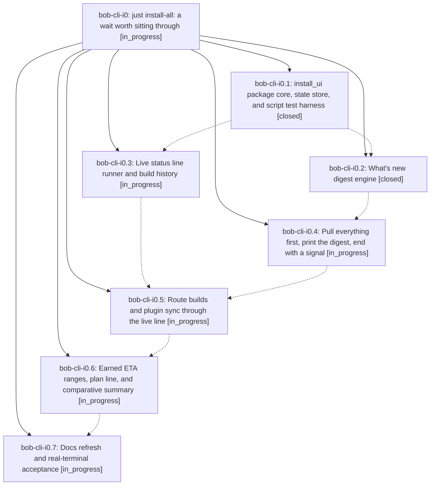

# Bead: bob-cli-i0 — just install-all: a wait worth sitting through

[Bead Pages](../README.md) / bob-cli-i0

**Status:** ◐ in_progress · **Type:** ▸ plan · **Tier:** epic
**Owner:** `bryanbugyi34@gmail.com` · **Created by:** [bbugyi200.athena.199](https://github.com/bobs-org/bob-cli--agents/blob/main/sessions/bbugyi200.athena.199.md) · **Assignee:** `bob-cli-i0.land`
**Created:** 2026-11-06 15:11:24 EST
**Plan:** [202611/install\_all\_wait\_and\_whats\_new.md](https://github.com/bobs-org/bob-cli--plans/blob/main/202611/install_all_wait_and_whats_new.md)

## Description

`just install-all` (and plain `just install`) stop looking hung during their long bob-cli and Bob Mac Capture builds. All three repos are pulled first, then one fit-to-screen "What's new" digest shows the commits since each repo's last successful install on this host, with full messages when they fit. Each build then runs behind one live status line: activity, elapsed time, and an ETA that only per-host history of comparable builds can earn. Compiler chatter goes to a log, failures print an excerpt, and the run ends with a summary, a terminal bell, and on macOS a Notification Center banner. A missing or failing helper always falls back to today's behavior.

## Phases

| Bead | Title | Status | Size | Created | Agents | Commits |
|---|---|---|---|---|---:|---:|
| [bob-cli-i0.1](bob-cli-i0.1.md) | install\_ui package core, state store, and script test harness | ✓ closed | medium | 2026-11-06 | 1 | 1 |
| [bob-cli-i0.2](bob-cli-i0.2.md) | What's new digest engine | ✓ closed | medium | 2026-11-06 | 1 | 1 |
| [bob-cli-i0.3](bob-cli-i0.3.md) | Live status line runner and build history | ◐ in_progress | medium | 2026-11-06 | 1 | 0 |
| [bob-cli-i0.4](bob-cli-i0.4.md) | Pull everything first, print the digest, end with a signal | ◐ in_progress | medium | 2026-11-06 | 1 | 0 |
| [bob-cli-i0.5](bob-cli-i0.5.md) | Route builds and plugin sync through the live line | ◐ in_progress | medium | 2026-11-06 | 1 | 0 |
| [bob-cli-i0.6](bob-cli-i0.6.md) | Earned ETA ranges, plan line, and comparative summary | ◐ in_progress | medium | 2026-11-06 | 1 | 0 |
| [bob-cli-i0.7](bob-cli-i0.7.md) | Docs refresh and real-terminal acceptance | ◐ in_progress | small | 2026-11-06 | 1 | 0 |

## Lineage

## Agents

| Agent | Bead | Commits |
|---|---|---:|
| [bbugyi200.athena.bob-cli-i0.1](https://github.com/bobs-org/bob-cli--agents/blob/main/agents/bbugyi200.athena.bob-cli-i0.1/README.md) | [bob-cli-i0.1](bob-cli-i0.1.md) | 1 |
| [bbugyi200.athena.bob-cli-i0.2](https://github.com/bobs-org/bob-cli--agents/blob/main/agents/bbugyi200.athena.bob-cli-i0.2/README.md) | [bob-cli-i0.2](bob-cli-i0.2.md) | 1 |
| [bbugyi200.athena.bob-cli-i0.3](https://github.com/bobs-org/bob-cli--agents/blob/main/agents/bbugyi200.athena.bob-cli-i0.3/README.md) | [bob-cli-i0.3](bob-cli-i0.3.md) | 0 |
| [bbugyi200.athena.bob-cli-i0.4](https://github.com/bobs-org/bob-cli--agents/blob/main/agents/bbugyi200.athena.bob-cli-i0.4/README.md) | [bob-cli-i0.4](bob-cli-i0.4.md) | 0 |
| [bbugyi200.athena.bob-cli-i0.5](https://github.com/bobs-org/bob-cli--agents/blob/main/agents/bbugyi200.athena.bob-cli-i0.5/README.md) | [bob-cli-i0.5](bob-cli-i0.5.md) | 0 |
| [bbugyi200.athena.bob-cli-i0.6](https://github.com/bobs-org/bob-cli--agents/blob/main/agents/bbugyi200.athena.bob-cli-i0.6/README.md) | [bob-cli-i0.6](bob-cli-i0.6.md) | 0 |
| [bbugyi200.athena.bob-cli-i0.7](https://github.com/bobs-org/bob-cli--agents/blob/main/agents/bbugyi200.athena.bob-cli-i0.7/README.md) | [bob-cli-i0.7](bob-cli-i0.7.md) | 0 |
| [bbugyi200.athena.bob-cli-i0.land](https://github.com/bobs-org/bob-cli--agents/blob/main/agents/bbugyi200.athena.bob-cli-i0.land/README.md) | [bob-cli-i0](README.md) | 0 |

## Commits

| Repo | Commit | Subject | Bead | Committed |
|---|---|---|---|---|
| bob-cli | [`10be962`](https://github.com/bobs-org/bob-cli/commit/10be96258b86bdf3ad8bdc6cabd5ae34e71e7bf0) | feat(install): add install\_ui core, watermarks, and script tests | [bob-cli-i0.1](bob-cli-i0.1.md) | 2026-11-06 15:33:58 EST |
| bob-cli | [`4fd782a`](https://github.com/bobs-org/bob-cli/commit/4fd782a3c172e732244a7625b2c236bcbd1f3600) | feat(install): add What's new digest engine | [bob-cli-i0.2](bob-cli-i0.2.md) | 2026-11-06 15:56:29 EST |
