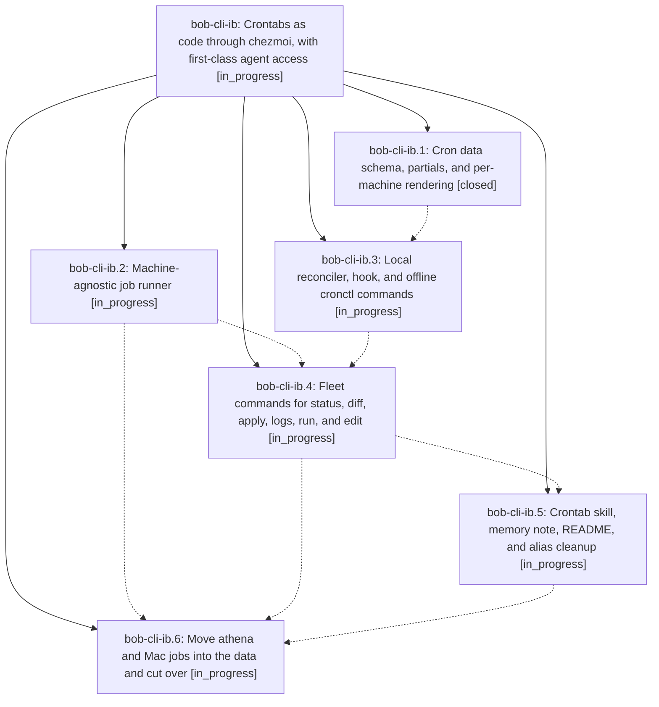

# Bead: bob-cli-ib — Crontabs as code through chezmoi, with first-class agent access

[Bead Pages](../README.md) / bob-cli-ib

**Status:** ◐ in_progress · **Type:** ▸ plan · **Tier:** epic
**Owner:** `bryanbugyi34@gmail.com` · **Created by:** [bbugyi200.athena.research.5w.linker.w1](https://github.com/bobs-org/bob-cli--agents/blob/main/sessions/bbugyi200.athena.research.5w.linker.w1.md) · **Assignee:** `bob-cli-ib.land`
**Created:** 2026-11-07 12:43:37 EST
**Plan:** [202611/crontab\_as\_code.md](https://github.com/bobs-org/bob-cli--plans/blob/main/202611/crontab_as_code.md)

## Description

One committed cron: block in the chezmoi repo is the single source of truth for every machine's user crontab; chezmoi update -a converges each machine's own marked block without touching other lines, and agents can read and write any machine's crontab from any machine through cronctl, a /crontab skill, and a global memory note.

## Phases

| Bead | Title | Status | Size | Created | Agents | Commits |
|---|---|---|---|---|---:|---:|
| [bob-cli-ib.1](bob-cli-ib.1.md) | Cron data schema, partials, and per-machine rendering | ✓ closed | medium | 2026-11-07 | 1 | 1 |
| [bob-cli-ib.2](bob-cli-ib.2.md) | Machine-agnostic job runner | ◐ in_progress | small | 2026-11-07 | 1 | 0 |
| [bob-cli-ib.3](bob-cli-ib.3.md) | Local reconciler, hook, and offline cronctl commands | ◐ in_progress | medium | 2026-11-07 | 1 | 0 |
| [bob-cli-ib.4](bob-cli-ib.4.md) | Fleet commands for status, diff, apply, logs, run, and edit | ◐ in_progress | medium | 2026-11-07 | 1 | 0 |
| [bob-cli-ib.5](bob-cli-ib.5.md) | Crontab skill, memory note, README, and alias cleanup | ◐ in_progress | small | 2026-11-07 | 1 | 0 |
| [bob-cli-ib.6](bob-cli-ib.6.md) | Move athena and Mac jobs into the data and cut over | ◐ in_progress | medium | 2026-11-07 | 1 | 0 |

## Lineage

## Agents

| Agent | Bead | Commits |
|---|---|---:|
| [bbugyi200.athena.bob-cli-ib.1](https://github.com/bobs-org/bob-cli--agents/blob/main/agents/bbugyi200.athena.bob-cli-ib.1/README.md) | [bob-cli-ib.1](bob-cli-ib.1.md) | 1 |
| [bbugyi200.athena.bob-cli-ib.2](https://github.com/bobs-org/bob-cli--agents/blob/main/agents/bbugyi200.athena.bob-cli-ib.2/README.md) | [bob-cli-ib.2](bob-cli-ib.2.md) | 0 |
| [bbugyi200.athena.bob-cli-ib.3](https://github.com/bobs-org/bob-cli--agents/blob/main/agents/bbugyi200.athena.bob-cli-ib.3/README.md) | [bob-cli-ib.3](bob-cli-ib.3.md) | 0 |
| [bbugyi200.athena.bob-cli-ib.4](https://github.com/bobs-org/bob-cli--agents/blob/main/agents/bbugyi200.athena.bob-cli-ib.4/README.md) | [bob-cli-ib.4](bob-cli-ib.4.md) | 0 |
| [bbugyi200.athena.bob-cli-ib.5](https://github.com/bobs-org/bob-cli--agents/blob/main/agents/bbugyi200.athena.bob-cli-ib.5/README.md) | [bob-cli-ib.5](bob-cli-ib.5.md) | 0 |
| [bbugyi200.athena.bob-cli-ib.6](https://github.com/bobs-org/bob-cli--agents/blob/main/agents/bbugyi200.athena.bob-cli-ib.6/README.md) | [bob-cli-ib.6](bob-cli-ib.6.md) | 0 |
| [bbugyi200.athena.bob-cli-ib.land](https://github.com/bobs-org/bob-cli--agents/blob/main/agents/bbugyi200.athena.bob-cli-ib.land/README.md) | [bob-cli-ib](README.md) | 0 |

## Commits

| Repo | Commit | Subject | Bead | Committed |
|---|---|---|---|---|
| chezmoi | [`chezmoi@d15ace3`](https://github.com/bbugyi200/dotfiles/commit/d15ace344c84b4d9c9bb8ab39a85305caf75f446) | feat(cron): add cron: data schema, validating partials, and per-machine crontab targets | [bob-cli-ib.1](bob-cli-ib.1.md) | 2026-11-07 13:04:28 EST |
