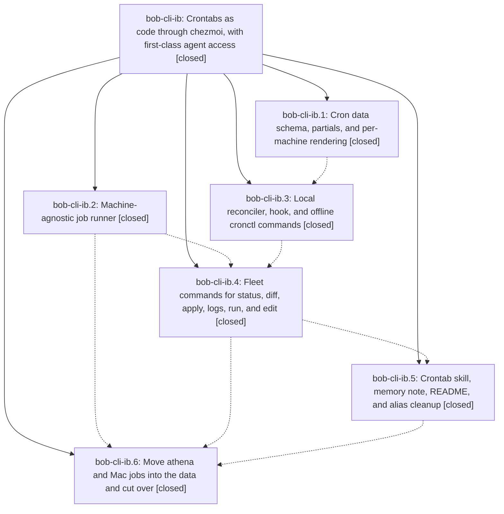

# Bead: bob-cli-ib — Crontabs as code through chezmoi, with first-class agent access

[Bead Pages](../README.md) / bob-cli-ib

**Status:** ✓ closed · **Resolution:** done · **Type:** ▸ plan · **Tier:** epic
**Owner:** `bryanbugyi34@gmail.com` · **Created by:** [bbugyi200.athena.research.5w.linker.w1](https://github.com/bobs-org/bob-cli--agents/blob/main/sessions/bbugyi200.athena.research.5w.linker.w1.md) · **Assignee:** `bob-cli-ib.land`
**Created:** 2026-11-07 12:43:37 EST · **Closed:** 2026-11-07 17:13:22 EST
**Plan:** [202611/crontab\_as\_code.md](https://github.com/bobs-org/bob-cli--plans/blob/main/202611/crontab_as_code.md)

<!-- sase:links:start -->

## Links

| Relation | Artifact | Why |
| --- | --- | --- |
| implemented-by | [plan:202611/crontab_as_code.md][1] | derived from the plan's `bead_id:` frontmatter field |

_Plus 8 automatic references — see [Referenced By](#referenced-by)._

[1]: https://github.com/bobs-org/bob-cli--plans/blob/main/202611/crontab_as_code.md

<!-- sase:links:end -->

## Description

One committed cron: block in the chezmoi repo is the single source of truth for every machine's user crontab; chezmoi update -a converges each machine's own marked block without touching other lines, and agents can read and write any machine's crontab from any machine through cronctl, a /crontab skill, and a global memory note.

## Notes

[2026-11-07T21:49:39Z · bob-cli-ib.land] LAND TRIAGE (bob-cli-ib land agent): outcomes for every PROPOSED FOLLOW-UP from the phase notes.
(1) chezmoi just test-nvim/test-hammerspoon busted.runner missing in non-interactive shells (ib.1 #1, ib.2 #2, ib.5 #1): filed as bob-cli-ie (bug, small). Reproduced at 6af21b40; not caused by the epic.
(2) poseidon_chezmoi_isolation_test 2 failures (ib.4 #2, ib.5 #2, ib.6 #5): filed as bob-cli-id (ci, small). chezmoi master CI has been red on every push since 9430387a (tailnet-h.1). The epic's cron suites pass in CI on the latest chezmoi.
(3) Delete cron.retire once status allows it (ib.6 #1): filed as bob-cli-if (small). It cannot happen yet: the post-commit 'cronctl apply mac' (monitor n7hy5x) failed with the expected macOS TCC 'Operation not permitted', so the Mac stays unmanaged with its 3 legacy lines until Bryan runs chezmoi update -a locally or grants Remote Login Full Disk Access.
(4) Upgrade athena chezmoi v2.13.1, then move data to .chezmoidata/cron.yaml (ib.6 #2): filed as bob-cli-ig (medium), linked as related to bob-cli-if.
(5) apollo duplicate ~/go/bin/chezmoi (ib.6 #3): filed as bob-cli-ih (xsmall). Verified: ~/bin v2.70.2 and ~/go/bin dev (Oct 18); asks Bryan before deleting.
(6) sase epic watchdog loses XDG_RUNTIME_DIR/DBUS after the env-line retirement (ib.6 #4): the code lives in the sase project and is causally tied to the live sase-1r2 watchdog, so it is recorded as a DISCOVERED ISSUE note on sase-1r2, not as a bob-cli task. The same-boot path still works.
INTEGRATION: closed bob-cli-30 (Mac crontab drift / ssh install) as superseded by this epic, with bob-cli-if tracking the Mac apply. Noted on bob-cli-5g that its Mac ref-jobs line must now be a cron: data job via /crontab. bob-cli docs/vault-git-sync.md: added the TCC/Full Disk Access caveat for 'cronctl apply mac', and pointed Nightly maintenance at the bob-nightly cron: job and cronctl logs.

[2026-11-07T22:12:02Z · bob-cli-ib.land] DISCOVERED ISSUE: cronctl status --all on 2026-11-07 (~17:15 EST) reports mac identity_mismatch, not unmanaged: the Mac's hostname (and .chezmoi.hostname) is currently Kellys-MBP, while cron.machines enrolls mac only as [Kellys-MacBook-Pro]. Root cause is the Mac's unset HostName, which makes its kernel hostname drift between Kellys-MBP and Kellys-MacBook-Pro.local; that is already tracked by task bob-cli-ew (+1 added with this cron impact). Until it is fixed, or both names are enrolled, the crontab hook renders empty on Kellys-MBP days, so bob-cli-if's local chezmoi update -a would not converge the Mac.

[2026-11-07T22:13:22Z · bob-cli-ib.land] THIS TALE (plan 202611/cronctl_lock_and_block_fixes.md, chezmoi home/bin/executable_cronctl):
- mkdir-lock spin fixed: every pass that does not take sync.lock.d returns or sleeps and counts toward CRONCTL_LOCK_TIMEOUT. A non-directory at the lock path returns 2 at once; a failed mkdir with nothing in the way (unwritable state dir) or a stale lock that will not move aside waits up to the timeout, then dies "cannot take the sync lock in ...". Live holders still exit 1.
- Liveness check narrowed to *cronctl* (both the hook and __apply run "$HOME/bin/cronctl" sync), so a recycled pid now owned by any bash is stale.
- Block emission normalised: cronctl_emit_lines writes the block line by line at both candidate sites, and sync works from a newline-terminated copy for the candidate, installed.block, and the line count. The hand-edit check compares by lines. status/diff/__apply already compared normalised copies.
- Fleet ssh adds -o ServerAliveInterval=10 -o ServerAliveCountMax=3, and the header comment is updated.
- Tests: 5 new cron_sync tests (file at the lock path, chmod 555 state dir, recycled bash pid, unterminated block on top and in place, each with a no-op second sync) plus a fleet ssh argv assertion. All 5 new sync tests failed against the old script: 2 spun until killed (rc 124), 1 waited out a recycled pid, and 2 merged the next line into the END marker.
- Results: the five cron suites passed 137/137 on chezmoi v2.13.1 and 137/137 on v2.74.0 (latest). On the Mac, /bin/bash 3.2.57 with chezmoi v2.52.1 passed cron_sync_test 39/39, and the perl-alarm test bound was verified with no timeout on PATH. shellcheck and shfmt -i 2 are clean on cronctl, and just lint exits 0. just test-bash passed 437/439; the 2 failures are poseidon_chezmoi_isolation_test (bob-cli-id). test-nvim and test-hammerspoon were not run (bob-cli-ie).
- cronctl status --all (checkout script, read-only): athena and apollo in_sync. mac reports identity_mismatch, not unmanaged, because its hostname drifted to Kellys-MBP, which is not enrolled. That was recorded as a +1 on bob-cli-ew plus a DISCOVERED ISSUE note here, and bob-cli-if is linked to it. The Mac's 3 retire lines are still live (bob-cli-if).

LAND AGENT VERIFICATION: all six phases' notes were addressed and the DECISIONS honored. cutover=retire is live: athena's 12 legacy lines were retired and the watchdog kept. mac_schedule=documented (:00/:05/:10 stagger with --retry-timeout 120). log_dir=state (~/.local/state/cron). crontab_memory_note and tailnet_memory_link both landed.
LIVE STATE AND TESTS: athena and apollo in_sync; mac pending its local apply (bob-cli-if). 132/132 cron tests passed on v2.13.1 before this tale. chezmoi CI's only failures are the poseidon tests (bob-cli-id).
INTEGRATION: bob-cli-30 closed as superseded. bob-cli-5g got a note to use the cron: data. bob-cli docs/vault-git-sync.md gained the TCC caveat and the nightly pointer.
FOLLOW-UP TRIAGE: bob-cli-id, bob-cli-ie, bob-cli-if, bob-cli-ig, and bob-cli-ih were filed, and the watchdog env issue was recorded on sase-1r2 (see the LAND TRIAGE note). bob-cli has no just symvision recipe, and epic-symbols lists no entries for bob-cli-ib.

## Phases

| Bead | Title | Status | Size | Created | Agents | Commits |
|---|---|---|---|---|---:|---:|
| [bob-cli-ib.1](bob-cli-ib.1.md) | Cron data schema, partials, and per-machine rendering | ✓ closed | medium | 2026-11-07 | 1 | 1 |
| [bob-cli-ib.2](bob-cli-ib.2.md) | Machine-agnostic job runner | ✓ closed | small | 2026-11-07 | 1 | 1 |
| [bob-cli-ib.3](bob-cli-ib.3.md) | Local reconciler, hook, and offline cronctl commands | ✓ closed | medium | 2026-11-07 | 1 | 1 |
| [bob-cli-ib.4](bob-cli-ib.4.md) | Fleet commands for status, diff, apply, logs, run, and edit | ✓ closed | medium | 2026-11-07 | 1 | 1 |
| [bob-cli-ib.5](bob-cli-ib.5.md) | Crontab skill, memory note, README, and alias cleanup | ✓ closed | small | 2026-11-07 | 1 | 1 |
| [bob-cli-ib.6](bob-cli-ib.6.md) | Move athena and Mac jobs into the data and cut over | ✓ closed | medium | 2026-11-07 | 1 | 2 |

## Lineage

## Agents

| Agent | Bead | Commits |
|---|---|---:|
| [bbugyi200.athena.bob-cli-ib.1](https://github.com/bobs-org/bob-cli--agents/blob/main/agents/bbugyi200.athena.bob-cli-ib.1/README.md) | [bob-cli-ib.1](bob-cli-ib.1.md) | 1 |
| [bbugyi200.athena.bob-cli-ib.2](https://github.com/bobs-org/bob-cli--agents/blob/main/agents/bbugyi200.athena.bob-cli-ib.2/README.md) | [bob-cli-ib.2](bob-cli-ib.2.md) | 1 |
| [bbugyi200.athena.bob-cli-ib.3](https://github.com/bobs-org/bob-cli--agents/blob/main/sessions/bbugyi200.athena.bob-cli-ib.3.md) | [bob-cli-ib.3](bob-cli-ib.3.md) | 1 |
| [bbugyi200.athena.bob-cli-ib.4](https://github.com/bobs-org/bob-cli--agents/blob/main/sessions/bbugyi200.athena.bob-cli-ib.4.md) | [bob-cli-ib.4](bob-cli-ib.4.md) | 1 |
| [bbugyi200.athena.bob-cli-ib.5](https://github.com/bobs-org/bob-cli--agents/blob/main/sessions/bbugyi200.athena.bob-cli-ib.5.md) | [bob-cli-ib.5](bob-cli-ib.5.md) | 1 |
| [bbugyi200.athena.bob-cli-ib.6](https://github.com/bobs-org/bob-cli--agents/blob/main/sessions/bbugyi200.athena.bob-cli-ib.6.md) | [bob-cli-ib.6](bob-cli-ib.6.md) | 2 |
| [bbugyi200.athena.bob-cli-ib.land](https://github.com/bobs-org/bob-cli--agents/blob/main/sessions/bbugyi200.athena.bob-cli-ib.land.md) | [bob-cli-ib](README.md) | 3 |

## Commits

| Repo | Commit | Subject | Bead | Committed |
|---|---|---|---|---|
| chezmoi | [`chezmoi@d15ace3`](https://github.com/bbugyi200/dotfiles/commit/d15ace344c84b4d9c9bb8ab39a85305caf75f446) | feat(cron): add cron: data schema, validating partials, and per-machine crontab targets | [bob-cli-ib.1](bob-cli-ib.1.md) | 2026-11-07 13:04:28 EST |
| chezmoi | [`chezmoi@a2c680b`](https://github.com/bbugyi200/dotfiles/commit/a2c680bce7eb4b912d8d58453fee858672df0310) | feat(cron): add cronrun, the machine-agnostic cron job runner | [bob-cli-ib.2](bob-cli-ib.2.md) | 2026-11-07 13:07:25 EST |
| chezmoi | [`chezmoi@0b8e738`](https://github.com/bbugyi200/dotfiles/commit/0b8e73884bdf1cc28d753e37fb74c3d04b26d389) | feat(cron): add cronctl list/render/check/sync and the crontab sync hook | [bob-cli-ib.3](bob-cli-ib.3.md) | 2026-11-07 14:01:55 EST |
| chezmoi | [`chezmoi@102e823`](https://github.com/bbugyi200/dotfiles/commit/102e8238aa24840afa0783d5d497e1bbbde4f66e) | feat(cron): add cronctl fleet commands status, diff, apply, logs, run, and edit | [bob-cli-ib.4](bob-cli-ib.4.md) | 2026-11-07 15:07:46 EST |
| chezmoi | [`chezmoi@16701bf`](https://github.com/bbugyi200/dotfiles/commit/16701bfa8745723d040a8b8f701c9631b8adea86) | feat(cron): add the /crontab skill, crontab memory note, and Crontabs README section | [bob-cli-ib.5](bob-cli-ib.5.md) | 2026-11-07 15:31:57 EST |
| bob-cli | [`591bde8`](https://github.com/bobs-org/bob-cli/commit/591bde8dc82b4aacc08ad511602434b57d29cb0b) | docs(cron): point Mac scheduled maintenance at the chezmoi cron: data | [bob-cli-ib.6](bob-cli-ib.6.md) | 2026-11-07 15:55:07 EST |
| chezmoi | [`chezmoi@6af21b4`](https://github.com/bbugyi200/dotfiles/commit/6af21b405fa1b0888f169c0908ef9c0340baf4a0) | feat(cron): migrate athena and Mac jobs into cron: data | [bob-cli-ib.6](bob-cli-ib.6.md) | 2026-11-07 15:55:32 EST |
| bob-cli | [`b73ac38`](https://github.com/bobs-org/bob-cli/commit/b73ac383c239a1f058742050f84b70c94e6c5732) | docs(cron): note the Mac SSH install caveat and the bob-nightly cron job | [bob-cli-ib](README.md) | 2026-11-07 16:53:26 EST |
| chezmoi | [`chezmoi@ceeef45`](https://github.com/bbugyi200/dotfiles/commit/ceeef451c08bed54dac69d91ae01aaab18cb5c15) | fix(cron): bound cronctl's mkdir sync lock and normalise block emission | [bob-cli-ib](README.md) | 2026-11-07 17:14:51 EST |
| bob-cli--plans | [`bob-cli--plans@a6e7a9e`](https://github.com/bobs-org/bob-cli--plans/commit/a6e7a9ec0c0ec03ba49fe7d3afc2b9321e1478d7) | chore(plans): mark the crontab\_as\_code epic done | [bob-cli-ib](README.md) | 2026-11-07 17:15:14 EST |

<!-- sase:referenced-by:start -->

## Referenced By

| Relation | Artifact | Why | Uses |
| --- | --- | --- | ---: |
| read-by | [agent:bob-cli-ib.1][1] | Need epic context and notes | 1 |
| read-by | [agent:bob-cli-ib.land][2] | Need the epic scope, children, and linked plan file | 1 |
| read-by | [agent:research.3m.cdx][3] | Understand the in-progress declarative crontab epic before recommending Gmail scheduling | 1 |
| read-by | [agent:research.3m.cld][4] | Understand the in-progress crontab-as-code epic so the gmail sync research can recommend a cron entry | 1 |
| read-by | [agent:research.3m.final][5] | Verify crontab epic status and deferred reply-detection bead for gmail sync consolidated research | 1 |
| read-by | [agent:research.3m.gem][6] | Review context on crontab config and gmail sync | 1 |
| read-by | [agent:research.3m.grk][7] | Need the in-progress crontab-as-code epic for where to schedule gmail sync | 1 |
| read-by | [agent:research.3m.mus][8] | research gmail sync crontab context | 1 |

[1]: https://github.com/bobs-org/bob-cli--agents/blob/main/agents/bbugyi200.athena.bob-cli-ib.1/README.md
[2]: https://github.com/bobs-org/bob-cli--agents/blob/main/sessions/bbugyi200.athena.bob-cli-ib.land.md
[3]: https://github.com/bobs-org/bob-cli--agents/blob/main/agents/bbugyi200.athena.research.3m.cdx/README.md
[4]: https://github.com/bobs-org/bob-cli--agents/blob/main/agents/bbugyi200.athena.research.3m.cld/README.md
[5]: https://github.com/bobs-org/bob-cli--agents/blob/main/agents/bbugyi200.athena.research.3m.final/README.md
[6]: https://github.com/bobs-org/bob-cli--agents/blob/main/agents/bbugyi200.athena.research.3m.gem/README.md
[7]: https://github.com/bobs-org/bob-cli--agents/blob/main/agents/bbugyi200.athena.research.3m.grk/README.md
[8]: https://github.com/bobs-org/bob-cli--agents/blob/main/agents/bbugyi200.athena.research.3m.mus/README.md

<!-- sase:referenced-by:end -->
