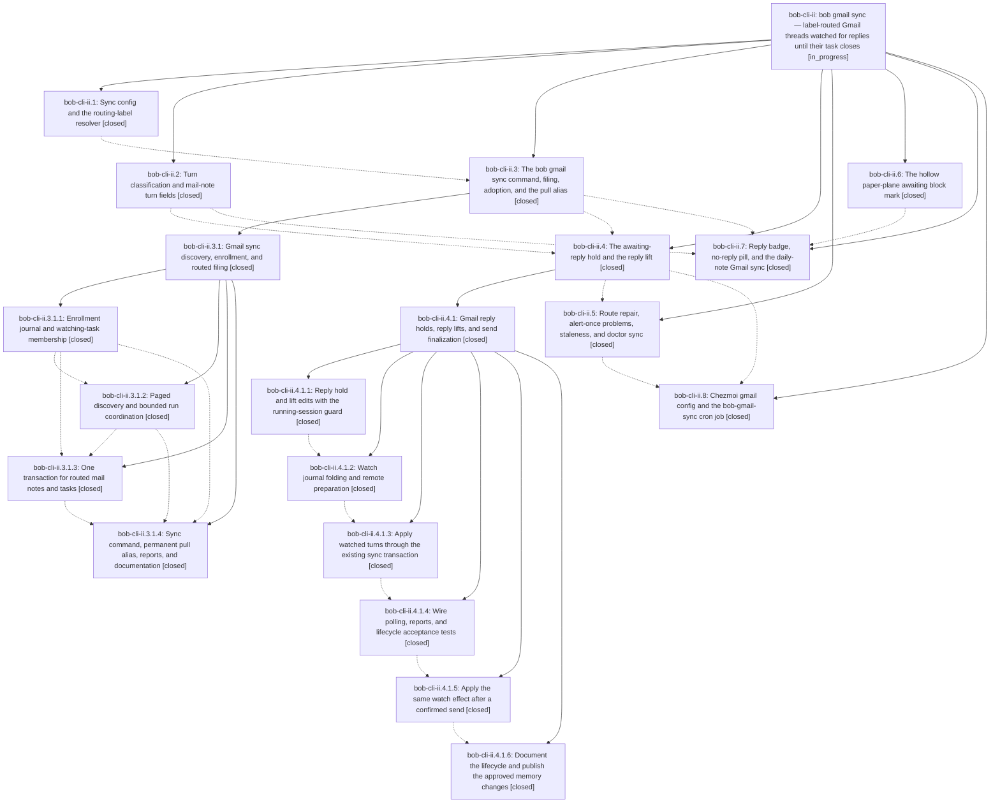

# Bead: bob-cli-ii — bob gmail sync — label-routed Gmail threads watched for replies until their task closes

[Bead Pages](../README.md) / bob-cli-ii

**Status:** ◐ in_progress · **Type:** ▸ plan · **Tier:** epic
**Owner:** `bryanbugyi34@gmail.com` · **Created by:** [bbugyi200.athena.19q](https://github.com/bobs-org/bob-cli--agents/blob/main/sessions/bbugyi200.athena.19q.md) · **Assignee:** `bob-cli-ii.land`
**Created:** 2026-11-07 17:21:21 EST
**Plan:** [202611/gmail\_sync\_reply\_watch.md](https://github.com/bobs-org/bob-cli--plans/blob/main/202611/gmail_sync_reply_watch.md)

<!-- sase:links:start -->

## Links

| Relation | Artifact | Why |
| --- | --- | --- |
| implemented-by | [plan:202611/gmail_sync_reply_watch.md][1] | derived from the plan's `bead_id:` frontmatter field |

_Plus 5 automatic references — see [Referenced By](#referenced-by)._

[1]: https://github.com/bobs-org/bob-cli--plans/blob/main/202611/gmail_sync_reply_watch.md

<!-- sase:links:end -->

## Description

Labelling a Gmail thread `bob` (plus an optional `#/<note>` or `+/<note>` routing label) files one task into that area or project note and keeps watching the thread until the task is closed: your reply puts the task on an awaiting-reply hold drawn as a hollow paper plane, their reply lifts it and resurfaces the task in the next review, and `bob gmail sync` runs every 15 minutes on the Mac from the chezmoi cron data.

## Notes

[2026-11-08T13:45:18Z · bryanbugyi34@gmail.com] The 202611/gmail_sync_threads_list.md plan in the plans repo may describe a related fix, which has already likely been applied. The epic lander agent should ensure this was the right fix if it really was related.

[2026-11-08T21:42:11Z · bob-cli-ii.4.1.land] DISCOVERED ISSUE: native::gmail::sync::guard::tests::real_lock_contention_and_release flakes (panics 'release frees the guard' at src/native/gmail/sync/guard.rs:206). Proposed by bob-cli-ii.4.1.2; triaged by the bob-cli-ii.4.1 land agent. Introduced by 39122cb2 (bob-cli-ii.3.1.2). Reproduced on the pre-watch base 23217c1d: 3 of 6 'cargo test --lib gmail::' runs failed; also failed 2 of 2 full lib runs on b252669b, and passes alone. Likely mechanism matches closed bob-cli-3t (fixed only for ob.rs by 57a29004): try_acquire uses flock try_lock_exclusive, and a concurrent test thread's fork can briefly inherit the guard fd until exec, so the immediate re-acquire after drop sees WouldBlock. Suggested fix: make the post-drop re-acquire retry within a short bounded window, as 57a29004 did, without weakening the Busy assertion. Not caused by ii.4.1.

## Phases

| Bead | Title | Status | Size | Created | Agents | Commits |
|---|---|---|---|---|---:|---:|
| [bob-cli-ii.1](bob-cli-ii.1.md) | Sync config and the routing-label resolver | ✓ closed | medium | 2026-11-07 | 1 | 1 |
| [bob-cli-ii.2](bob-cli-ii.2.md) | Turn classification and mail-note turn fields | ✓ closed | medium | 2026-11-07 | 1 | 1 |
| [bob-cli-ii.3](bob-cli-ii.3.md) | The bob gmail sync command, filing, adoption, and the pull alias | ✓ closed | large | 2026-11-07 | 1 | 0 |
| [bob-cli-ii.4](bob-cli-ii.4.md) | The awaiting-reply hold and the reply lift | ✓ closed | large | 2026-11-07 | 1 | 0 |
| [bob-cli-ii.5](bob-cli-ii.5.md) | Route repair, alert-once problems, staleness, and doctor sync | ✓ closed | medium | 2026-11-07 | 1 | 1 |
| [bob-cli-ii.6](bob-cli-ii.6.md) | The hollow paper-plane awaiting block mark | ✓ closed | medium | 2026-11-07 | 1 | 1 |
| [bob-cli-ii.7](bob-cli-ii.7.md) | Reply badge, no-reply pill, and the daily-note Gmail sync | ✓ closed | medium | 2026-11-07 | 1 | 1 |
| [bob-cli-ii.8](bob-cli-ii.8.md) | Chezmoi gmail config and the bob-gmail-sync cron job | ✓ closed | small | 2026-11-07 | 1 | 2 |

## Lineage

## Agents

| Agent | Bead | Commits |
|---|---|---:|
| [bbugyi200.athena.bob-cli-ii.1](https://github.com/bobs-org/bob-cli--agents/blob/main/agents/bbugyi200.athena.bob-cli-ii.1/README.md) | [bob-cli-ii.1](bob-cli-ii.1.md) | 1 |
| [bbugyi200.athena.bob-cli-ii.2](https://github.com/bobs-org/bob-cli--agents/blob/main/agents/bbugyi200.athena.bob-cli-ii.2/README.md) | [bob-cli-ii.2](bob-cli-ii.2.md) | 1 |
| [bbugyi200.athena.bob-cli-ii.3](https://github.com/bobs-org/bob-cli--agents/blob/main/sessions/bbugyi200.athena.bob-cli-ii.3.md) | [bob-cli-ii.3](bob-cli-ii.3.md) | 0 |
| [bbugyi200.athena.bob-cli-ii.3.1.1](https://github.com/bobs-org/bob-cli--agents/blob/main/agents/bbugyi200.athena.bob-cli-ii.3.1.1/README.md) | [bob-cli-ii.3.1.1](bob-cli-ii.3.1.1.md) | 1 |
| [bbugyi200.athena.bob-cli-ii.3.1.2](https://github.com/bobs-org/bob-cli--agents/blob/main/sessions/bbugyi200.athena.bob-cli-ii.3.1.2.md) | [bob-cli-ii.3.1.2](bob-cli-ii.3.1.2.md) | 1 |
| [bbugyi200.athena.bob-cli-ii.3.1.3](https://github.com/bobs-org/bob-cli--agents/blob/main/agents/bbugyi200.athena.bob-cli-ii.3.1.3/README.md) | [bob-cli-ii.3.1.3](bob-cli-ii.3.1.3.md) | 1 |
| [bbugyi200.athena.bob-cli-ii.3.1.4](https://github.com/bobs-org/bob-cli--agents/blob/main/agents/bbugyi200.athena.bob-cli-ii.3.1.4/README.md) | [bob-cli-ii.3.1.4](bob-cli-ii.3.1.4.md) | 1 |
| [bbugyi200.athena.bob-cli-ii.3.1.land](https://github.com/bobs-org/bob-cli--agents/blob/main/sessions/bbugyi200.athena.bob-cli-ii.3.1.land.md) | [bob-cli-ii.3.1](bob-cli-ii.3.1.md) | 1 |
| [bbugyi200.athena.bob-cli-ii.4](https://github.com/bobs-org/bob-cli--agents/blob/main/sessions/bbugyi200.athena.bob-cli-ii.4.md) | [bob-cli-ii.4](bob-cli-ii.4.md) | 0 |
| [bbugyi200.athena.bob-cli-ii.4.1.1](https://github.com/bobs-org/bob-cli--agents/blob/main/agents/bbugyi200.athena.bob-cli-ii.4.1.1/README.md) | [bob-cli-ii.4.1.1](bob-cli-ii.4.1.1.md) | 1 |
| [bbugyi200.athena.bob-cli-ii.4.1.2](https://github.com/bobs-org/bob-cli--agents/blob/main/agents/bbugyi200.athena.bob-cli-ii.4.1.2/README.md) | [bob-cli-ii.4.1.2](bob-cli-ii.4.1.2.md) | 1 |
| [bbugyi200.athena.bob-cli-ii.4.1.3](https://github.com/bobs-org/bob-cli--agents/blob/main/agents/bbugyi200.athena.bob-cli-ii.4.1.3/README.md) | [bob-cli-ii.4.1.3](bob-cli-ii.4.1.3.md) | 1 |
| [bbugyi200.athena.bob-cli-ii.4.1.4](https://github.com/bobs-org/bob-cli--agents/blob/main/agents/bbugyi200.athena.bob-cli-ii.4.1.4/README.md) | [bob-cli-ii.4.1.4](bob-cli-ii.4.1.4.md) | 1 |
| [bbugyi200.athena.bob-cli-ii.4.1.5](https://github.com/bobs-org/bob-cli--agents/blob/main/agents/bbugyi200.athena.bob-cli-ii.4.1.5/README.md) | [bob-cli-ii.4.1.5](bob-cli-ii.4.1.5.md) | 1 |
| [bbugyi200.athena.bob-cli-ii.4.1.6](https://github.com/bobs-org/bob-cli--agents/blob/main/agents/bbugyi200.athena.bob-cli-ii.4.1.6/README.md) | [bob-cli-ii.4.1.6](bob-cli-ii.4.1.6.md) | 1 |
| [bbugyi200.athena.bob-cli-ii.4.1.land](https://github.com/bobs-org/bob-cli--agents/blob/main/sessions/bbugyi200.athena.bob-cli-ii.4.1.land.md) | [bob-cli-ii.4.1](bob-cli-ii.4.1.md) | 3 |
| [bbugyi200.athena.bob-cli-ii.5](https://github.com/bobs-org/bob-cli--agents/blob/main/sessions/bbugyi200.athena.bob-cli-ii.5.md) | [bob-cli-ii.5](bob-cli-ii.5.md) | 1 |
| [bbugyi200.athena.bob-cli-ii.6](https://github.com/bobs-org/bob-cli--agents/blob/main/agents/bbugyi200.athena.bob-cli-ii.6/README.md) | [bob-cli-ii.6](bob-cli-ii.6.md) | 1 |
| [bbugyi200.athena.bob-cli-ii.7](https://github.com/bobs-org/bob-cli--agents/blob/main/agents/bbugyi200.athena.bob-cli-ii.7/README.md) | [bob-cli-ii.7](bob-cli-ii.7.md) | 1 |
| [bbugyi200.athena.bob-cli-ii.8](https://github.com/bobs-org/bob-cli--agents/blob/main/sessions/bbugyi200.athena.bob-cli-ii.8.md) | [bob-cli-ii.8](bob-cli-ii.8.md) | 2 |
| [bbugyi200.athena.bob-cli-ii.land](https://github.com/bobs-org/bob-cli--agents/blob/main/agents/bbugyi200.athena.bob-cli-ii.land/README.md) | [bob-cli-ii](README.md) | 0 |

## Commits

| Repo | Commit | Subject | Bead | Committed |
|---|---|---|---|---|
| bob-cli | [`539b71d`](https://github.com/bobs-org/bob-cli/commit/539b71dce39ac19e958f028c833e8f4ccdb5b481) | docs(blocked-marks): specify the hollow paper-plane awaiting mark | [bob-cli-ii.6](bob-cli-ii.6.md) | 2026-11-07 17:54:32 EST |
| bob-cli | [`6b17476`](https://github.com/bobs-org/bob-cli/commit/6b1747638b0d346189c17f934665ecfffcd88a92) | feat(gmail): add sync routing config, label resolver, and doctor routes row | [bob-cli-ii.1](bob-cli-ii.1.md) | 2026-11-07 18:00:13 EST |
| bob-cli | [`4734146`](https://github.com/bobs-org/bob-cli/commit/47341462a6d15a6c6074c1eba45d00eeaee2f7b2) | feat(gmail): record whose turn a thread is in on mail notes | [bob-cli-ii.2](bob-cli-ii.2.md) | 2026-11-07 18:19:09 EST |
| bob-cli | [`343b4d8`](https://github.com/bobs-org/bob-cli/commit/343b4d8ff7e0be48e41a0dc980d2e8be815c3677) | feat(gmail): add sync enrollment fold, watching-task scan, and adoption decisions | [bob-cli-ii.3.1.1](bob-cli-ii.3.1.1.md) | 2026-11-07 18:49:30 EST |
| bob-cli | [`39122cb`](https://github.com/bobs-org/bob-cli/commit/39122cb23010bb464047bcc586eacc5baf514f71) | feat(gmail): add sync discovery, guard, and retry helpers | [bob-cli-ii.3.1.2](bob-cli-ii.3.1.2.md) | 2026-11-07 20:09:20 EST |
| bob-cli | [`d5c61ee`](https://github.com/bobs-org/bob-cli/commit/d5c61ee57a94003f88b37799e5fa5d1869f63efd) | feat(gmail): stage routed sync filings in one vault transaction | [bob-cli-ii.3.1.3](bob-cli-ii.3.1.3.md) | 2026-11-07 21:05:40 EST |
| bob-cli | [`5df6b9d`](https://github.com/bobs-org/bob-cli/commit/5df6b9d5267e59087bd41a5b37fa1a210eb5dda6) | feat(gmail)!: file labelled threads by routing label as bob gmail sync | [bob-cli-ii.3.1.4](bob-cli-ii.3.1.4.md) | 2026-11-07 22:07:38 EST |
| bob-cli | [`f904135`](https://github.com/bobs-org/bob-cli/commit/f9041354c191eb8bb781abc000821675f9bb7cdb) | fix(gmail): repair sync landing gaps for filing, coordination, reports, and recovery | [bob-cli-ii.3.1](bob-cli-ii.3.1.md) | 2026-11-07 23:18:09 EST |
| bob-cli | [`126958b`](https://github.com/bobs-org/bob-cli/commit/126958b2f5ff0a3bb05d0ad6ebb75b6e02f0d4c5) | docs(mail): add reply-badge and no-reply-pill display contracts | [bob-cli-ii.7](bob-cli-ii.7.md) | 2026-11-08 12:30:03 EST |
| bob-cli | [`b4147b0`](https://github.com/bobs-org/bob-cli/commit/b4147b0bad1a91560490269a58b8bf3646addab9) | feat(gmail)!: reply hold/lift line rules with running-session guard | [bob-cli-ii.4.1.1](bob-cli-ii.4.1.1.md) | 2026-11-08 12:32:46 EST |
| bob-cli | [`86af3d5`](https://github.com/bobs-org/bob-cli/commit/86af3d5ebd91dca623891e62cd6cdf9b44b3ba0b) | feat(gmail): add watch journal and preparation planning | [bob-cli-ii.4.1.2](bob-cli-ii.4.1.2.md) | 2026-11-08 13:26:57 EST |
| bob-cli | [`9e0bcdd`](https://github.com/bobs-org/bob-cli/commit/9e0bcdd81aa8f39b4d0559df440a839e38fd582d) | feat(gmail): apply watched turns through sync transaction | [bob-cli-ii.4.1.3](bob-cli-ii.4.1.3.md) | 2026-11-08 14:10:31 EST |
| bob-cli | [`457153f`](https://github.com/bobs-org/bob-cli/commit/457153f0b1cd7574c02b68c26b9a206f402d10e1) | feat(gmail): wire reply watch polling into sync | [bob-cli-ii.4.1.4](bob-cli-ii.4.1.4.md) | 2026-11-08 15:00:55 EST |
| bob-cli | [`5a63e9a`](https://github.com/bobs-org/bob-cli/commit/5a63e9a2ccc4f4376da6c54df0ed07a01caa9660) | feat(gmail): apply reply-watch effects after a confirmed send | [bob-cli-ii.4.1.5](bob-cli-ii.4.1.5.md) | 2026-11-08 15:42:13 EST |
| bob-cli | [`b252669`](https://github.com/bobs-org/bob-cli/commit/b252669b866bff0711483caa8bfd98708626788e) | docs(gmail): publish reply-watch contracts and tagged-hold decision | [bob-cli-ii.4.1.6](bob-cli-ii.4.1.6.md) | 2026-11-08 15:56:57 EST |
| bob-cli | [`25c0223`](https://github.com/bobs-org/bob-cli/commit/25c02232a5820c6625c8cf99f2e2eabeace421eb) | fix(gmail): clear reply-watch lint and stale dead-code allowances | [bob-cli-ii.4.1](bob-cli-ii.4.1.md) | 2026-11-08 16:45:30 EST |
| bob-cli | [`5ef6612`](https://github.com/bobs-org/bob-cli/commit/5ef66125d29191aaaef087bde986528967202740) | fix(gmail): preserve watched targets across shifted lines | [bob-cli-ii.4.1](bob-cli-ii.4.1.md) | 2026-11-08 17:43:54 EST |
| bob-cli--plans | [`bob-cli--plans@695d4da`](https://github.com/bobs-org/bob-cli--plans/commit/695d4da9bb803f7a833825100432e5a4d9b1f5ae) | docs(plans): mark Gmail reply watch plan complete | [bob-cli-ii.4.1](bob-cli-ii.4.1.md) | 2026-11-08 17:44:23 EST |
| bob-cli | [`8427bd9`](https://github.com/bobs-org/bob-cli/commit/8427bd96dbab8470c2e4228d8f199265b690ab50) | feat(gmail): refile resolved inbox routes and alarm stale skips | [bob-cli-ii.5](bob-cli-ii.5.md) | 2026-11-08 18:47:14 EST |
| bob-cli | [`ad2298d`](https://github.com/bobs-org/bob-cli/commit/ad2298d44d9810beb721db6085a1a92dfa361795) | docs(vault-sync): document mac bob-gmail-sync maintenance slot | [bob-cli-ii.8](bob-cli-ii.8.md) | 2026-11-08 18:59:07 EST |
| chezmoi | [`chezmoi@d227de1`](https://github.com/bbugyi200/dotfiles/commit/d227de13589dfeb6696846dd9541917cfff6f49e) | feat(gmail): add disabled mac bob-gmail-sync cron slot and config | [bob-cli-ii.8](bob-cli-ii.8.md) | 2026-11-08 18:59:39 EST |

<!-- sase:referenced-by:start -->

## Referenced By

| Relation | Artifact | Why | Uses |
| --- | --- | --- | ---: |
| read-by | [agent:bob-cli-ii.1][1] | Need epic notes and phase status | 2 |
| read-by | [agent:bob-cli-ii.2][2] | Need epic phases and notes | 1 |
| read-by | [agent:bob-cli-ii.4.1.land--1][3] | Confirm the ancestor epic remains open and inspect its child relationship | 4 |
| read-by | [agent:bob-cli-ii.6][4] | Need epic context and sibling phase status | 1 |
| read-by | [agent:bob-cli-in.land--1][5] | Confirm outer epic remains open for its waiting land agent | 1 |

[1]: https://github.com/bobs-org/bob-cli--agents/blob/main/agents/bbugyi200.athena.bob-cli-ii.1/README.md
[2]: https://github.com/bobs-org/bob-cli--agents/blob/main/agents/bbugyi200.athena.bob-cli-ii.2/README.md
[3]: https://github.com/bobs-org/bob-cli--agents/blob/main/sessions/bbugyi200.athena.bob-cli-ii.4.1.land.md
[4]: https://github.com/bobs-org/bob-cli--agents/blob/main/agents/bbugyi200.athena.bob-cli-ii.6/README.md
[5]: https://github.com/bobs-org/bob-cli--agents/blob/main/sessions/bbugyi200.athena.bob-cli-in.land.md

<!-- sase:referenced-by:end -->
