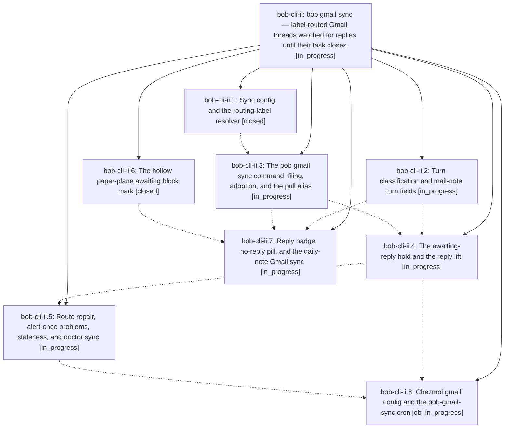

# Bead: bob-cli-ii — bob gmail sync — label-routed Gmail threads watched for replies until their task closes

[Bead Pages](../README.md) / bob-cli-ii

**Status:** ◐ in_progress · **Type:** ▸ plan · **Tier:** epic
**Owner:** `bryanbugyi34@gmail.com` · **Created by:** [bbugyi200.athena.19q](https://github.com/bobs-org/bob-cli--agents/blob/main/sessions/bbugyi200.athena.19q.md) · **Assignee:** `bob-cli-ii.land`
**Created:** 2026-11-07 17:21:21 EST
**Plan:** [202611/gmail\_sync\_reply\_watch.md](https://github.com/bobs-org/bob-cli--plans/blob/main/202611/gmail_sync_reply_watch.md)

<!-- sase:links:start -->

## Links

| Relation | Artifact | Why |
| --- | --- | --- |
| implemented-by | [plan:202611/gmail_sync_reply_watch.md][1] | derived from the plan's `bead_id:` frontmatter field |

_Plus 1 automatic references — see [Referenced By](#referenced-by)._

[1]: https://github.com/bobs-org/bob-cli--plans/blob/main/202611/gmail_sync_reply_watch.md

<!-- sase:links:end -->

## Description

Labelling a Gmail thread `bob` (plus an optional `#/<note>` or `+/<note>` routing label) files one task into that area or project note and keeps watching the thread until the task is closed: your reply puts the task on an awaiting-reply hold drawn as a hollow paper plane, their reply lifts it and resurfaces the task in the next review, and `bob gmail sync` runs every 15 minutes on the Mac from the chezmoi cron data.

## Phases

| Bead | Title | Status | Size | Created | Agents | Commits |
|---|---|---|---|---|---:|---:|
| [bob-cli-ii.1](bob-cli-ii.1.md) | Sync config and the routing-label resolver | ✓ closed | medium | 2026-11-07 | 1 | 1 |
| [bob-cli-ii.2](bob-cli-ii.2.md) | Turn classification and mail-note turn fields | ◐ in_progress | medium | 2026-11-07 | 1 | 0 |
| [bob-cli-ii.3](bob-cli-ii.3.md) | The bob gmail sync command, filing, adoption, and the pull alias | ◐ in_progress | large | 2026-11-07 | 1 | 0 |
| [bob-cli-ii.4](bob-cli-ii.4.md) | The awaiting-reply hold and the reply lift | ◐ in_progress | large | 2026-11-07 | 1 | 0 |
| [bob-cli-ii.5](bob-cli-ii.5.md) | Route repair, alert-once problems, staleness, and doctor sync | ◐ in_progress | medium | 2026-11-07 | 1 | 0 |
| [bob-cli-ii.6](bob-cli-ii.6.md) | The hollow paper-plane awaiting block mark | ✓ closed | medium | 2026-11-07 | 1 | 1 |
| [bob-cli-ii.7](bob-cli-ii.7.md) | Reply badge, no-reply pill, and the daily-note Gmail sync | ◐ in_progress | medium | 2026-11-07 | 1 | 0 |
| [bob-cli-ii.8](bob-cli-ii.8.md) | Chezmoi gmail config and the bob-gmail-sync cron job | ◐ in_progress | small | 2026-11-07 | 1 | 0 |

## Lineage

## Agents

| Agent | Bead | Commits |
|---|---|---:|
| [bbugyi200.athena.bob-cli-ii.1](https://github.com/bobs-org/bob-cli--agents/blob/main/agents/bbugyi200.athena.bob-cli-ii.1/README.md) | [bob-cli-ii.1](bob-cli-ii.1.md) | 1 |
| [bbugyi200.athena.bob-cli-ii.2](https://github.com/bobs-org/bob-cli--agents/blob/main/agents/bbugyi200.athena.bob-cli-ii.2/README.md) | [bob-cli-ii.2](bob-cli-ii.2.md) | 0 |
| [bbugyi200.athena.bob-cli-ii.3](https://github.com/bobs-org/bob-cli--agents/blob/main/agents/bbugyi200.athena.bob-cli-ii.3/README.md) | [bob-cli-ii.3](bob-cli-ii.3.md) | 0 |
| [bbugyi200.athena.bob-cli-ii.4](https://github.com/bobs-org/bob-cli--agents/blob/main/agents/bbugyi200.athena.bob-cli-ii.4/README.md) | [bob-cli-ii.4](bob-cli-ii.4.md) | 0 |
| [bbugyi200.athena.bob-cli-ii.5](https://github.com/bobs-org/bob-cli--agents/blob/main/agents/bbugyi200.athena.bob-cli-ii.5/README.md) | [bob-cli-ii.5](bob-cli-ii.5.md) | 0 |
| [bbugyi200.athena.bob-cli-ii.6](https://github.com/bobs-org/bob-cli--agents/blob/main/agents/bbugyi200.athena.bob-cli-ii.6/README.md) | [bob-cli-ii.6](bob-cli-ii.6.md) | 1 |
| [bbugyi200.athena.bob-cli-ii.7](https://github.com/bobs-org/bob-cli--agents/blob/main/agents/bbugyi200.athena.bob-cli-ii.7/README.md) | [bob-cli-ii.7](bob-cli-ii.7.md) | 0 |
| [bbugyi200.athena.bob-cli-ii.8](https://github.com/bobs-org/bob-cli--agents/blob/main/agents/bbugyi200.athena.bob-cli-ii.8/README.md) | [bob-cli-ii.8](bob-cli-ii.8.md) | 0 |
| [bbugyi200.athena.bob-cli-ii.land](https://github.com/bobs-org/bob-cli--agents/blob/main/agents/bbugyi200.athena.bob-cli-ii.land/README.md) | [bob-cli-ii](README.md) | 0 |

## Commits

| Repo | Commit | Subject | Bead | Committed |
|---|---|---|---|---|
| bob-cli | [`539b71d`](https://github.com/bobs-org/bob-cli/commit/539b71dce39ac19e958f028c833e8f4ccdb5b481) | docs(blocked-marks): specify the hollow paper-plane awaiting mark | [bob-cli-ii.6](bob-cli-ii.6.md) | 2026-11-07 17:54:32 EST |
| bob-cli | [`6b17476`](https://github.com/bobs-org/bob-cli/commit/6b1747638b0d346189c17f934665ecfffcd88a92) | feat(gmail): add sync routing config, label resolver, and doctor routes row | [bob-cli-ii.1](bob-cli-ii.1.md) | 2026-11-07 18:00:13 EST |

<!-- sase:referenced-by:start -->

## Referenced By

| Relation | Artifact | Why | Uses |
| --- | --- | --- | ---: |
| read-by | [agent:bob-cli-ii.6][1] | Need epic context and sibling phase status | 1 |

[1]: https://github.com/bobs-org/bob-cli--agents/blob/main/agents/bbugyi200.athena.bob-cli-ii.6/README.md

<!-- sase:referenced-by:end -->
