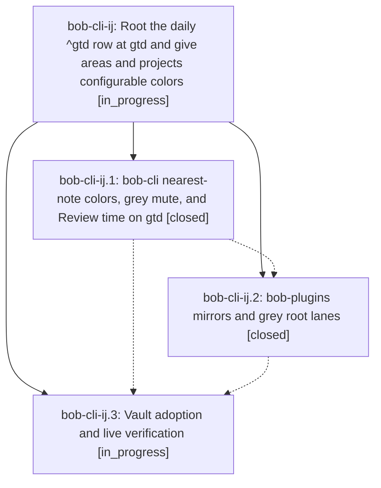

# Bead: bob-cli-ij — Root the daily ^gtd row at gtd and give areas and projects configurable colors

[Bead Pages](../README.md) / bob-cli-ij

**Status:** ◐ in_progress · **Type:** ▸ plan · **Tier:** epic
**Owner:** `bryanbugyi34@gmail.com` · **Created by:** [bbugyi200.athena.19s](https://github.com/bobs-org/bob-cli--agents/blob/main/sessions/bbugyi200.athena.19s.md) · **Assignee:** `bob-cli-ij.land`
**Created:** 2026-11-07 17:26:27 EST
**Plan:** [202611/gtd\_root\_and\_area\_colors.md](https://github.com/bobs-org/bob-cli--plans/blob/main/202611/gtd_root_and_area_colors.md)

<!-- sase:links:start -->

## Links

| Relation | Artifact | Why |
| --- | --- | --- |
| implemented-by | [plan:202611/gtd_root_and_area_colors.md][1] | derived from the plan's `bead_id:` frontmatter field |

_Plus 1 automatic references — see [Referenced By](#referenced-by)._

[1]: https://github.com/bobs-org/bob-cli--plans/blob/main/202611/gtd_root_and_area_colors.md

<!-- sase:links:end -->

## Description

New daily notes root their ^gtd row at gtd.md and the built-in Review time keeps counting that time. Any area or project note can set its own color with a `color:` slot, either a palette hue or grey, and every Bob surface honors it, so the gtd area renders grey like the PLAN type in the Day and period stats strips.

## Phases

| Bead | Title | Status | Size | Created | Agents | Commits |
|---|---|---|---|---|---:|---:|
| [bob-cli-ij.1](bob-cli-ij.1.md) | bob-cli nearest-note colors, grey mute, and Review time on gtd | ✓ closed | medium | 2026-11-07 | 1 | 1 |
| [bob-cli-ij.2](bob-cli-ij.2.md) | bob-plugins mirrors and grey root lanes | ✓ closed | medium | 2026-11-07 | 1 | 1 |
| [bob-cli-ij.3](bob-cli-ij.3.md) | Vault adoption and live verification | ◐ in_progress | small | 2026-11-07 | 1 | 0 |

## Lineage

## Agents

| Agent | Bead | Commits |
|---|---|---:|
| [bbugyi200.athena.bob-cli-ij.1](https://github.com/bobs-org/bob-cli--agents/blob/main/agents/bbugyi200.athena.bob-cli-ij.1/README.md) | [bob-cli-ij.1](bob-cli-ij.1.md) | 1 |
| [bbugyi200.athena.bob-cli-ij.2](https://github.com/bobs-org/bob-cli--agents/blob/main/agents/bbugyi200.athena.bob-cli-ij.2/README.md) | [bob-cli-ij.2](bob-cli-ij.2.md) | 1 |
| [bbugyi200.athena.bob-cli-ij.3](https://github.com/bobs-org/bob-cli--agents/blob/main/agents/bbugyi200.athena.bob-cli-ij.3/README.md) | [bob-cli-ij.3](bob-cli-ij.3.md) | 0 |
| [bbugyi200.athena.bob-cli-ij.land](https://github.com/bobs-org/bob-cli--agents/blob/main/agents/bbugyi200.athena.bob-cli-ij.land/README.md) | [bob-cli-ij](README.md) | 0 |

## Commits

| Repo | Commit | Subject | Bead | Committed |
|---|---|---|---|---|
| bob-cli | [`d1b645d`](https://github.com/bobs-org/bob-cli/commit/d1b645d1c703927016be7edfe43bd7b61de9c5fd) | feat(homes): resolve hues from the nearest area or project color slot, add grey mute, and root review\_time at gtd | [bob-cli-ij.1](bob-cli-ij.1.md) | 2026-11-07 18:10:53 EST |
| bob-plugins | [`bob-plugins@59df267`](https://github.com/bobs-org/bob-plugins/commit/59df26757cecfcec89bd3c4f07eeed0b2114e912) | feat(ledger-tools): mirror nearest-note area/project colors and keep grey roots gray | [bob-cli-ij.2](bob-cli-ij.2.md) | 2026-11-07 18:34:27 EST |

<!-- sase:referenced-by:start -->

## Referenced By

| Relation | Artifact | Why | Uses |
| --- | --- | --- | ---: |
| read-by | [agent:bob-cli-ij.1][1] | Need epic notes and context | 1 |

[1]: https://github.com/bobs-org/bob-cli--agents/blob/main/agents/bbugyi200.athena.bob-cli-ij.1/README.md

<!-- sase:referenced-by:end -->
