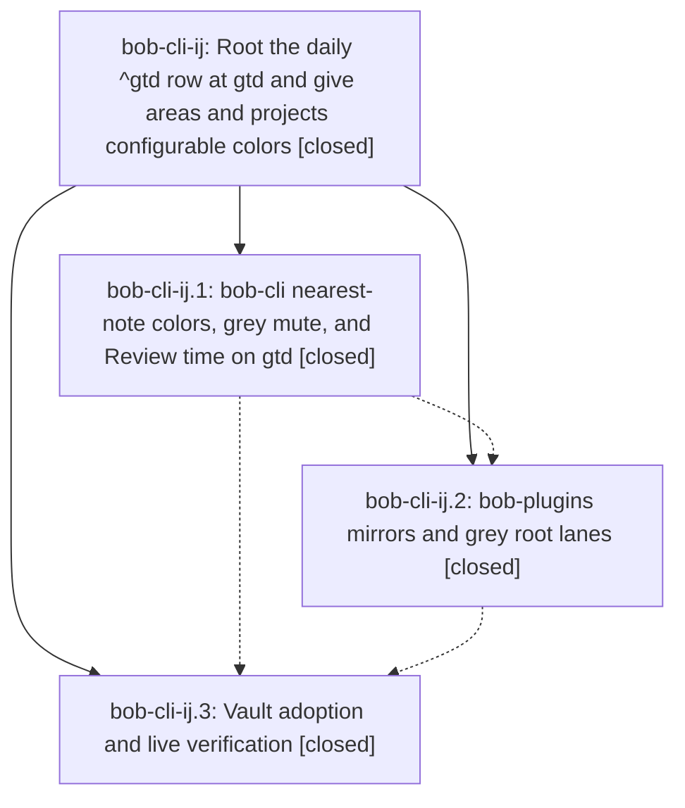

# Bead: bob-cli-ij — Root the daily ^gtd row at gtd and give areas and projects configurable colors

[Bead Pages](../README.md) / bob-cli-ij

**Status:** ✓ closed · **Resolution:** done · **Type:** ▸ plan · **Tier:** epic
**Owner:** `bryanbugyi34@gmail.com` · **Created by:** [bbugyi200.athena.19s](https://github.com/bobs-org/bob-cli--agents/blob/main/sessions/bbugyi200.athena.19s.md) · **Assignee:** `bob-cli-ij.land`
**Created:** 2026-11-07 17:26:27 EST · **Closed:** 2026-11-07 19:04:32 EST
**Plan:** [202611/gtd\_root\_and\_area\_colors.md](https://github.com/bobs-org/bob-cli--plans/blob/main/202611/gtd_root_and_area_colors.md)

<!-- sase:links:start -->

## Links

| Relation | Artifact | Why |
| --- | --- | --- |
| implemented-by | [plan:202611/gtd_root_and_area_colors.md][1] | derived from the plan's `bead_id:` frontmatter field |

_Plus 2 automatic references — see [Referenced By](#referenced-by)._

[1]: https://github.com/bobs-org/bob-cli--plans/blob/main/202611/gtd_root_and_area_colors.md

<!-- sase:links:end -->

## Description

New daily notes root their ^gtd row at gtd.md and the built-in Review time keeps counting that time. Any area or project note can set its own color with a `color:` slot, either a palette hue or grey, and every Bob surface honors it, so the gtd area renders grey like the PLAN type in the Day and period stats strips.

## Notes

[2026-11-07T23:59:10Z · bob-cli-ij.land] FOLLOW-UP TRIAGE: bob-cli-ij.2 note #1 accepted as bob-cli-il (feature, small, ready): restore editing headroom in bob-plugins docs/bob-ledger-tools.md. Independently measured 6000 words before this epic versus 5999 after with bob_docs.markdown.count_words; evidence file:explicit:1c8217323da9a411f1ee5770. It predates this epic, which reduced the count. Same-type/all-type searches, last-week sweeps, and active-epic scope review found no duplicate or causal epic; related Mac-page budget tasks h9/bh linked for context. No other PROPOSED FOLLOW-UP entries exist on ij.1/.2/.3. The vault-phase visual-check caveat is not a blocked acceptance item: the approved plan explicitly leaves Mac/Apollo updates to their usual path and asks for live JSON checks plus an expected-appearance summary.

[2026-11-08T00:04:32Z · bob-cli-ij.land] LAND VERIFIED: Reviewed the approved plan, the epic notes, every note on ij.1/.2/.3, source and tests, bob-cli d1b645d1, bob-plugins 59df267, and vault commits 42a1933d0/8bbc4f10d. Decisions honored: history=all (all 143 daily ^gtd rows plus template now root at gtd), gtd_link=no (all visible gtd_daily links retained), only glossary:root-parent changed, no decisions record added. Verified nearest area/project palette or grey colors, invalid-value inheritance/lints, root-own hues, additive stats hue_source, grey type hues/cache v2, and review_time rooted at gtd. All three shared-vector copies match byte-for-byte. Independently verified vault diffs contain only approved substitutions, no old roots remain, live gtd catalog is null/muted, no area_color_invalid, review_time=463m/7d and 1742m/30d, PLAN stays exempt-muted; deployed plugin matches the committed bundle. Integration audit through fetched bob-cli 343b4d8f and bob-plugins 59df267 included concurrent 539b71dc/6b174763/47341462/343b4d8f and plugin 9dd2888: Gmail routing, metadata, enrollment, and awaiting marks neither duplicate nor bypass color/home resolution; shared docs and generated plugin remain coherent; no integration edits needed. just check passed (ToolRun de56547ba70ae13a459ee5e738cef77e); 165 focused plugin tests, build:check, and validate (9/9) passed. No check-full run. Follow-up: ij.2 note #1 accepted as ready small feature bob-cli-il, with measured pre-existing 6000->5999-word budget evidence and related h9/bh links; no other proposals or declined proposals. Mac/Apollo rollout remains the explicitly approved normal update path; expected appearance is grey gtd in root lanes matching PLAN grey in type lanes. epic-symbols returned no entries; this repo has no symvision recipe. All descendants are closed; no remaining epic work.

## Phases

| Bead | Title | Status | Size | Created | Agents | Commits |
|---|---|---|---|---|---:|---:|
| [bob-cli-ij.1](bob-cli-ij.1.md) | bob-cli nearest-note colors, grey mute, and Review time on gtd | ✓ closed | medium | 2026-11-07 | 1 | 1 |
| [bob-cli-ij.2](bob-cli-ij.2.md) | bob-plugins mirrors and grey root lanes | ✓ closed | medium | 2026-11-07 | 1 | 1 |
| [bob-cli-ij.3](bob-cli-ij.3.md) | Vault adoption and live verification | ✓ closed | small | 2026-11-07 | 1 | 0 |

## Lineage

## Agents

| Agent | Bead | Commits |
|---|---|---:|
| [bbugyi200.athena.bob-cli-ij.1](https://github.com/bobs-org/bob-cli--agents/blob/main/agents/bbugyi200.athena.bob-cli-ij.1/README.md) | [bob-cli-ij.1](bob-cli-ij.1.md) | 1 |
| [bbugyi200.athena.bob-cli-ij.2](https://github.com/bobs-org/bob-cli--agents/blob/main/agents/bbugyi200.athena.bob-cli-ij.2/README.md) | [bob-cli-ij.2](bob-cli-ij.2.md) | 1 |
| [bbugyi200.athena.bob-cli-ij.3](https://github.com/bobs-org/bob-cli--agents/blob/main/agents/bbugyi200.athena.bob-cli-ij.3/README.md) | [bob-cli-ij.3](bob-cli-ij.3.md) | 0 |
| [bbugyi200.athena.bob-cli-ij.land](https://github.com/bobs-org/bob-cli--agents/blob/main/agents/bbugyi200.athena.bob-cli-ij.land/README.md) | [bob-cli-ij](README.md) | 1 |

## Commits

| Repo | Commit | Subject | Bead | Committed |
|---|---|---|---|---|
| bob-cli | [`d1b645d`](https://github.com/bobs-org/bob-cli/commit/d1b645d1c703927016be7edfe43bd7b61de9c5fd) | feat(homes): resolve hues from the nearest area or project color slot, add grey mute, and root review\_time at gtd | [bob-cli-ij.1](bob-cli-ij.1.md) | 2026-11-07 18:10:53 EST |
| bob-plugins | [`bob-plugins@59df267`](https://github.com/bobs-org/bob-plugins/commit/59df26757cecfcec89bd3c4f07eeed0b2114e912) | feat(ledger-tools): mirror nearest-note area/project colors and keep grey roots gray | [bob-cli-ij.2](bob-cli-ij.2.md) | 2026-11-07 18:34:27 EST |
| bob-cli--plans | [`bob-cli--plans@6a95d8b`](https://github.com/bobs-org/bob-cli--plans/commit/6a95d8be627072190d585e9cab82c36d30edbe88) | docs(plan): mark gtd root and area colors epic done | [bob-cli-ij](README.md) | 2026-11-07 19:05:26 EST |

<!-- sase:referenced-by:start -->

## Referenced By

| Relation | Artifact | Why | Uses |
| --- | --- | --- | ---: |
| read-by | [agent:bob-cli-ij.1][1] | Need epic notes and context | 1 |
| read-by | [agent:bob-cli-ij.2][2] | Need epic notes/context | 1 |

[1]: https://github.com/bobs-org/bob-cli--agents/blob/main/agents/bbugyi200.athena.bob-cli-ij.1/README.md
[2]: https://github.com/bobs-org/bob-cli--agents/blob/main/agents/bbugyi200.athena.bob-cli-ij.2/README.md

<!-- sase:referenced-by:end -->
