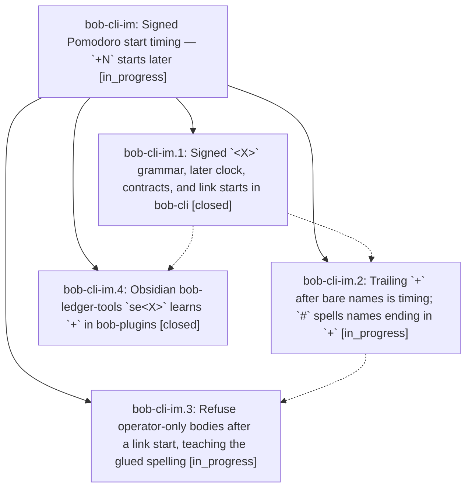

# Bead: bob-cli-im — Signed Pomodoro start timing — \`+N\` starts later

[Bead Pages](../README.md) / bob-cli-im

**Status:** ◐ in_progress · **Type:** ▸ plan · **Tier:** epic
**Owner:** `bryanbugyi34@gmail.com` · **Created by:** [bbugyi200.athena.research.5x.linker.w0](https://github.com/bobs-org/bob-cli--agents/blob/main/sessions/bbugyi200.athena.research.5x.linker.w0.md) · **Assignee:** `bob-cli-im.land`
**Created:** 2026-11-08 05:50:21 EST
**Plan:** [202611/start\_timing\_later\_offset.md](https://github.com/bobs-org/bob-cli--plans/blob/main/202611/start_timing_later_offset.md)

<!-- sase:links:start -->

## Links

| Relation | Artifact | Why |
| --- | --- | --- |
| implemented-by | [plan:202611/start_timing_later_offset.md][1] | derived from the plan's `bead_id:` frontmatter field |

[1]: https://github.com/bobs-org/bob-cli--plans/blob/main/202611/start_timing_later_offset.md

<!-- sase:links:end -->

## Description

Inside a start's `<X>`, `-` starts earlier and `+` starts later (a lone sign is one five-minute unit), so `=fix2+` writes exactly what `=fix2 ++` writes, `@foo:bar=+3` links and starts a task 15 minutes later in one item, `x=` stays a past-only record with teaching refusals, and Obsidian `se<X>` keeps byte-for-byte parity.

## Phases

| Bead | Title | Status | Size | Created | Agents | Commits |
|---|---|---|---|---|---:|---:|
| [bob-cli-im.1](bob-cli-im.1.md) | Signed \`\<X\>\` grammar, later clock, contracts, and link starts in bob-cli | ✓ closed | medium | 2026-11-08 | 1 | 1 |
| [bob-cli-im.2](bob-cli-im.2.md) | Trailing \`+\` after bare names is timing; \`#\` spells names ending in \`+\` | ◐ in_progress | medium | 2026-11-08 | 1 | 0 |
| [bob-cli-im.3](bob-cli-im.3.md) | Refuse operator-only bodies after a link start, teaching the glued spelling | ◐ in_progress | small | 2026-11-08 | 1 | 0 |
| [bob-cli-im.4](bob-cli-im.4.md) | Obsidian bob-ledger-tools \`se\<X\>\` learns \`+\` in bob-plugins | ✓ closed | small | 2026-11-08 | 1 | 1 |

## Lineage

## Agents

| Agent | Bead | Commits |
|---|---|---:|
| [bbugyi200.athena.bob-cli-im.1](https://github.com/bobs-org/bob-cli--agents/blob/main/agents/bbugyi200.athena.bob-cli-im.1/README.md) | [bob-cli-im.1](bob-cli-im.1.md) | 1 |
| [bbugyi200.athena.bob-cli-im.2](https://github.com/bobs-org/bob-cli--agents/blob/main/agents/bbugyi200.athena.bob-cli-im.2/README.md) | [bob-cli-im.2](bob-cli-im.2.md) | 0 |
| [bbugyi200.athena.bob-cli-im.3](https://github.com/bobs-org/bob-cli--agents/blob/main/agents/bbugyi200.athena.bob-cli-im.3/README.md) | [bob-cli-im.3](bob-cli-im.3.md) | 0 |
| [bbugyi200.athena.bob-cli-im.4](https://github.com/bobs-org/bob-cli--agents/blob/main/agents/bbugyi200.athena.bob-cli-im.4/README.md) | [bob-cli-im.4](bob-cli-im.4.md) | 1 |
| [bbugyi200.athena.bob-cli-im.land](https://github.com/bobs-org/bob-cli--agents/blob/main/agents/bbugyi200.athena.bob-cli-im.land/README.md) | [bob-cli-im](README.md) | 0 |

## Commits

| Repo | Commit | Subject | Bead | Committed |
|---|---|---|---|---|
| bob-cli | [`f9601b7`](https://github.com/bobs-org/bob-cli/commit/f9601b704b23f6857cb26cef45a2c870afbdd1b6) | feat(capture): add signed later Pomodoro starts | [bob-cli-im.1](bob-cli-im.1.md) | 2026-11-08 06:55:19 EST |
| bob-plugins | [`bob-plugins@9003569`](https://github.com/bobs-org/bob-plugins/commit/9003569c6aea6b31d16da0e4ada017c05218bbd5) | feat(ledger-tools): support later (+) offsets in se\<X\> starts | [bob-cli-im.4](bob-cli-im.4.md) | 2026-11-08 07:13:41 EST |
